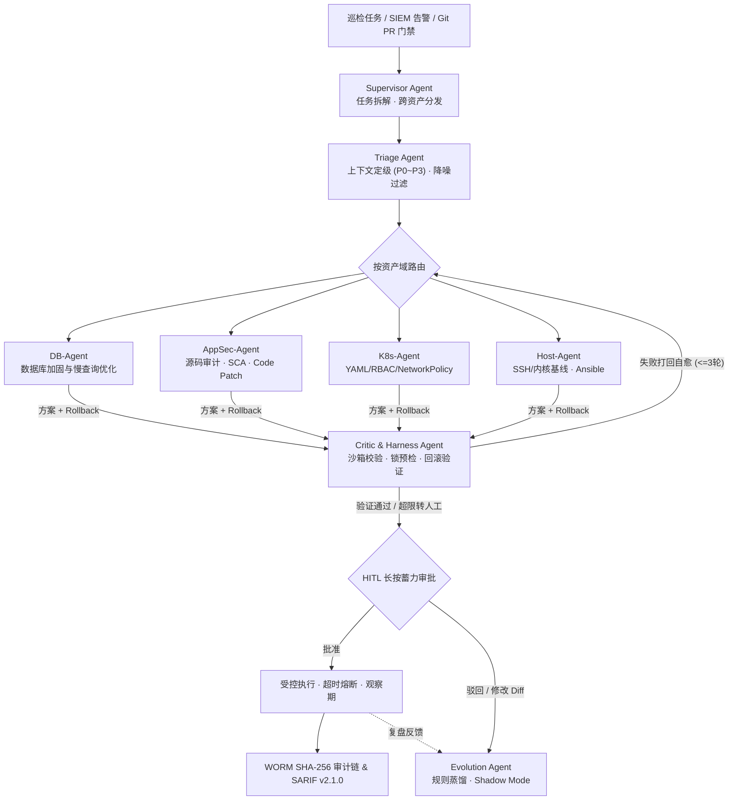

# AegisForge

**零信任 AI 护栏工程与多 Agent 安全运维平台（Zero-Trust AI Harness, Multi-Agent SecOps & Reusable Guardrails）**

[](#六测试与验证)
[](#五快速开始)
[-6366f1.svg)](#三原生桌面工作台与特色交互)
[](#二系统架构与多-agent-协同)
[](LICENSE)

> 面向**异构数据库（PostgreSQL / MySQL / Redis / TiDB / Oracle）**与**后端服务代码 / 云原生配置**的零信任安全运维平台：以 **StateGraph 确定性多 Agent 编排**、**多模态双向可逆脱敏网关**、**双轨/隔离沙箱自愈（Critic Harness）**、**HITL 长按蓄力审批**与 **WORM 审计链**为底座，同时将 **CI/CD 安全门禁 CLI（`aegisforge-gate`）**、**通用 Agent 护栏 SDK（`core.guardrails`）**与**防泄漏评测中台（`core.eval`）**独立解耦，支持直接复用到其他 AI Agent 项目。

> **项目状态：技术预览（TECH_PREVIEW）**。接口、规则与部署方式持续演进中，不建议未评估直接用于生产环境；已知边界见 [docs/w12/known-limitations.md](docs/w12/known-limitations.md)，安全披露流程见 [SECURITY.md](SECURITY.md)。

---

## 目录

- [一、核心定位与四大护栏](#一核心定位与四大护栏)
- [二、系统架构与多 Agent 协同](#二系统架构与多-agent-协同)
- [三、原生桌面工作台与特色交互](#三原生桌面工作台与特色交互)
- [四、开箱复用指南：CI/CD 门禁、护栏 SDK 与评测中台](#四开箱复用指南cicd-门禁护栏-sdk-与评测中台)
- [五、快速开始](#五快速开始)
- [六、测试与验证](#六测试与验证)
- [七、目录结构、技术规范与安全红线](#七目录结构技术规范与安全红线)

---

## 一、核心定位与四大护栏

将大模型 Agent 引入数据库与核心后端研发链路，最大瓶颈往往不是推理能力，而是**敏感数据出域、幻觉误修改、生产锁雪崩与缺乏客观回归评测**。AegisForge 采用 **「胖控制面 + 瘦桌面端（零凭据工作台）」** 与 **Harness Engineering（护栏工程）** 设计，落地四道工程防线：

1. **多模态双向可逆脱敏（Privacy Gateway）**：出站调用外部 LLM 前，按载荷格式自动路由至 SQL AST / YAML / Code / Text 处理器替换敏感标识符与凭据；映射表经 `Fernet / KMS` 信封加密绑定 `workflow_run_id` 与 TTL 持久化，入站先校验语法结构再精准还原，PII 令牌永久保持掩码且闭环销毁。
2. **确定性 StateGraph 与 Critic 对抗自愈**：以有向状态机代替自由对话，由 `Supervisor` → `Triage` → 领域专家 Agent → `Critic` 形成闭环；沙箱验证或红队检查不通过时自动打回专家 Agent 修正（硬上限 `max_self_correction_rounds = 3`），超限挂起转人工，杜绝死循环与带病放行。
3. **双轨验证、CI 沙箱与双期熔断回滚**：数据库变更支持沙箱容器 PoC/Dry-Run 与生产只读长事务（`>30s`）预检，强制注入会话锁超时（`lock_wait_timeout = 3` / `lock_timeout = '3s'`）及 **0~5m 实时熔断 + 24~72h SIEM 一键恢复**；本地仓库修复补丁在 `tempfile` 隔离目录中真实试打、执行 `py_compile`/单测并校验逆向回滚哈希，不污染源仓库。
4. **通用护栏 SDK 与防泄漏评测门控**：将脱敏门控、高危工具审批拦截与防泄漏评测抽成独立无重依赖包（`core.guardrails` + `core.eval`），支持 A/B 指标门控与金标数据集防泄漏二次复检。

---

## 二、系统架构与多 Agent 协同

### 2.1 StateGraph 多 Agent 协同拓扑



### 2.2 四层十模块核心底座与四大领域插件

底层治理沿用四层十模块引擎（[core/platform/ten_modules.py](core/platform/ten_modules.py)），并通过统一四接口契约（`DomainProbe` / `DomainMasker` / `DomainSandboxHarness` / `DomainRollbackExecutor`，见 [core/plugins/contracts.py](core/plugins/contracts.py)）接入四大业务域：

| 业务域插件 | 核心代码位置 | 探测与脱敏范围 | 沙箱验证与回滚能力（如实边界说明） |
| --- | --- | --- | --- |
| **Database（纵深核心）** | [core/plugins/database/plugin.py](core/plugins/database/plugin.py) | 限流只读探测 + CIS/等保基线 + SQL AST 双向脱敏 | MySQL 8 / PostgreSQL 16 真实双引擎靶场 + 双轨沙箱 + `Rollback SQL` 与双期紧急回滚 |
| **AppSec（后端源码与依赖）** | [core/plugins/appsec/plugin.py](core/plugins/appsec/plugin.py)<br/>[core/plugins/appsec/ci_harness.py](core/plugins/appsec/ci_harness.py) | SQL 注入、N+1 查询、硬编码凭据、IDOR（启发式）与离线依赖 SCA | 生成 unified diff Patch + 联动 DB 加固 SQL；在 `tempfile` 隔离目录真实打补丁、`py_compile`/单测并校验逆向 Patch 还原 |
| **K8s（云原生清单）** | [core/plugins/k8s/plugin.py](core/plugins/k8s/plugin.py) | 特权容器、宿主命名空间共享、root 运行、RBAC 通配、缺失 NetworkPolicy；YAML 双向脱敏 | 消费采集清单与本地 YAML 文件，结构级 `dry-run` 校验与声明式回退（不依赖外部真实 K8s 集群） |
| **Host（主机基线）** | [core/plugins/host/plugin.py](core/plugins/host/plugin.py) | `sshd` 配置、内核 CVE、全局可写目录、`sudo` 无密码；IP/主机名/路径/用户脱敏 | 消费采集好的主机基线事实，生成幂等 Ansible Playbook 与逆向回滚脚本（不直接发起远程 SSH 执行） |

---

## 三、原生桌面工作台与特色交互

项目提供**零浏览器依赖**的纯原生 Windows 桌面客户端 `AegisForge.exe`（源码 [apps/desktop/NativeShell.cs](apps/desktop/NativeShell.cs) + 引擎桥接 [apps/desktop/launcher.py](apps/desktop/launcher.py)，由 [scripts/build_desktop_app.ps1](scripts/build_desktop_app.ps1) 本地编译生成），包含**六大核心视图**：

| 视图 | 对应模块 | 核心功能 |
| --- | --- | --- |
| **1. 工作流编排** | `M01 / M05 / M06 / M09` | 8 节点可拖拽 S 型 DAG 画布 + 右侧 4-Tab 检视器（`修复 SQL` / `Rollback 回滚` / `双轨验证报告` / `脱敏对比`）+ 长按边框蓄力审批栏 |
| **2. 资产与凭据** | `M02 / M04` | 零信任统计卡 + 异构数据库实例清单（瞬时容器/温备池策略、Vault 动态凭据、上下文风险分）+ CMDB 增量同步 |
| **3. 模型网关与脱敏** | `M07` | L1 本地 (`vLLM/Ollama`) + L2 云端 (`BYOK`) + L2-B 灾备路由 + 多模态四重脱敏开关 + 实时脱敏预览 |
| **4. 自主进化中心** | `M08` | 自主进化 / 纯静态确定性模式开关横幅 + Shadow Mode 影子测试指标 + Git 风格快照历史与一键回滚 |
| **5. 审计日志** | `M09 / M10` | 24~72h SIEM 观察期监控与「一键紧急恢复」+ WORM SHA-256 哈希链审计表 + 跨栈 SARIF 导出 + 三权分立 RBAC 切换 |
| **6. 评测与数据** | `Eval & Golden` | 直连 `core/eval` 与 `core/benchmark/golden.py`，支持 **⚡ 运行护栏基准评测**（读入真实 `LIVE_EVAL` 报告）、**⌕ 本地代码库安全扫描**与**一键导出金标防泄漏数据集** |

### 特色安全与交互设计
- **长按边框蓄力防误触审批**：按住 `长按批准执行` 或 `长按驳回` 按钮时，霓虹进度条沿按钮四条边框顺时针填充；未满松开则弹性阻尼回弹清空；填满后触发窗口微震动并锁定状态，彻底防止高危操作误触。
- **双模式动效切换**：支持「**1.4 秒 SmoothStep 慢速圆心扩散主题切换**」与「**极速排障模式**」（一键关闭非必要过渡动效，实现 0ms 瞬切响应）。

---

## 四、开箱复用指南：CI/CD 门禁、护栏 SDK 与评测中台

V4.1 将原本耦合在安全运维平台内的三大核心能力抽离为**零重型外部依赖（无需 Docker/K8s/SSH 靶机）**的可复用组件：

### 4.1 在任意后端仓库使用 `aegisforge-gate` 做 CI/CD 安全门禁

已在 `pyproject.toml` 注册命令行入口 `aegisforge-gate = "apps.cli.secops_gate:main"`，也可通过模块形式直接运行：

```powershell
# 1. 全量扫描 + 门禁阻断（命中 >= P0 返回退出码 2，通过返回 0，参数/路径异常返回 1）
.\.venv\Scripts\python.exe -m apps.cli.secops_gate `
  --repo . `
  --fail-on P0 `
  --sarif-out runs/ci-gate.sarif `
  --markdown-summary runs/ci-gate.md `
  --patch-out runs/ci-gate.patch

# 2. 只扫本次 Git PR 增量变更（PR 门禁推荐；git 失败时显式记录 warnings 并回退）
.\.venv\Scripts\python.exe -m apps.cli.secops_gate --repo . --changed-only --base-ref origin/main --fail-on P1

# 3. 开启隔离临时目录沙箱编译与测试验证（不修改源仓库文件）
.\.venv\Scripts\python.exe -m apps.cli.secops_gate --repo . --fail-on P0 --run-sandbox-tests --test-cmd "pytest -q"

# 4. 可选：触发 SecOpsOrchestrator 多 Agent 修复与 Critic 自愈环
.\.venv\Scripts\python.exe -m apps.cli.secops_gate --repo . --fail-on P0 --run-agents
```

- **零重复规则**：[core/scanners/repo_scanner.py](core/scanners/repo_scanner.py) 直接复用 `AppSecProbe` 与 `K8sProbe` 规则；`requirements*.txt` / `pyproject.toml` / `package.json` 基于离线公告表 `OFFLINE_ADVISORIES` 执行零联网 SCA 检查。
- **产物安全**：证据原文均经 `MultimodalPrivacyGateway` 脱敏后再产出 SARIF v2.1.0 / Markdown 摘要 / Patch，硬编码凭据 diff 在产物中自动遮蔽原文。
- **GitHub Actions 已集成**：见 [.github/workflows/aegisforge-gate.yml](.github/workflows/aegisforge-gate.yml)（PR 增量阻断 + 全量基线 SARIF 上报）。

### 4.2 在其他 AI Agent 项目复用 `core.guardrails` 安全护栏 SDK

框架无关（不绑定 LangChain / LlamaIndex 等第三方 Agent 框架），5 行代码即可为任意外部 Agent 工具链加上出站脱敏、HITL 拦截与不可篡改审计链：

```python
from core.guardrails import AgentGuardrailClient, guard_tool_call

client = AgentGuardrailClient()
decision = client.guard_outbound("手机号 13800000000 的订单查询", workflow_run_id="wf-1")
masked_prompt = decision.masked_payload
restored_text = client.guard_inbound_restore(llm_output, workflow_run_id="wf-1")

@guard_tool_call(risk_tier="P0")  # 未显式传入 hitl_approved=True 将抛出 GuardrailBlockedError
def drop_table(name: str, hitl_approved: bool = False, workflow_run_id: str = "") -> str:
    return f"dropped {name}"

audit_events = client.export_audit_chain()  # 含 prev_hash 与 sha256，支持 verify_audit_chain() 校验
```

### 4.3 用 `core.eval` 做通用 Agent 护栏与防泄漏 A/B 评测

内置离线确定性基准套件 [benchmarks/guardrails/suite-agent-safety-v1.json](benchmarks/guardrails/suite-agent-safety-v1.json)，指标与 [core/eval/repository.py](core/eval/repository.py) 完全对齐（缺测保留 `None`，绝不补 0），并支持导出防泄漏金标数据集：

```python
from pathlib import Path
from core.eval.agent_benchmark import (
    build_reference_runner,
    compare_agent_variants,
    load_agent_eval_suite,
    run_agent_eval_suite,
)
from core.guardrails import AgentGuardrailClient

suite = Path("benchmarks/guardrails/suite-agent-safety-v1.json")
report = compare_agent_variants(
    suite,
    build_reference_runner(),                                  # Baseline：无护栏
    build_reference_runner(guardrail=AgentGuardrailClient()),  # Candidate：启用护栏 + Critic
    export_golden_dir=Path("runs/golden/agent-safety-v1"),     # 可选：清洗/切分/落盘二次复检
)
print(report["verdict"], report["leakage"])  # CANDIDATE_BETTER {'baseline': ..., 'candidate': 0}

# 接入外部自定义 Agent：实现 runner(case) -> dict 即可
metrics = run_agent_eval_suite(load_agent_eval_suite(suite), my_custom_runner)
print(metrics.to_repository_metrics())
```

---

## 五、快速开始

### 方式 A：直接运行 / 构建原生桌面端（Windows）

```powershell
# 1. 直接启动根目录桌面客户端
.\AegisForge.exe

# 2. 修改界面或桥接后重新初始化并打包生成 AegisForge.exe 与 dist\AegisForge.exe
powershell -ExecutionPolicy Bypass -File scripts/build_desktop_app.ps1

# 3. 命令行直调桌面桥接功能
.\.venv\Scripts\python.exe -m apps.desktop.launcher --scan-repo .
.\.venv\Scripts\python.exe -m apps.desktop.launcher --run-guardrail-eval
.\.venv\Scripts\python.exe -m apps.desktop.launcher --eval-summary
```

### 方式 B：完整控制面 API + 双引擎 Lab 环境

```powershell
# 1. 安装依赖（Python 3.14）
uv venv .venv --python 3.14
uv pip install -e ".[dev]" --python .venv\Scripts\python.exe

# 2. 初始化环境变量（.env 已被 gitignore，切勿提交真实密钥）
Copy-Item .env.example .env
.\.venv\Scripts\python.exe -m apps.desktop.launcher --prepare-only

# 3. 幂等初始化 MySQL 8 + PostgreSQL 16 双引擎实验环境与最小权限账号
powershell -ExecutionPolicy Bypass -File scripts/start_lab.ps1

# 4. 启动 FastAPI 控制面与 /console Web 控制台
.\.venv\Scripts\python.exe -m uvicorn apps.api.main:app --host 127.0.0.1 --port 8000
```

健康探针验证：

```powershell
Invoke-RestMethod http://127.0.0.1:8000/healthz
Invoke-RestMethod http://127.0.0.1:8000/healthz/db   # MySQL 只读身份
Invoke-RestMethod http://127.0.0.1:8000/healthz/pg   # PostgreSQL 只读身份
```

### 方式 C：Docker 隔离网络编排（生产模拟）

```powershell
# 构建并在独立网段运行控制面与 Worker（API 移除 lab_net 物理隔离目标库）
docker compose config
docker compose up -d control_db mysql_lab pg_lab api worker
powershell -ExecutionPolicy Bypass -File scripts/verify_docker_runtime.ps1
```

---

## 六、测试与验证

```powershell
# 1. V4.1（仓库门禁 / 护栏 SDK / 评测引擎）与桌面桥接单元测试（47 passed in 4.23s）
.\.venv\Scripts\python.exe -m pytest `
  tests/unit/test_v41_repo_gate.py `
  tests/unit/test_v41_guardrails_sdk.py `
  tests/unit/test_v41_agent_eval.py `
  tests/unit/test_desktop_launcher.py `
  -o addopts="" -q -p no:cacheprovider

# 2. 全量单元测试套件（2,060 passed in 33.14s）
.\.venv\Scripts\python.exe -m pytest tests/unit -o addopts="" -q -p no:cacheprovider

# 3. 本地 CI 全套检查（compileall、全量单测、Compose 校验、密钥泄露扫描）
powershell -ExecutionPolicy Bypass -File scripts/ci_check.ps1
```

> **最新实测基线**：全量单元测试 **`2,060 passed, 1 warning in 33.14s`**；V4.1 + 桌面桥接专项测试 **`47 passed in 4.23s`**；[scripts/ci_check.ps1](scripts/ci_check.ps1) 在本地 Docker daemon 未启动时会跳过 `docker compose config` 并通过其余全部检查（退出码 `0`）。

---

## 七、目录结构、技术规范与安全红线

### 目录结构

```text
apps/
  api/                  FastAPI 控制面入口与路由（含 /v1/secops 与 /v1/eval）
  cli/                  CI/CD 安全门禁 CLI（aegisforge-gate / secops_gate.py）
  desktop/              Windows 原生客户端（NativeShell.cs + launcher.py）
  web/                  Web 调度台静态资源
core/
  orchestrator/         确定性 StateGraph 状态机与 SecOps 多 Agent 编排装配
  agents/               Supervisor / Triage / Critic / Evolution 与四大领域专家 Agent
  plugins/              四接口领域插件契约、SDK 跨栈 SARIF、Database/AppSec/K8s/Host 实现
  privacy_gateway/      多模态双向可逆脱敏网关（SQL AST / YAML / JSON / Code / Text）
  guardrails/           框架无关通用 Agent 安全护栏 SDK（脱敏 / 策略门控 / 哈希审计链）
  scanners/             本地代码库与 Git Diff 增量采集适配器（repo_scanner.py）
  platform/             V2.0 生产增强十模块核心引擎（ten_modules.py）
  benchmark/ eval/      金标数据集防泄漏导出与通用 Agent A/B 评测中台
  security/ auth/ audit/ RedactionGate、Fernet SecretBox、RBAC/OIDC、WORM 哈希链归档
  knowledge/ memory/    3-Gate 两级晋升、Wiki 编译与跨领域共享记忆
adapters/               PostgreSQL / MySQL 只读与受控适配层
benchmarks/             数据库基准套件（w10/suite-v2.json）与 Agent 安全套件（guardrails/）
database/               17 支数据库迁移脚本（001–017）与只读/追加写权限初始化
deploy/                 Docker 网络隔离拓扑与生产部署清单
docs/                   ADR、平台详细大纲与 V2.0/V3.0/V4.1 AI 执行规范 JSON
scripts/                桌面端编译 (build_desktop_app.ps1)、CI 检查 (ci_check.ps1)、压测脚本
tests/                  单元测试与集成测试（2,060+ 单元测试用例）
```

### 规范文档索引
- 平台详细功能大纲：[docs/platform-detailed-outline.md](docs/platform-detailed-outline.md)
- V2.0 生产增强执行规范：[docs/v2-production-enhancement-spec.json](docs/v2-production-enhancement-spec.json)
- V3.0 多 Agent 演进执行规范：[docs/v3-multi-agent-secops-spec.json](docs/v3-multi-agent-secops-spec.json)
- V4.1 CI/CD 门禁与护栏评测复用规范：[docs/v4.1-cicd-guardrails-eval-spec.json](docs/v4.1-cicd-guardrails-eval-spec.json)

### 核心安全红线（Engineering Invariants）
- **控制库只追加权限**：控制库账号 `dg_ctl` 对审计与事件表仅授予 `SELECT / INSERT`（禁止 `UPDATE / DELETE`）。
- **凭证与映射零明文**：所有生产 DSN、BYOK Key 与脱敏映射表均经 `Fernet / KMS` 加密存储，桌面端零凭据落盘；PII 永不明文还原。
- **失败闭环（Fail-Closed）**：策略缺失、Critic 自愈超过 `3` 轮、缺少有效 `Rollback`、或轨道 2 发现 `>30s` 活跃长事务时一律阻断或转人工审批。

---

## 许可证与安全

- **许可证**：本项目采用 [Apache License 2.0](LICENSE) 授权。
- **第三方声明**：依赖与许可信息见 [NOTICE](NOTICE)。
- **安全披露**：请勿公开提交安全 Issue，流程见 [SECURITY.md](SECURITY.md)。
- **社区规范**：参与贡献即表示同意 [CODE_OF_CONDUCT.md](CODE_OF_CONDUCT.md) 与 [CONTRIBUTING.md](CONTRIBUTING.md)。
