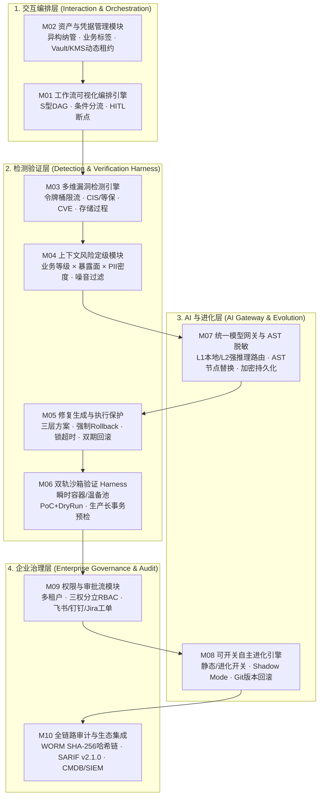
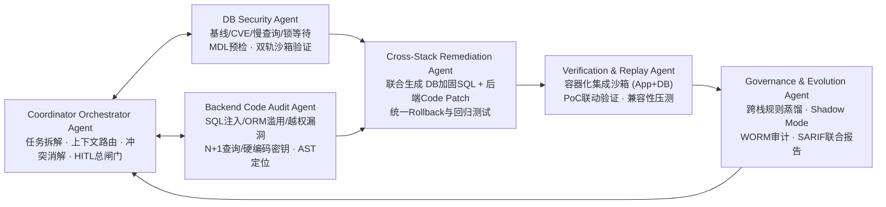

# AegisForge

**企业级零信任全栈安全与多 Agent 自进化修复平台（Zero-Trust AI Harness & Multi-Agent Security Ops）**

[](#五测试与验证)
[](#四快速开始)
[](#三原生桌面工作台与特色交互)
[](#二四层十模块架构)

> 面向企业级异构数据库（PostgreSQL / MySQL / Redis / TiDB / Oracle）与后端服务代码的**零信任漏洞探测、AST 级出站双向可逆脱敏、双轨沙箱 Harness 验证、画布内长按 HITL 人工审批及受控自主进化平台**，持续演进**后端代码安全审计与多 Agent 协同调度（Multi-Agent Collaboration）**。

---

## 目录

- [一、为什么需要 AegisForge？](#一为什么需要-aegisforge)
- [二、四层十模块架构](#二四层十模块架构)
- [三、原生桌面工作台与特色交互](#三原生桌面工作台与特色交互)
- [四、快速开始](#四快速开始)
- [五、测试与验证](#五测试与验证)
- [六、演进路线图：迈向「数据库 + 后端代码」多 Agent 协同调度](#六演进路线图迈向数据库--后端代码多-agent-协同调度)
- [七、目录结构与安全不变量](#七目录结构与安全不变量)

---

## 一、为什么需要 AegisForge？

将大模型 Agent 引入企业生产环境（尤其是数据库与核心后端服务），最大的障碍不是模型推理能力不足，而是**数据合规出域、概率性幻觉、长事务锁雪崩与不可逆变更风险**。AegisForge 采用 **「胖控制面（内网集群）+ 瘦桌面端（零凭据安全工作台）」** 架构与 **Harness Engineering（护栏工程）** 设计，确保：

1. **隐私不出域**：外发外部模型 API 前，基于 SQL 词法/AST 节点精准替换真实表名、字段名、IP 与 PII 敏感值；映射表由 `Fernet / KMS` 加密按 `workflow_run_id` 持久化，返回 SQL 先做本地语法校验再精准还原，闭环立即销毁。
2. **零幻觉上生产**：采用**双轨沙箱验证（Harness）**——轨道 1 在同版本瞬时容器/温备池中先跑 PoC 消除误报，再 Dry-Run 修复与回滚脚本并回放脱敏业务 SQL；轨道 2 只读采集生产表行数、体积与 `>30s` 活跃长事务，自动拦截 MDL 锁雪崩风险。
3. **强制可逆与双期熔断**：所有修复方案强制附带 `Rollback` 脚本与外层会话级锁超时保护（`lock_wait_timeout = 3` / `lock_timeout = '3s'`）；执行后提供 **0~5 分钟实时熔断自动回滚** 与 **24~72 小时 SIEM 延迟观察期「一键紧急恢复」**。
4. **受控自主进化**：支持「**自主进化（Shadow Mode 影子测试）**」与「**纯静态确定性模式**」一键切换；仅从误报与人工修改中蒸馏检测规则和领域记忆，支持 Git 风格版本快照秒级回滚。

---

## 二、四层十模块架构



核心编排与 V2.0 生产增强模块位于 [core/platform/ten_modules.py](core/platform/ten_modules.py)，相关技术规格详见：
- 详细架构与功能大纲：[docs/platform-detailed-outline.md](docs/platform-detailed-outline.md)
- V2.0 生产增强执行规范（JSON）：[docs/v2-production-enhancement-spec.json](docs/v2-production-enhancement-spec.json)

---

## 三、原生桌面工作台与特色交互

项目提供**零浏览器依赖**的纯原生 Windows 桌面客户端 `AegisForge.exe`（由 `scripts/build_desktop_app.ps1` 本地编译生成；源码 [apps/desktop/NativeShell.cs](apps/desktop/NativeShell.cs) + 本地引擎桥接 [apps/desktop/launcher.py](apps/desktop/launcher.py)），包含五大核心视图：

| 视图 | 对应模块 | 核心功能 |
| --- | --- | --- |
| **1. 工作流编排** | `M01 / M05 / M06 / M09` | 8 节点可拖拽 S 型 DAG 画布 + 右侧 4-Tab 检视器（`修复 SQL` / `Rollback 回滚` / `双轨验证报告` / `脱敏对比`）+ 底部长按边框蓄力审批栏 |
| **2. 资产与凭据** | `M02 / M04` | 零信任统计卡 + 异构数据库实例清单（显示瞬时容器/常驻温备池策略、Vault 动态凭据、上下文风险分）+ CMDB 增量同步 |
| **3. 模型网关与脱敏** | `M07` | L1 本地 (`vLLM/Ollama`) + L2 云端 (`BYOK`) + L2-B 灾备集群三层路由 + AST 四重脱敏开关 + 实时脱敏预览 |
| **4. 自主进化中心** | `M08` | 自主进化 / 纯静态确定性模式联动横幅 + 影子测试指标卡 + Git 风格快照历史与一键回滚 |
| **5. 审计日志** | `M09 / M10` | 24~72h 延迟观察期 SIEM 监控横幅与「一键紧急恢复」+ WORM SHA-256 哈希链审计表 + 导出 SARIF 报告 + 三权分立 RBAC 角色切换 |

### 特色安全与交互设计
- **长按边框蓄力防误触审批**：按住 `长按批准执行` 或 `长按驳回` 按钮时，霓虹进度条沿按钮四条边框顺时针填充；未满松开则弹性阻尼回弹清空；填满后触发窗口微震动并锁定状态，彻底防止生产高危误操作。
- **双模式动效切换**：支持「**1.4 秒 SmoothStep 慢速圆心扩散主题切换**」（太阳/月亮图标旋转变形）与「**极速排障模式**」（一键关闭非必要过渡动效，实现 0ms 瞬切响应）。

---

## 四、快速开始

### 方式 A：直接运行 / 编译原生桌面端（Windows）

```powershell
# 1. 直接双击根目录下的桌面客户端
.\AegisForge.exe

# 2. 若修改了界面源码，一条命令重新初始化主密钥并打包生成 AegisForge.exe 与 dist\AegisForge.exe
powershell -ExecutionPolicy Bypass -File scripts/build_desktop_app.ps1
```

### 方式 B：完整控制面 API + 双引擎 Lab 环境

```powershell
# 1. 安装依赖（Python 3.14）
uv venv .venv --python 3.14
uv pip install -e ".[dev]" --python .venv\Scripts\python.exe

# 2. 初始化环境变量（.env 已被 gitignore，切勿提交真实密钥）
Copy-Item .env.example .env
.\.venv\Scripts\python.exe -m apps.desktop.launcher --prepare-only

# 3. 幂等初始化 MySQL 8 + PostgreSQL 16 双引擎实验环境与最小权限账号
powershell -ExecutionPolicy Bypass -File scripts/start_lab.ps1

# 4. 启动 FastAPI 控制面与 /console Web 控制台
.\.venv\Scripts\python.exe -m uvicorn apps.api.main:app --host 127.0.0.1 --port 8000
```

健康探针验证：

```powershell
Invoke-RestMethod http://127.0.0.1:8000/healthz
Invoke-RestMethod http://127.0.0.1:8000/healthz/db   # MySQL 只读身份
Invoke-RestMethod http://127.0.0.1:8000/healthz/pg   # PostgreSQL 只读身份
```

### 方式 C：Docker 隔离网络编排（生产模拟）

```powershell
# 构建并在独立网段运行控制面与 Worker（API 移除 lab_net 物理隔离目标库）
docker compose config
docker compose up -d control_db mysql_lab pg_lab api worker
powershell -ExecutionPolicy Bypass -File scripts/verify_docker_runtime.ps1
```

---

## 五、测试与验证

```powershell
# 1. 运行十大核心模块与桌面桥接单元测试（当前 19 passed）
.\.venv\Scripts\python.exe -m pytest tests/unit/test_ten_core_modules.py tests/unit/test_desktop_launcher.py -o addopts="" -q -p no:cacheprovider

# 2. 运行全量单元测试套件（当前 1,970 passed）
.\.venv\Scripts\python.exe -m pytest tests/unit -o addopts="" -q -p no:cacheprovider

# 3. 运行本地全套 CI 检查（编译、全量单测、Compose 校验、密钥泄露扫描）
powershell -ExecutionPolicy Bypass -File scripts/ci_check.ps1
```

> **工程基线**：在最新回归验证中，全量单元测试 **`1,970 passed in 21.10s`**，核心十模块及桌面端桥接测试 **`19 passed`**。

---

## 六、演进路线图：迈向「数据库 + 后端代码」多 Agent 协同调度

当前的 **V2.0 生产增强版**已经打通了「**数据库漏洞探测 → AST 脱敏 → 双轨沙箱 → 分级回滚 → 自进化治理**」全链路。下一阶段（**V3.0 Multi-Agent DevSecOps**）将进一步把平台从**纯数据库防御**扩展为**「数据库 + 后端源码 + 运行时基础设施」协同定位与修复的多 Agent 调度中枢**：



### V3.0 核心扩展规划

1. **后端代码安全与性能联合审计 Agent（`Backend Code Audit Agent`）**
   - **跨栈关联定位**：当 `DB Security Agent` 发现高危慢查询、全表扫描、未收敛事务或异常连接泄漏时，自动触发 `Code Audit Agent` 扫描后端源码（Python / Java / Go / Node.js）对应的 Repository / ORM / Service 调用链。
   - **代码级缺陷检出**：覆盖字符串拼接 SQL 注入、ORM `N+1` 查询雪崩、长事务跨 RPC 调用持有数据库锁、越权访问控制（IDOR）以及源码中的明文 DSN / API Key 泄露。
   - **AST 级脱敏一致性扩展**：将现有 `M07` 的 SQL AST 脱敏器扩展至后端代码（`Tree-sitter` AST 脱敏），在向外部大模型发送故障代码片段前同样实现业务逻辑标识符与凭据的双向可逆替换。
2. **多 Agent 协同调度引擎（`Multi-Agent Orchestrator`）**
   - **状态机升级**：基于现有 [core/platform/ten_modules.py](core/platform/ten_modules.py) 的 `WorkflowDagEngine` 与 [core/execution/dispatch_queue.py](core/execution/dispatch_queue.py) 的只追加派发队列，支持**主从编排（Coordinator-Worker）**与**并行扇出/扇入（Fan-out / Fan-in）**任务图。
   - **跨栈联合沙箱（App + DB Harness）**：联合拉起后端应用测试镜像与同版本数据库沙箱，同时验证 **DB 修复 SQL + 后端代码 Patch** 的端到端兼容性与 PoC 阻断效果，杜绝“修好了库却挂掉了应用代码”的割裂问题。
   - **统一 SARIF 跨栈报告**：在 `M10` 导出报告中同时归并数据库实例漏洞位置（`db://asset`）与后端源码文件行号（`file://src/...#L123`），直接接入企业 GitHub / GitLab PR 门禁。

---

## 七、目录结构与安全不变量

```text
apps/
  api/                  FastAPI 控制面入口与路由（OpenAPI 3.1）
  desktop/              Windows 原生客户端（NativeShell.cs + launcher.py）
  web/                  Web 调度台静态资源
core/
  platform/             四层十大核心模块编排与 V2.0 增强引擎（ten_modules.py）
  agent/                Agent Loop、工具调度与上下文治理
  security/             RedactionGate、SecretBox (Fernet)、InputGuard、RBAC/Policy
  execution/            ToolGateway、Pre-flight 预检、只追加派发队列
  knowledge/            3-Gate 两级人工确认晋升、LLM Wiki 编译与 Hybrid 检索
  audit/                不可篡改 WORM 哈希链与 S3/MinIO Object Lock 归档
  auth/                 OIDC/SSO 认证与三权分立权限控制
  benchmark/ eval/      评测中台、金标回流与反幻觉统计门禁
adapters/               PostgreSQL / MySQL 只读与受控适配层
workers/                隔离执行 Worker
database/               17 支数据库迁移脚本（001–017）与只读/追加写权限初始化
deploy/                 Docker 网络隔离拓扑与生产部署清单
docs/                   ADR、平台详细架构大纲、V2.0 执行规范
scripts/                一键构建桌面端 (build_desktop_app.ps1)、CI 检查、压测脚本
tests/                  单元测试与集成测试（1,970+ 用例）
```

### 核心安全不变量（Engineering Invariants）
- **控制库只追加权限**：控制库账号 `dg_ctl` 对审计与事件表仅授予 `SELECT / INSERT`（禁止 `UPDATE / DELETE`）。
- **凭证与映射零明文**：所有生产 DSN、BYOK Key 与 AST 脱敏映射表均经 `Fernet / KMS` 加密存储，桌面端零凭据落盘。
- **失败闭环（Fail-Closed）**：策略缺失拒绝执行；缺少 `Rollback` 脚本禁止进入沙箱/生产；轨道 2 发现 `>30s` 活跃长事务自动挂起变更窗口。
