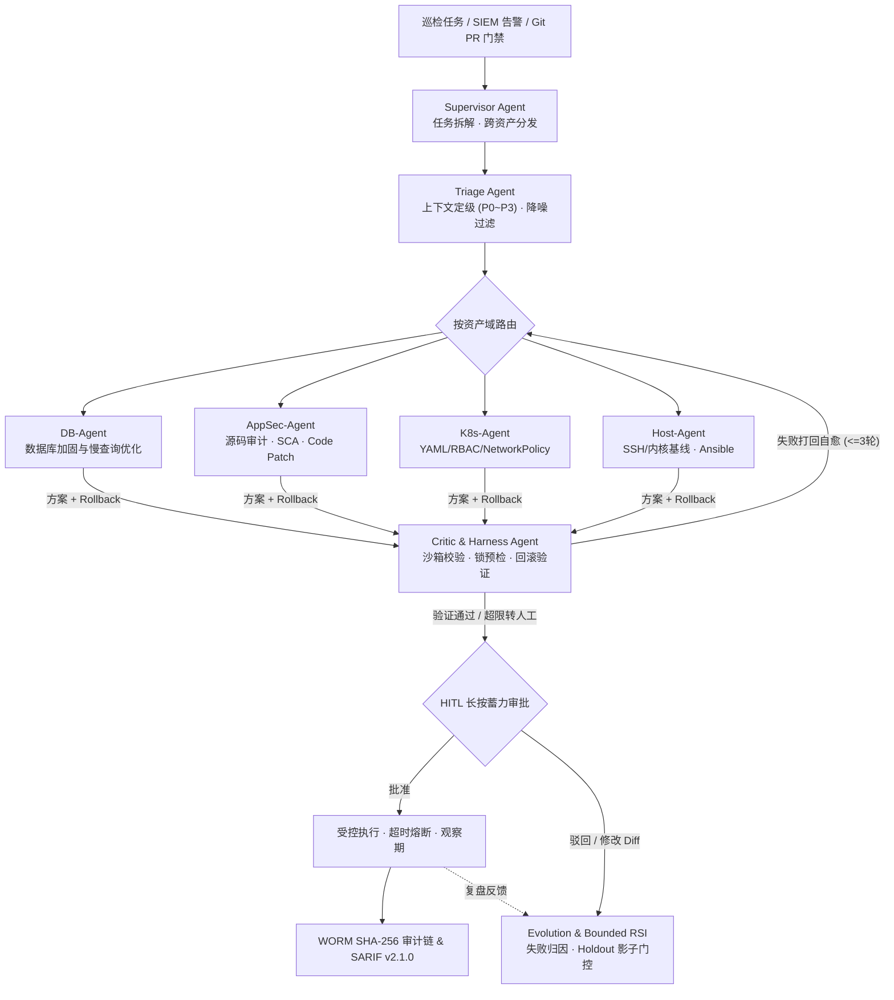
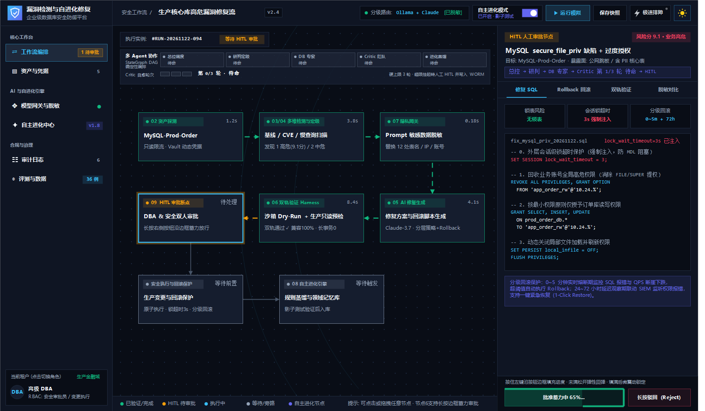
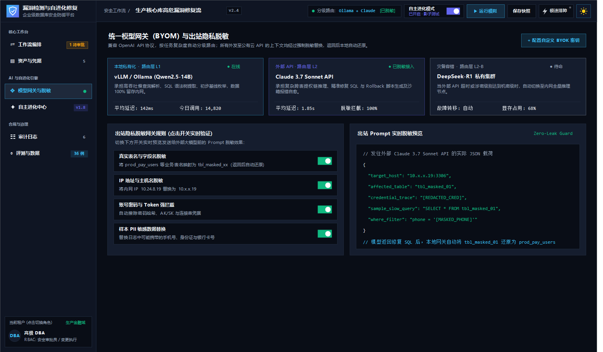
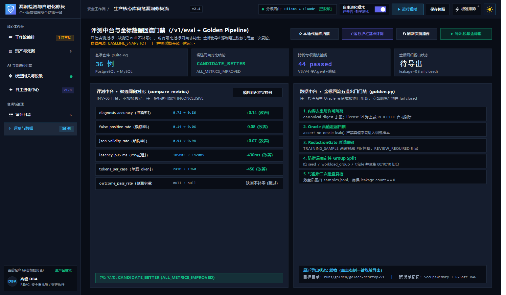
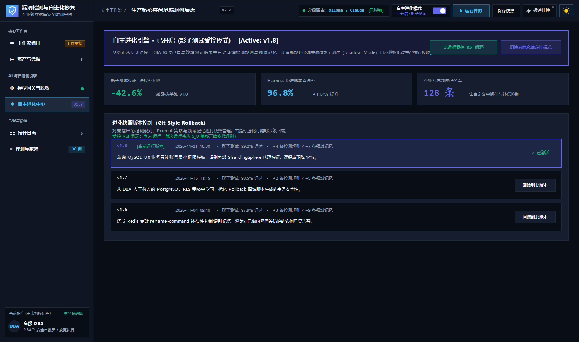

# AegisForge

**零信任 AI 护栏工程与多 Agent 安全运维平台（Zero-Trust AI Harness, Multi-Agent SecOps & Reusable Guardrails）**

[](#七测试与-ci-验证)
[](#六快速开始)
[-6366f1.svg)](#三原生桌面工作台与界面实拍)
[](#二系统架构与多-agent-协同)
[](LICENSE)

> 面向**异构数据库（PostgreSQL / MySQL / Redis / TiDB / Oracle）**与**后端源码 / 云原生配置**的零信任自主安全运维平台：以 **StateGraph 确定性多 Agent 编排**、**多模态双向可逆脱敏网关**、**双轨/隔离沙箱自愈（Critic Harness）**、**HITL 长按蓄力审批**、**受控多代自进化（Bounded RSI）**与 **WORM 审计链**为底座；同时将 **`aegisforge-gate` CI/CD 门禁 CLI**、**`core.guardrails` 护栏 SDK**、**`core.eval` 防泄漏评测中台**与 **`core.evolution` 进化引擎**解耦为兼容 **Python ≥3.12** 的库形态组件，可直接 `pip install -e` 复用到其他 AI Agent 项目。

> **项目状态：技术预览（TECH_PREVIEW）**。接口、规则与部署方式持续演进中，不建议未评估直接用于生产环境；已知边界见 [docs/w12/known-limitations.md](docs/w12/known-limitations.md)，安全披露流程见 [SECURITY.md](SECURITY.md)。

---

## 目录

- [一、核心定位与五道护栏](#一核心定位与五道护栏)
- [二、系统架构与多 Agent 协同](#二系统架构与多-agent-协同)
- [三、原生桌面工作台与界面实拍](#三原生桌面工作台与界面实拍)
- [四、受控递归自我改进（Eval-Gated Bounded RSI）](#四受控递归自我改进eval-gated-bounded-rsi)
- [五、跨项目开箱复用指南](#五跨项目开箱复用指南)
- [六、快速开始](#六快速开始)
- [七、测试与 CI 验证](#七测试与-ci-验证)
- [八、目录结构、规范索引与安全红线](#八目录结构规范索引与安全红线)

---

## 一、核心定位与五道护栏

将大模型 Agent 引入数据库与核心后端研发链路，最大瓶颈往往不是推理能力，而是**敏感数据出域、幻觉误修改、生产锁雪崩、进化退化与缺乏客观回归评测**。AegisForge 采用 **「胖控制面 + 瘦桌面端（零凭据工作台）」** 与 **Harness Engineering（护栏工程）** 设计，落地五道工程防线：

1. **多模态双向可逆脱敏（Privacy Gateway）**：出站调用外部 LLM 前，按载荷格式自动路由至 SQL AST / YAML / Code / Text 处理器替换敏感标识符与凭据；映射表经 `Fernet / KMS` 信封加密绑定 `workflow_run_id` 与 TTL 持久化，入站先校验语法结构再精准还原，PII 令牌永久保持掩码且闭环销毁。
2. **确定性 StateGraph 与 Critic 对抗自愈**：以有向状态机代替自由对话，由 `Supervisor` → `Triage` → 领域专家 Agent → `Critic` 形成闭环；沙箱验证或红队检查不通过时自动打回专家 Agent 修正（硬上限 `max_self_correction_rounds = 3`），超限挂起转人工，杜绝死循环与带病放行。
3. **双轨验证、CI 沙箱与双期熔断回滚**：数据库变更支持沙箱容器 PoC/Dry-Run 与生产只读长事务（`>30s`）预检，强制注入会话锁超时（`lock_wait_timeout = 3` / `lock_timeout = '3s'`）及 **0~5m 实时熔断 + 24~72h SIEM 一键恢复**；本地仓库修复补丁在 `tempfile` 隔离目录中真实试打、执行 `py_compile`/单测并校验逆向回滚哈希，不污染源仓库。
4. **受控多代自进化（Eval-Gated Bounded RSI）**：通过宪法锁（`Constitutional Lock`）物理锁定安全核心源码，仅允许进化模块修改声明式策略包，并强制经过 **Train/Holdout 严格隔离评测 + 零泄漏门控** 后方可晋升，退化即自动回滚并记录元经验。
5. **跨项目可复用护栏与评测底座**：将 `core.guardrails`、`core.eval`、`core.evolution` 与 `aegisforge-gate` 抽离为无重型外部框架依赖（兼容 Python `>=3.12`）的组件包，可直接服务于外部 AI Agent 主项目或企业 CI/CD 流水线。

---

## 二、系统架构与多 Agent 协同

### 2.1 StateGraph 多 Agent 协同拓扑



### 2.2 四层十模块底座与四大领域插件

底层治理沿用四层十模块引擎（[core/platform/ten_modules.py](core/platform/ten_modules.py)），并通过统一四接口契约（`DomainProbe` / `DomainMasker` / `DomainSandboxHarness` / `DomainRollbackExecutor`，见 [core/plugins/contracts.py](core/plugins/contracts.py)）接入四大业务域：

| 业务域插件 | 核心代码位置 | 探测与脱敏范围 | 沙箱验证与回滚能力（如实边界说明） |
| --- | --- | --- | --- |
| **Database（纵深核心）** | [core/plugins/database/plugin.py](core/plugins/database/plugin.py) | 限流只读探测 + CIS/等保基线 + SQL AST 双向脱敏 | MySQL 8 / PostgreSQL 16 真实双引擎靶场 + 双轨沙箱 + `Rollback SQL` 与双期紧急回滚 |
| **AppSec（后端源码与依赖）** | [core/plugins/appsec/plugin.py](core/plugins/appsec/plugin.py)<br/>[core/plugins/appsec/ci_harness.py](core/plugins/appsec/ci_harness.py) | SQL 注入、N+1 查询、硬编码凭据、IDOR（启发式）与离线依赖 SCA | 生成 unified diff Patch + 联动 DB 加固 SQL；在 `tempfile` 隔离目录真实打补丁、`py_compile`/单测并校验逆向 Patch 还原 |
| **K8s（云原生清单）** | [core/plugins/k8s/plugin.py](core/plugins/k8s/plugin.py) | 特权容器、宿主命名空间共享、root 运行、RBAC 通配、缺失 NetworkPolicy；YAML 双向脱敏 | 消费采集清单与本地 YAML 文件，结构级 `dry-run` 校验与声明式回退（不依赖外部真实 K8s 集群） |
| **Host（主机基线）** | [core/plugins/host/plugin.py](core/plugins/host/plugin.py) | `sshd` 配置、内核 CVE、全局可写目录、`sudo` 无密码；IP/主机名/路径/用户脱敏 | 消费采集好的主机基线事实，生成幂等 Ansible Playbook 与逆向回滚脚本（不直接发起远程 SSH 执行） |

---

## 三、原生桌面工作台与界面实拍

项目提供**零浏览器依赖**的纯原生 Windows 桌面客户端 `AegisForge.exe`（源码 [apps/desktop/NativeShell.cs](apps/desktop/NativeShell.cs) + 引擎桥接 [apps/desktop/launcher.py](apps/desktop/launcher.py)，由 [scripts/build_desktop_app.ps1](scripts/build_desktop_app.ps1) 本地编译生成），包含**六大核心视图**：

| 视图 | 对应模块 | 核心功能 |
| --- | --- | --- |
| **1. 工作流编排** | `M01 / M05 / M06 / M09` | 8 节点可拖拽 S 型 DAG 画布 + 右侧 4-Tab 检视器（`修复 SQL` / `Rollback 回滚` / `双轨验证报告` / `脱敏对比`）+ 长按边框蓄力审批栏 |
| **2. 资产与凭据** | `M02 / M04` | 零信任统计卡 + 异构数据库实例清单（瞬时容器/温备池策略、Vault 动态凭据、上下文风险分）+ CMDB 增量同步 |
| **3. 模型网关与脱敏** | `M07` | L1 本地 (`vLLM/Ollama`) + L2 云端 (`BYOK`) + L2-B 灾备路由 + 多模态四重脱敏开关 + 实时脱敏预览 |
| **4. 自主进化中心** | `M08 / V5.0` | 自主进化 / 纯静态模式切换 + **🧬 运行受控 RSI 闭环**（展示多代 Holdout 跃迁与回滚状态）+ Git 风格快照回滚 |
| **5. 审计日志** | `M09 / M10` | 24~72h SIEM 观察期监控与「一键紧急恢复」+ WORM SHA-256 哈希链审计表 + 跨栈 SARIF 导出 + 三权分立 RBAC 切换 |
| **6. 评测与数据** | `Eval & Golden` | 直连 `core/eval` 与 `core/benchmark/golden.py`，支持 **⚡ 运行护栏基准评测**（`LIVE_EVAL` 实测摘要）、**⌕ 本地代码库安全扫描**与**一键导出金标数据集** |

### 特色安全与交互设计
- **长按边框蓄力防误触审批**：按住 `长按批准执行` 或 `长按驳回` 按钮时，霓虹进度条沿按钮四条边框顺时针填充；未满松开则弹性阻尼回弹清空；填满后触发窗口微震动并锁定状态，彻底防止高危操作误触。
- **双模式动效切换**：支持「**1.4 秒 SmoothStep 慢速圆心扩散主题切换**」与「**极速排障模式**」（一键关闭非必要过渡动效，实现 0ms 瞬切响应）。

### 界面实拍（`AegisForge.exe --render-preview` 离屏渲染，非示意图）

| 工作流编排（8 节点 DAG + 长按蓄力审批） | 模型网关与双向脱敏预览 |
| --- | --- |
|  |  |
| **评测与数据中台（LIVE_EVAL + 金标门禁）** | **自主进化中心（受控 RSI 多代闭环）** |
|  |  |

> 截图由 `dist/AegisForge.exe --render-preview docs/assets` 在本地离屏渲染生成，随仓库同步更新；不含任何真实凭据或客户数据。

---

## 四、受控递归自我改进（Eval-Gated Bounded RSI）

V5.0 将「自主进化」从单纯的文本记忆写入升级为**可验证能力的多代递归改进**，同时明确划清「能改什么、绝不能改什么」的安全边界。

### 4.1 与“无约束自由改写内核”的边界

| 维度 | AegisForge 受控 RSI（当前实现） | 无约束自由改写（刻意禁止） |
| --- | --- | --- |
| **可改写面** | 仅声明式策略包（安全规则 / 修复模板 / Prompt 指导 / 噪声过滤 / 元经验） | 任意修改平台源码 |
| **安全宪法锁** | `core/guardrails/`、`core/security/`、`core/audit/`、`state_graph.py` **代码级只读锁定** | 安全边界可被绕过或重写 |
| **晋升依据** | 实跑隔离 Train/Holdout 的 `compare_metrics` 判为 `CANDIDATE_BETTER` + `leakage_count == 0` | 固定分值或模型自评 |
| **迭代上界** | `max_generations <= 5` 硬上限 + `patience` 早停 | 无界循环 |
| **退化处理** | 自动驳回 + 版本栈回滚 + 记录负向元经验 + WORM 审计事件 | 无退化保障 |

### 4.2 五段闭环与核心模块

```text
S_g ──Train 评测──> 失败归因（聚簇）──Meta-Proposer──> S_{g+1} 候选
    ──Holdout 影子门控──> 晋升（写谱系 + WORM）或 驳回（记负向经验 + 回滚）
    └──────────────── 基于最新 S_{g+1} 继续下一代 ────────────────┘
```

| 模块 | 核心职责 |
| --- | --- |
| [core/evolution/strategy_store.py](core/evolution/strategy_store.py) | 策略包版本化管理 + 宪法锁 `assert_constitutional_safe` + SHA-256 谱系链与一键回滚 |
| [core/evolution/proposer.py](core/evolution/proposer.py) | 失败归因聚簇（注入语用变体 / 编码凭据 / URL 编码路径穿越 / 恒真删表等）+ 元反思（避开已证伪变异） |
| [core/evolution/runtime_adapter.py](core/evolution/runtime_adapter.py) | 将激活策略包热绑定到检测策略与评测运行器，确保进化真正改变运行时行为 |
| [core/evolution/shadow_evaluator.py](core/evolution/shadow_evaluator.py) | 强制校验 Train/Holdout `workload_group` 零重叠，拦截过拟合刷榜策略 |
| [core/evolution/rsi_loop.py](core/evolution/rsi_loop.py) | 有界多代调度、逐代 `GenerationRecord`、WORM 审计与 `ToggleableEvolutionEngine` 版本栈同步 |

### 4.3 离线实测代际增益与防作弊机制

```powershell
# CLI 一键运行受控 RSI 周期，完整报告落盘至 runs/evolution/rsi-latest.json
.\.venv\Scripts\python.exe -m apps.desktop.launcher --run-rsi-cycle
```

实测结果（离线、零外部 API Key、零 Docker，Train/Holdout 各 10 条互不重叠样本）：

| 代 | 版本 | Holdout 准确率 | 误报率 | 泄漏数 | 决策 |
| --- | --- | --- | --- | --- | --- |
| — | `S_0` | `0.50` | `0.00` | `0` | 基线（基础 4 类安全规则） |
| `1` | `S_1` | `0.80` | `0.00` | `0` | 晋升（新增注入语用变体 + 恒真条件删表） |
| `2` | `S_2` | `1.00` | `0.00` | `0` | 晋升（新增编码凭据 + URL 编码路径穿越） |
| `3` | `S_3` 候选 | `1.00` | `0.00` | `0` | 早停（`NO_NEW_MUTATION`：剩余失败维度已覆盖或已证伪） |

- 净增益 `monotonic_gain = 0.50`，`final_version = S_2`，全程 `leakage_count = 0`、`worm_integrity_ok = true`。
- **防作弊设计**：Train 仅用于失败归因，Holdout 仅用于最终裁决；仅死记硬背 Train 字面量的投机策略在 Holdout 上无增益，会被 `ShadowEvaluator` 拦截（单测 `test_evaluator_blocks_train_overfit_candidate` 覆盖）；未真实测量的指标保留 `None`，绝不补 `0`。

---

## 五、跨项目开箱复用指南

项目已将 Python 版本下限放宽至 **`requires-python >=3.12`**（见 [pyproject.toml](pyproject.toml)），在你的其他 AI Agent 项目（Python 3.12+）环境中执行一条命令即可作为本地可编辑库直接导入：

```powershell
pip install -e D:\DBGuaredian
```

### 5.1 在任意后端仓库使用 `aegisforge-gate` 做 CI/CD 安全门禁

已在 `pyproject.toml` 注册 CLI 入口 `aegisforge-gate = "apps.cli.secops_gate:main"`，也可通过模块形式直接运行：

```powershell
# 1. 全量扫描 + 门禁阻断（命中 >= P0 返回退出码 2，通过返回 0，参数/路径异常返回 1）
.\.venv\Scripts\python.exe -m apps.cli.secops_gate `
  --repo . `
  --fail-on P0 `
  --sarif-out runs/ci-gate.sarif `
  --markdown-summary runs/ci-gate.md `
  --patch-out runs/ci-gate.patch

# 2. 只扫本次 Git PR 增量变更（PR 门禁推荐；git 失败显式写 warnings 并安全回退）
.\.venv\Scripts\python.exe -m apps.cli.secops_gate --repo . --changed-only --base-ref origin/main --fail-on P1

# 3. 开启隔离临时目录沙箱编译与测试验证（不修改源仓库文件）
.\.venv\Scripts\python.exe -m apps.cli.secops_gate --repo . --fail-on P0 --run-sandbox-tests --test-cmd "pytest -q"

# 4. 可选：串联 SecOpsOrchestrator 多 Agent 修复与 Critic 自愈环
.\.venv\Scripts\python.exe -m apps.cli.secops_gate --repo . --fail-on P0 --run-agents
```

- **零重复规则**：[core/scanners/repo_scanner.py](core/scanners/repo_scanner.py) 直接复用 `AppSecProbe` 与 `K8sProbe` 规则，结合离线公告表 `OFFLINE_ADVISORIES` 执行零联网 SCA 检查；产物中自动遮蔽硬编码凭据原文。
- **GitHub Actions 已集成**：见 [.github/workflows/aegisforge-gate.yml](.github/workflows/aegisforge-gate.yml)（PR 增量阻断 + 全量基线 SARIF 上报）。

### 5.2 在其他 AI Agent 项目复用 `core.guardrails` 安全护栏 SDK

框架无关（不绑定 LangChain / LlamaIndex 等重型框架），5 行代码为任意外部 Agent 工具链加上出站脱敏、HITL 拦截与防篡改审计链：

```python
from core.guardrails import AgentGuardrailClient, guard_tool_call

client = AgentGuardrailClient()
decision = client.guard_outbound("手机号 13800000000 的订单查询", workflow_run_id="wf-1")
masked_prompt = decision.masked_payload
restored_text = client.guard_inbound_restore(llm_output, workflow_run_id="wf-1")

@guard_tool_call(risk_tier="P0")  # 未显式传入 hitl_approved=True 将抛出 GuardrailBlockedError
def drop_table(name: str, hitl_approved: bool = False, workflow_run_id: str = "") -> str:
    return f"dropped {name}"

audit_events = client.export_audit_chain()  # 含 prev_hash 与 sha256，支持 verify_audit_chain() 校验
```

### 5.3 用 `core.eval` 做通用 Agent 护栏与防泄漏 A/B 评测

内置离线确定性基准套件 [benchmarks/guardrails/suite-agent-safety-v1.json](benchmarks/guardrails/suite-agent-safety-v1.json)，指标与 [core/eval/repository.py](core/eval/repository.py) 完全对齐，并支持导出防泄漏金标数据集（[core/benchmark/golden.py](core/benchmark/golden.py)）：

```python
from pathlib import Path
from core.eval.agent_benchmark import (
    build_reference_runner,
    compare_agent_variants,
    load_agent_eval_suite,
    run_agent_eval_suite,
)
from core.guardrails import AgentGuardrailClient

suite = Path("benchmarks/guardrails/suite-agent-safety-v1.json")
report = compare_agent_variants(
    suite,
    build_reference_runner(),                                  # Baseline：无护栏
    build_reference_runner(guardrail=AgentGuardrailClient()),  # Candidate：启用护栏 + Critic
    export_golden_dir=Path("runs/golden/agent-safety-v1"),     # 可选：清洗/切分/落盘二次复检
)
print(report["verdict"], report["leakage"])  # CANDIDATE_BETTER {'baseline': ..., 'candidate': 0}

# 接入外部自定义 Agent：只需实现 runner(case) -> dict
metrics = run_agent_eval_suite(load_agent_eval_suite(suite), my_custom_runner)
print(metrics.to_repository_metrics())
```

---

## 六、快速开始

### 方式 A：直接运行 / 构建原生桌面端（Windows）

```powershell
# 1. 直接启动根目录桌面客户端
.\AegisForge.exe

# 2. 修改界面或桥接后重新初始化并打包生成 AegisForge.exe 与 dist\AegisForge.exe
powershell -ExecutionPolicy Bypass -File scripts/build_desktop_app.ps1

# 3. 命令行直调桌面桥接能力
.\.venv\Scripts\python.exe -m apps.desktop.launcher --scan-repo .
.\.venv\Scripts\python.exe -m apps.desktop.launcher --run-guardrail-eval
.\.venv\Scripts\python.exe -m apps.desktop.launcher --run-rsi-cycle
.\.venv\Scripts\python.exe -m apps.desktop.launcher --eval-summary
```

### 方式 B：完整控制面 API + 双引擎 Lab 环境

```powershell
# 1. 安装依赖（支持 Python >=3.12；CI 在 3.12 与 3.14 双版本验证）
uv venv .venv --python 3.12
uv pip install -e ".[dev]" --python .venv\Scripts\python.exe

# 2. 初始化环境变量（.env 已被 gitignore，切勿提交真实密钥）
Copy-Item .env.example .env
.\.venv\Scripts\python.exe -m apps.desktop.launcher --prepare-only

# 3. 幂等初始化 MySQL 8 + PostgreSQL 16 双引擎实验环境与最小权限账号
powershell -ExecutionPolicy Bypass -File scripts/start_lab.ps1

# 4. 启动 FastAPI 控制面与 /console Web 控制台
.\.venv\Scripts\python.exe -m uvicorn apps.api.main:app --host 127.0.0.1 --port 8000
```

健康探针验证：

```powershell
Invoke-RestMethod http://127.0.0.1:8000/healthz
Invoke-RestMethod http://127.0.0.1:8000/healthz/db   # MySQL 只读身份
Invoke-RestMethod http://127.0.0.1:8000/healthz/pg   # PostgreSQL 只读身份
```

### 方式 C：Docker 隔离网络编排（生产模拟）

```powershell
# 构建并在独立网段运行控制面与 Worker（API 移除 lab_net 物理隔离目标库）
docker compose config
docker compose up -d control_db mysql_lab pg_lab api worker
powershell -ExecutionPolicy Bypass -File scripts/verify_docker_runtime.ps1
```

---

## 七、测试与 CI 验证

```powershell
# 1. 运行 V4.1 / V5.0 受控 RSI / 桌面桥接 / 依赖契约专项测试（78 passed in 5.97s）
.\.venv\Scripts\python.exe -m pytest `
  tests/unit/test_v41_repo_gate.py `
  tests/unit/test_v41_guardrails_sdk.py `
  tests/unit/test_v41_agent_eval.py `
  tests/unit/test_v5_rsi_loop.py `
  tests/unit/test_desktop_launcher.py `
  tests/unit/test_dependency_contract.py `
  -o addopts="" -q -p no:cacheprovider

# 2. 运行全量单元测试套件（2,087 passed, 1 warning in 33.91s）
.\.venv\Scripts\python.exe -m pytest tests/unit -o addopts="" -q -p no:cacheprovider

# 3. 运行本地全套 CI 检查（compileall、全量单测、Compose 校验、密钥泄露扫描）
powershell -ExecutionPolicy Bypass -File scripts/ci_check.ps1
```

> **最新实测基线**：全量单元测试 **`2,087 passed, 1 warning in 33.91s`**；V4.1 + V5.0 + 桌面端 + 依赖契约专项测试 **`78 passed in 5.97s`**；[scripts/ci_check.ps1](scripts/ci_check.ps1) 在本地 Docker daemon 未启动时会跳过 `docker compose config` 并通过其余全部检查（退出码 `0`）。GitHub Actions 已配置 **Python 3.12（`unit-python-floor`）+ Python 3.14** 双版本全量单测门禁，详见 [.github/workflows/ci.yml](.github/workflows/ci.yml)。

---

## 八、目录结构、规范索引与安全红线

### 目录结构

```text
apps/
  api/                  FastAPI 控制面入口与路由（含 /v1/secops 与 /v1/eval）
  cli/                  CI/CD 安全门禁 CLI（aegisforge-gate / secops_gate.py）
  desktop/              Windows 原生客户端（NativeShell.cs + launcher.py）
  web/                  Web 调度台静态资源
core/
  orchestrator/         确定性 StateGraph 状态机与 SecOps 多 Agent 编排装配
  agents/               Supervisor / Triage / Critic / Evolution 与四大领域专家 Agent
  plugins/              四接口领域插件契约、SDK 跨栈 SARIF、Database/AppSec/K8s/Host 实现
  privacy_gateway/      多模态双向可逆脱敏网关（SQL AST / YAML / JSON / Code / Text）
  guardrails/           框架无关通用 Agent 安全护栏 SDK（脱敏 / 策略门控 / 哈希审计链）
  evolution/            V5.0 受控多代自进化闭环（StrategyStore 宪法锁 / Proposer / ShadowEvaluator / RsiLoop）
  scanners/             本地代码库与 Git Diff 增量采集适配器（repo_scanner.py）
  platform/             V2.0 生产增强十模块核心引擎（ten_modules.py）
  benchmark/ eval/      金标数据集防泄漏导出与通用 Agent A/B 评测中台
  security/ auth/ audit/ RedactionGate、Fernet SecretBox、RBAC/OIDC、WORM 哈希链归档
  knowledge/ memory/    3-Gate 两级晋升、Wiki 编译与跨领域共享记忆
adapters/               PostgreSQL / MySQL 只读与受控适配层
benchmarks/             数据库基准套件（w10/）、护栏安全套件（guardrails/）与 RSI Train/Holdout 套件（rsi/）
database/               17 支数据库迁移脚本（001–017）与只读/追加写权限初始化
deploy/                 Docker 网络隔离拓扑与生产部署清单
docs/                   ADR、界面截图（assets/）、平台大纲与 V2.0~V5.0 执行规范 JSON
scripts/                桌面端编译 (build_desktop_app.ps1)、CI 检查 (ci_check.ps1)、压测脚本
tests/                  单元测试与集成测试（2,087+ 单元测试用例）
```

### 规范文档索引
- 平台详细功能大纲：[docs/platform-detailed-outline.md](docs/platform-detailed-outline.md)
- V2.0 生产增强执行规范：[docs/v2-production-enhancement-spec.json](docs/v2-production-enhancement-spec.json)
- V3.0 多 Agent 演进执行规范：[docs/v3-multi-agent-secops-spec.json](docs/v3-multi-agent-secops-spec.json)
- V4.1 CI/CD 门禁与护栏评测复用规范：[docs/v4.1-cicd-guardrails-eval-spec.json](docs/v4.1-cicd-guardrails-eval-spec.json)
- V5.0 受控递归自我改进规范：[docs/v5-bounded-rsi-spec.json](docs/v5-bounded-rsi-spec.json)
- V5.0 收尾与主项目复用清单：[docs/v5-closeout-and-handoff.json](docs/v5-closeout-and-handoff.json)

### 核心安全红线（Engineering Invariants）
- **控制库只追加权限**：控制库账号 `dg_ctl` 对审计与事件表仅授予 `SELECT / INSERT`（禁止 `UPDATE / DELETE`）。
- **凭证与映射零明文**：所有生产 DSN、BYOK Key 与脱敏映射表均经 `Fernet / KMS` 加密存储，桌面端零凭据落盘；PII 永不明文还原。
- **失败闭环与宪法锁**：策略缺失、Critic 自愈超过 `3` 轮、缺少有效 `Rollback`、或轨道 2 发现 `>30s` 活跃长事务时一律阻断；自我进化模块严禁改写 `core/guardrails/`、`core/security/`、`core/audit/` 与 `state_graph.py`。

---

## 许可证与安全

- **许可证**：本项目采用 [Apache License 2.0](LICENSE) 授权。
- **第三方声明**：依赖与许可信息见 [NOTICE](NOTICE)。
- **安全披露**：请勿公开提交安全 Issue，流程见 [SECURITY.md](SECURITY.md)。
- **社区规范**：参与贡献即表示同意 [CODE_OF_CONDUCT.md](CODE_OF_CONDUCT.md) 与 [CONTRIBUTING.md](CONTRIBUTING.md)。
