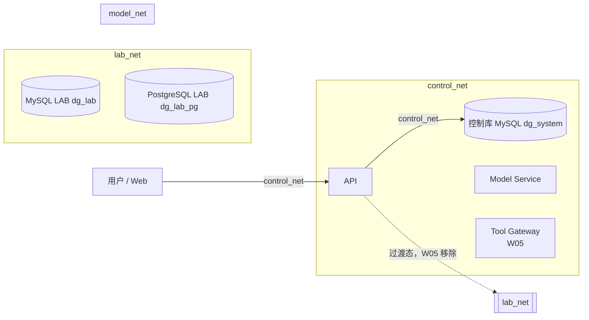

# 网络拓扑与端口（V2.2 W01）



## 端口清单

| 服务 | 容器端口 | 宿主绑定 | 网络 | 说明 |
| --- | --- | --- | --- | --- |
| api | 8000 | 127.0.0.1:8000 | control_net + lab_net（过渡） | W05 后只保留 control_net |
| control_db | 3306 | 127.0.0.1:3308 | control_net | dg_system |
| mysql_lab | 3306 | 127.0.0.1:3307 | lab_net | dg_lab |
| pg_lab | 5432 | 127.0.0.1:55432 | lab_net | dg_lab_pg |
| model_service | 11434 | 127.0.0.1:11434 | model_net + control_net | `profiles: ["model"]`，绝不接入 lab_net |
| tool_gateway | - | - | control_net + lab_net | W01 占位，W05 实现 |

## 启动顺序

1. `control_db` → 2. `mysql_lab` / `pg_lab` → 3. `api` → 4. （W05）`tool_gateway` → 5. `model_service`（可选）。

```powershell
docker compose up -d control_db mysql_lab pg_lab
docker compose up -d api
docker compose --profile model up -d model_service
```

## 逐容器网络挂载检查

```powershell
docker inspect -f '{{.Name}} {{range $k,$v := .NetworkSettings.Networks}}{{$k}} {{end}}' $(docker compose ps -q)
```

预期：`model_service` 只出现 `dbguardian_model_net` 与 `dbguardian_control_net`；`pg_lab`/`mysql_lab` 只出现 `dbguardian_lab_net`。

## 连通性负测（Docker 可用后执行）

```powershell
# 模型容器不得访问 LAB（预期失败）
docker compose --profile model exec model_service sh -c "getent hosts pg_lab || exit 0; exit 1"

# API 在 W05 后不得直连 LAB；当前为过渡态，预期成功（记录为已知偏差）
docker compose exec api python -c "import socket; socket.create_connection(('pg_lab',5432),3); print('W01 transitional reachability confirmed')"
```

## 已知限制

- 本机 Docker daemon 不可用，以上网络负测**尚未运行验证**，状态 NOT_VERIFIED。
- W01 尚无 Tool Gateway；API 暂时同时接入 `control_net` 与 `lab_net`，这是过渡态，W05 门禁前必须移除 `lab_net`。
