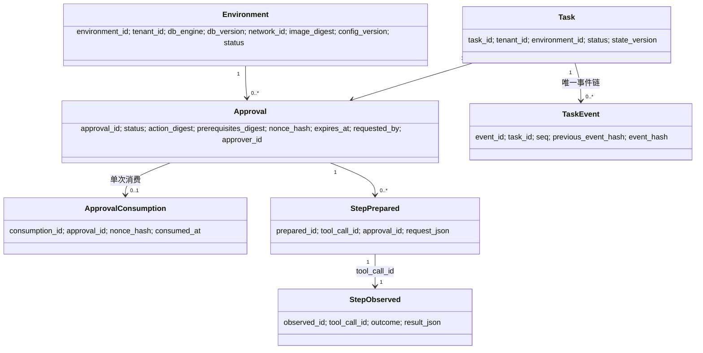

# W06 增量架构设计｜审批事务与追加式审计

- 基线 `d2ceae8`（W05 全量 660 passed）；只做增量。需求基线：`docs/w06/01-prd.md`、`docs/w06/00-task-book.md`（最高优先级）、`docs/w06/00-context.md`
- 冻结：不新增第三方依赖；不破坏 W05 认证/RBAC/Gateway/fencing；不宣称 Exactly Once、分布式事务、容器级 WORM
- 已采纳主理人决策：TTL 1800s/上限 7200s、拒绝必填理由、撤销权=申请人+Approver（Administrator 不可）、WORM 只写候选方案、控制库账号本轮不拆分、`prerequisites_digest` 仅服务端生成、同 step 允许多张 PENDING 但执行必须显式带 `approval_id`

---

## 1. 实现方案总览

### 1.1 三个难点与取舍

| 难点 | 取舍 |
|---|---|
| 审计真相只允许一份 | **扩展现有 `task_events`**，不新建 `audit_events`（§1.3）。新增只追加表只有 `approval_consumptions`/`step_prepared`/`step_observed`，它们是"证据"不是"第二套事件流" |
| 规范化不得新增依赖 | 标准库实现 **RFC 8785 JCS 受约束子集**：UTF-16 码元键序 + 紧凑分隔符 + 非 ASCII 不转义；**浮点/`Decimal`/`datetime` 一律拒绝**，数值只允许 `int`（\|v\|≤2^53−1）与十进制字符串（ADR-0005） |
| "人工同意"必须是能力凭证 | 删除 `ApprovalDecision`；改 `ApprovalGrant`（冻结 dataclass，只能由 `ApprovalService.consume()` 用模块私有 seal 构造）。`_precheck` 只接受 `ApprovalGrant`，"传 `approved=True`"的旁路在类型层与运行时都不存在 |

### 1.2 架构模式
分层 + 端口适配，沿用既有风格：`core/approval`（领域/用例）、`core/audit`（审计与完整性）、`core/execution`（Prepared/Observed 与核对）、`apps/api/routes`（HTTP 适配）、`database/migrations`。不引入 ORM、消息队列、新进程。


### 1.3 审计落点：为什么扩 `task_events` 而非新建 `audit_events`

| 判断依据 | 结论 |
|---|---|
| 查询模式 / 租户隔离 | 现有 `GET /v1/tasks/{id}/events` 已按 `after_seq` 游标读链；审计查询"按 task/审批/时间"与 `(task_id, seq)` 完全重合；且 `task_events` 经 `tasks(tenant_id, task_id)` 隔离，`_require_own_task` 已实现，语义一致 |
| 链的边界 | 链边界是 `task_id`（`uq_events_task_seq`）。W06 规定审批必须带 `task_id`（`NOT NULL`），审批事件天然同链；若另建全局 seq 的 `audit_events`，同一审批事件会出现在两条链上 → 两套互相矛盾的事件真相 |
| 与 W03 事件语义的区别 | W03 是任务生命周期流；W06 审计是同一流的**字段补齐**（`action_digest`/`policy_version`/`decision`/`result`/`integrity_ref`/`actor`），不是另一条流 |
| 对 `insert_event` 重试逻辑的影响 | **零改动**：仍 `MAX(seq)+1` + `previous_event_hash` + 撞 1062 重试 3 次 |

落地：审计专有字段全部进 `payload_json`（`event_hash()` 已覆盖 `payload`，计算式无需改），`task_events` 只增 `tenant_id`/`actor_user_id` 两列用于过滤。**存量 660 测试的哈希链断言不受影响。**

### 1.4 主时序

```mermaid
sequenceDiagram
    autonumber
    participant Op as Operator
    participant Ap as Approver
    participant Api as routes/approvals
    participant Svc as ApprovalService
    participant Pr as PrerequisiteProbe
    participant Db as dg_system
    participant W as Worker
    participant Gw as ToolGateway
    participant Ex as ToolExecutor

    Op->>Api: POST /v1/approvals(task_id, step_id, tool, params, target_objects)
    Api->>Api: ensure_permission(approval:create)；环境必须 LAB
    Api->>Pr: probe(definition, environment, target_objects)
    Pr-->>Api: checks[]（非全 PASS 则拒绝创建）
    Api->>Svc: create(...)
    Svc->>Svc: build_action_descriptor → canonical_json → action_digest / prerequisites_digest
    Svc->>Db: INSERT approvals(status=PENDING) + event APPROVAL_REQUESTED
    Svc-->>Op: ApprovalDetail（digest 原文与全部展示字段）

    Ap->>Api: POST /v1/approvals/{id}/approve
    Api->>Api: ensure_permission(approval:decide)；approver_id != requested_by
    Api->>Svc: approve(id, reason?)
    Svc->>Db: UPDATE approvals SET status='APPROVED' WHERE status='PENDING' + 事件
    Svc-->>Ap: APPROVED + expires_at

    W->>Gw: execute(envelope{approval_id}, params)
    Gw->>Gw: 1-7 验签/nonce/租约/状态版本/工具版本/args_digest
    Gw->>Gw: 8 policy.decide → required_approval=True
    Gw->>Svc: consume(approval_id, 服务端重算上下文)
    Svc->>Db: 9 项校验（含重算 action/prerequisites digest）
    Svc->>Db: BEGIN; SELECT…FOR UPDATE; INSERT approval_consumptions; UPDATE status='CONSUMED'; COMMIT
    Svc-->>Gw: ApprovalGrant（唯一出口）
    Gw->>Db: 8c 追加 STEP_PREPARED（失败→AUDIT_UNAVAILABLE，fail closed）
    Gw->>Ex: execute(..., approval_grant)
    Ex->>Ex: _precheck 只接受 ApprovalGrant
    Ex->>Db: INSERT step_prepared（未落盘不得发起执行）
    Ex->>Ex: _invoke（写操作永不重试）
    Ex->>Db: INSERT step_observed + TOOL_CALL_* 事件
    Ex-->>W: ToolResult；UNKNOWN_OUTCOME → NEEDS_RECONCILIATION
```

---

## 2. 数据模型（`database/migrations/006_w06_approval_audit.sql`）

### 2.1 `ALTER TABLE dg_system.task_events`
`+ tenant_id VARCHAR(64) NULL`、`+ actor_user_id VARCHAR(64) NULL`；索引 `idx_events_tenant_created(tenant_id, created_at)`、`idx_events_actor(actor_user_id)`。哈希链列与计算式不动。

### 2.2 `dg_system.approvals`（状态表，可变；历史靠 `task_events`）
字段：`approval_id VARCHAR(64) PK`；`tenant_id/task_id/step_id(N)/environment_id/db_engine`；`environment_fingerprint CHAR(64)` + `environment_fingerprint_json JSON`；`action_digest CHAR(64)`、`parameters_digest CHAR(64)`、`target_objects_digest CHAR(64)`（分通道，用于定位不符项）、`prerequisites_digest CHAR(64)`；`prerequisites_json JSON`、`action_descriptor_json JSON`（展示全文，与 digest 同源）；`policy_version/tool_name/tool_version VARCHAR`；`requested_by`、`requested_session_id(N)`、`approver_id(N)`、`approver_session_id(N)`、`authn_context_json JSON`；`nonce_hash CHAR(64)`；`status VARCHAR(16) DEFAULT 'PENDING'`；`decision_reason VARCHAR(512) NULL`；`operator_note VARCHAR(2000) NULL`（**不参与摘要**）；`created_at/expires_at/decided_at(N)/consumed_at(N)/consumed_by(N)/revoked_at(N)/revoked_by(N) DATETIME(6)/VARCHAR`
键：`UNIQUE uq_approvals_nonce(nonce_hash)`；`idx_approvals_tenant_task(tenant_id, task_id, step_id, status)`；`idx_approvals_status_expires(status, expires_at)`；`idx_approvals_digest(tenant_id, action_digest)`
外键：`(tenant_id, task_id) → tasks(tenant_id, task_id)`、`(tenant_id, environment_id) → environments(tenant_id, environment_id)`（复用 004 的 `uq_tasks_tenant` / `uq_environments_tenant`，跨租户不可能落库）

### 2.3 `dg_system.approval_consumptions`（消费台账，写一次）
`consumption_id PK`；`approval_id`、`tenant_id`、`task_id`、`tool_call_id(N)`、`envelope_id(N)`、`nonce_hash`、`action_digest`、`policy_version`、`consumed_by`、`consumed_at`
键：**`UNIQUE uq_consumption_approval(approval_id)` + `UNIQUE uq_consumption_nonce(nonce_hash)`** → 单次消费由数据库保证，不依赖应用判断；`idx_consumption_task`；`FK approval_id → approvals(approval_id)`

### 2.4 `dg_system.step_prepared`（写一次）
`prepared_id PK`；`tenant_id/task_id/run_id/step_id(N)/tool_call_id/envelope_id(N)/approval_id(N)/tool_name/tool_version/action_digest(N)/idempotency_key(N)/policy_version/environment_id/request_json(脱敏)/prepared_at`
键：**`UNIQUE uq_prepared_call(tool_call_id)`**、`idx_prepared_task(tenant_id, task_id, prepared_at)`、`idx_prepared_approval(approval_id)`、FK `(tenant_id,task_id)→tasks`、FK `envelope_id→execution_envelopes`

### 2.5 `dg_system.step_observed`（写一次）
`observed_id PK`；`tenant_id/task_id/run_id/step_id(N)/tool_call_id/tool_name/outcome VARCHAR(32)/result_json(脱敏,N)/error_code(N)/started_at/finished_at(N，执行中断时无结束时间)/duration_ms INT(N)/observed_at`
键：**`UNIQUE uq_observed_call(tool_call_id)`**、`idx_observed_task`、FK `(tenant_id,task_id)→tasks`
**刻意不含 `reconciliation_state`**（否则需 UPDATE）：核对结论写 `task_events` + `tasks.status`。

### 2.6 授权与回滚
`CONTROL_WRITE_GRANTS += ["GRANT UPDATE ON dg_system.approvals TO 'dg_ctl'@'%'"]`——**只有 `approvals` 得到 UPDATE，且无 DELETE**；`approval_consumptions`/`step_prepared`/`step_observed` 只靠既有的 `SELECT, INSERT ON dg_system.*`，**不出现**在授权列表。
回滚 `rollback/006_rollback.sql`：逆 FK 顺序 `DROP` 四表 → `ALTER TABLE task_events` 删两列两索引 → `DELETE FROM schema_migrations WHERE version='006_w06_approval_audit'`。

### 2.7 实体关系



### 2.8 工具契约变更（P0-03b）：`target_objects` 由契约声明、由服务端抽取
`core/tools/contracts.py::ToolDefinition` 新增 `target_objects: list[TargetObjectSpec] = Field(default_factory=list)`。每个 spec 只声明「从哪个已规范化参数取目标对象」，**值不由客户端提交**：`object_type: Literal["table","row","index","database","schema"]`、`database_field: str`、`name_field: str`、`schema_field: str|None`、`keys_field: str|None`（值为 `list[str]`）、`required: bool=True`。
抽取顺序：`normalize_tool_parameters` → `extract_target_objects(definition, params)` → §2.2 规范化排序 → 进摘要。**客户端无法提交 `target_objects`，因此「展示的目标对象」与「参数里真正执行的对象」必然同源**（满足 PRD §4 硬规则②）。`side_effect="write"` 且 `target_objects==[]`（未声明或抽取为空）→ 审批创建 `APPROVAL_PREREQUISITE_FAILED`（`reason=TARGET_OBJECTS_UNDECLARED`），`_precheck` 另做 `POLICY_DENIED` 兜底。
**兼容性与回归范围**：新字段有默认值、`extra="forbid"` 只约束未知字段，故 `adapters/*`、`tests/**`、`test_policy_engine.py::DEFAULT_TOOL` 等**全部构造点无需改动**。序列化面仅 3 处且已核实为纯增量：①`apps/api/routes/adapters.py:84` 响应多一个 `target_objects: []` 键（无全等断言）；②`tests/unit/test_model_gateway.py:235` 的 catalog 按 `name` 选工具（增量无害）；③`core/context/builder.py::_catalog_entry` 是 7 字段显式投影，**不会自动带出新字段**——本轮**刻意不**把它放进 planner 目录（避免提示膨胀）。需**新增**两条断言：不带新字段仍可构造；write 工具未声明目标对象时审批被拒。本周仅测试桩工具声明该字段（测试代码内定义，不进生产注册表），真实写工具抽取归 W07。

---

## 3. 模块与文件清单

#### 新增
| 路径 | 职责 |
|---|---|
| `core/security/canonical.py` | JCS 受约束子集 + SHA-256，**唯一摘要计算入口** |
| `core/approval/{__init__,models,digest,prerequisites,repository,service}.py` | `Approval`/`ApprovalGrant`(seal)、指纹与摘要构建、服务端前置条件探测、审批仓储与状态迁移、创建/批准/拒绝/撤销/过期/**消费**用例 |
| `core/audit/{integrity,service,worm}.py` | 纯函数 `verify_event_chain`（通过或断裂 `seq` + 受影响区间）；审计查询与完整性校验编排、`emit_required()`（失败抛 `AuditUnavailableError`）；`AuditArchivePort` + `LocalArchiveSink` + `ObjectStorageArchiveSink`（未实测占位，默认不装配） |
| `core/execution/{__init__,step_records,reconciler}.py` | Prepared/Observed 模型与只 INSERT 仓储；未 observed 的收敛（→`NEEDS_RECONCILIATION`/`MANUAL_INTERVENTION`，绝不重放） |
| `apps/api/routes/{approvals,audit}.py` + `scripts/audit_verify.py` | 审批 6 端点、审计 2 端点；审计链巡检 CLI（人工核对用） |
| `database/migrations/006_w06_approval_audit.sql` + `rollback/006_rollback.sql` | 本轮 schema / 回滚 |
| `docs/adr/ADR-000{5,6}-*.md`、`docs/w06/05-freeze.md` | ADR 已产出；`05-freeze.md` 冻结审批协议 / digest 向量 / 审计事件 Schema / 故障演练报告 |
| `tests/unit/test_{canonical,action_digest,audit_integrity,approval_lifecycle}.py` | 规范化向量、摘要稳定性与 6 类失效、篡改检出、状态白名单与职责分离 |
| `tests/integration/test_{approval_api,approval_consume,audit_service,step_prepared}.py` | API+权限、并发/过期/撤销/篡改/双消费、审计查询与追加式负测、崩溃恢复 |

#### 修改
| 路径 | 改动 |
|---|---|
| `core/errors.py` | 新增 9 个 `ErrorCode` + 异常类（§5） |
| `core/config.py` | `approval_ttl_s=1800`/`approval_max_ttl_s=7200`（Field 校验 + `ttl<=max`）、`action_digest_version="w06-v1"`；`policy_version` 默认改 `w06-v1` |
| `core/security/{models,policy}.py` | `EnvironmentContext` +`config_version`/`image_digest`/`network_id`；`ExecutionEnvelope` +`approval_id`（自动进签名载荷）；R2 分支改 `reason="R2_REQUIRES_APPROVAL"`、`deny_code=APPROVAL_REQUIRED`（仍 `allowed=False`） |
| `core/tasks/models.py` | **删除** `ApprovalDecision` |
| `core/tools/contracts.py` | `ToolDefinition` +`preconditions: list[str] = []`、+`target_objects: list[TargetObjectSpec] = []`（§2.8） |
| `core/tools/executor.py` | `_precheck` R2→`ApprovalGrant`；StepPrepared/Observed；写操作 `TIMEOUT`→`UNKNOWN_OUTCOME`；审计 fail closed |
| `core/gateway/tool_gateway.py` + `core/tasks/service.py` + `core/worker/worker.py` | Gateway 新增第 8b 步（审批消费）、第 8c 步（STEP_PREPARED 门禁）并透传 grant；`run_tool(approval_grant=...)`、`UNKNOWN_OUTCOME`→`NEEDS_RECONCILIATION`；`worker.submit(approval_id=...)` 透传 |
| `core/audit/events.py` | 新增审批/审计/核对类 `AuditEventType` |
| `database/mysql/transaction.py` | 新增 `transaction()` 上下文管理器与 `execute_in`/`fetch_all_in`（本轮唯一被事务使用的入口）。**不放在 `connection.py`**：该文件原始字节被 W04 故障资产哈希覆盖（`core/faults/store.py`），改动会让已冻结的故障 Manifest 判为过期、36 项 W04 冲击用例变红 |
| `scripts/bootstrap_mysql.py`、`apps/api/{deps,main}.py` | 新表授权；装配服务与 router |
| `apps/api/routes/tasks.py` | legacy `call_tool` **不新增**审批入口（R2 保持 `APPROVAL_REQUIRED` 拒绝） |

---

## 4. 关键接口签名

```python
# core/security/canonical.py
class CanonicalizationError(DBGuardianError): ...           # code=REQUEST_INVALID
def canonical_json(value: Any) -> str: ...                  # 拒绝 float/datetime/Decimal/bytes/set/非str键/孤立代理项
def sha256_hex(text: str) -> str: ...
def canonical_digest(value: Any) -> str: ...
def normalize_timestamp(value: datetime) -> str: ...         # 固定 ISO-8601 UTC，毫秒，Z 结尾
# core/approval/models.py
class ApprovalStatus(str, Enum): PENDING APPROVED REJECTED EXPIRED REVOKED CONSUMED
@dataclass(frozen=True)
class ApprovalGrant:
    approval_id: str; tenant_id: str; task_id: str; step_id: str | None
    tool_name: str; tool_version: str; environment_id: str
    action_digest: str; prerequisites_digest: str; policy_version: str
    consumed_by: str; consumed_at: datetime
    grant_seal: object        # 模块私有哨兵；非 seal 构造 → ValueError
# core/tools/contracts.py（P0-03b，新增）
class TargetObjectSpec(BaseModel):
    model_config = ConfigDict(extra="forbid")
    object_type: Literal["table", "row", "index", "database", "schema"]
    database_field: str; name_field: str
    schema_field: str | None = None; keys_field: str | None = None
    required: bool = True
# ToolDefinition 新增 target_objects: list[TargetObjectSpec] = []
# core/approval/digest.py
def environment_fingerprint_from_row(row: Mapping[str, Any]) -> dict[str, Any]: ...
def normalize_tool_parameters(definition: ToolDefinition, params: dict[str, Any]) -> dict[str, Any]: ...
def build_action_descriptor(*, tenant_id: str, environment_id: str, db_engine: str,
    fingerprint: dict[str, Any], definition: ToolDefinition,
    normalized_operation: dict[str, Any], target_objects: Sequence[dict[str, Any]],
    parameters: dict[str, Any], policy_version: str) -> dict[str, Any]: ...
def extract_target_objects(definition: ToolDefinition, params: dict[str, Any]) -> list[dict[str, Any]]: ...
def validate_display_fields(detail: ApprovalDetail) -> None: ...   # 缺失 → APPROVAL_PREREQUISITE_FAILED
def compute_action_digest(descriptor: dict[str, Any]) -> tuple[str, str, str]:   # (action, parameters, target_objects)
def compute_prerequisites_digest(*, action_digest: str, checks: Sequence[dict[str, Any]]) -> str: ...
# core/approval/prerequisites.py
class PrerequisiteProbe:
    def __init__(self, repository: TaskRepository, target_probe: TargetProbePort | None = None) -> None: ...
    def probe(self, *, definition: ToolDefinition, environment: EnvironmentContext,
              target_objects: Sequence[dict[str, Any]], actor: Principal) -> list[dict[str, Any]]: ...
# core/approval/service.py
class ApprovalService:
    def __init__(self, repository: ApprovalRepository, task_repository: TaskRepository,
                 probe: PrerequisiteProbe, audit: AuditService, *, settings: Settings) -> None: ...
    def create(self, *, principal: Principal, task_id: str, step_id: str | None, tool_name: str,
               params: dict[str, Any], operator_note: str | None = None,
               ttl_s: float | None = None) -> ApprovalDetail: ...   # target_objects 由服务端抽取
    def get(self, approval_id: str, *, tenant_id: str) -> ApprovalDetail: ...
    def list(self, *, tenant_id: str, status: ApprovalStatus | None = None, task_id: str | None = None,
             limit: int = 50, cursor: str | None = None) -> tuple[list[ApprovalDetail], str | None]: ...
    def approve(self, approval_id: str, *, principal: Principal, reason: str | None = None) -> ApprovalDetail: ...
    def reject(self, approval_id: str, *, principal: Principal, reason: str) -> ApprovalDetail: ...
    def revoke(self, approval_id: str, *, principal: Principal, reason: str | None = None) -> ApprovalDetail: ...
    def expire_due(self, *, limit: int = 100) -> int: ...
    def consume(self, *, approval_id: str, principal: Principal, task: Task,
                definition: ToolDefinition, params: dict[str, Any],
                environment_row: Mapping[str, Any], policy_version: str,
                envelope_id: str | None, tool_call_id: str | None) -> ApprovalGrant: ...
# core/audit/integrity.py
@dataclass(frozen=True)
class ChainVerification:
    ok: bool; checked: int; broken_at_seq: int | None
    affected_range: tuple[int, int] | None; reason: str | None
def verify_event_chain(events: Sequence[TaskEvent]) -> ChainVerification: ...
# core/audit/service.py
class AuditService:
    def __init__(self, repository: TaskRepository) -> None: ...
    def query(self, *, tenant_id: str, task_id: str | None, approval_id: str | None,
              event_types: Sequence[str] | None, since: datetime | None, until: datetime | None,
              limit: int, cursor: str | None) -> tuple[list[TaskEvent], str | None]: ...
    def verify(self, *, tenant_id: str, task_id: str) -> ChainVerification: ...
    def emit_required(self, event: TaskEvent) -> None: ...   # 失败抛 AuditUnavailableError
# core/execution/step_records.py
class StepRecordRepository:
    def insert_prepared(self, record: StepPrepared) -> None: ...
    def insert_observed(self, record: StepObserved) -> None: ...
    def find_unobserved(self, *, tenant_id: str, older_than_s: float, limit: int = 50) -> list[StepPrepared]: ...
# core/execution/reconciler.py
class Reconciler:
    def __init__(self, step_records: StepRecordRepository, task_repository: TaskRepository,
                 audit: AuditService) -> None: ...
    def sweep(self, *, tenant_id: str | None = None, older_than_s: float = 60.0) -> list[ReconcileResult]: ...
# database/mysql/transaction.py（新增，独立的显式事务模块）
@contextmanager
def transaction(client: MysqlClient) -> Iterator[pymysql.Connection]: ...  # begin → yield → commit / rollback；只读客户端拒绝
def execute_in(client: MysqlClient, conn: pymysql.Connection, sql: str, params: tuple | None = None) -> int: ...
def fetch_all_in(client: MysqlClient, conn: pymysql.Connection, sql: str, params: tuple | None = None, *, max_rows: int = 500) -> list[dict[str, object]]: ...
```

---

## 5. 消费校验 9 项与失败码映射

第 1–8 项只读不持锁；第 9 项进事务（重算 digest 需要读环境/契约，若持锁会长时间占用行锁）。
`approve()` 前置：`validate_display_fields()` 重校验 PRD §4 全部必需字段（操作/目标对象/影响面/风险/前置条件/补偿/验证计划/有效期/绑定信息），缺任一即拒绝批准——**可测的服务端行为**，不是纸面约定；本期无前端，载体是 `GET /v1/approvals/{id}` 的响应字段完整性。

| # | 检查 | 错误码 | HTTP |
|---|---|---|---|
| 1 | 审批存在且 `tenant_id` 匹配（跨租户按不存在） | `APPROVAL_NOT_FOUND` | 404 |
| 2 | `status`：`PENDING`→`APPROVAL_NOT_APPROVED`／`REJECTED`→`APPROVAL_REJECTED`／`EXPIRED`→`APPROVAL_EXPIRED`／`REVOKED`→`APPROVAL_REVOKED`／`CONSUMED`→`APPROVAL_ALREADY_CONSUMED` | 见左 | 409 |
| 3 | `now < expires_at`；否则先落 `status='EXPIRED'` + 事件，再报错 | `APPROVAL_EXPIRED` | 409 |
| 4 | `task_id`/`step_id`/`environment_id`/`db_engine` 与当前上下文一致 | `APPROVAL_DIGEST_MISMATCH`(`channel=environment`) | 409 |
| 5 | 服务端**重算** `environment_fingerprint` 摘要一致 | `APPROVAL_DIGEST_MISMATCH`(`channel=environment_fingerprint`) | 409 |
| 6 | `policy_version` 一致 | `APPROVAL_DIGEST_MISMATCH`(`channel=policy_version`) | 409 |
| 7 | `tool_name`+`tool_version` 一致 | `APPROVAL_DIGEST_MISMATCH`(`channel=tool_version`) | 409 |
| 8 | 重算 `parameters_digest` → `target_objects_digest` → `action_digest`（先分通道定位，再整体门禁） | `APPROVAL_DIGEST_MISMATCH`(`channel=parameters`/`target_objects`/`action`) | 409 |
| 9 | 重算 `prerequisites_digest` → **原子消费**：`BEGIN`；`SELECT … FOR UPDATE`；复核 `status='APPROVED'` 且未过期；`INSERT approval_consumptions`（撞 1062 → 已消费）；`UPDATE approvals SET status='CONSUMED' … WHERE approval_id=%s AND status='APPROVED'`，`affected != 1` → 重读状态映射；`COMMIT` | `APPROVAL_DIGEST_MISMATCH`(`channel=prerequisites`)／`APPROVAL_ALREADY_CONSUMED` | 409 |

**新增 `ErrorCode` 全量清单**：`APPROVAL_NOT_FOUND`(404)、`APPROVAL_NOT_APPROVED`(409)、`APPROVAL_REJECTED`(409)、`APPROVAL_EXPIRED`(409)、`APPROVAL_REVOKED`(409)、`APPROVAL_ALREADY_CONSUMED`(409)、`APPROVAL_DIGEST_MISMATCH`(409)、`APPROVAL_PREREQUISITE_FAILED`(422)、`AUDIT_UNAVAILABLE`(503)。复用既有：`APPROVAL_REQUIRED`(403)、`FORBIDDEN`(403)、`STATE_CONFLICT`(409)、`REQUEST_INVALID`(400，含规范化失败)、`TASK_NOT_FOUND`(404)。职责分离冲突用 `FORBIDDEN` + `details.reason="SEGREGATION_OF_DUTY"`（按 PRD P0-09）。

**分离原则**：过期/撤销/拒绝是"审批状态"（`approvals.status` + `task_events`）；消费失败是"执行结果"（`ToolResult(DENIED)` + `step_observed.outcome='DENIED'`），分别记录，不合并成"审批无效"。

**为什么不是 Exactly Once**：① 第 9 项的控制库事务与目标库写入是两个独立事务；控制库 `COMMIT` 成功而目标库未执行 → 审批已耗、操作未发生；目标库已执行而控制库 `COMMIT` 失败 → 有副作用但审批仍为 `APPROVED`。② 因此只保证"**每张审批至多被消费一次**"，不保证"操作恰好被执行一次"。③ 兜底是幂等键 + `action_digest` 核对 + 停止策略，不是重试补偿。

**隔离级别**：保持默认 `REPEATABLE READ`；正确性只依赖行锁 + 条件 UPDATE + 唯一键，不依赖快照读。`SELECT … FOR UPDATE` 是当前读，能见最新已提交状态；唯一键是最后防线，两者都保留。

---

## 6. 任务分解（5 个任务，按依赖排序）
**T01 数据与规范化基座（P0，无依赖）**
文件：`database/migrations/006_*.sql` + `rollback/006_rollback.sql`、`scripts/bootstrap_mysql.py`、`core/security/canonical.py`、`core/errors.py`、`core/config.py`、`database/mysql/transaction.py`、`tests/unit/test_canonical.py`
验收：`scripts/migrate.py` 幂等成功、回滚可执行；ADR-0005 的 6 组向量逐字节复现 + 8 条反向量抛 `CanonicalizationError`；`transaction()` 异常后行不变（回滚用例）。

**T02 审批领域层（P0，依赖 T01）**
文件：`core/approval/{__init__,models,digest,prerequisites,repository,service}.py`、`tests/unit/test_action_digest.py`、`tests/unit/test_approval_lifecycle.py`
验收：6 类失效（参数/目标对象/环境/环境指纹/策略版本/工具版本）各自产生不同 `action_digest` 且 `consume` 报 `APPROVAL_DIGEST_MISMATCH` 并给出 `channel`（目标对象子用例证据来自**声明了 `target_objects` 的测试桩工具**）；`side_effect="write"` 且未声明目标对象 → 审批创建被拒；`ApprovalGrant` 直接构造抛 `ValueError`；状态迁移仅 P0-05 白名单，非法迁移 `STATE_CONFLICT`；`approver_id==requested_by` → `FORBIDDEN` 且有事件。

**T03 审计服务与 Prepared/Observed（P0，依赖 T01）**
文件：`core/audit/{integrity,service,worm}.py`、`core/audit/events.py`、`core/execution/{__init__,step_records,reconciler}.py`、`tests/unit/test_audit_integrity.py`、`tests/integration/{test_audit_service,test_step_prepared}.py`
验收：篡改单条后 `verify_event_chain` 返回 `ok=False` + 精确 `broken_at_seq`/`affected_range`；`dg_ctl` 对四张只追加表 UPDATE/DELETE 实测 `DatabasePermissionError`；**T9 定档为自动化**：独立子进程落盘 `step_prepared` 后被 `Popen.kill()` 强制终止，重启 `Reconciler` 收敛为确定结论或 `MANUAL_INTERVENTION`，并断言**零重复执行**；若 CI 不稳定，拆为「稳定断言（状态收敛）+ 可重试进程级用例」两部分上报并附稳定性数据，**不得改成人工声明**。

**T04 执行链接入与旁路消除（P0，依赖 T02、T03）**
文件：`core/security/{policy,models}.py`、`core/tasks/{models,service}.py`、`core/tools/{contracts,executor}.py`、`core/gateway/tool_gateway.py`、`core/worker/worker.py`、`apps/api/routes/tasks.py`、`tests/integration/{test_approval_consume,test_executor,test_worker_gateway}.py`、`tests/unit/test_policy_engine.py`、`tests/integration/test_rbac_api.py`
验收：N=8 并发消费同一审批 → 恰好 1 成功、其余 `APPROVAL_ALREADY_CONSUMED`；无 `approval_id` 的 R2 → `APPROVAL_REQUIRED` 且 `tool_calls` 计数 0；legacy `/tasks/{id}/tools/{name}` 对 R2 仍拒绝且无消费入口；注入审计失败 → R2 工具未被调用、返回 `AUDIT_UNAVAILABLE`、`AUDIT_WRITE_FAILED` 日志；写操作 `TIMEOUT`→`UNKNOWN_OUTCOME`→`NEEDS_RECONCILIATION` 且无 `TOOL_CALL_RETRIED`；`_should_retry` 有"未放宽"断言。

**T05 API、CLI、冻结与全量回归（P0，依赖 T04）**
文件：`apps/api/routes/{approvals,audit}.py`、`apps/api/{deps,main}.py`、`scripts/audit_verify.py`、`tests/integration/test_approval_api.py`、`docs/w06/{05-freeze,03-implementation}.md`
验收：6 个审批端点 + 2 个审计端点按 PRD 权限矩阵工作（`Approver` 可裁决、`Administrator` 裁决 `FORBIDDEN`、`Auditor` 只读审计）；`POST /v1/approvals` **不接受**客户端 `target_objects`；批准前缺 PRD §4 任一字段 → 拒绝批准；审批详情返回 PRD 第 4 节全部字段且与 `action_digest` 同源（缺字段阻止批准）；`05-freeze.md` 冻结协议/向量/Schema/故障演练；全量 `pytest` 全绿且 skip 数不增加。

---

## 7. 依赖包
**不新增任何第三方依赖。** JCS 用 `json` + `hashlib` + `str.encode("utf-16-be")`；事务用已装的 `PyMySQL`；`jsonschema` 已在依赖内可复用于 `input_schema` 校验。`requirements.lock.txt` 与 `pyproject.toml` 不变。

---

## 8. 共享知识（跨文件约定）
- **摘要唯一入口**：所有 `action_digest`/`prerequisites_digest`/分通道摘要必经 `canonical_digest`。禁止在别处 `json.dumps`+`hashlib`；`events.py` 的事件哈希保持既有实现，二者不混用（`compute_args_digest` 的 `default=str` 属降级路径，W06 摘要不复用）。
- **规范化输入纪律**：拒绝 `float`/`datetime`/`Decimal`/`bytes`/`set`/非 `str` 键/孤立代理项/`|v|>2^53−1`；时间先 `normalize_timestamp()`；`DECIMAL` 用十进制字符串。**失败即报错，不降级。**
- **缺失值策略**：`action_descriptor` 字段集封闭；必填缺失 = 错误（不是 `null`）；仅 `schema`/`image_digest`/`step_id`/`keys` 允许 `null` 且必须**显式写出**，"不写"≠"写 null"。
- **时间**：进程内一律 tz-aware UTC；入库 `.astimezone(UTC).replace(tzinfo=None)`；摘要内一律 `normalize_timestamp()`；有效期比较只用服务端 `utc_now()`，不接受客户端时间。
- **参数规范化**：进摘要前必经 `normalize_tool_parameters`（`model_validate` + `model_dump(mode="json")` + `assert_canonical_supported`），审批创建侧与执行侧**同一函数**，保证"显式写默认值"与"不写"同摘要。
- **错误传播**：领域层抛 `DBGuardianError` 子类；`ToolExecutor` 内部拒绝转 `ToolResult(DENIED)`；`ToolGateway` 的审批/审计失败也转 `ToolResult(DENIED)`，唯 `AUDIT_UNAVAILABLE` 需抛 `AuditUnavailableError`（必须阻断且需告警）；任何 `details` 不含 DSN/Token/密码。
- **fail closed 落点**：仅两个"必须成功"写入点——`AuditService.emit_required()`、`StepRecordRepository.insert_prepared()`。失败 → `AuditUnavailableError`(503) + `logger.error(extra={"alert":"AUDIT_WRITE_FAILED"})` + best-effort 写 `AUDIT_WRITE_FAILED` 事件。不引入新告警基础设施。
- **测试夹具**：集成清理必须按逆 FK 顺序 `step_observed → step_prepared → approval_consumptions → approvals → task_events → tool_calls → task_steps → checkpoints → execution_envelopes → worker_leases → tasks`；新增 4 张表必须插在 `task_events` 之前，否则 FK 失败。
- **命名**：表/列 snake_case；事件类型 UPPER_SNAKE；ID 前缀 `apr_`/`acn_`/`spr_`/`sob_`（沿用 `new_id(prefix)`）。
- **不宣称**：文档与 API 响应不得出现"Exactly Once"/"精确一次"/"WORM 已具备"/"分布式事务"的肯定表述。

---

## 9. 对 W05 既有测试的影响评估
| 测试 | 影响 | 处理方式（避免"改测试迁就实现"） |
|---|---|---|
| `test_executor.py::test_risk_policy_and_approval` | **必改**。它断言 `ApprovalDecision(approved=True)` 让 R2 执行成功——**这条断言就是被要求消除的旁路本身** | 删除该断言；替换为：①无 grant → `APPROVAL_REQUIRED`；②`ApprovalGrant` 直接构造抛 `ValueError`；③成功路径必须用 `ApprovalService.consume()` 返回的 grant。同时删除顶部 `ApprovalDecision` import。契约变更点写入 PR 说明 |
| `test_policy_engine.py`（3 条 R2 用例） | `allowed is False`/`required_approval is True` 不变；`reason`、`deny_code` 字面量变更 | 只允许"旧字面量→新字面量"替换，且**必须新增** `assert decision.deny_code == "APPROVAL_REQUIRED"`；`policy_version` 断言改 `== PolicyEngine().policy_version`。禁止删除这三条用例 |
| `test_rbac_api.py::test_r2_tool_call_is_denied_by_policy` | `reason`/`deny_code` 变更 | 同上替换，并**新增**断言：legacy 响应无 `approval_id`、`tool_calls` 计数 0，证明 legacy 路由不提供审批入口 |
| `test_worker_gateway.py::test_high_risk_tools_are_denied_without_tool_calls` | 断言 `policy_version == "w05-v1"`（默认改 `w06-v1`） | 改为 `== settings.policy_version`（去硬编码，非放宽）；`_cleanup_created_tasks` 追加新表清理 |
| `test_worker_gateway.py` 其余（R0/R3/R4） | 无影响（不经审批消费） | 不改；新增 R2 用例独立成 `test_approval_consume.py`，避免污染基线 |
| `test_w03_integrity.py`、`test_state_machine.py` | 无影响（增列不改哈希链；`EXECUTING→NEEDS_RECONCILIATION`、`TIMED_OUT→NEEDS_RECONCILIATION` 已在白名单） | 不改原文件；只在新测试追加新表负测，并在 `05-freeze.md` 引用现状作为"迁移合法"证据 |
| 删除 `ApprovalDecision` | 全仓仅 `executor.py`、`service.py`、`test_executor.py` 引用 | 一次改完，`grep ApprovalDecision` 必须为 0 |

**防"迁就实现"硬规则**（写入 `05-freeze.md`）：任何测试改动必须在 PR 中同时给出①旧断言②新断言③契约依据（PRD 条目/ADR 章节）。只删不补、只改字面量不加新契约断言的改动一律驳回。

---

## 10. 待明确事项（已全部定档，无开放项）
> 原 5 条已由主理人裁定：`target_objects` 契约形态见 §11.1；T9 崩溃测试见 §11.2；目标库只读探测见 §11.3。`image_digest` 为 NULL **不阻断**：`fingerprint_completeness=PARTIAL` 参与摘要、允许 LAB 审批，但**必须在审批详情返回给审批人**，不得静默写成 `COMPLETE`，也不得为兼容旧审批而回退指纹字段（补全后旧审批失效是正确行为）。审批 1800s + 信封 60s 的语义是"批准后 30 分钟内任意时刻可消费"，**不设"N 秒内必须开始执行"**。

## 11. 增量修订（主理人裁定；只追加，§1–§10 结论不变，以本节为准）

### 11.1 `ToolDefinition.target_objects` 契约形态（P0-03b，与 §2.8 一致）
`target_objects: list[TargetObjectSpec] = Field(default_factory=list)`。**spec 只声明抽取规则，对象值由服务端从已规范化参数抽取，客户端不可提交 `target_objects`**。既有 10 个只读工具不声明 → 默认空列表，构造点零改动。

- **`TargetObjectSpec`**（`extra="forbid"`）：`object_type: Literal["table","row","index","database","schema"]`（必填）、`database_field: str`、`name_field: str`、`schema_field: str | None = None`、`keys_field: str | None = None`（值须为 `list[str]`）、`required: bool = True`。
- **fail closed 两道**：① 契约层 `model_validator(mode="after")`——`side_effect=="write"` 且 `target_objects` 为空即抛 `ValueError`（只读工具空列表合法）；② `ApprovalService.create()` 再校验一次，并要求 `extract_target_objects()` 结果非空，否则 `APPROVAL_PREREQUISITE_FAILED`（`reason=TARGET_OBJECTS_UNDECLARED`），防止绕过契约直接传空。
- **抽取与规范形**：`normalize_tool_parameters` → `extract_target_objects(definition, params)` → 每项键集封闭：`object_type`、`database`、`name`、`schema`（str 或**显式 `null`**）、`keys`（可为空但必须显式写出）；`keys` 去重后按 UTF-16 码元升序，数组整体按各自规范串的字节序字典序排序；再 `canonical_digest`。非法项（字段缺失、未知键、类型不符、含 `float`）→ `CanonicalizationError`(`REQUEST_INVALID`,400)，**不产生 PENDING 行**。
- **摘要与通道**：`build_action_descriptor` 放规范化后的 `target_objects`；`target_objects_digest = canonical_digest(规范化数组)`，消费第 8 项先比它 → `channel=target_objects`。因为对象值来自**本次** `parameters`，`target_objects` 不随 `tool.version` 冻结，"这次到底动了哪张表/哪些行"由该通道独立校验；改契约抽取规则则会同时通过 `tool_version` 变更使旧审批失效。
- **兼容性与回归范围（已实测统计，非估计）**：只读工具实际 **10 个**（`explain_query`/`get_activity`/`get_blocking_tree`/`get_database_size`/`get_db_settings`/`get_db_version`/`get_index_stats`/`get_locks`/`get_query_stats`/`get_table_stats`），`side_effect` 全为 `read`；`adapters/*` 与 `build_observer_registry()` **无 write 工具**。序列化面 3 处均为纯增量：`apps/api/routes/adapters.py:84`（无全等断言）、`tests/unit/test_model_gateway.py:235`（按 `name` 选工具）、`core/context/builder.py::_catalog_entry`（7 字段显式投影，**刻意不**把 `target_objects` 放进 planner 目录，避免提示膨胀）。
- **会失败的既有构造点共 6 处（4 个测试文件）必须补 spec 声明**（初版写"5 处/3 个文件"有误，此处为准）：`tests/integration/test_executor.py:360 stub_idem_write`、`:400 stub_fail_write`、`:476 stub_cancelled_write`；`tests/unit/test_model_gateway.py:47 _WriteTool`；`tests/unit/test_policy_engine.py:275 make_tool(side_effect="write")`；`tests/unit/test_planner_schema.py::_StubTool`（`side_effect` 由参数注入，初版 grep 未捕获）。
- **证明只读工具不受影响、且受影响构造点已穷尽的三条断言**（不接受"应该不影响"）：① 参数化遍历 `build_observer_registry().definitions()`，逐个断言 `side_effect != "write"`、`target_objects == []` 且构造未抛错（10 个参数化用例）；② `ToolDefinition(**DEFAULT_TOOL)` 不带新字段可构造且默认 `[]`；③ **运行时门禁（唯一可作为"已穷尽"依据的手段）**：(a) 遍历 `build_observer_registry()` 与各测试桩注册表中**所有** `side_effect == "write"` 的 `ToolDefinition`，断言 `target_objects` 非空；(b) 直接构造 `ToolDefinition(name=..., side_effect="write")`（不带 `target_objects`）必须抛 `ValueError`。**静态 grep 降级为"列候选"**：匹配面扩大为 `side_effect=`（以捕获参数注入、变量、默认值等非字面量写法），命中项逐个人工确认，但**不得**把 grep 结果当作穷尽性证明——§11.1 初版曾用 `grep 'side_effect="write"'` 宣称穷尽，实际漏掉 `tests/unit/test_planner_schema.py::_StubTool`（其 `side_effect` 由函数参数注入），故该口径作废。
- **另需 2 条新断言**：`side_effect="write"` 且未声明 spec → 构造抛错；声明了 spec 但参数缺 `database`/`table` 致 `extract_target_objects()` 为空 → 审批创建 `APPROVAL_PREREQUISITE_FAILED`。
- **本周证据来源**：仅测试桩工具声明 spec（测试代码内定义，**不得进 `adapters/registry.py` 与 `build_observer_registry`**）。**W07 承接**：真实写工具声明 spec，并用 `input_schema` 把 `database`/`table`/`keys` 设为必填，使 per-call 精确对象稳定落入 `parameters`。

### 11.2 T9 崩溃恢复测试设计（定档自动化，不接受人工兜底）
**归属**：新文件 `tests/integration/test_step_prepared_crash.py`；`@pytest.mark.integration` + 新 marker `crash`（在 `pyproject.toml` 登记）。默认全量**包含**它（T10 门禁要求全绿），内环可用 `-m "not crash"` 跳过。

**同步信号用"轮询控制库"，不用文件/端口**：文件与端口只能证明子进程启动过，证明不了 `step_prepared` **已提交**；而那一行本身正是被测事实，且零新增依赖。

**流程**：① 父进程建 task + 桩 write 工具（已声明 spec）+ `ApprovalService.consume()` 得到的真实 grant；② `proc = subprocess.Popen([sys.executable, "-c", SCRIPT], stdout=PIPE, stderr=PIPE, text=True)`，SCRIPT 内保存 `step_prepared`、打印 `tool_call_id` 并 flush、然后 `time.sleep(300)` 阻塞；③ 父进程以 200ms 间隔轮询 `SELECT … WHERE tool_call_id=%s`，**上限 10s**，超时即 fail 并输出子进程 stdout/stderr；④ 命中后 `proc.kill()`（Windows=TerminateProcess）+ `proc.wait(timeout=10)`；⑤ `Reconciler(...).sweep(older_than_s=0)`；⑥ `finally`：若 `proc.poll() is None` 再 kill 并 `communicate()` 回收管道，随后按 §8 逆 FK 顺序清理该 tenant 下本用例行——**避免残留子进程污染后续用例**。

**断言点（5 条，缺一不可）**：① `step_prepared` 恰好 1 行、`step_observed` 0 行；② `tasks.status ∈ {NEEDS_RECONCILIATION, MANUAL_INTERVENTION}` 且迁移经 `ensure_transition` 白名单；③ `COUNT(*) FROM tool_calls WHERE task_id=%s AND tool_name=%s == 1` 且 `attempt == 1`（**无第二/第三次调用**）；④ `task_events` 中 `TOOL_CALL_RETRIED` 计数为 0，`TOOL_CALL_SUCCEEDED`/`TOOL_CALL_TIMEOUT` 不存在（子进程死在 `_invoke` 之前）；⑤ `sweep()` 返回项 `replayed is False` 且 `decision ∈ {RECONCILED, MANUAL_INTERVENTION}`。

**稳定性**：连续跑 10 次并记录 `成功/总数`，**只有 10/10 才算通过**。失败形态判定：①10s 内未落盘 → 子进程环境/导入问题（非被测逻辑），附 stderr 单独排查；②`kill()` 后出现 `step_observed` → 观测写在 `_invoke` 之前，属实现缺陷；③`sweep` 后 `tool_calls` 出现第 2 行 → 重放缺陷。**任何情况下不得改为 in-process 异常模拟来"通过"**；未达 10/10 按缺陷登记并保留原始输出，不得删用例。

### 11.3 `TargetProbePort`（已批准：允许审批阶段只读探测目标库）
- **账号**：MySQL 用 `dg_ro`、PG 用 `dg_ro_pg`，**不得**用读写账号；客户端 `read_only=True`（会话层 `SET SESSION TRANSACTION READ ONLY`）。
- **探测集固定且封闭**：`database_exists` / `table_exists` / `index_exists` / `is_readable`，各自使用固定参数化 SQL（MySQL `information_schema.tables`/`information_schema.statistics`；PG `pg_catalog`/`information_schema`）。**禁止任意 SQL，禁止接受客户端传入的 SQL 片段**；库名/表名只能来自已规范化参数，且必须按标识符字符集校验后才拼接。
- **超时**沿用 `Settings.connect_timeout_s` / `Settings.statement_timeout_ms`，不新增配置项。
- **探测失败一律 fail closed**：连接失败、超时、权限不足、结果未知 → `check.status ∈ {FAIL, UNKNOWN}` → 审批创建 `APPROVAL_PREREQUISITE_FAILED`。**不得把"探测失败"当成"通过"**，也不得降级为"跳过该 check"。
- **结果必须落盘并参与摘要**：写入 `approvals.prerequisites_json` 并参与 `prerequisites_digest`（否则审批人看到的与绑定的不是一回事）；消费时按 §5 第 9 项重算比对，不一致 → `channel=prerequisites`。
