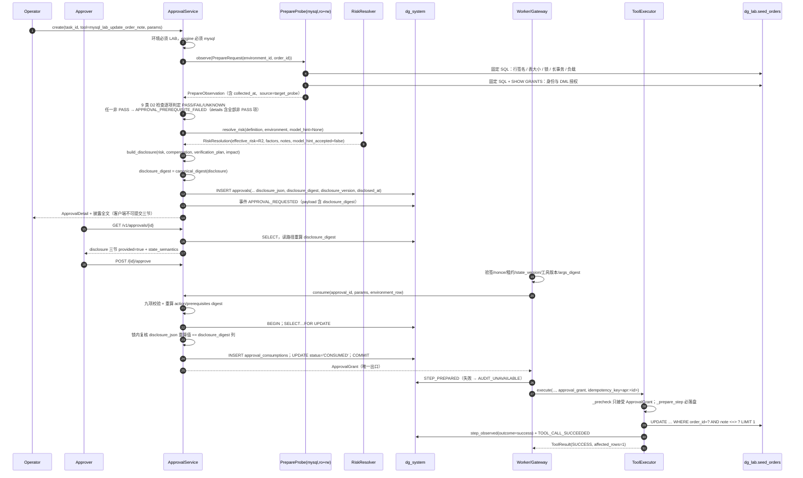
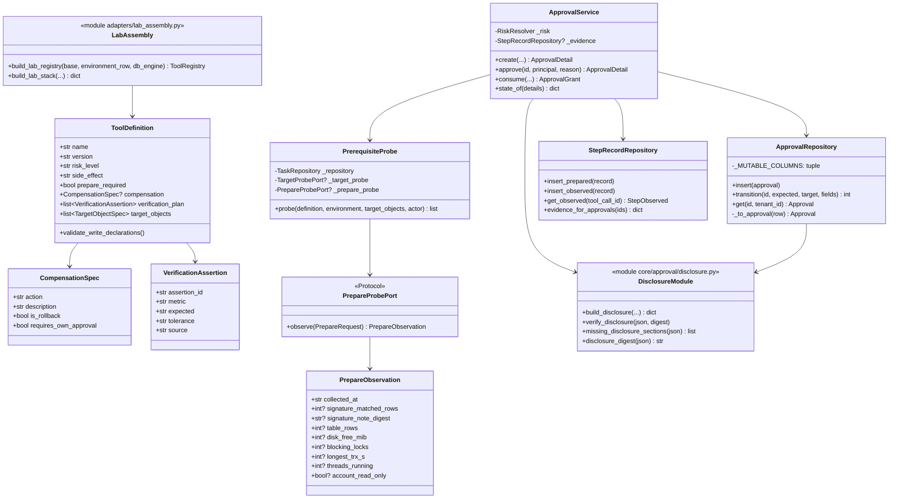

# W07 增量架构设计｜单引擎沙箱修复（MySQL LAB 单一 R2 动作）

- 架构师：高见远（Bob）｜日期：2026-11-11｜阶段：W07 收口
- 需求基线：`docs/w07/01-prd.md`（P0 6 条 / AC 15 条 / Q1–Q8）、`docs/w07/00-action-spec.md`、`docs/adr/ADR-0007-single-engine-lab-repair.md`
- 门禁依据：`docs/w06/07-gate-review.md` §5/§6、`docs/w06/08-pm-ruling.md`（路径 2 + 生效条件 C1–C4）
- 冻结：不新增第三方依赖；不改 `action_digest` 字段集与 `action_digest_version`（W06 冻结向量逐字节不变）；不开放第二引擎写、不开放 DDL、不做 UI、不做 W08 Verifier
- 已采纳主理人裁定（无替代方案）：Q2/Q3/Q4/Q5/Q6/Q7/Q8 与 P0-W07-06 装配点口径，全文按裁定落地

---

# Part A｜系统设计

## 1. 实现方案总览

### 1.1 三个技术难点与取舍

| 难点 | 取舍（定案） |
|---|---|
| 三节披露（风险/补偿/验证计划）在 W06 无事实来源，且 **不能进 `action_digest`**（W06 冻结向量不可重算） | 三节由**服务端**在 `create()` 时刻生成快照，落新列 `disclosure_json`，并对快照规范化 JSON 取 **`disclosure_digest`**（复用 `canonical_digest`）。读取/批准/消费时用库内 JSON 重算比对，不一致抛 `STATE_CONFLICT`（`reason=DISCLOSURE_TAMPERED`）。`action_digest` 输入字段集不变、版本不变 |
| Prepare 需扩到 9 类前置条件，但 `TargetProbePort` 只有 `object_exists`，且 W06 大量单参构造测试不能坏 | 新增**独立端口** `PrepareProbePort.observe(PrepareRequest) -> PrepareObservation`：只吃冻结 dataclass（无 SQL 字符串入参），SQL 全部是模块内**固定原文 + 绑定参数**，标识符只接受服务端白名单常量。`PrerequisiteProbe` 第三参数为 keyword-only 可选，`PrerequisiteProbe(repository)` 与 `PrerequisiteProbe(repository, target_probe)` 行为不变 |
| 唯一写工具尚未接入任何执行链，且"无 grant 的写只记 warning"是 W06 遗留缺口（D7） | 新增 `adapters/lab_assembly.py` 作为**唯一 LAB 装配点**；`build_adapter_registry(adapter)` 与 `build_observer_registry()` 默认行为**保持只读**（`core/diagnosis/runner.py:95`、`apps/api/routes/adapters.py:104` 两个既有调用点零改动）；`ToolExecutor._prepare_step` 删除 warning 旁路，写操作无 `ApprovalGrant` 即拒绝 |

### 1.2 四段式主流程（新增点已标注 `＋W07`）

```mermaid
flowchart LR
    subgraph P["Prepare 准备"]
        P1["任务/环境读取<br/>environments.status 必须 LAB"]
        P2["契约解析<br/>ToolDefinition（＋compensation / verification_plan / prepare_required）"]
        P3["PrerequisiteProbe<br/>5 条 W06 检查"]
        P4["＋W07 PrepareProbePort.observe<br/>7 条固定 SQL 检查"]
        P5["＋W07 披露快照<br/>risk / compensation / verification_plan"]
        P6["＋W07 disclosure_digest<br/>canonical_digest(快照)"]
        P1 --> P2 --> P3 --> P4 --> P6
        P2 --> P5 --> P6
    end
    subgraph A["Approve 审批"]
        A1["missing_required_fields()<br/>＋disclosure.risk / .compensation / .verification_plan"]
        A2["＋W07 DISCLOSURE_INCOMPLETE(409)<br/>details.missing_fields"]
        A3["职责分离 + 未过期 + 状态白名单"]
        A1 --> A2 --> A3
    end
    subgraph E["Execute 执行（唯一链）"]
        E1["Worker 租约 + 信封签名/nonce"]
        E2["Gateway 策略复核<br/>PROD 一律 PROD_TARGET_NOT_ALLOWED"]
        E3["consume() 九项校验<br/>＋W07 锁内 disclosure_digest 复核"]
        E4["STEP_PREPARED（审计不可用即阻断）"]
        E5["ToolExecutor：写操作必须有 grant<br/>＋W07 删除 warning 旁路"]
        E6["UPDATE dg_lab.seed_orders<br/>SET note=? WHERE order_id=? AND note<=>?"]
        E1 --> E2 --> E3 --> E4 --> E5 --> E6
    end
    subgraph O["Observe 观测"]
        O1["StepObserved（outcome=success）"]
        O2["UNKNOWN_OUTCOME → NEEDS_RECONCILIATION<br/>禁止自动重试"]
        O3["＋W07 state_semantics<br/>建议/等待审批/已执行/结果未知"]
        O1 --> O3
        O2 --> O3
    end
    P6 --> A1
    A3 --> E1
    E6 --> O1
```



### 1.3 关键路径时序



---

## 2. D2 九类前置条件（`core/approval/prerequisites.py`）

### 2.1 check_id 命名与集合（常量写死）

```python
# D2 九类（PRD P0-W07-02 语义，逐项不得裁剪）
D2_CHECK_IDS: tuple[str, ...] = (
    "environment_fingerprint",     # ① 环境指纹与 environment_id 匹配（含 fingerprint_completeness）
    "target_object_signature",     # ② 对象签名：目标行存在、唯一、当前值摘要
    "table_size",                  # ③ 表大小：行数 / 数据长度
    "disk_headroom",               # ④ 磁盘余量
    "blocking_locks",              # ⑤ 目标表阻塞锁
    "long_transactions",           # ⑥ 长事务
    "server_load",                 # ⑦ 当前负载（threads_running / 连接数）
    "tool_capabilities",           # ⑧ 能力：required_capabilities 是否具备
    "db_identity_privilege",       # ⑨ 权限：执行账号 DML 授权 + read_only=false
)
# W06 三条版本/存在性检查保留（不重复语义，见 §2.4）
LEGACY_CHECK_IDS: tuple[str, ...] = (
    "target_object_exists",
    "tool_version_matches",
    "policy_version_matches",
)
FIXED_CHECK_IDS: tuple[str, ...] = D2_CHECK_IDS + LEGACY_CHECK_IDS   # 12 条
```

- AC-04 判据是 `{c["check_id"]} ⊇ 9 个 id`，本设计实际落 **12 条**：9 条 D2 + 3 条 W06 版本绑定。多出的 3 条不放宽任何语义（`target_object_exists` 在 `prepare_required=true` 的工具上固定记 `NOT_APPLICABLE / reason=SUPERSEDED_BY_SIGNATURE`）。
- 只有 `definition.prepare_required is True` 的工具才追加 7 条新检查；只读工具仍是 W06 的 5 条，**其 `prerequisites_digest` 不变**（降低 W06 夹具连坐面）。

### 2.2 固定 SQL 原文（只允许这些语句 + 绑定参数）

> 硬规则：探针内**没有任何**接受 SQL 文本的入口。7 条语句以模块级常量固化；标识符只允许服务端常量，参数一律 `%s` 绑定。AC-05 的签名检查断言 `PrepareProbePort.observe` 只有一个 `request` 参数。

| # | check_id | 固定 SQL 原文（`%s` 为绑定参数） | 命中对象 | 连接账号 |
|---|---|---|---|---|
| 2 | `target_object_signature` | `SELECT COUNT(*) AS matched_rows, SUM(note IS NULL) AS null_rows, SHA2(COALESCE(note, '<NULL>'), 256) AS note_digest, CHAR_LENGTH(COALESCE(note, '')) AS note_chars FROM dg_lab.seed_orders WHERE order_id = %s` | `dg_lab.seed_orders`（表 + 主键行） | `dg_ro` |
| 3 | `table_size` | `SELECT COALESCE(TABLE_ROWS, 0) AS table_rows, COALESCE(DATA_LENGTH, 0) + COALESCE(INDEX_LENGTH, 0) AS data_length_bytes FROM information_schema.TABLES WHERE TABLE_SCHEMA = %s AND TABLE_NAME = %s` | `information_schema.TABLES` | `dg_ro` |
| 4 | `disk_headroom` | `SELECT @@datadir AS datadir` （随后本机 `shutil.disk_usage(datadir)` 取余量） | `@@datadir` + 宿主文件系统 | `dg_ro` |
| 5 | `blocking_locks` | `SELECT COUNT(*) AS blocking_locks FROM performance_schema.data_lock_waits AS w JOIN performance_schema.data_locks AS l ON l.ENGINE_LOCK_ID = w.BLOCKING_ENGINE_LOCK_ID WHERE l.OBJECT_SCHEMA = %s AND l.OBJECT_NAME = %s` | `performance_schema.data_lock_waits` / `data_locks` | `dg_ro` |
| 6 | `long_transactions` | `SELECT COALESCE(MAX(TIMESTAMPDIFF(SECOND, trx_started, NOW(6))), 0) AS longest_trx_s FROM information_schema.INNODB_TRX WHERE trx_state = 'RUNNING'` | `information_schema.INNODB_TRX` | `dg_ro` |
| 7 | `server_load` | `SELECT (SELECT CAST(VARIABLE_VALUE AS UNSIGNED) FROM performance_schema.global_status WHERE VARIABLE_NAME = 'Threads_running') AS threads_running, (SELECT CAST(VARIABLE_VALUE AS UNSIGNED) FROM performance_schema.global_status WHERE VARIABLE_NAME = 'Threads_connected') AS threads_connected, (SELECT CAST(VARIABLE_VALUE AS UNSIGNED) FROM performance_schema.global_variables WHERE VARIABLE_NAME = 'max_connections') AS max_connections` | `performance_schema.global_status` / `global_variables` | `dg_ro` |
| 9 | `db_identity_privilege` | `SELECT CURRENT_USER() AS current_user, @@read_only AS read_only, @@super_read_only AS super_read_only` + 固定语句 `SHOW GRANTS`（无参数、无字符串拼接，客户端解析 `GRANT ... ON \`dg_lab\`.*`） | 会话身份 + 授权表 | `dg_rw`（必须是执行写操作的那个账号） |

- ① `environment_fingerprint` 与 ⑧ `tool_capabilities` 不查目标库：前者读控制库 `dg_system.environments`（既有实现），后者读适配器能力矩阵（`MySQLAdapter.probe_capabilities()` 的 `capability_report`，W02 既有）。
- ④ 的诚实边界：只有 LAB 目标库与 API/Worker 同机时 `disk_usage(datadir)` 才可判定；路径不可访问 → `UNKNOWN`（阻断）。远程目标一律 `UNKNOWN`，不猜测。
- `SHOW GRANTS` 属"固定语句"而非任意 SQL：语句无参数位、无拼接，解析失败即 `UNKNOWN`。

### 2.3 PASS / FAIL / UNKNOWN 判定（阈值全部写死为常量）

```python
# core/approval/prerequisites.py 顶部常量
DISK_FREE_MIN_MIB = 512                    # ④ 磁盘余量下限
BLOCKING_LOCK_MAX = 0                      # ⑤ 目标表阻塞锁上限
LONG_TRX_MAX_SECONDS = 60                  # ⑥ 长事务阈值
THREADS_RUNNING_MAX = 64                   # ⑦ 并发运行线程上限
THREADS_CONNECTED_MAX_PERCENT = 80         # ⑦ 连接数占 max_connections 上限（整数百分比）
TABLE_ROWS_MAX = 100_000                   # ③ 表行数上限
TABLE_DATA_LENGTH_MAX_BYTES = 536_870_912  # ③ 数据+索引长度上限（512 MiB）
TARGET_MATCHED_ROWS_EXPECTED = 1           # ② 命中行数必须恰好 1
PREPARE_PROBE_VERSION = "w07-v1"
```

| check_id | PASS 条件 | FAIL 条件 | UNKNOWN 条件 | `observed` 关键字段 | `source` |
|---|---|---|---|---|---|
| `environment_fingerprint` | `environments.status == LAB` 且 `fingerprint.db_engine` 与任务引擎一致 | 记录缺失 / 非 LAB / 引擎不一致 | 无（控制库读失败直接异常→阻断） | `environment_id, environment_status, fingerprint, fingerprint_completeness, reason` | `control_db` |
| `target_object_signature` | `matched_rows == 1` 且 `null_rows ∈ {0,1}` 且 `note_chars ≤ 128` | `matched_rows == 0`（不存在）或 `> 1`（不唯一）或 `note_chars > 128` | 探针未装配 / 查询异常 / 任一字段 `None` | `matched_rows, null_rows, note_digest, note_chars, note_is_null, order_id, collected_at` | `target_probe` |
| `table_size` | `table_rows ≤ 100_000` 且 `data_length_bytes ≤ 512 MiB` | 任一超限 | 行缺失 / 字段 `None` | `table_rows, data_length_bytes, limits` | `target_probe` |
| `disk_headroom` | `free_mib ≥ 512` | `free_mib < 512` | `datadir` 不可访问 / `disk_usage` 抛错 | `datadir, free_mib, required_mib, collected_at` | `target_probe` |
| `blocking_locks` | `blocking_locks == 0` | `blocking_locks > 0` | 查询异常 / 字段 `None` | `blocking_locks, table, max_allowed` | `target_probe` |
| `long_transactions` | `longest_trx_s ≤ 60` | `longest_trx_s > 60` | 查询异常 / 字段 `None` | `longest_trx_s, threshold_s` | `target_probe` |
| `server_load` | `threads_running ≤ 64` 且 `threads_connected * 100 ≤ max_connections * 80` | 任一超限 | 字段 `None`（`max_connections` 缺失按 UNKNOWN，不按 0） | `threads_running, threads_connected, max_connections, within_connection_budget` | `target_probe` |
| `tool_capabilities` | `set(required_capabilities) ⊆ available_capabilities` | 声明了能力但报告为 `DENIED`/`NOT_SUPPORTED` | 能力报告缺失（未探测/探测失败） | `required, available, missing` | `server_probe` |
| `db_identity_privilege` | `required_role` 与副作用一致 且 `read_only == 0` 且 `super_read_only == 0` 且 授权含 `UPDATE on dg_lab.*` | 角色不一致 / 连接只读 / 缺 DML 授权 | `SHOW GRANTS` 解析失败 / `CURRENT_USER` 为空 | `required_role, expected_role, current_user, read_only, super_read_only, has_update_on_target, verified_against_target` | `target_probe` |

- 判定口径统一：**非 PASS 即阻断**（`FAIL` 与 `UNKNOWN` 同等阻断，`NOT_APPLICABLE` 仅用于 3 条 W06 遗留项与只读工具未启用的 7 条）。
- `collected_at` 放在 `observed.collected_at`（`normalize_timestamp()` 的 UTC 字符串），**不新增 check 顶层键**——`PrerequisiteCheck.model_config.extra="forbid"` 与 `core/approval/digest.py` 的 `_CHECK_KEYS = ("check_id","status","observed","source")` 字段集封闭，新增顶层键会直接破坏 `prerequisites_digest` 的 W06 冻结输入形态。
- `source` 新增取值 `target_probe`：需同步放宽 `core/approval/models.py::CheckSource` 与 `core/approval/digest.py::_CHECK_SOURCES` 两个常量元组。这是**增量**允许值（既有 5 条检查仍用 `control_db`/`server_probe`），W06 冻结向量的输入不变、摘要不变。

### 2.4 `PrerequisiteProbe` 的向后兼容扩展（端口签名）

```python
# 新增（core/approval/prerequisites.py）
@dataclass(frozen=True)
class PrepareRequest:
    environment_id: str
    order_id: int                 # 由 create() 从已规范化参数 params["order_id"] 取
    target_database: str = "dg_lab"
    target_table: str = "seed_orders"

@dataclass(frozen=True)
class PrepareObservation:
    collected_at: str             # normalize_timestamp(utc_now())
    signature_matched_rows: int | None
    signature_null_rows: int | None
    signature_note_digest: str | None
    signature_note_chars: int | None
    table_rows: int | None
    table_data_length_bytes: int | None
    disk_free_mib: int | None
    disk_datadir: str | None
    blocking_locks: int | None
    longest_trx_s: int | None
    threads_running: int | None
    threads_connected: int | None
    max_connections: int | None
    available_capabilities: tuple[str, ...] | None
    account_current_user: str | None
    account_read_only: bool | None
    account_super_read_only: bool | None
    account_update_on_target: bool | None

@runtime_checkable
class PrepareProbePort(Protocol):
    def observe(self, request: PrepareRequest) -> PrepareObservation: ...
```

```python
class PrerequisiteProbe:
    def __init__(
        self,
        repository: TaskRepository,
        target_probe: TargetProbePort | None = None,
        *,
        prepare_probe: PrepareProbePort | None = None,     # 新增，keyword-only
    ) -> None: ...
```

兼容性（逐条可核对）：

| 既有调用点 | 现状 | W07 之后 |
|---|---|---|
| `PrerequisiteProbe(repository)`（`apps/api/deps.py:81`、`tests/integration/test_w07_repair_e2e.py:73`） | 单参 | 不报错；`prepare_required=false` 的工具行为完全不变 |
| `PrerequisiteProbe(repository, probe)`（W06 单测桩） | 两参位置参数 | 不报错；`target_object_exists` 语义不变 |
| `TargetProbePort.object_exists`（AC-05 签名检查对象） | 唯一方法、无 SQL 入参 | **原样保留**，不新增方法、不改为通用查询 |
| 新端口入参 | — | `PrepareRequest` 冻结 dataclass，**不含任何 SQL/查询文本字段**；`target_database`/`target_table` 由服务端常量给出（不取自客户端参数） |

`probe()` 的判定顺序保持既有顺序（避免"先报哪一项"随机）：5 条 W06 检查 →（仅 `prepare_required`）7 条 D2 新检查 → `_declared_preconditions`。`blocking_checks()`（`core/approval/prerequisites.py:303-309`）不变，仍以 `{PASS, NOT_APPLICABLE}` 为放行集。

阻断明细必须全量上报（PRD P0-W07-02 末条）：`ApprovalService.create()` 的 `ApprovalPrerequisiteFailedError.details.blocking_checks` 从当前的 `{check_id, status}` 扩为 `{check_id, status, observed}`（`core/approval/service.py:195-198`），不得只报第一项。

---

## 3. 数据模型

### 3.1 `database/migrations/007_w07_disclosure.sql`（新建，完整定义）

```sql
-- W07：审批披露三节的创建时刻快照（风险等级 / 补偿方案 / 验证计划）。
-- 与 action_digest 解耦：W06 冻结向量字段集不含三节，纳入需升版并重算全部向量。
-- 完整性由两件事共同保证：
--   1) disclosure_digest = canonical_digest(disclosure_json)，读/批/消费三处重算比对；
--   2) repository 的 UPDATE 列白名单不含这四个列（应用层约束，不依赖触发器）。

ALTER TABLE dg_system.approvals
    ADD COLUMN disclosure_json    JSON        NULL AFTER action_descriptor_json,
    ADD COLUMN disclosure_digest  CHAR(64)    NULL AFTER disclosure_json,
    ADD COLUMN disclosure_version VARCHAR(16) NULL AFTER disclosure_digest,
    ADD COLUMN disclosed_at       DATETIME(6) NULL AFTER disclosure_version,
    ADD KEY idx_approvals_disclosure_digest (tenant_id, disclosure_digest);
```

| 列 | 类型 | NULL | 默认 | 语义 | 写入方 |
|---|---|---|---|---|---|
| `disclosure_json` | `JSON` | 允许（仅历史行） | 无 | 三节快照全文，键集封闭（§3.4） | 仅 `ApprovalRepository.insert()` |
| `disclosure_digest` | `CHAR(64)` | 允许（仅历史行） | 无 | `canonical_digest(disclosure_json)` | 同上 |
| `disclosure_version` | `VARCHAR(16)` | 允许（仅历史行） | 无 | `w07-v1` | 同上 |
| `disclosed_at` | `DATETIME(6)` | 允许（仅历史行） | 无 | 快照采集时刻（naive UTC 入库） | 同上 |
| `idx_approvals_disclosure_digest` | 索引 | — | — | `(tenant_id, disclosure_digest)`，供按快照取证 | 迁移 |

**为什么允许 NULL**：W06 已存在的 PENDING/终态行无法回填真实内容，`NOT NULL DEFAULT` 只能造假。应用层用不变量兜住新行——`ApprovalRepository.insert()` 断言 `disclosure_digest` 非空（否则 `RequestInvalidError`），因此**新行不可能为 NULL**；历史行在 `approve()` 被 `DISCLOSURE_INCOMPLETE` 阻断（fail closed），在 `GET` 显式标 `provided=false / reason=LEGACY_ROW_WITHOUT_DISCLOSURE`。

### 3.2 `database/migrations/rollback/007_rollback.sql`（新建）

```sql
-- 回滚 W07：删除披露快照列与索引。非幂等，重复执行会报 1091。
ALTER TABLE dg_system.approvals
    DROP KEY idx_approvals_disclosure_digest,
    DROP COLUMN disclosed_at,
    DROP COLUMN disclosure_version,
    DROP COLUMN disclosure_digest,
    DROP COLUMN disclosure_json;

DELETE FROM dg_system.schema_migrations WHERE version = '007_w07_disclosure';
```

**必须由 `DG_ADMIN_DSN` 人工执行**（`docs/migrations.md:34-36`、`:72-76` 既有口径）：`dg_ctl` 只有 `SELECT, INSERT, CREATE, ALTER, INDEX, REFERENCES`（`scripts/bootstrap_mysql.py:45-49`），**无 DELETE**，`DELETE FROM schema_migrations` 会失败。如实标注两点：

1. `DROP COLUMN`/`DROP KEY` 属 `ALTER` 权限，`dg_ctl` 技术上能执行——这是 W06 门禁 §6-5 已登记的残余风险（`ALTER TABLE … DROP COLUMN`），W07 不解决，W11 收口。
2. 回滚后必须重跑 `python scripts/migrate.py` 才能回到 007（回滚脚本不自动重放）。

### 3.3 approvals 已授予 UPDATE → 三节"不被改写"的代码层约束

`scripts/bootstrap_mysql.py:67` 已给 `dg_ctl` 授予 `UPDATE ON dg_system.approvals`（状态迁移必需），`CREATE/ALTER` 也具备，因此**不能靠数据库触发器或列级授权**。三层约束，全部落在应用层，且每层都有测试断言：

| 层 | 机制 | 文件 | 违反时表现 |
|---|---|---|---|
| L1 写入白名单 | `_MUTABLE_COLUMNS` 不含 `disclosure_json`/`disclosure_digest`/`disclosure_version`/`disclosed_at`；`transition()` 收到即抛错 | `core/approval/repository.py:44-54`、`:200-206` | `RequestInvalidError(details.column=...)` |
| L2 自校验 | `_to_approval()` 读出后用 `canonical_digest(disclosure)` 与 `disclosure_digest` 列比对，不一致即拒绝映射 | `core/approval/repository.py:377-436`（末尾新增 `verify_disclosure()` 调用） | `StateConflictError(reason=DISCLOSURE_TAMPERED)` |
| L3 锁内二次复核 | `consume()` 的事务内 `lock_row` 之后，用锁内 JSON 重算 digest 与锁外快照 `approval.disclosure_digest` 比对 | `core/approval/service.py:703-724`（既有 10 列比对块内追加） | `StateConflictError(reason=DISCLOSURE_TAMPERED)` |

L2 是**唯一读取入口**（`get`/`list`/`approve`/`reject`/`revoke`/`consume` 全部经 `_to_approval`），所以"读取时用库内 JSON 重算比对"由一处实现即为全路径生效。残余风险如实登记：同时改写 `disclosure_json` 与 `disclosure_digest` 的攻击检测不到——这与"改写 `action_descriptor_json` 同时改 `action_digest`"同构，属 W06 已接受的同类风险，由 W11 的 WORM/账号拆分承接，W07 不宣称解决。

### 3.4 `disclosure_json` 键集（封闭，`w07-v1`）

```json
{
  "disclosure_version": "w07-v1",
  "captured_at": "2026-11-11T03:21:45.120Z",
  "risk": {
    "effective_risk": "R2",
    "factors": ["definition.risk_level=R2", "operation_class=repair", "side_effect=write"],
    "notes": [],
    "model_hint": null,
    "model_hint_accepted": false,
    "operation_known": true,
    "side_effect_known": true,
    "source": "risk_resolver",
    "policy_version": "w06-v1"
  },
  "compensation": {
    "action": "mysql_lab_update_order_note",
    "description": "把 note 写回执行前 before.note；需新的 Prepare、新的 approval_id 与新审批",
    "is_rollback": false,
    "requires_own_approval": true,
    "tool_name": "mysql_lab_update_order_note",
    "tool_version": "1.0"
  },
  "verification_plan": {
    "assertions": [
      {"assertion_id": "affected_rows", "metric": "affected_rows", "expected": "1", "tolerance": "exact", "source": "step_observed"},
      {"assertion_id": "target_note_final", "metric": "dg_lab.seed_orders.note", "expected": "$params.note", "tolerance": "exact", "source": "target_readback"},
      {"assertion_id": "snapshot_comparable", "metric": "before_after_snapshot", "expected": "before==$params.expected_note && after==$params.note", "tolerance": "exact", "source": "step_observed"}
    ],
    "min_assertions": 3
  },
  "impact": {
    "reversible": true,
    "affects_other_tasks": false,
    "reversible_reason": "把 before.note 写回（独立 R2 动作，需新审批）",
    "affects_other_tasks_reason": "note 不参与外键/索引/约束"
  },
  "sources": {"risk": "risk_resolver", "compensation": "tool_definition", "verification_plan": "tool_definition"}
}
```

- 全部值域为 `str`/`int`/`bool`/`null`/数组/对象，**无 float、无 datetime 对象**（`core/security/canonical.py:98-148` 会拒绝），`captured_at` 用 `normalize_timestamp()` 字符串。
- `impact` 顺带闭合 P1-W07-01（`reversible` / `affects_other_tasks` 的服务端事实来源）。

---

## 4. `ToolDefinition` 扩展与唯一动作声明

### 4.1 新增字段（`core/tools/contracts.py`）

```python
class CompensationSpec(BaseModel):
    model_config = ConfigDict(extra="forbid")
    action: str = Field(min_length=1, max_length=128)          # 补偿调用的工具名
    description: str = Field(min_length=1, max_length=1024)    # 人可读的补偿说明
    is_rollback: bool = False                                  # 本动作口径恒为 False
    requires_own_approval: bool = True                         # 补偿是独立 R2 动作

class VerificationAssertion(BaseModel):
    model_config = ConfigDict(extra="forbid")
    assertion_id: str = Field(pattern=r"^[a-z][a-z0-9_]{1,63}$")
    metric: str = Field(min_length=1, max_length=128)
    expected: str = Field(min_length=1, max_length=512)
    tolerance: str = Field(default="exact", min_length=1, max_length=128)
    source: Literal["step_observed", "target_readback", "audit_event"]

class ToolDefinition(BaseModel):
    model_config = ConfigDict(extra="forbid")   # 不变
    ...
    compensation: CompensationSpec | None = None
    verification_plan: list[VerificationAssertion] = Field(default_factory=list)
    prepare_required: bool = False
```

| 字段 | 类型 | 默认值 | 校验规则 |
|---|---|---|---|
| `compensation` | `CompensationSpec \| None` | `None` | `side_effect="write"` 时**必须非 None**，否则构造失败（`ValueError`） |
| `verification_plan` | `list[VerificationAssertion]` | `[]` | `side_effect="write"` 时**长度 ≥ 3**，`assertion_id` 不得重复，且必须覆盖 `step_observed` 与 `target_readback` 两个 source |
| `prepare_required` | `bool` | `False` | `True` 时要求 `side_effect="write"`；驱动 9 类 D2 检查与"探针缺失即 UNKNOWN 阻断" |

**为什么新字段必须有默认值（必须显式写进实现）**：`ToolDefinition.model_config = ConfigDict(extra="forbid")`，字段一旦无默认值即为必填。全仓构造点共 27 处（`adapters/postgres_mcp/tools.py:117`、`database/observers/base.py:40`、`adapters/mysql/adapter.py:184`、`tests/**` 22 处），必填会让 PG 的 7 个只读工具与全部观察器一并构造失败。**验证方式**：`tests/unit/test_tool_declarations.py::test_existing_definitions_still_construct` 逐一构造 `build_adapter_registry(MySQLAdapter(ro))` 与 `PostgresMcpAdapter` 的全部工具定义，断言成功且 `compensation is None`、`verification_plan == []`、`prepare_required is False`。

**构造期收紧的已知代价（必须与实现同批改造）**：`side_effect="write"` 的既有夹具共 12 处会因缺 `compensation`/`verification_plan` 而失败——`tests/integration/test_approval_api.py:60`、`test_approval_consume.py:107`、`test_approval_service.py:79`、`:176`、`test_w06_acceptance.py:136`、`test_executor.py:111`（`_definition` 助手）、`tests/unit/test_action_digest.py:234`、`:272`、`test_model_gateway.py:48`、`test_write_tool_gate.py:39`、`:49`、`:76`。统一在 `tests/helpers/definitions.py`（新建）提供 `write_declarations()` 工厂，夹具改为 `ToolDefinition(**{**base, **write_declarations()})`。

### 4.2 `mysql_lab_update_order_note` 的具体声明（`adapters/mysql/lab_repair.py:67-103` 增量）

```python
ToolDefinition(
    name="mysql_lab_update_order_note",
    version="1.0",
    risk_level="R2",
    side_effect="write",
    operation_class="repair",
    permissions=["mysql:write"],
    timeout_ms=5000,          # 资源预算 5000 ms（00-action-spec §1）
    idempotent=True,
    db_engines=["mysql"],
    allowed_environments=["LAB"],
    required_role="dg_rw",
    required_capabilities=["optimistic_update"],       # 能力矩阵既有键，缺失即 ⑧ FAIL
    target_objects=[TargetObjectSpec(object_type="row", database_field="database",
                                     name_field="table", keys_field="keys", required=True)],
    prepare_required=True,                             # W07：启用 9 类 D2 检查
    compensation=CompensationSpec(
        action="mysql_lab_update_order_note",
        description="把 note 写回执行前 before.note；补偿是独立 R2 动作，需新的 Prepare、新的 approval_id 与新审批，不称为回滚",
        is_rollback=False,
        requires_own_approval=True,
    ),
    verification_plan=[
        VerificationAssertion(assertion_id="affected_rows", metric="affected_rows",
                              expected="1", tolerance="exact", source="step_observed"),
        VerificationAssertion(assertion_id="target_note_final", metric="dg_lab.seed_orders.note",
                              expected="$params.note", tolerance="exact", source="target_readback"),
        VerificationAssertion(assertion_id="snapshot_comparable", metric="before_after_snapshot",
                              expected="before==$params.expected_note && after==$params.note",
                              tolerance="exact", source="step_observed"),
    ],
)
```

- `risk_level="R2"` + 因子：`RiskResolver` 会产出 `definition.risk_level=R2`、`operation_class=repair`、`side_effect=write`（`core/security/policy.py:79-102`），`effective_risk` 由 `max_risk` 收敛为 `R2`；`model_hint=None`（`create()` 不接受客户端风险提示），`model_hint_accepted=false`。
- `is_rollback=false` + `requires_own_approval=true` 是动作规范 §5 的硬口径，直接落进披露，不由文案解释。
- 3 条断言覆盖 PRD 要求的三项：affected 行数、目标行 `note` 终值、前后快照可比对。`expected` 允许 `$params.*` 占位（W08 Verifier 解析用；W07 只展示不执行比对，见 Q7）。

---

## 5. 披露装配（生成 → 持久化 → 读取 → 消费）

### 5.1 `create()` 取快照并持久化（`core/approval/service.py:116-277` 增量）

新增 `core/approval/disclosure.py`（唯一构建/校验入口）：

```python
DISCLOSURE_VERSION = "w07-v1"
DISCLOSURE_SECTIONS = ("risk", "compensation", "verification_plan")
DISCLOSURE_KEYS = ("disclosure_version", "captured_at", "risk", "compensation",
                   "verification_plan", "impact", "sources")

def build_disclosure(*, resolution: RiskResolution, definition: ToolDefinition,
                     captured_at: datetime) -> dict[str, Any]: ...
def verify_disclosure(disclosure: Mapping[str, Any], expected_digest: str) -> None: ...
def missing_disclosure_sections(disclosure: Mapping[str, Any]) -> list[str]: ...
def disclosure_digest(disclosure: Mapping[str, Any]) -> str: ...  # canonical_digest
```

`create()` 内的确定性步骤（在既有 `checks` 之后、`Approval` 构造之前）：

1. `resolution = self._risk.resolve_risk(definition, environment, model_risk_hint=None)` —— `self._risk` 为构造参数 `risk_resolver: RiskResolver | None = None`（默认 `RiskResolver()`），**不**复用 `PolicyEngine`（策略引擎的 `decide()` 会因 R2 直接 deny，语义不同）。
2. `disclosure = build_disclosure(resolution=..., definition=definition, captured_at=now)`；`build_disclosure` 内部校验 `definition.compensation` 与 `verification_plan`，缺失抛 `DisclosureIncompleteError`（运行期第二道防线，第一道在 §4.1 构造期）。
3. `digest = canonical_digest(disclosure)`；`Approval(... disclosure=disclosure, disclosure_digest=digest, disclosure_version="w07-v1", disclosed_at=now)`。
4. `INSERT` 增 4 列（`core/approval/repository.py:130-177`），`insert()` 断言 `disclosure_digest` 非空。
5. `APPROVAL_REQUESTED` 事件 payload 追加 `disclosure_digest`、`disclosure_version`、`effective_risk`（不进 `action_digest`，只进事件便于取证）。
6. 三节**不接受客户端提交**：`CreateApprovalRequest`（`apps/api/routes/approvals.py:34-44`）的 `extra="forbid"` 保持不变，请求体里出现 `disclosure`/`risk`/`compensation` 等字段直接 422。

`errors.py` 新增：

```python
DISCLOSURE_INCOMPLETE = "DISCLOSURE_INCOMPLETE"

class DisclosureIncompleteError(DBGuardianError):     # HTTP 409
    default_status_code = 409
    def __init__(self, message, *, details=None):
        super().__init__(ErrorCode.DISCLOSURE_INCOMPLETE, message, details=details)
```

`apps/api/errors.py:63-75` 无需改动（`error_response` 按 `error.status_code`/`error.code.value` 通用映射），`_RETRYABLE_ERROR_CODES` 不新增（缺披露不可重试）。

### 5.2 `_disclosure()` 改读快照（`apps/api/routes/approvals.py:65-137`）

- 输入从"现算 `operation`/`targets`"改为"`detail.disclosure` 快照 + `detail.normalized_operation`/`target_objects`"。
- 三节 `provided` 判据从 `False` 改为"快照中该节存在且通过 `verify_disclosure`"；`reason` 字段只在历史行出现，取值改为 `LEGACY_ROW_WITHOUT_DISCLOSURE`，**`NOT_PERSISTED_IN_W06` 字面量从代码中删除**（AC-01 断言不再出现）。
- 顶层追加 `disclosure_digest`、`disclosure_version`、`disclosed_at`，供审批人核对"页面显示的就是落库的那份"。

### 5.3 `missing_required_fields()` 收紧（`core/approval/models.py:372-398`）

在既有 14 项 + `target_objects` 之后追加三项（键名稳定，供测试与前端引用）：

```python
if not self.disclosure.get("risk"):
    missing.append("disclosure.risk")
if not self.disclosure.get("compensation"):
    missing.append("disclosure.compensation")
if not self.disclosure.get("verification_plan"):
    missing.append("disclosure.verification_plan")
```

`approve()` 的错误码分流（`core/approval/service.py:312-320` 改写）：

| `missing` 内容 | 抛错 | HTTP | `details` |
|---|---|---|---|
| 仅含 `disclosure.*` | `DisclosureIncompleteError` | 409 | `{approval_id, missing_fields:[...], sections:[...], reason:"DISCLOSURE_INCOMPLETE"}` |
| 含其他字段 | `StateConflictError`（保持 W06 行为） | 409 | `{approval_id, missing_fields:[...]}` |
| 两类都有 | `DisclosureIncompleteError`（更精确者优先） | 409 | 同上，`missing_fields` 全量列出 |

`DISCLOSURE_INCOMPLETE` 与 `STATE_CONFLICT` 严格区分：前者是"缺内容，补不了就不能批"，后者是"状态不允许"。审批状态保持 `PENDING` 不变（不因缺字段而迁移）。

### 5.4 `consume()` 是否复算 `disclosure_digest`

**结论：复算，且必须做。** 理由三条：

1. `approvals` 有 `UPDATE` 权限（`scripts/bootstrap_mysql.py:67`），三节不进 `action_digest`，因此"批准后、消费前被改写"只能靠 digest 自校验发现。L2（读取时校验）只覆盖 `get`/`approve` 时刻，消费时库里的行可能已被改写。
2. `consume()` 已有"锁外快照 vs 锁内行"逐列比对机制（`core/approval/service.py:703-724`，10 列）；把 `disclosure_digest` 加入该列表即可获得 TOCTOU 保护，实现成本为 1 行代码 + 1 条测试。
3. 开销可忽略：`canonical_digest` 对约 1 KB 的 JSON 是微秒级，且只在消费路径执行一次。

落地：`consume()` 在 `lock_row` 之后，(a) 把 `disclosure_digest` 加入既有逐列比对元组；(b) 用锁内 `disclosure_json` 重算 `canonical_digest` 并与列值比对。任一不符 → `StateConflictError(reason=DISCLOSURE_TAMPERED)`，且**不插入 `approval_consumptions`、不迁移状态**（事务回滚）。

---

## 6. 接口变更

### 6.1 `GET /v1/approvals/{approval_id}` 披露块前后对照

| 键 | W06 现状（`apps/api/routes/approvals.py:93-118`） | W07 之后 |
|---|---|---|
| `风险等级.provided` | `false` | `true` |
| `风险等级.effective_risk` | `null` | `"R2"`（来自 `RiskResolution`） |
| `风险等级.factors` | `[]` | `["definition.risk_level=R2","operation_class=repair","side_effect=write"]` |
| `风险等级.notes` | 键不存在 | `[]`（解析告警，如模型提示被忽略） |
| `风险等级.model_hint` / `model_hint_accepted` | `null` / `null` | `null` / `false` |
| `风险等级.source` / `captured_at` | 键不存在 | `"risk_resolver"` / 快照时刻 |
| `风险等级.reason` | `"NOT_PERSISTED_IN_W06"` | 键不出现（历史行才出现 `"LEGACY_ROW_WITHOUT_DISCLOSURE"`） |
| `补偿方案.provided` | `false` | `true` |
| `补偿方案.description` | `null` | 契约 `compensation.description` |
| `补偿方案.action` / `requires_own_approval` | 键不存在 | `"mysql_lab_update_order_note"` / `true` |
| `补偿方案.is_rollback` | `false` | `false`（值不变，现在有事实来源） |
| `验证计划.provided` | `false` | `true` |
| `验证计划.assertions` | `[]` | 3 条结构化断言（§4.2） |
| `验证计划.assertion_count` / `min_assertions` | 键不存在 | `3` / `3` |
| `影响面.reversible` / `affects_other_tasks` | `null` / `null` + `missing:[...]` | `true` / `false` + `missing:[]` |
| 顶层 `disclosure_digest` / `disclosure_version` / `disclosed_at` | 键不存在 | `"<64 hex>"` / `"w07-v1"` / 快照时刻 |
| 顶层 `state_semantics` | 键不存在 | 见 §6.2 |

### 6.2 新增 `state_semantics`（四态精确推导）

```json
{
  "state": "AWAITING_APPROVAL",
  "label": "等待审批",
  "approval_status": "PENDING",
  "execution_evidence": {"step_prepared": false, "step_observed_outcome": null},
  "derived_from": ["approvals.status", "step_prepared.approval_id", "step_observed.outcome"],
  "terminal": false,
  "actionable": "approve_or_reject",
  "degraded": false
}
```

推导规则（`core/approval/state_semantics.py`，纯函数 + 证据端口，互斥且完备）：

| `approvals.status` | `step_prepared` | `step_observed.outcome` | `state` | `label` | `actionable` |
|---|---|---|---|---|---|
| `PENDING` | 任意 | 任意 | `AWAITING_APPROVAL` | 等待审批 | `approve_or_reject` |
| `APPROVED` | 无 | 无 | `SUGGESTED` | 建议（已批准、待执行） | `execute_or_revoke` |
| `CONSUMED` | 有 / 无 | `success` | `EXECUTED` | 已执行 | `verify` |
| `CONSUMED` | 有 | `timeout` / `unknown_outcome` | `UNKNOWN_OUTCOME` | 结果未知 | `reconcile_manually` |
| `CONSUMED` | 有 / 无 | 无 | `UNKNOWN_OUTCOME` | 结果未知（已执行未回执） | `reconcile_manually` |
| `CONSUMED` | 任意 | `denied` / `error` / `partial` / `not_supported` | `FAILED` | 执行失败 | `verify` |
| `REJECTED` / `EXPIRED` / `REVOKED` | 任意 | 任意 | `CLOSED` | 已关闭（未执行） | `none` |

- 四态为 PRD §2-D4 强制项（`AWAITING_APPROVAL` / `SUGGESTED` / `EXECUTED` / `UNKNOWN_OUTCOME`），`FAILED` 与 `CLOSED` 是把"执行失败"与"拒绝/过期/撤销"从四态中**拆出**的精确化，避免把否定结果塞进"结果未知"（PRD 明令"不得合并表述"）。
- 证据端口未装配时（`StepRecordRepository` 缺失）：`CONSUMED` 一律判 `UNKNOWN_OUTCOME` 且 `degraded=true`（宁可让 SRE 去核对，不谎称已执行）；`PENDING`/`APPROVED`/终态不受影响。
- 证据查询为**批量**（`list` 不产生 N+1）：`StepRecordRepository.evidence_for_approvals(ids)` 两条固定 SQL（`WHERE approval_id IN (...)` 拼占位符，不拼值）。

---

## 7. 关键类与文件清单

### 7.1 `classDiagram`



### 7.2 文件清单（相对路径，新建 / 修改）

| # | 文件 | 动作 | 归属任务 | 说明 |
|---|---|---|---|---|
| 1 | `database/migrations/007_w07_disclosure.sql` | 新建 | T1 | §3.1 |
| 2 | `database/migrations/rollback/007_rollback.sql` | 新建 | T1 | §3.2 |
| 3 | `docs/migrations.md` | 修改 | T1 | 版本表加 007；权限边界一节加"披露快照无 UPDATE" |
| 4 | `core/tools/contracts.py` | 修改 | T1 | `CompensationSpec` / `VerificationAssertion` / 3 字段 / 校验器 |
| 5 | `core/errors.py` | 修改 | T1 | `DISCLOSURE_INCOMPLETE` + `DisclosureIncompleteError` |
| 6 | `core/approval/models.py` | 修改 | T1 | `CheckSource` 加 `target_probe`；`Approval`/`ApprovalDetail` 加 `disclosure*`；`missing_required_fields()` 收紧 |
| 7 | `core/approval/disclosure.py` | 新建 | T2 | §5.1 |
| 8 | `core/approval/repository.py` | 修改 | T2 | insert 4 列、`_to_approval` 校验、`_MUTABLE_COLUMNS` 不变（断言） |
| 9 | `core/approval/service.py` | 修改 | T2/T3/T5 | create 取快照（T2）、probe 阻断明细（T3）、consume 复核与 state（T2/T5） |
| 10 | `adapters/mysql/lab_repair.py` | 修改 | T2 | §4.2 声明 |
| 11 | `apps/api/routes/approvals.py` | 修改 | T2/T5 | `_disclosure()` 读快照（T2）、`state_semantics`（T5） |
| 12 | `core/approval/prerequisites.py` | 修改 | T3 | 12 条 check、`PrepareProbePort`、阈值常量 |
| 13 | `adapters/mysql/prepare_probe.py` | 新建 | T3 | 固定 SQL 实现（ro + rw 两个连接） |
| 14 | `core/approval/digest.py` | 修改 | T3 | `_CHECK_SOURCES` 加 `target_probe`（唯一改动） |
| 15 | `adapters/registry.py` | 修改 | T4 | 新增 `build_lab_registry()`，`build_adapter_registry()` 不动 |
| 16 | `adapters/lab_assembly.py` | 新建 | T4 | 唯一 LAB 执行栈装配 |
| 17 | `apps/api/deps.py` | 修改 | T3/T4 | 装配 `PrepareProbe`（T3）；审批侧改 `build_lab_registry`（T4） |
| 18 | `core/tools/executor.py` | 修改 | T4 | `_prepare_step` 删除 warning 旁路 |
| 19 | `core/approval/state_semantics.py` | 新建 | T5 | §6.2 纯函数 |
| 20 | `core/execution/step_records.py` | 修改 | T5 | `evidence_for_approvals(ids)` 批量查询 |
| 21 | `tests/helpers/definitions.py` | 新建 | T1 | `write_declarations()` 夹具工厂 |

---

# Part B｜任务分解

## 8. 依赖包

**不新增任何第三方依赖。** 具体核对：

| 需要 | 复用既有 | 版本约束 |
|---|---|---|
| 规范化 + SHA-256 | `core/security/canonical.py::canonical_digest` | 仓库内，无 |
| 磁盘余量 | 标准库 `shutil.disk_usage` | 无 |
| JSON Schema 校验（既有） | `jsonschema`（`core/approval/digest.py:157` 已用） | 不变 |
| MySQL 访问 | `database/mysql/connection.py::MysqlClient` | 不变 |
| 数据库探针 | `pymysql`（传送层既有） | 不变 |

明确不做：不引入 `apscheduler`/`prometheus_client`/`psutil`。④ 磁盘余量用 `shutil` 而非 `psutil`，避免为一个指标引入新依赖。

## 9. 任务列表（5 个，按依赖排序）

### T1｜披露数据底座：迁移 007 + 契约声明字段 + 错误码

| 项 | 内容 |
|---|---|
| ID | `W07-T01` |
| 优先级 | P0（基础设施，其余任务的唯一前置） |
| 涉及文件 | `database/migrations/007_w07_disclosure.sql`（新建）、`database/migrations/rollback/007_rollback.sql`（新建）、`docs/migrations.md`（修改）、`core/tools/contracts.py`（修改）、`core/errors.py`（修改）、`core/approval/models.py`（修改）、`tests/helpers/definitions.py`（新建） |
| 依赖 | 无 |
| 验收方式 | ① `tests/unit/test_tool_declarations.py`（新建）：`test_write_tool_without_compensation_fails_construction`、`test_write_tool_with_two_assertions_fails_construction`、`test_write_tool_with_three_assertions_constructs`、`test_existing_definitions_still_construct`（PG 7 个 + MySQL 观察器全部可构造、新字段为默认值）；② `tests/unit/test_approval_lifecycle.py` 扩 `test_missing_required_fields_includes_disclosure_sections`（断言含 `disclosure.risk/.compensation/.verification_plan`）；③ 迁移：`python scripts/migrate.py` 输出含 `007_w07_disclosure`，`docs/migrations.md` 版本表新增一行；④ 回归：`tests/unit/test_action_digest.py::test_frozen_vector_is_byte_exact`、`tests/integration/test_db_permissions.py` 保持绿 |

### T2｜披露快照闭环：生成 / 持久化 / 校验 / 披露读取

| 项 | 内容 |
|---|---|
| ID | `W07-T02` |
| 优先级 | P0（W07 门禁硬条件 C1–C4） |
| 涉及文件 | `core/approval/disclosure.py`（新建）、`core/approval/service.py`（修改：create 取 `RiskResolver`、approve 分流 `DISCLOSURE_INCOMPLETE`、consume 锁内复核）、`core/approval/repository.py`（修改：insert 4 列 + `_to_approval` 自校验）、`adapters/mysql/lab_repair.py`（修改：§4.2 声明）、`apps/api/routes/approvals.py`（修改：`_disclosure()` 读快照） |
| 依赖 | T1 |
| 验收方式 | ① `tests/integration/test_approval_api.py::test_disclosure_three_sections_persisted`：三节 `provided=true`、`effective_risk=="R2"`、`factors` 非空、`is_rollback is False`、`len(assertions) >= 2`（实际 3）、无 `NOT_PERSISTED_IN_W06`；② `test_disclosure_snapshot_is_immutable_after_approve`：批准后替换契约声明，`GET` 仍返回旧快照，且 `canonical_digest(snapshot) == disclosure_digest`；③ `tests/integration/test_approval_service.py::test_approve_blocked_when_disclosure_section_missing`：构造缺节的写工具 → 抛 `DISCLOSURE_INCOMPLETE`（409），`details.missing_fields` 含对应键，状态仍 `PENDING`；④ `tests/unit/test_disclosure_snapshot.py`（新建）：`test_tamper_json_is_detected_on_read`（直接 `UPDATE disclosure_json` 后 `service.get()` → `STATE_CONFLICT`/`DISCLOSURE_TAMPERED`）、`test_transition_rejects_disclosure_column`（`transition(fields={"disclosure_json": ...})` → `REQUEST_INVALID`）、`test_consume_detects_tamper_before_consumption`（无 `approval_consumptions` 行、状态不变） |

### T3｜Prepare 九类检查：探针端口 + 固定 SQL + 阈值

| 项 | 内容 |
|---|---|
| ID | `W07-T03` |
| 优先级 | P0（P0-W07-02） |
| 涉及文件 | `core/approval/prerequisites.py`（修改：12 条 check、`PrepareProbePort`、阈值常量、`blocking_checks` 不变）、`adapters/mysql/prepare_probe.py`（新建：7 条固定 SQL 的 `dg_ro`/`dg_rw` 双连接实现）、`core/approval/digest.py`（修改：`_CHECK_SOURCES` 加 `target_probe`）、`core/approval/service.py`（修改：阻断明细全量、`prepare_required` 缺端口 fail closed）、`apps/api/deps.py`（修改：装配 `MysqlPrepareProbe`） |
| 依赖 | T2（同改 `service.py`，串行执行避免冲突） |
| 验收方式 | ① `tests/unit/test_prerequisites_w07.py`（新建）`test_d2_nine_checks_present`：`{c["check_id"]} ⊇ D2_CHECK_IDS` 且 ⊇ 12 条；② `test_each_check_fail_or_unknown_blocks_creation`（9 个参数化细粒度用例，每个独立）：`create()` 抛 `APPROVAL_PREREQUISITE_FAILED`，`details.blocking_checks` 含全部非 PASS 项的 `check_id` + `observed`；③ `test_prepare_probe_protocol_has_no_sql_parameter`（AC-05）：`inspect.signature(PrepareProbePort.observe)` 参数集 == `{"request"}`，`PrerequisiteProbe` 无接受 `sql`/`query` 的公开方法；④ `test_prepare_required_without_port_is_blocked`：`prepare_required=true` + 无 `prepare_probe` → 7 项 `UNKNOWN` → 创建被拒；⑤ `test_probe_rejects_non_allowlisted_table`：`PrepareRequest(target_table="seed_orders; DROP ...")` → `ValueError` |

### T4｜LAB 装配点 + 写路径收紧（P0-W07-06 / D7）

| 项 | 内容 |
|---|---|
| ID | `W07-T04` |
| 优先级 | P0（P0-W07-05、P0-W07-06） |
| 涉及文件 | `adapters/lab_assembly.py`（新建：`build_lab_registry()` + `build_lab_stack()`）、`adapters/registry.py`（修改：`build_adapter_registry()` **签名与行为不变**）、`apps/api/deps.py`（修改：`get_approval_service` 用 `build_lab_registry` 并传 `environment_row`）、`core/tools/executor.py`（修改：`_prepare_step` 删除 warning 旁路）、`tests/integration/test_executor.py`（修改：4 个写桩用例注入 `issue_grant` + `StepRecordRepository`） |
| 依赖 | T3 |
| 验收方式 | ① `tests/unit/test_write_tool_gate.py` 新增 `test_build_adapter_registry_has_no_write_tool`（`build_adapter_registry(MySQLAdapter(ro))` 与 `build_observer_registry()` 的 `side_effect=="write"` 集合为空）、`test_build_lab_registry_registers_single_write_tool_only_for_lab_mysql`（LAB+mysql → 命中 `mysql_lab_update_order_note`；PROD → 不注册；postgresql → 不注册）、`test_lab_write_tool_declares_prepare_required_and_r2`；② `tests/integration/test_adapter_registry.py` 新增断言：`/adapters/{engine}/tools` 的装配点 write 集合为空；③ `tests/integration/test_executor.py::test_write_without_grant_is_denied_before_tool_call`（新建）：`DENIED / APPROVAL_REQUIRED`、无 `step_prepared` 行、无工具调用；④ 既有 4 个写桩（`test_idempotent_write_is_replayed`、`test_write_timeout_becomes_unknown_outcome_and_needs_reconciliation`、`test_fail_write_*`、`test_cancelled_write_*`）改造后仍绿，且新增断言"每次写调用都有 `step_prepared` 行" |

### T5｜状态语义 + 六类拒绝矩阵 + 端到端收口

| 项 | 内容 |
|---|---|
| ID | `W07-T05` |
| 优先级 | P0（P0-W07-04、P0-W07-05 断言、D4 状态语义） |
| 涉及文件 | `core/approval/state_semantics.py`（新建）、`core/execution/step_records.py`（修改：`evidence_for_approvals`）、`core/approval/service.py`（修改：`__init__` 加 `step_records`，`state_of()`）、`apps/api/routes/approvals.py`（修改：响应加 `state_semantics`）、`tests/integration/test_w07_rejection_matrix.py`（新建 6 个独立用例）、`tests/integration/test_w07_repair_e2e.py`（修改：`w07_stack` 改用 `build_lab_stack`） |
| 依赖 | T2、T4 |
| 验收方式 | ① `tests/integration/test_w07_rejection_matrix.py`（AC-08）：6 个独立用例（无审批 `APPROVAL_REQUIRED`、过期 `APPROVAL_EXPIRED`、改参数 `APPROVAL_DIGEST_MISMATCH/channel=parameters`、换环境 `channel=environment`、越界目标（创建期 `APPROVAL_PREREQUISITE_FAILED`／执行期 `channel=target_objects`／`order_id=2300` → `POLICY_DENIED`）、重复消费 `APPROVAL_ALREADY_CONSUMED`），每例断言 `note` 逐字未变 + 无 `STEP_OBSERVED` + 拒因可定位 + 审计有对应事件；② `tests/unit/test_state_semantics.py`（新建）：7 行推导表逐行断言（含 `degraded=true` 分支）；③ `tests/integration/test_w07_repair_e2e.py`（AC-10/AC-13）：`registry.get(TOOL_NAME).definition.side_effect == "write"`、事件序列完整、`state_semantics.state == "EXECUTED"` |

## 10. 共享知识（跨文件约定）

| 主题 | 约定 |
|---|---|
| 常量命名 | 阈值 `DISK_FREE_MIN_MIB` / `BLOCKING_LOCK_MAX` / `LONG_TRX_MAX_SECONDS` / `THREADS_RUNNING_MAX` / `THREADS_CONNECTED_MAX_PERCENT` / `TABLE_ROWS_MAX` / `TABLE_DATA_LENGTH_MAX_BYTES` / `TARGET_MATCHED_ROWS_EXPECTED`；check id 一律小写下划线（`D2_CHECK_IDS` / `LEGACY_CHECK_IDS` / `FIXED_CHECK_IDS`）；披露 `DISCLOSURE_VERSION="w07-v1"` / `DISCLOSURE_SECTIONS` / `DISCLOSURE_KEYS`；探针 `PREPARE_PROBE_VERSION="w07-v1"` |
| 错误码 | 新增 `DISCLOSURE_INCOMPLETE`（HTTP 409，`details.missing_fields`）；篡改一律 `STATE_CONFLICT` + `details.reason="DISCLOSURE_TAMPERED"`；前置条件 `APPROVAL_PREREQUISITE_FAILED`（422，`details.blocking_checks[*]={check_id,status,observed}`）。不改既有 9 个审批错误码语义 |
| 时间字段 | 入库 `_to_db()` 转 naive UTC，出库 `_from_db()` 补 `tzinfo=utc`（`core/approval/repository.py:85-98` 既有口径）；`disclosed_at` / `Prepared_at` 同规则；**进入摘要/披露的时间一律 `normalize_timestamp()` 字符串**（毫秒 + `Z`） |
| JSON 序列化 | 落库文本用 `json.dumps(value, ensure_ascii=False, separators=(",", ":"))`（与 `core/approval/repository.py:57-63` 一致）；摘要唯一入口 `canonical_digest`；**禁止 float**（`data_length_bytes`/`free_mib` 一律 int）；MySQL `JSON` 列读出可能是 `str`，先 `json.loads` 再 `canonical_digest` |
| `canonical_digest` 复用 | `disclosure_digest = canonical_digest(disclosure)`；`verify_disclosure()` 内部同函数；不得用 `json.dumps(sort_keys=True)` 或 `compute_args_digest`（ADR-0005 明令） |
| `action_digest` 冻结 | `DESCRIPTOR_KEYS`、`ACTION_DIGEST_VERSION`、`OPERATION_KEYS` 全部不动；三节只进 `disclosure_json`，不进 `action_descriptor` |
| 装配点纪律 | 写工具**只**在 `build_lab_registry()` 注册；`build_adapter_registry()` 与 `build_observer_registry()` 的 write 集合恒为空；策略层再拒一次（PROD 已在 `core/security/policy.py:199-205` 返回 `PROD_TARGET_NOT_ALLOWED`，无需新增字面量） |
| 测试夹具 | 写工具定义统一用 `tests/helpers/definitions.py::write_declarations()`；构造 `ApprovalGrant` 只走 `core.approval.models.issue_grant()`（既有单测已如此） |
| 同一文件多次改动 | `core/approval/service.py` 由 T2→T3→T5 顺序改，`apps/api/routes/approvals.py` 由 T2→T5 顺序改，不得并行编辑 |

## 11. 任务依赖图与待明确事项


关键路径：`T1 → T2 → T3 → T4 → T5`（T5 同时等 T2 与 T4）。T2 与 T3 均改 `core/approval/service.py`，必须串行。

### 待明确事项（3 条，均给默认决策）

| # | 事项 | 默认决策（本设计已按此落地，主理人可否决） |
|---|---|---|
| 1 | `state_semantics` 中「建议」的判定：PRD 只给四态名称，未给映射 | 定 `SUGGESTED` = `status=APPROVED` 且无 `step_prepared`（标签「建议（已批准、待执行）」），`AWAITING_APPROVAL` = `PENDING`。理由：接口按 `approval_id` 取详情，`PENDING` 必然是"等待审批"，"建议"只能落在已批准未执行的窗口。若主理人要求「建议」= `PENDING`，需另加"是否已送达审批人"字段（本设计不引入） |
| 2 | 9 类阈值是否需可配置 | 定为**代码常量**，不新增配置项（`core/config.py` 不动）。理由：W07 单动作、单环境，配置化只会增加"配置被改而审批未重算"的新风险；W08 若需按环境调整再抽 `Settings` |
| 3 | `prepare_required` 是否与 `operation_class="repair"` 在构造期强绑定 | 不绑定。构造期只校验 `prepare_required=True → side_effect="write"`；"唯一 R2 动作必须声明 `prepare_required=True`"由测试断言（`test_lab_write_tool_declares_prepare_required_and_r2`）保证。理由：构造期强绑定会让 W06 的 `write+repair` 夹具（6 处）全部连坐，并被迫引入探针桩，改动面远大于收益 |

---

## 附 A｜既有测试影响评估（实现前必须知道）

| 影响 | 受影响测试 | 处置 |
|---|---|---|
| `side_effect="write"` 构造期收紧（§4.1） | `test_approval_api.py:60`、`test_approval_consume.py:107`、`test_approval_service.py:79/176`、`test_w06_acceptance.py:136`、`test_executor.py:111`、`test_action_digest.py:234/272`、`test_model_gateway.py:48`、`test_write_tool_gate.py:39/49/76` | T1 用 `write_declarations()` 补齐声明；`test_write_tool_gate.py:39/45` 的"缺 target_objects 必失败"断言保持（两类校验互不影响） |
| `_prepare_step` 删除 warning 旁路（D7） | `test_executor.py:464/508/542/618` 四个写桩 | T4 注入 `issue_grant(...)` + `StepRecordRepository`；新增"无 grant 即拒绝"用例 |
| 披露读取改为快照 | `test_approval_api.py` 中所有断言 `provided=false`/`NOT_PERSISTED_IN_W06` 的用例 | T2 全部改写为 `provided=true` 断言；历史行的 `LEGACY_ROW_WITHOUT_DISCLOSURE` 单独补 1 例 |
| 12 条 check（仅 `prepare_required` 工具） | 只读工具与 W06 写桩不受影响（仍 5 条） | 无需改动；`test_action_digest.py` 的字面量 `prerequisites_digest` 向量不受影响 |
| `GET` 响应新增键 | `test_approval_api.py` 的严格字段集断言（若有） | 新增键为增量，不改既有键名/类型；如存在 `set(payload) == {...}` 式断言需补 3 个新键 |

## 附 B｜风险登记（W07 新增）

| # | 风险 | 缓解 |
|---|---|---|
| W07-R1 | 契约构造期收紧与 D7 收紧导致既有夹具大面积红，若与实现不同批改造会污染门禁证据 | T1/T4 与既有测试改造同批提交，先跑 `tests/unit` 再跑 `tests/integration`；验收里显式列出受影响文件 |
| W07-R2 | 三节不进 `action_digest`；若有人同时改写 `disclosure_json` 与 `disclosure_digest` 列，代码层检出不了 | 已登记为 W06 R-3 的延续：靠"创建时刻快照 + 读取/批准/消费三处自校验 + 锁内复核"降低，彻底解决需 WORM（W11）。W07 不宣称解决 |
| W07-R3 | `state_semantics` 依赖 `step_prepared`/`step_observed` 关联；证据端口未装配时 `CONSUMED` 一律报"结果未知"，可能误报 | 响应带 `degraded=true` 与 `execution_evidence` 原始字段，SRE 可自行判定；`get`/`list` 均装配证据仓储（T5 验收断言 `degraded=false`） |
| W07-R4 | ④ 磁盘余量仅在本机 LAB 可判定，远程目标恒 `UNKNOWN` 会阻断审批 | 这是刻意的 fail closed；ADR-0007 已限定本机 LAB 场景，远程接入时须新增强制探针后再开写 |

---

## 附 C｜未验证项（NOT_VERIFIED）与已知偏离

> **两种性质不得混写**：
> - **NV = 无法验证**——未取得运行态证据，**不得**在验收材料里表述为「已验证」；
> - **KD = 已确定的状态/配置**——已由静态事实或控制库查询确定成立的偏离，**不因「无法实跑」而变得不确定**。
>
> 补录时间：2026-11-12（W07 收口实现落地后补录）。NV-2..NV-4 的正文以 `workers/README.md:81-90` 为准本；**NV-1 例外**：QA 最终复核（2026-11-11 23:56）实测本机 Docker daemon 29.7.2 可用、`docker compose config` exit 0，故 NV-1 以 `docs/w07/07-gate-review.md` §3.1 的**三段式事实为定稿口径**。`workers/README.md:87` 的 NV-1 硬原因表述已失实，**待工程师解冻后同步**（本轮 README 已冻结、未改）。

### C.1 NV-1..NV-4 交叉引用表

| 编号 | 未验证项 | 硬原因（摘要，详见 README） | 追加的**可执行**锚点（已提交、随 CI 执行，非一次性手工断言） |
|---|---|---|---|
| NV-1 | Docker **镜像构建**与**容器起栈 / 网络隔离运行态**（`compose` 配置层已实测解析，不属未验证项） | **「没跑过」，不是「跑不了」**：QA 实测 daemon 29.7.2 在运行、`docker compose config` exit 0、`docker ps -q` 当前 0 容器（从未起过）；仅 `docker build -f deploy/Dockerfile.worker` 与 `compose up worker` 未执行 | ① 配置层已实测：worker 块 `networks=['control_net','lab_net']`、`'model_net' in worker = False`、`DG_MODEL_PROVIDER='disabled'`、`dockerfile='deploy/Dockerfile.worker'`；② CI 层可执行单测：`tests/unit/test_worker_layering.py:129-135` `test_worker_dockerfile_uses_module_entrypoint`、`:140-142` `test_pyproject_ships_workers_package`、`:145-151` `test_docker_compose_declares_worker_without_model_network`、`:111` 无裸 SQL、`:118-121` 组合根反向依赖；③ 静态事实：`deploy/Dockerfile.worker:23/26/28/30/31`、`docker-compose.yml:145/:151-153` |
| NV-2 | POSIX `SIGTERM`/`SIGINT` 优雅停机（真实信号路径） | Windows 无 POSIX 信号；`Popen.terminate()` 走 `TerminateProcess`（实测 rc=1、stdout 未 flush），不能代表 SIGTERM | `tests/unit/test_worker_runner.py:1062` `test_install_signal_handlers_forwards_to_request_stop`；`:898` `test_runner_request_stop_prevents_new_work`；`:919` `test_run_forever_stops_after_request_stop`（三个函数名已逐一核对存在，非引用未落地用例） |
| NV-3 | PostgreSQL 引擎执行路径 | 本轮刻意不接：写工具只在 `LAB + mysql` 注册（`adapters/lab_assembly.py:41` `is_lab_mysql_target`），Worker 侧不读 `DG_PG_*` | 无（属设计范围外，非缺陷）；PG 只读能力仍由既有 W01/W07 适配层测试覆盖 |
| NV-4 | `tests/integration/test_worker_gateway.py`（既有用例） | 本机 `DG_ADMIN_DSN`(root) 认证失败（MySQL 1045），autouse 清理夹具在 setup 阶段即报错 | 无（**未**声称通过）；该文件与本次改动无交集（gateway/leases/config 校验逻辑未改） |

→ NV-1 的准确对外表述（三段式，详见 `docs/w07/07-gate-review.md` §3.1）：**① 已实测通过**——`docker compose config` 解析成功，worker 网络仅 `control_net`+`lab_net`、不含 `model_net`、`DG_MODEL_PROVIDER=disabled`；**② 仍未验证**——镜像构建与容器起栈 / 网络隔离运行态（当前 0 容器）；**③ 定性**——compose 配置层已可真实验证，容器运行态仍 `NOT_VERIFIED`，**这是「没跑过」，不是「跑不了」**。隔离不变量另由 5 个可执行单测在 CI 层锚定。不得写成「容器网络隔离已验证」，也不得写成「本机无 docker daemon / compose config 无法执行」。

### C.2 KD-1｜`api` 维持双网（已知偏离，且**不能靠删配置消除**）

- **事实**：`docker-compose.yml:112-115` api 挂 `control_net` + `lab_net`；`:113` 注释「过渡态：W01 暂无 Tool Gateway；W05 后 api 只保留 control_net」的时间点已过期，**且该目标在当前架构下达不成**。
- **根因**：`apps/api/deps.py:119-132`，`get_approval_service` 用 `settings.ro_dsn` / `settings.rw_dsn` 构造 `MysqlPrepareProbe`，探针连的就是 LAB MySQL；D5 七条固定 SQL、D2 前置条件、披露快照的 `missing` 列表**都依赖它**。摘网会直接打断 `POST /v1/approvals`。
- **统一表述**：**当前隔离边界是账号级（`dg_ro`/`dg_rw`/`dg_ctl` 的 DB 级授权），不是网络级；worker 侧网络已收窄且可静态验证；api 侧维持双网属已知偏离。**
- **处置**：**不得**把「移除 `api` 的 `lab_net`」写成 W08 前置项（照做即打断审批创建）；改为「评估 prepare probe 迁出 API（W08/W09 决策，需 ADR）」。

### C.3 KD-2｜`tool_gateway` 占位服务保留（既定指令，**非遗漏**）

- **事实**：`docker-compose.yml:156-162` 的 `tool_gateway` 仍为 `profiles: ["future"]` + `command: print('tool_gateway placeholder; W05 implemented')`，**无 build、无 healthcheck、无环境变量**，任何默认 `docker compose up` 都不会启动它；而 `:155` 注释已改为「W05/W07 引入真实 Worker/Policy/Tool Gateway」，与实现不一致。
- **归因**：按 team-lead 在 W07 收口任务书中的明文指令保留（「保留现有 `tool_gateway` placeholder 不动（本轮不删，避免误伤）」），**不属实现侧疏忽**。
- **与实现相反之处**：Gateway 实际跑在 **worker 进程内**——`workers/stack.py:217` `gateway = ToolGateway(` 与 `:229` `worker = Worker(` 同进程装配；且 `workers/` 内唯一出现 `ToolGateway(` 的模块就是 `stack.py`，由 `tests/unit/test_worker_layering.py:83-89` `test_stack_is_the_only_module_building_the_gateway`（`assert builders == ["stack.py"]`）锁定。
- **危害（非命名洁癖）**：W08 若据服务名理解为「api → gateway 容器」需新增协议，会**推翻 `GatewayPort` 进程内契约**（`core/worker/client.py` 的 `GatewayPort.execute()` 与 `ToolGateway.execute()` 签名一致，是当前拓扑成立的前提）。
- **处置**：本轮**只登记、不动 compose**（工程师冻结 T0=2026-11-11T23:52:44+08:00，改动会破坏 QA 快照一致性）。W08 二选一：删除该占位服务；或改名 `gateway_legacy_placeholder` 并附本段说明。

### C.4 KD-3｜环境非「可复现清零」状态

- 控制库存在 **6 条** task 残留未清理：`dg_ctl` 对只追加表（`task_events`/`approvals`/`approval_consumptions`/`step_prepared`/`step_observed`/`worker_leases`/`execution_envelopes`）无 `DELETE`，本机 admin 账号 1045 不可用；完整清单、核对 SQL 与清理前提见 **`docs/w07/worker-residue.md`**。
- 这是 W06 权限收口的**刻意设计**，不得为「好清理」而放宽 `dg_ctl` 权限。
- 凡本设计或验收材料出现「环境可复现 / 可清理 / 已清理」表述，**必须**同时引用该文件；W08 复跑前须先就绪 admin DSN，或改在可整体重置的实例上执行。

### C.5 对外表述禁令（引用本设计时必须遵守）

| 禁止表述 | 应改为 |
|---|---|
| 「容器网络隔离已完成 / 已验证」 | 「compose 配置层已实测解析（daemon 29.7.2）；**容器运行态 NOT_VERIFIED（没跑过，不是跑不了）**（NV-1 三段式）；api 侧维持双网属已知偏离（KD-1）」 |
| 「W07 已收口」 | 「W07 **代码完整**；四条 AC 已由 QA 最终复核确认（2026-11-11 23:56）；门禁**有条件放行**（`docs/w07/07-gate-review.md` GR-0）；C-4 的 commit/tag 已落地（tag 内容滞后另见该文件 §7），`05-freeze.md` 缺失已登记为 KD-5」 |
| 「环境可复现 / 可清理」 | 「环境存在已登记的测试残留，见 `docs/w07/worker-residue.md`」（KD-3） |
| 「Gateway 为独立部署组件」 | 「Gateway 与 Worker 同进程装配（`workers/stack.py:217/:229`）；`tool_gateway` 服务为遗留占位（KD-2）」 |
