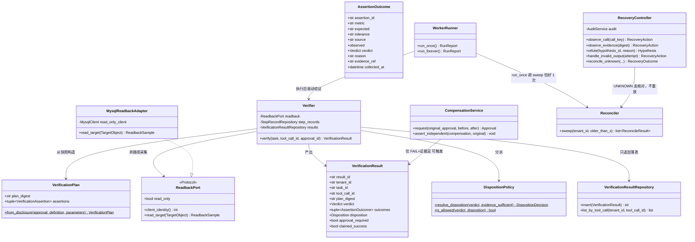
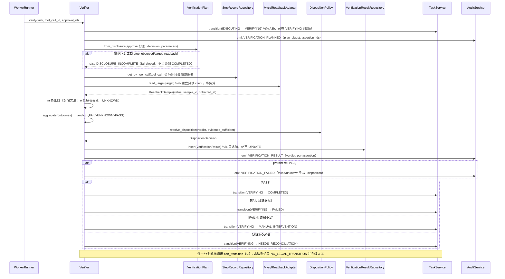
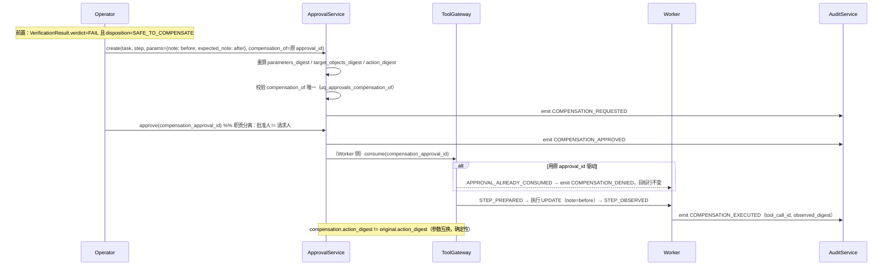
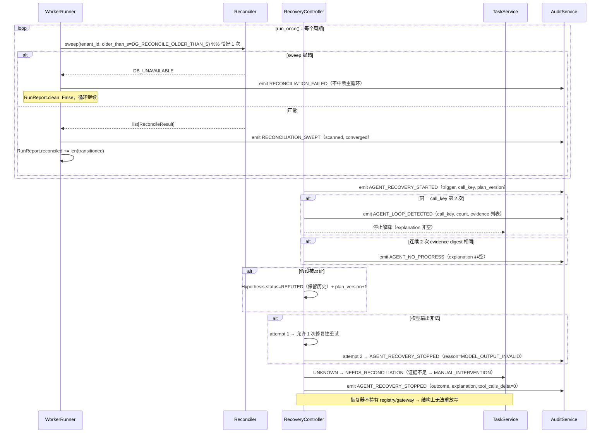

# W08 增量架构设计｜独立验证与恢复（单引擎 R2 修复闭环的安全收口）

- 依据：`docs/w08/01-prd.md`（207 行，P0×8 / P1×5 / P2×5，AC-01…AC-21）、主理人 Q1–Q8 裁定、`docs/w07/02-design.md:343-350`（三条断言）、`docs/w07/07-gate-review.md` GR-0
- 前置锚点：`tag w07-close` = **`c8a739ad9ff1dabdcf4908e353bb11baacd30075`**（实测 `git rev-parse w07-close`；提交链 `c8a739a → fe6135e → 7d284dc → d937b77 → 6176430`）
  > PRD `:10/:11/:186` 引用的 `7d284dc` 是**中间锚点**，非最终 tag；以 `git rev-parse w07-close` 为准。此项已回报 PM 校准 PRD，本设计不回改 PRD。
- 本周不新增：写工具 / 第二写动作 / PG 写路径 / API `execute`·`consume` 端点 / 前端 / 第三方依赖

---

## 0. 关键裁决（须先立，其余设计依此展开）

| # | 裁决 | 理由（可复核） |
|---|---|---|
| **A1** | `ReadbackPort` 采**窄接口**：`read_target(TargetObject) -> ReadbackSample`，`TargetObject` 只能由 `VerificationPlan` 从审批快照 `action_descriptor.target_objects` 构造，适配器再用**封闭白名单** `READBACK_TARGETS` 校验 `(database, table, key_column, column)`；**端口不接受 SQL 字符串、host、port、DSN** | 满足 AC-05 三条断言（`read_only is True`、`id != id(执行 client)`、无 SQL 入参）；延续 W07 `TargetProbePort` 口径，评审只需看一个协议 |
| **A2** | 采集通道**独立 client**（`read_only=True`、`autocommit=True`）、**执行事务之外**、**不复用** `step_observed.result`；每次返回带 `collected_at` 与 `sample_id` | 「异路径」必须能被 `id()` 与 `read_only` 断言，不能只靠注释；事务外才有意义（同事务读到未提交值等于自证） |
| **A3** | 任务出边：`PASS → COMPLETED`；`FAIL + 证据足 → FAILED`；`FAIL + 证据不足 → MANUAL_INTERVENTION`；`UNKNOWN → NEEDS_RECONCILIATION`；**任一路径均不得绕过 `can_transition`** | `core/tasks/state_machine.py:79-88` 中 `VERIFYING` 的合法出边为 `{COMPLETED, FAILED, NEEDS_RECONCILIATION, MANUAL_INTERVENTION, CANCEL_REQUESTED, TIMED_OUT}`——上述四条全部落在集合内，**无非法转换** |
| **A3b** | **W08 必须补 `EXECUTING → VERIFYING` 这一跳** | W07 执行成功后任务**停在 `EXECUTING`**（门禁件 §2.1 实证 `EXECUTING/v4`）；`state_machine.py:69-77` 允许 `EXECUTING → VERIFYING`，但当前无调用方 → W08 的 `Verifier` 入口负责推进，否则验证永远不触发 |
| **A4** | 判定**九格矩阵**定义为「`verdict` × `disposition` 的允许/拒绝」，而非「`verdict` × 证据充分性」 | PRD AC-12 要求「9 格逐格断言」且「`UNKNOWN→SAFE_TO_COMPENSATE` 抛 `POLICY_DENIED`」——只有 `3×3`（verdict×disposition）才自然构成 9 格；「证据充分性」退化为 `SAFE_TO_COMPENSATE` 的附加前置条件 |
| **A5** | `compensation_of` **不进 `action_digest`**；补偿与原动作的 digest 必然不同，因为 `note` / `expected_note` **互换** | 进摘要需升 `ACTION_DIGEST_VERSION` 并重算全部 W06/W07 冻结向量（ADR-0005 明令不建议）。改用「独立列 `approvals.compensation_of` + 唯一键 + 审计字段」保证不可混淆；digest 差异由参数互换**确定性**产生（同 `before` 两次构造必得同值） |
| **A6** | `MODEL_OUTPUT_INVALID` **不新增事件类型**，作为 `AGENT_RECOVERY_STOPPED.reason` 取值 + 错误码 | 主理人冻结「11 个事件、不得多也不得少」；`AGENT_LOOP_DETECTED` / `AGENT_NO_PROGRESS` 已存在于 `core/audit/events.py:69-70`，**复用不重建** |
| **A7** | 补偿复用 `mysql_lab_update_order_note` 本身（把 `note` 写回 `before`），**不新增写工具** | 补偿语义 = 「把该列置为某值」，与既有动作同型；新增工具将违反「不做第二种写动作」，且使 `tool_version` 必须升版 |

---

## 1. 实现方案与选型

### 1.1 三个技术难点与取舍

| 难点 | 取舍 |
|---|---|
| **怎么证明「不是自证」** | 不是靠约定而是靠**构造**：`Verifier.verify()` 形参只接受 `(plan, execution_evidence, params)`，`plan` 是 `extra="forbid"` 的 pydantic 模型，模型文本字段一注入即 `ValidationError`；`inspect.signature` 断言无 `model_output`/`llm`/`narrative` |
| **怎么证明「异路径」** | 采集端口对象与执行 client **必须是不同实例**（`id()` 断言），且 `read_only is True`；把 `step_observed.result` 改坏不影响 `target_readback` 判定 |
| **怎么做到「未知不重放」** | `RecoveryController` **结构上不持有 tool registry / gateway**（与 `core/execution/reconciler.py:1-8` 同款约束），只能读证据、写状态、发审计；恢复前后 `COUNT(tool_calls)` 不变由测试锁死 |

### 1.2 判定链（新增点标注 `＋W08`）

```
执行（W07 已有）
  → ＋W08  EXECUTING → VERIFYING（A3b，Verifier 入口）
  → ＋W08  从审批快照读 VerificationPlan（fail closed）
  → ＋W08  双路采集：step_observed（控制库只追加表）＋ target_readback（独立只读、事务外）
  → ＋W08  逐条断言 verdict ∈ {PASS,FAIL,UNKNOWN} → 汇总（最差）
  → ＋W08  持久化 VerificationResult（只追加）
  → ＋W08  disposition（九格矩阵）
  → ＋W08  出边：COMPLETED / FAILED / MANUAL_INTERVENTION / NEEDS_RECONCILIATION（A3）
```

### 1.3 `expected` 表达式：封闭文法，绝不 `eval`

W07 冻结的三条断言（`docs/w07/02-design.md:344-348`）形态为：`"1"`、`"$params.note"`、`"before==$params.expected_note && after==$params.note"`。W08 只支持**三种形式**，其余一律 `UNKNOWN(reason=EXPECTED_UNSUPPORTED)`（fail closed，且**不抛未捕获异常**，满足 AC-02）：

1. 字面量比较：`expected` 不含 `$params.` → 与 `observed` 按 `tolerance`（`exact`/`int`）比较；
2. 单占位：`^\$params\.[a-z][a-z0-9_]*$` → 用服务端解析出的参数值替换后比较；
3. 双等值合取：`^before==<expr> && after==<expr>$` → 拆成两个等值子句，**任一不成立即 FAIL**；子句内可含 `$params.*`。

占位符解析失败（参数缺失/非标量）→ 该断言 `UNKNOWN`，**绝不按字面量比较**。

---

## 2. 文件清单

### 2.1 新增

| 路径 | 职责 |
|---|---|
| `database/migrations/008_w08_verification.sql` | `verification_results` 只追加表 + `approvals.compensation_of`（可空、唯一） |
| `database/migrations/rollback/008_rollback.sql` | 逆操作（先删约束/索引，再删表/列） |
| `core/verification/__init__.py` | 包标记 + 导出面 |
| `core/verification/models.py` | `Verdict` / `Disposition` / `AssertionOutcome` / `VerificationPlan` / `VerificationResult` / `DispositionDecision`（全部 `extra="forbid"`） |
| `core/verification/plan.py` | `VerificationPlan.from_disclosure()`、`resolve_expected()`、`plan_digest()` |
| `core/verification/readback.py` | `ReadbackPort` Protocol、`TargetObject`、`ReadbackSample`、`READBACK_TARGETS` 白名单 |
| `core/verification/perf.py` | P50/P95（排序索引法，无第三方）、`WORKLOAD_SEQUENCE`、`claimed_success` 判定 |
| `core/verification/verifier.py` | `Verifier`（入口 `EXECUTING→VERIFYING`、双路采集、汇总、落表、出边） |
| `core/verification/disposition.py` | `resolve_disposition()`、`is_allowed()`（九格矩阵） |
| `core/verification/compensation.py` | `CompensationService`：补偿请求构造、独立性断言（`digest` 必不同、复用具名拒绝）；**不新增写工具** |
| `core/verification/repository.py` | `VerificationResultRepository`（只追加，`INSERT` only） |
| `core/recovery/__init__.py` | 包标记 |
| `core/recovery/models.py` | `Hypothesis`、`RecoveryAction`、`RecoveryOutcome`（含 `explanation`） |
| `core/recovery/controller.py` | `RecoveryController`（循环/无进展/反证/一次重试/UNKNOWN 核对；**不持有 registry/gateway**） |
| `adapters/mysql/readback.py` | `MysqlReadbackAdapter`（独立只读 client、事务外、白名单校验） |
| `tests/unit/test_verification_plan.py` | AC-01/02/03/04/09 |
| `tests/unit/test_verification_perf.py` | AC-06/07 |
| `tests/unit/test_compensation_contract.py` | AC-10/11（契约部分） |
| `tests/unit/test_disposition_policy.py` | AC-12 |
| `tests/unit/test_recovery_controller.py` | AC-13/14/15 |
| `tests/unit/test_worker_scheduler.py` | AC-17（`sweep` 恰好 1 次、抛错不中断） |
| `tests/unit/test_verification_determinism.py` | AC-21 |
| `tests/integration/test_w08_verifier_readback.py` | AC-05 |
| `tests/integration/test_w08_verifier_rejects.py` | AC-08 |
| `tests/integration/test_w08_compensation.py` | AC-10（集成部分） |
| `tests/integration/test_w08_recovery_e2e.py` | AC-16 |
| `tests/integration/test_w08_crash_matrix.py` | AC-18/19（7 个独立用例） |
| `docs/w08/08-drill-report.md` | 7 类注入演练报告 + 「可自动恢复 vs 必须人工介入」边界 |
| `docs/w08/07-gate-review.md` | W8→W9 门禁复核件（由架构师在门禁阶段产出，本设计不预写结论） |

### 2.2 修改

| 路径 | 改动 |
|---|---|
| `core/config.py` | 新增 `reconcile_interval_s` / `reconcile_older_than_s` / `verification_perf_samples`（见 §8.2） |
| `workers/runner.py` | `RunReport` 增加 `reconciled` 字段与 `merged`/`to_public_dict`/`clean` 同步；`run_once()` 内调用 `sweep()` **恰好 1 次**，抛错不中断 |
| `workers/stack.py` | 装配 `Verifier` / `MysqlReadbackAdapter` / `RecoveryController` / `Reconciler` 并注入 `WorkerRunner` |
| `core/tools/contracts.py` | `CompensationSpec` 增加 `to_public_dict()` 口径（`label` 禁含 `rollback`），**不改 `action_digest` 字段集** |
| `core/approval/repository.py` | 读写 `compensation_of`（新增可空列）+ 唯一键冲突映射为领域错误 |
| `core/approval/service.py` | `create()` 支持 `compensation_of`；对「复用原审批」路径保持既有拒绝（`APPROVAL_ALREADY_CONSUMED`） |

### 2.3 零改动清单（发现必须改须先回报，不得自行扩权）

- `core/gateway/*`（`tool_gateway.py` 的 8 步管线、`envelope.py`、`leases.py`）—— W08 只在 Gateway **之后**做验证，管线顺序不动
- `core/execution/step_records.py`（写一次语义）、`core/execution/reconciler.py`（**只加调度，不改 `sweep` 内部**）
- `core/security/*`（R2 恒拒绝策略）、`core/audit/worm.py`、`core/tasks/state_machine.py`（**不新增状态、不改边表**）
- `adapters/mysql/lab_repair.py` 的 `TOOL_NAME` / `ALLOWED_*` / `tool_version="1.0"` / 三条断言内容
- `database/migrations/006_*.sql` / `007_*.sql` 及其 rollback（W06/W07 冻结）
- `apps/api/**`（不加 `execute`/`consume`；不改 `deps.py` 的 `MysqlPrepareProbe`）
- `workers/discovery.py`、`core/worker/*`、`docker-compose.yml`（除 P1-W08-01 的 KD-2 处置，且须单列提交）

---

## 3. 数据结构与接口

### 3.1 关键签名（仅签名级）

```python
# core/verification/models.py
Verdict = Literal["PASS", "FAIL", "UNKNOWN"]
Disposition = Literal["SAFE_TO_COMPENSATE", "HUMAN_ADVICE_ONLY", "MANUAL_INTERVENTION"]

class AssertionOutcome(BaseModel):          # extra="forbid"
    assertion_id: str
    metric: str
    expected: str                            # 原始表达式（快照值，不重算）
    tolerance: str
    source: Literal["step_observed", "target_readback", "audit_event"]
    observed: str | int | None               # 实测值，非布尔；缺失为 None
    verdict: Verdict
    reason: str | None                       # EXPECTED_UNSUPPORTED / UNRESOLVED_PLACEHOLDER / READBACK_FAILED / ...
    evidence_ref: str | None
    collected_at: datetime

class VerificationPlan(BaseModel):           # extra="forbid"
    plan_digest: str
    assertions: tuple[VerificationAssertion, ...]
    @classmethod
    def from_disclosure(cls, approval, *, definition, parameters) -> "VerificationPlan": ...

class VerificationResult(BaseModel):         # extra="forbid"
    result_id: str
    tenant_id: str; task_id: str; tool_call_id: str
    plan_digest: str
    verdict: Verdict
    outcomes: tuple[AssertionOutcome, ...]
    disposition: Disposition | None
    approval_required: bool
    claimed_success: bool
    collected_at: datetime

# core/verification/plan.py
def resolve_expected(expected: str, parameters: Mapping[str, Any]) -> ResolvedExpected
def aggregate(outcomes: Sequence[AssertionOutcome]) -> Verdict        # 最差法：FAIL>UNKNOWN>PASS

# core/verification/readback.py
class TargetObject(frozen dataclass): database: str; table: str; key_column: str; key_value: int; column: str
class ReadbackSample(frozen dataclass): value: Any; sample_id: str; collected_at: datetime
class ReadbackPort(Protocol):
    @property
    def read_only(self) -> bool: ...
    def client_identity(self) -> int: ...
    def read_target(self, target: TargetObject) -> ReadbackSample: ...

# core/verification/verifier.py
class Verifier:
    def __init__(self, *, plan_source, readback: ReadbackPort, step_records,
                 results: VerificationResultRepository, tasks, audit, settings) -> None: ...
    def verify(self, task: Task, *, tool_call_id: str, approval_id: str) -> VerificationResult: ...
    # 形参中不存在 model_output / llm / narrative —— 由 AC-04 用 inspect.signature 锁死

# core/verification/disposition.py
def resolve_disposition(verdict: Verdict, *, evidence_sufficient: bool) -> DispositionDecision
def is_allowed(verdict: Verdict, disposition: Disposition) -> bool   # 九格矩阵

# core/verification/perf.py
def percentile(samples: Sequence[float], p: float) -> float          # 排序索引法
def evaluate_performance(samples: Sequence[float], *, baseline: float | None) -> PerfReport

# core/recovery/controller.py
class RecoveryController:                    # 不持有 registry / gateway / dsn
    def __init__(self, *, audit, tasks, *, max_duplicate_calls=2,
                 no_progress_threshold=2, max_repair_retries=1) -> None: ...
    def observe_call(self, call_key: str) -> RecoveryAction: ...      # CONTINUE / STOP_LOOP
    def observe_evidence(self, evidence_digest: str) -> RecoveryAction: ...  # CONTINUE / STOP_NO_PROGRESS
    def refute(self, hypothesis_id: str, *, reason: str) -> Hypothesis: ...   # status=REFUTED, plan_version+1
    def handle_invalid_output(self, attempt: int) -> RecoveryAction: ...      # 仅重试 1 次
    def reconcile_unknown(self, *, action_digest: str, idempotency_key: str,
                          target_objects: tuple, evidence_sufficient: bool) -> RecoveryOutcome: ...

# workers/runner.py（修改）
@dataclass(frozen=True)
class RunReport:
    cycles: int = 0; discovered: int = 0; executed: int = 0
    denied: int = 0; skipped: int = 0; failed: int = 0
    unknown_outcome: int = 0
    reconciled: int = 0        # ＋W08
```

### 3.2 九格矩阵（A4）

| `verdict` ＼ `disposition` | `SAFE_TO_COMPENSATE` | `HUMAN_ADVICE_ONLY` | `MANUAL_INTERVENTION` |
|---|---|---|---|
| `PASS` | 拒绝 | 拒绝 | 拒绝（PASS 无需处置） |
| `FAIL` | **允许**（且 `evidence_sufficient=True`，`approval_required=True`） | **允许** | **允许** |
| `UNKNOWN` | **拒绝 → `POLICY_DENIED`** | **允许** | **允许** |

默认分派：`FAIL+足 → SAFE_TO_COMPENSATE`；`FAIL+不足 → HUMAN_ADVICE_ONLY`；`UNKNOWN → MANUAL_INTERVENTION`（若核对未完成则先 `NEEDS_RECONCILIATION`）。

### 3.3 `classDiagram`



---

## 4. 时序图

### 4.1 主链：验证 → 判定 → 落表 → 出边



### 4.2 补偿：独立审批，不叫回滚



### 4.3 恢复 + 生产调度



---

## 5. 审计事件冻结表（11 条，W08 之后不得新增而不升版本）

> 命名统一：全大写下划线；`VERIFICATION_*` / `COMPENSATION_*` / `RECONCILIATION_*` / `AGENT_RECOVERY_*` 四族。
> `AGENT_LOOP_DETECTED`（`core/audit/events.py:69`）与 `AGENT_NO_PROGRESS`（`:70`）**已存在，复用不重建**；`RECONCILIATION_REQUIRED`（`:91`）为 W06 事件，保持不动。

| # | 事件 | 触发点 | 必备字段（payload） |
|---|---|---|---|
| 1 | `VERIFICATION_PLANNED` | `verify()` 入口、plan 构造成功后、采集前 | `task_id` `tool_call_id` `approval_id` `plan_digest` `assertion_ids[]` `assertion_count` `sources[]` |
| 2 | `VERIFICATION_RESULT` | 每次 `verify()` 结束（PASS/FAIL/UNKNOWN 均发） | `verdict` `outcomes[]{assertion_id,verdict,source,tolerance,has_observed}` `observed_digest` `collected_at` `plan_digest` `result_ids[]` |
| 3 | `VERIFICATION_FAILED` | `verdict != PASS` 时额外一条（便于按类型检索） | `verdict` `failed_assertions[]` `unknown_assertions[]` `disposition` |
| 4 | `COMPENSATION_REQUESTED` | 补偿审批创建成功 | `original_approval_id` `compensation_approval_id` `parameters_digest` `action_digest` `requested_by` |
| 5 | `COMPENSATION_APPROVED` | 补偿审批通过 | `compensation_approval_id` `original_approval_id` `approver_id` |
| 6 | `COMPENSATION_EXECUTED` | 补偿 `step_observed` 写入后 | `compensation_approval_id` `tool_call_id` `observed_digest` `outcome` |
| 7 | `COMPENSATION_DENIED` | 补偿被拒（含复用原审批、digest 不符、未审批） | `reason` `deny_code` `original_approval_id` `compensation_approval_id?` |
| 8 | `RECONCILIATION_SWEPT` | `sweep()` 单轮结束（结果为空也发） | `scanned` `converged` `conclusions[]{task_id,tool_call_id,conclusion}` `duration_ms` |
| 9 | `RECONCILIATION_FAILED` | `sweep()` 抛错（**不中断**主循环） | `error_code` `message_digest` `consecutive_failures` |
| 10 | `AGENT_RECOVERY_STARTED` | 恢复器接管（LOOP_DETECTED / NO_PROGRESS / UNKNOWN_OUTCOME 任一触发） | `trigger` `call_key` `plan_version` `evidence_count` |
| 11 | `AGENT_RECOVERY_STOPPED` | 恢复器结束 | `outcome`（`CONTINUE`/`STOP_LOOP`/`STOP_NO_PROGRESS`/`STOP_INVALID_OUTPUT`/`ESCALATE`）`reason`（含 `MODEL_OUTPUT_INVALID`）`explanation` `plan_version` `tool_calls_delta`（必须为 0） |

> 冻结口径：字段只增不改；`tool_calls_delta` 恒为 0 是「不重放」的**可断言证据**；`explanation` 恒非空是「停止得可解释」的可断言证据。

---

## 6. 有序任务列表（6 个，按依赖排序）

| ID | 任务 | 源文件 | 依赖 | 优先级 | 完成判据 |
|---|---|---|---|---|---|
| **T01** | 契约与模型：结果/断言/处置模型 + 契约与配置扩展 | `core/verification/{__init__,models}.py`、`core/tools/contracts.py`（`CompensationSpec.to_public_dict`，**不改 `action_digest` 字段集**）、`core/config.py`（3 项配置 + 校验） | — | P0 | 模型 `extra="forbid"`；`Verdict`/`Disposition` 枚举封闭；`N=0` 等越界抛 `REQUEST_INVALID`；`DG_RECONCILE_*` 越界被拒 |
| **T02** | 读回 + 判定 + 迁移 008：采集端口、封闭文法、九格矩阵、性能统计、只追加落表 | `database/migrations/008_w08_verification.sql`、`rollback/008_rollback.sql`、`core/verification/{plan,disposition,readback,perf,repository}.py`、`adapters/mysql/readback.py` | T01 | P0 | AC-01/02/03/04/05/06/07/09/12 全绿；迁移可升可回滚；`verification_results` 无 UPDATE/DELETE |
| **T03** | **状态推进与判定-executor**：`Verifier.verify()` 含显式 `EXECUTING→VERIFYING` | `core/verification/verifier.py` | T02 | P0 | AC-08 全绿；四种出边均过 `can_transition` |
| **T04** | 补偿：独立审批链 + 独立性断言 | `core/verification/compensation.py`、`core/approval/{repository,service}.py` | T03 | P0 | AC-10/11 全绿；复用原 `approval_id` 被拒且目标行不变 |
| **T05** | RecoveryController：循环/无进展/反证/一次重试/UNKNOWN 核对 | `core/recovery/{__init__,models,controller}.py` | T01、T03 | P0 | AC-13/14/15/16 全绿；`tool_calls` 零增长；`explanation` 恒非空 |
| **T06** | 生产调度 + 崩溃矩阵 + 演练报告 | `workers/{runner,stack}.py`、`tests/unit/test_worker_scheduler.py`、`tests/integration/test_w08_crash_matrix.py`、`docs/w08/08-drill-report.md` | T04、T05 | P0 | AC-17/18/19/21 全绿；`sweep` 恰好 1 次；7 类注入各自独立可定位 |

**关键路径**：`T01 → T02 → T03 → T04 → T06`，`T05` 在 `T03` 之后与 `T04` 并行汇入 `T06`。
**`EXECUTING → VERIFYING` 的位置（A3b，本次设计最重要的衔接点）**：由 **T03** 落实，调用方为 `Verifier.verify()` 的**第一步**（在读取 plan、任何采集之前）；时点为「执行侧 `step_observed` 已写入之后」；`task.status` 已是 `VERIFYING` 则**跳过**（幂等，不重复涨 `state_version`）；**推进失败或 Verifier 后续抛错** → `try/except` 内落 `NEEDS_RECONCILIATION`（`EXECUTING → NEEDS_RECONCILIATION` 合法，`state_machine.py:69-77`）并发 `VERIFICATION_FAILED(reason=VERIFIER_ERROR)`，**不得停留在 `EXECUTING` 让任务无声卡死**。**T03 必须先于 T05/T06 合入，否则端到端跑不通。**
**派工纪律**：`core/approval/service.py` 只由 T04 改；`workers/runner.py` 只由 T06 改；`core/verification/verifier.py` 只由 T03 改；不得并行编辑同一文件。

---

## 7. 依赖包（不新增）

```
无新增第三方依赖。沿用 requirements.lock.txt。
P50/P95 用标准库实现（排序 + 索引法），不引入 numpy/statistics 之外的包；
时间统一 core.utils.time.utc_now()；摘要统一 canonical_digest（ADR-0005）。
```

---

## 8. 共享约定

### 8.1 跨文件口径

| 主题 | 约定 |
|---|---|
| 判定来源 | `Verifier` 只接受 `(plan, execution_evidence, params)`；**任何**自然语言/模型字段不得进入签名或模型（`extra="forbid"`） |
| `observed` | 一律记录**实测值**（字符串/整数/None），**不得**只存布尔——布尔无法复核 |
| `verdict` 汇总 | `aggregate()` 最差法：任一 `FAIL`→`FAIL`；无 `FAIL` 有 `UNKNOWN`→`UNKNOWN`；全 `PASS`→`PASS`。顺序无关（按 `assertion_id` 排序后计算，保证确定性） |
| 一致性 | 同一 `tool_call_id` 重复 `verify()`，`verdict` 必须稳定（AC-21）；`observed` 可因数据变化而变 |
| 只追加 | `verification_results` / `step_prepared` / `step_observed` / `task_events` 一律 `INSERT` only；`dg_ctl` 不授予 `UPDATE`/`DELETE` |
| 补偿措辞 | 面向人字段（`label`/`description`/`report_text`）**禁含** `rollback`（大小写不敏感）；统一用「补偿」 |
| 事务边界 | 回读必须**在执行事务之外**；不得在同一事务内读到自己未提交的写入 |
| 错误码 | 新增 `DISCLOSURE_INCOMPLETE` 复用既有；新增 `POLICY_DENIED`（处置矩阵拒绝）、`READBACK_TARGET_NOT_ALLOWED`、`REQUEST_INVALID`（`N=0` 等参数越界） |

### 8.2 新增配置（`core/config.py`）

| 键 | 默认 | 校验 |
|---|---|---|
| `DG_RECONCILE_INTERVAL_S` | `60` | `gt=0, le=3600` |
| `DG_RECONCILE_OLDER_THAN_S` | `60` | `gt=0, le=3600` |
| `DG_VERIFICATION_PERF_SAMPLES` | `5` | `ge=1, le=50`（`N=0` 抛 `REQUEST_INVALID` 由调用侧校验） |

`model_provider` 三态（`fake`/`openai_compat`/`disabled`）保持不变；Worker 不装配 `ModelGateway`。

### 8.3 T06 生产调度边界（主理人裁定 4 条 + 2 条澄清）

| # | 裁定 | 落点 / 依据 |
|---|---|---|
| 1 | `RunReport.reconciled` **必须同时改 3 处**：字段声明、`merged()` 逐字段累加、`to_public_dict()` | 均在 `workers/runner.py` 内；**漏 `merged()` 会让 `run_forever` 静默丢计数**，属必修项。`workers/cli.py:117` 直接 `payload.update(...)`，故 cli 不用改 |
| 2 | **`clean` 不含 `reconciled`**，退出码语义不变：`0` 干净 / `1` 失败·拒绝·未知·在途未收敛 / `2` 配置或自检失败 | `workers/cli.py:242/252` 用 `report.clean and outstanding == 0` 判退出码。成功收敛历史残留是**正常运维结果**，不得让退出码变 1。新增单测断言「`reconciled>0` 且无失败时 `run_once()` 返回 0」；`test_worker_runner.py::test_run_report_clean_semantics` 同步 |
| 3 | `reconciled = sum(1 for r in sweep() if r.transitioned)`（**实际发生状态迁移/落账的条数**） | `ReconcileResult.transitioned`（`core/execution/reconciler.py:41`）。候选数另设 `reconcile_scanned`（可选，仅进日志），**不得与 `len(results)` 混用** |
| 4 | **授权改 `workers/stack.py`**：由 `WorkerStack` 暴露 `reconciler` 字段，**runner 不得自建** | 组合根是唯一可持依赖的层；`Reconciler(step_records, task_repository, audit)`（`:63-71`）三个依赖 stack 已有。`tests/unit/test_worker_layering.py` 增断言「`Reconciler(` 在 `workers/` 内只出现在 `stack.py`」，与 `ToolGateway(` / `build_lab_stack(` 同款守卫 |
| 5 | **对外可观测变化**：CLI JSON 输出新增 `reconciled` 键 | 登记进发布说明；既有键名/类型不变，属新增键而非破坏性变更 |
| 6 | 澄清：`DG_RECONCILE_OLDER_THAN_S=60` **已在 T01 落地**（§8.2），T06 只读取配置 | 不为 T06 临时加配置项；`core/config.py` 属 T01 文件，不在零改动清单 |

---

## 9. 风险与待明确

| # | 风险 / 待明确 | 处置（本设计的默认决策） |
|---|---|---|
| R1 | 「证据充分」无客观阈值 → `HUMAN_ADVICE_ONLY` 与 `SAFE_TO_COMPENSATE` 边界漂移 | 定为**可判定的三条件合取**：① 三条断言中 `FAIL` 的断言 `observed` 非 `None`；② `step_observed` 行存在；③ `target_readback` 成功（`sample_id` 非空）。任一不满足 → `evidence_sufficient=False`。**不做打分** |
| R2 | 补偿与原动作共用工具，可能被误读为「同一动作重复执行」 | `approvals.compensation_of` 唯一键 + `COMPENSATION_*` 三事件 + `is_rollback=False` 三重区分；测试覆盖「换 `before` 值 → digest 变 / 同 `before` 两次 → digest 同」 |
| R3 | `sweep` 每周期扫全表可能拖慢 Worker | 分页 500（`reconciler.py:83`）+ `older_than_s` 窗口；`RECONCILIATION_SWEPT` 记 `duration_ms`；不做并发扫描（单 Worker 串行） |
| R4 | `EXECUTING → VERIFYING` 由 Verifier 推进，若 Verifier 抛错则任务卡在 EXECUTING | 出边推进置于 `try/except` 内：Verifier 内部异常 → 落 `NEEDS_RECONCILIATION`（`EXECUTING → NEEDS_RECONCILIATION` 合法，`state_machine.py:69-77`），并发 `VERIFICATION_FAILED(reason=VERIFIER_ERROR)` |
| R5 | 七类崩溃用例需要可控注入点，改动生产代码易引入风险 | 注入通过**现有接缝**：`context_factory`、`LeaseService`、`step_records`、`WorkerRunner` 的 stack 依赖；**不为测试加生产分支** |
| R6 | P1 四项是否会挤占 P0 | Q8 已裁「不进门禁」；T01–T06 不含 P1 工作，P1 单独立项，不占关键路径 |
| R7 | W07 冻结件缺件（KD-5）导致 W08 门禁无「上一周期冻结四件套」可比对 | 门禁复核时以 `tag w07-close`（`c8a739ad`）+ `docs/w06/05-freeze.md` 为替代锚点，并在 `07-gate-review.md` 显式登记该替代关系 |

---

## 10. W07 遗留登记（不阻断，已在 W08 承接）

| # | W07 交接项 | 状态 | W08 落点 |
|---|---|---|---|
| 1 | Reconciler 落账（`sweep()` 仅测试调用） | **开放** | **P0-W08-07** / T06 / AC-17 |
| 2 | KD-2 `tool_gateway` 占位服务与实现相反 | **开放**（按指令本轮保留） | **P1-W08-01** |
| 3 | prepare probe 迁出评估（`MysqlPrepareProbe` 依赖 LAB 网络） | **开放**（仅 ADR，**不摘网**） | **P1-W08-02** |
| 4 | Docker 容器运行态实跑（NV-1 补偿） | **开放** | **P1-W08-03** |
| 5 | W07 冻结件缺件（`05-freeze.md` / `06-conformance-audit.md`） | **开放**（KD-5） | **P1-W08-04** |

> 本表 **5 项**均与 W07 门禁结论「有条件放行」一致；**W08 不因此表重启 W07 门禁**。
> 原拟登记的第 6 项「W07-GR-1（门禁件提交方式仅描述目录形式）」经主理人裁定**撤回登记**：实测 tag `w07-close` 内 `docs/w07/07-gate-review.md:146` 已为「首次入库 `d937b77` 采用目录形式；后续追加提交按裁定改为逐路径 `git add -- <路径>`，禁用 `-A`/`-u`/目录形式」，`grep -c 逐路径` = **1**，内部自洽，**不构成遗留**。
