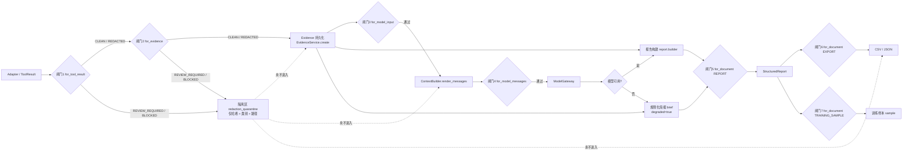
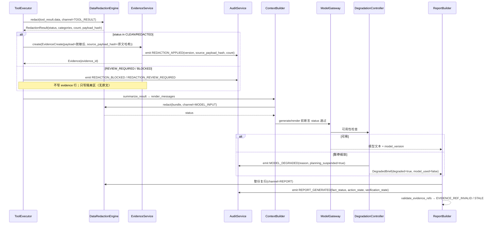
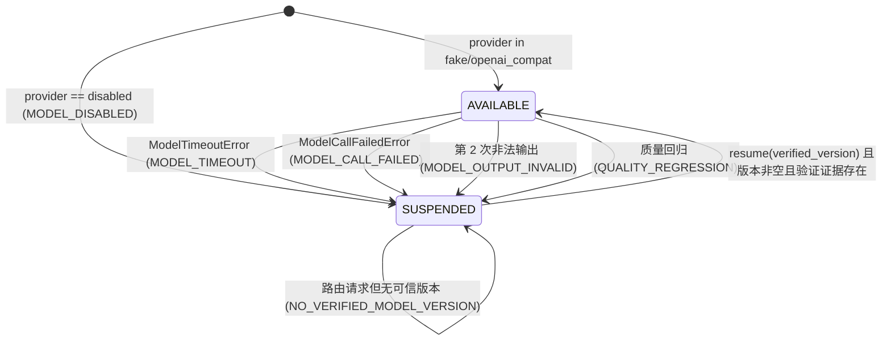
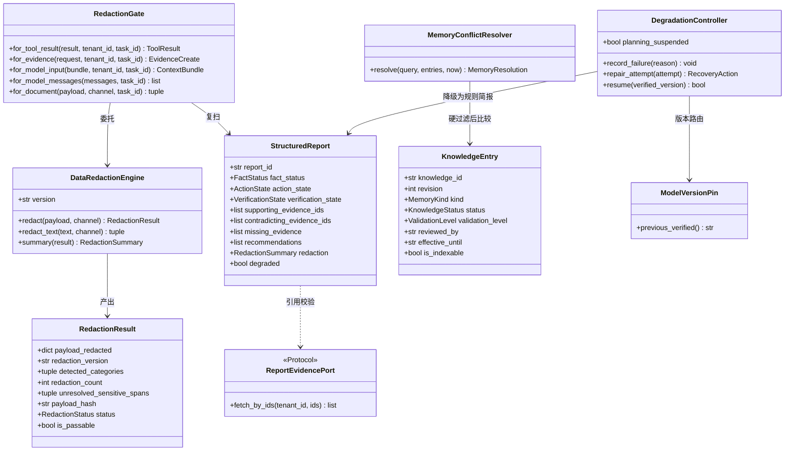

# W09 增量架构设计｜报告、脱敏与记忆（让每一份进入模型/证据/报告/记忆的数据先脱敏）

- 依据：`docs/w09/01-prd.md`（209 行，P0×6 / P1×3 / P2×3，AC-01…AC-21）、`docs/w08/02-design.md`（§5 事件冻结写法）、`docs/w08/07-gate-review.md`（GR-0「有条件放行」+ §4 KD-1…KD-5 + §8 承接清单）
- 前置锚点：W08 门禁结论为**「有条件放行」**（`docs/w08/07-gate-review.md:10-27`），本设计**不以「W08 已通过」为前提**；W09 门禁不得替代 W08 门禁证据
- 本周不新增：第三方依赖 / 第二个写动作 / PostgreSQL 写路径 / PG 可连假设 / 前端 / API 新端点
- 环境前提（设计必须成立）：PG 5432 拒绝（`docs/w08/07-gate-review.md:75`）、`DG_ADMIN_DSN` root 1045 不可用（`:76`）、控制库 830+ 历史行清不掉（`:77`）→ **所有测试用离线替身；DB 相关用例只 INSERT，不依赖 admin 清理，不依赖 PG**

---

## 0. 关键裁决（先立，其余依此展开）

| # | 裁决 | 理由（可复核） |
|---|---|---|
| **A1** | 脱敏采**双强制闸门 + 五处复扫**：强制闸门 = 进 Evidence 前、进模型前；报告/导出/训练样本**各自重新扫描**（不复用上游结果）；工具结果在 Executor 汇聚点另设闸门（§1.2 闸门1） | PRD G1 判定口径是「五条通道入口断言 `redaction_result.status`」（`01-prd.md:26`）；只在前端显示时脱敏无法满足任何入口断言，且 `evidence`/`task_events` 只追加、`dg_ctl` 无 DELETE（`docs/w08/02-design.md:481`）——原文一旦入库即永久留存 |
| **A2** | **`payload_hash` 三列分工**：`payload_hash` = 写入载荷（`payload` 列）的哈希（既有不变量不变）；**新增 `source_payload_hash`** = 脱敏前原文哈希（引擎给出）；`redacted_payload_hash` = 脱敏后哈希。落库映射**固定**为 `evidence.source_payload_hash = RedactionResult.payload_hash`、`evidence.payload_hash = canonical_payload_hash(evidence.payload)` | PRD P0-01.2 要求 `payload_hash` 对**脱敏前**载荷计算（`01-prd.md:65`），但 `EvidenceService.create` 现按 `request.payload` 计算（`core/evidence/service.py:92`），且既有集成用例断言 `evidence.payload_hash == canonical_payload_hash(request.payload)`（`tests/integration/test_evidence_service.py:98`）。二者直接冲突 → 用**新列承载原文锚点**，既有列语义零漂移。**命名冲突警告**：`RedactionResult.payload_hash`（原文）与 `evidence.payload_hash`（写入载荷）同名不同义，**禁止**把前者直接写进后者。差异作为「PRD 字面口径校准」登记于 §11，回报 PM，本设计不改 PRD |
| **A3** | `RedactionResult.status` **封闭四值**：`CLEAN` / `REDACTED` / `REVIEW_REQUIRED` / `BLOCKED`；判定按**优先级** `BLOCKED > REVIEW_REQUIRED > REDACTED > CLEAN`，不按命中顺序 | 同一载荷可能同时命中「私钥（BLOCKED）」与「手机号（REDACTED）」；优先级法保证判定与规则顺序无关（AC-02 确定性要求） |
| **A4** | 报告有**两组六态 + 一组三态**：`FactStatus`（事实等级，6 值）/ `ActionState`（动作执行，6 值）/ `VerificationState`（验证，3 值，镜像 W08 `Verdict`） | PRD 同时要求「六态互不等价」（AC-09，`:139`）、「结论 `status != CONFIRMED`」（AC-10，`:140`）、「含 `STALE`」（AC-12，`:142`）、「建议/未执行/等待审批/已执行/结果未知/已验证」（P0-03.1，`:82`）——这是**两类**互不推导的语义，硬塞进一个枚举必然出现「已执行 = 已验证」的推导漏洞 |
| **A5** | 五类记忆**存储分工**：`Working` 只存进程内（不落库）；`Episodic` 是 `task_events`+`evidence` 的**只读投影**；`Semantic`/`Procedural`/`Environment` 落 `knowledge_entries`（只追加）；**只有 `Semantic` 可进正式索引** | PRD G3（`:28`）「只有 Semantic 类经 reviewed_by + validation_level + 有效期校验后才可进入正式索引」；新增 5 张表纯属过度设计，且 Episodic 的事实源已在控制库 |
| **A6** | `Reconciler.sweep()` **签名与返回类型不变**（仍返回 `list[ReconcileResult]`）；新增 `sweep_detailed()` 返回 `SweepReport(scanned_total, conclusions, scanned_tenants)`；`runner` 优先用 `sweep_detailed`，无该属性时回落 `sweep()` | 7 处集成调用点对返回值的用法已冻结：`len(results)`、`results[0]`、**`results == []`**（`tests/integration/test_step_prepared.py:155/181/210-211/384/534`、`test_w06_acceptance.py:996/1049`）。改成 dataclass 会让 `== []` 直接红，违反「不得破坏 W08 既有断言」（`01-prd.md:109`） |
| **A7** | `reconcile_interval_s` **生效为跨周期节流**（两次 sweep 的最小间隔），时钟可注入；替身/历史栈按 `0.0` 缺省 → 不节流 | KD-4（`docs/w08/07-gate-review.md:68`）要求「明确语义或删除」。删除会破坏配置契约；节流让配置项名副其实，且 `getattr(settings, "reconcile_interval_s", 0.0)` 的缺省值保证 W08 冻结用例（3 轮 3 次 sweep）逐字不变 |
| **A8** | `RunReport` **新增 `reconcile_failed`**，其口径是 `failed` 的**子集**；`failed` 语义保持不变（仍含核对失败） | W08 冻结断言 `report.failed == 1`（`tests/unit/test_worker_scheduler.py:402`）不可改；同时 KD-5（`:69`）要求核对失败可单独观测。子集口径同时满足二者，W12 若需彻底拆分再升报告版本 |
| **A9** | `model_provider="disabled"` 由 `build_model_gateway` 返回 `DisabledModelGateway`（**不再抛 `ConfigError`**）；「路由回前一验证版本」实现为 `ModelVersionPin` 机制，但当前 `model_commit=null`（`benchmarks/baseline_v0/baseline_manifest.json:6`）**没有合法回滚目标** → 路由结果恒为 `None`，降级态=`规则简报 + 暂停规划` | 现状 `core/models/factory.py:28-32` 对 `disabled` 抛 `ConfigError`，即「配置了禁用态反而起不来」——与 AC-16（`01-prd.md:146`）直接矛盾；Q7 明确「不得凭空指定模型版本」（`:179`） |
| **A10** | W09 事件表在 W08 冻结 11 条基础上**新增 6 条**（`REDACTION_APPLIED` / `REDACTION_BLOCKED` / `REDACTION_REVIEW_REQUIRED` / `MODEL_DEGRADED` / `REPORT_GENERATED` / `KNOWLEDGE_REVOKED`），W08 的 11 条**字段只增不改** | AC-06/AC-18 点名 `REDACTION_BLOCKED`、`MODEL_DEGRADED`（`:136/:148`）；AC-08 需要事件侧脱敏版本与证据行对齐；知识撤销需可按事件检索 |

---

## 1. 实现方案总览

### 1.1 三个技术难点与取舍

| 难点 | 取舍（结论，不是选项） |
|---|---|
| **「脱敏」怎么证明是真脱敏，而不是声明** | 现状是**声明式假脱敏**：`core/diagnosis/evidence_mapping.py:117-118` 把**原始** payload `deepcopy` 进 `redacted_payload`，`payload = _payload(result)`（`:98`）仍是工具原文，却把 `redaction_version` 写成 `tool-redaction-v1`（`:23`）。W09 的取舍：**脱敏结果必须由引擎产出且可复算** —— 证据行同时落 `source_payload_hash`（原文哈希，引擎给出）与 `redacted_payload_hash`（= `canonical_payload_hash(payload)`，任何人可复算）；闸门断言 `status ∈ {CLEAN, REDACTED}`，否则不写行、不发模型。**禁止**「版本号写了就算脱敏」 |
| **报告事实与 `evidence_id` 的引用完整性** | 不靠约定，靠**先取后判**：报告构建前用 `ReportEvidencePort` 按 `(tenant_id, evidence_ids)` 批量取回证据行（跨租户取不到 ⇒ 与不存在同码 `EVIDENCE_REF_INVALID`，沿用 `core/evidence/repository.py:126-136` 的「不泄漏存在性」口径），再逐条做**三查**（归属 / 环境 / 采集状态），任何一项不过就降级 `FactStatus` 并把 id 塞进 `missing_evidence`。**弱证据不得升格**是模型层校验器，不是调用方自觉 |
| **五类记忆的硬过滤先于相似度** | 结构上**没有相似度**：`MemoryConflictResolver` 的输入是**已硬过滤**的候选集，比较只用「证据等级 / 证据条数 / 生效时间 / knowledge_id 字典序」四个确定序。引擎、主版本、Adapter、能力、环境、风险、状态、有效期 8 道过滤按固定顺序短路，任一不过即排除，**不参与后续比较**——因此「PostgreSQL 的知识在 MySQL 任务上被文本相似度捞出来」在代码路径上不可达（AC-14） |

### 1.2 七条通道与七道闸门（闸门5/6/7 复用 `for_document`，按 `channel` 区分）



> 三个**内部**通道（`StepPrepared.request` / `StepObserved.result` / `TrajectoryRecorder`）不属于七条对外通道，但**脱敏强度不同，须分别认定**（①② 合并登记为**已知限制 `KD-W09-03`**，W10 再议）：① `StepPrepared.request` 由 `ToolExecutor._prepare_step` 在工具执行**前**写入，当时引擎判定尚不存在，只经 `redact_payload`（仅键名+两条正则，`core/audit/events.py:26-36`、`core/logging.py:12-17`），故**非敏感键名下的 PII 可能原样落盘**；② `TrajectoryRecorder.record` / `TrajectoryRecorder.finish`（`usage`）只追加「`BLOCKED` 时整条事件置 `{"redaction": "BLOCKED"}`、原文零残留」，**不接管 `REDACTED` / `REVIEW_REQUIRED` 的改写**（`scan_event` 返回的 `payload_redacted` 对非 `BLOCKED` 状态不采用），同样存在 PII 原样落盘面（含 `customer_name` 这类 R05 键）；③ `StepObserved.result` 位于闸门① **之后**（`ToolExecutor.execute` 内先调 `for_tool_result`、再调 `_observe_step`，当前快照 `:251` / `:259`），内容已由引擎兜住或置空，**不属本限制**。W09 **不替换**该审计链路（PRD `01-prd.md:38` 明确 `redact_payload` 保持不变），只在轨迹落盘前追加引擎扫描（`TrajectoryRecorder.record`，当前快照 `core/agent/trajectory.py:91`）。

### 1.3 主链时序：先证据后模型，降级不越权



---

## 2. 脱敏引擎

### 2.1 `RedactionResult`（`extra="forbid"`，PRD P0-01.2）

| 字段 | 类型 | 语义 / 约束 |
|---|---|---|
| `payload_redacted` | `dict[str, Any]` | 脱敏后载荷；结构与入参**同形**（缺键即缺陷，不做截断删除） |
| `redaction_version` | `str` | 规则集版本，本周期**默认 `redaction-v2`（常量 `RS_REDACTION_V2`）**；`redaction-v1`（`RS_REDACTION_V1`）仅保留给历史数据库行与既有审计口径引用、**不得删除或改写历史值**；**不得为 `none`** |
| `detected_categories` | `tuple[SensitiveCategory, ...]` | 按枚举声明序去重排序（非命中顺序），空元组允许 |
| `redaction_count` | `int`（`ge=0`） | 全部规则 `subn` 返回的替换次数之和，跨 5 轮恒定（AC-02） |
| `unresolved_sensitive_spans` | `tuple[SensitiveSpan, ...]` | 仅记录**未能替换**的命中；`SensitiveSpan = {category, json_path, start, end, reason}`，按 `(json_path, start, category)` 排序 |
| `payload_hash` | `str`（64 hex） | **脱敏前**原文哈希 = `sha256(canonical_payload_text(payload))`。⚠ 与 `evidence.payload_hash`（写入载荷哈希）**同名不同义**，落库只允许进 `evidence.source_payload_hash`（见 §0 A2） |
| `status` | `Literal["CLEAN","REDACTED","REVIEW_REQUIRED","BLOCKED"]` | 见 §2.3 判定 |
| `blockers` | `tuple[str, ...]` | 结构性阻断原因（`BINARY_LEAF` / `UNKNOWN_ENCODING` / `SCAN_SIZE_EXCEEDED` / `DEPTH_EXCEEDED`），与 12 类正交 |

**为什么 `blockers` 不并进 `detected_categories`**：AC-01 要求「12 类逐类命中」可枚举；把「二进制/超深嵌套」混进类别集合会让 12 类基线不可判（类别数漂移）。二者正交，测试可分别断言。

`payload_redacted_hash` **不进** `RedactionResult`（它是证据层产物）：由 `EvidenceService.create` 用 `canonical_payload_hash(request.payload)` 计算（`core/evidence/service.py:93-95` 现有逻辑不动）。

### 2.2 12 类敏感类别与检测规则（`core/redaction/rules.py`）

顺序固定为下表行序（`R01→R12`），**每类对每个字符串叶子只扫一遍，不回溯**。

| # | `SensitiveCategory` | 检测规则（正则/结构判定） | 替换产物 | 判定 |
|---|---|---|---|---|
| R01 | `SQL_LITERAL` | `'(?:[^'\\]|\\.|'')*'` 与 `"(?:[^"\\]|\\.)*"`（SQL 字面量）；**排除**纯数字/`NULL`/`TRUE`/`FALSE`（长度判定：`len(body) < 8` 或 `fullmatch(r"-?\d+(\.\d+)?")`） | `'<L:sha8>'`（长值保留相关性），短值/数字形态不替换 | `REDACTED` |
| R02 | `PHONE` | `(?<!\d)1[3-9]\d{9}(?!\d)` + 分隔符变体 `(?<!\d)1[3-9]\d[ -]?\d{4}[ -]?\d{4}(?!\d)` | `<PHONE:sha8>` | `REDACTED` |
| R03 | `EMAIL` | `[A-Za-z0-9._%+\-]+@[A-Za-z0-9.\-]+\.[A-Za-z]{2,}` | `<EMAIL:sha8>` | `REDACTED` |
| R04 | `ID_CARD` | `(?<!\d)\d{17}[\dXx](?!\d)` + **GB 11643 校验位**（mod 11-2） | 校验通过 `<ID:sha8>`；校验失败 → 记 span、不替换 | 通过→`REDACTED`；失败→`REVIEW_REQUIRED` |
| R05 | `PERSON_OR_BUSINESS_ID` | 键名判定**两组**（复用 `normalize_key()` 归一化，同 `core/audit/events.py:112-119` 口径）：**A 组精确匹配 1 项**（归一化后相等才命中）`NAME_EXACT_KEYS = frozenset({"name"})`；**B 组受限子串 13 项** `NAME_KEY_MARKERS` = 姓名、联系人、商户号、`owner_name`、`real_name`、`order_no`、`biz_id`、`customer_id`、`user_name`、`customer_name`、`display_name`、`account_name`、`full_name`（词表归一化后子串匹配，**不含裸 `name`**）；**无元数据白名单**（精确匹配已使 `ToolResult` 15 个顶层字段与 `name_field` 全 `False`，不再维护闭集）；纯键名函数、不读值、无启发式 → 满足 AC-02 五轮确定性。或值匹配 `^[A-Z]{2,6}\d{6,}$` | `<NAME:sha8>` / `<BIZ:sha8>`；**键名命中优先于值匹配**：键名命中（A 组精确或 B 组子串）产出 `<NAME:sha8>`；`<BIZ:sha8>` 仅用于**键名未命中**而值匹配 `^[A-Z]{2,6}\d{6,}$` 的情形（对应 `engine.py:412-414` 的 `token = "<NAME:…>" if is_name_key(key) else "<BIZ:…>"`）。 | `REVIEW_REQUIRED`（替换后仍需人工确认语义） |
| R06 | `CONNECTION_STRING` | `(?i)\b(mysql|mariadb|postgres(?:ql)?)(?:\+\w+)?://[^\s"'<>]+` | **不做可用化改写**：插入固定 `<BLOCKED:CATEGORY>` 占位（`CATEGORY` ∈ `CONNECTION_STRING` / `PRIVATE_KEY` / `CERTIFICATE`，取 `SensitiveCategory` 类别值）抹除原串，**占位不计入 `redaction_count`**；原串仅以 `SensitiveSpan` 定位信息保留（`json_path/start/end`），不落任何原值。（本行即 `<BLOCKED:CONNECTION_STRING>`） | `BLOCKED` |
| R07 | `USERNAME_PASSWORD` | `(?i)\b(user(?:name)?|uid|account|登录名)\s*[:=]\s*[^\s,;&}]+` 且同一叶子内出现 `(?i)(password\|passwd\|pwd)\s*[:=]` | 两者值均 → `<CREDENTIAL>` | `REDACTED` |
| R08 | `TOKEN` | `(?i)\b(bearer)\s+[A-Za-z0-9._\-]{8,}`、`\beyJ[A-Za-z0-9_\-]{10,}\.[A-Za-z0-9_\-]{10,}\.`（JWT）、`(?i)\b(token\|session[_\-]?id)\s*[:=]\s*[A-Za-z0-9._\-]{8,}` | `<TOKEN>` | `REDACTED` |
| R09 | `API_KEY` | `(?i)\b(api[_\-]?key\|access[_\-]?key\|secret[_\-]?key\|appkey\|x-api-key)\s*[:=]\s*[A-Za-z0-9/\+_\-]{8,}`、`\bAKIA[0-9A-Z]{16}\b` | `<API_KEY>` | `REDACTED` |
| R10 | `PRIVATE_KEY` | `-----BEGIN [A-Z ]*PRIVATE KEY-----[\s\S]*?-----END [A-Z ]*PRIVATE KEY-----` | **不做可用化改写**：插入固定 `<BLOCKED:CATEGORY>` 占位（`CATEGORY` ∈ `CONNECTION_STRING` / `PRIVATE_KEY` / `CERTIFICATE`，取 `SensitiveCategory` 类别值）抹除原串，**占位不计入 `redaction_count`**；原串仅以 `SensitiveSpan` 定位信息保留（`json_path/start/end`），不落任何原值。（本行即 `<BLOCKED:PRIVATE_KEY>`；触发原因：长度与结构超限） | `BLOCKED` |
| R11 | `CERTIFICATE` | `-----BEGIN CERTIFICATE-----[\s\S]*?-----END CERTIFICATE-----` | **不做可用化改写**：插入固定 `<BLOCKED:CATEGORY>` 占位（`CATEGORY` ∈ `CONNECTION_STRING` / `PRIVATE_KEY` / `CERTIFICATE`，取 `SensitiveCategory` 类别值）抹除原串，**占位不计入 `redaction_count`**；原串仅以 `SensitiveSpan` 定位信息保留（`json_path/start/end`），不落任何原值。（本行即 `<BLOCKED:CERTIFICATE>`） | `BLOCKED` |
| R12 | `LOG_FIELD` | 键名归一化命中 `password\|passwd\|pwd\|secret\|token\|dsn\|authorization\|apikey\|credential`（与 `core/audit/events.py:26-36` 同一词表，**共享常量**避免漂移；**R12 仍用子串法，不随 R05 的两组口径调整**） | 整值 `<REDACTED:LOG_FIELD>` | `REDACTED` |

**「无法可靠脱敏」的判定条件（闭集，三选一即成立）**
1. 命中 R06/R10/R11（连接串/私钥/证书）：替换会破坏结构或留下可用残余 → `BLOCKED`；`BLOCKED` **不等于原样外发**：`payload_redacted` 必须已抹除原串并以 `<BLOCKED:CATEGORY>` 占位，否则 AC-01「脱敏后不含原串」不成立；`redaction_count` 只统计可替换规则的 `subn` 次数，BLOCKED 三类不计入。
2. 字符串叶子存在非 JSON 原生类型（`bytes`/`bytearray`/`memoryview`）或解码失败 → `BLOCKED` + `blockers=(BINARY_LEAF|UNKNOWN_ENCODING,)`；
3. 嵌套深度 > `MAX_REDACTION_DEPTH=12`、叶子数 > `MAX_REDACTION_ITEMS=5000`、扫描文本 > `MAX_SCAN_CHARS=200_000` → `REVIEW_REQUIRED` + `blockers=(DEPTH_EXCEEDED|SCAN_SIZE_EXCEEDED,)`（**不截断**：截断等于静默丢弃敏感内容）。

`re.sub` 的 `count` 上限取 `MAX_REDACTION_ITEMS`，所有量词为有界/线性形态（禁止嵌套回溯），**不引入 `regex` 包**（无三方依赖）。

**已知限制 KD-W09-02｜嵌套裸 `name` 会命中 A 组精确规则（fail-closed，本周接受）**

- **现象**：载荷中出现**嵌套的裸 `name` 键**（如合成载荷 `definition.name`）会命中 A 组精确规则 → `status=REVIEW_REQUIRED` + 该值被 `<NAME:sha8>` 掩码。
- **定性**：属 **fail-closed（保守降级，不泄露原文）**。代价是可用性降级，与「欠脱敏」不同级，**不判缺陷、不计回归失败**。
- **影响面**：`ToolResult.model_dump()` 顶层 15 字段**不含** `definition`，已逐一核实这 15 个字段与 `name_field` 的 `is_name_key()` 均为 `False`；上述样例是合成载荷，不是闸门① 的实际输入。
- **本周不引入路径感知**：`json_path` 白名单需长期维护「哪些路径下的 `name` 是系统标识」的闭集，且会再触发一轮 `redaction_version` 升级 + QA 复验，收益不匹配。`is_name_key("name") is True` **保持不变**（不加值形态判定、不加启发式，AC-02 五轮确定性不受影响）。
- **规避手段（T02 组合层纪律，不是引擎规则）**：`ToolResult.data` / `source_metadata` **只放业务键值**，不得把 `ToolDefinition` / `TargetObjectSpec` 等契约对象 `model_dump()` 整包塞进待脱敏载荷；契约对象如需传递，走结构化字段而非序列化进 `data`。
- **升级路径**：若 W10 出现真实误判，再以「闭集 `json_path` 白名单 + 升 `redaction_version` + 补回归断言」处理；本周不预判其形态。

### 2.3 `status` 判定（优先级法，实现为一次 `max()`，不依赖规则顺序）

```
BLOCKED          ← 任一 R06/R10/R11 命中，或 blockers 含 BINARY_LEAF / UNKNOWN_ENCODING
REVIEW_REQUIRED  ← 命中 R05，或 unresolved_sensitive_spans 非空，或 blockers 非空
REDACTED         ← 有替换发生（redaction_count > 0）且未升级为上面两态
CLEAN            ← 无替换、无 span、无 blocker
```

**不变量（测试可断言）**：`status == REDACTED` ⇒ `redaction_count > 0 ∧ unresolved_sensitive_spans == ()`；`status ∈ {REVIEW_REQUIRED, BLOCKED}` ⇒ `unresolved_sensitive_spans 非空 ∨ blockers 非空`。

### 2.4 确定性（AC-02）

| 维度 | 冻结做法 |
|---|---|
| 载荷序列化 | 唯一入口 `core/redaction/payload_text.py::canonical_payload_text(payload)` = `json.dumps(payload, sort_keys=True, ensure_ascii=False, separators=(",", ":"), default=str)`。`core/evidence/service.py::canonical_payload_hash` 改为**委托**该函数（保持向后兼容导出），全仓仅一份实现 |
| 规则顺序 | 固定 `R01..R12` 表序；类别集合按枚举声明序输出 |
| 替换顺序 | 按**叶子遍历序**（dict 键按 `sorted()`、list 按下标）逐叶子应用全部规则；同一叶子内按 R01→R12 顺序 |
| 计数量 | 每条规则 `subn` 的替换次数直接累加（不做「同值去重」），因此同输入同输出 |
| span 序 | `sorted(key=(json_path, start, category.value))` |
| 哈希输入 | `sha256(UTF-8(canonical_payload_text(原始 payload)))` |

**`canonical_digest` 还是 `sha256(canonical(raw))`：结论 = 后者，且只此一条路。**
`core/security/canonical.py:189` 的 `canonical_digest` **拒绝 float / Decimal / datetime / bytes / set**（`:108-147`，抛 `CanonicalizationError`）。而工具结果必然含 `duration_ms`（float，`core/tools/contracts.py:51`）、时间字符串与查询数值 → 用 `canonical_digest` 会让**每一份**工具结果抛异常，等价于把「脱敏」实现成「全量阻断」。同时证据表既有 `payload_hash` 口径就是 `canonical_payload_hash`（`core/evidence/service.py:30-39,92`），改口径会让 W03–W08 存量行无法对齐。
→ **冻结**：载荷哈希一律 `sha256(canonical_payload_text(...))`；`canonical_digest` 只服务 `action_digest` 类（W06+）摘要，两者**不得混用**（加一条断言测试：同一 dict 在 `canonical_payload_hash` 下 5 轮恒定，且与 `canonical_digest` 的输出**不必相等**——明确写进文档，防止后续有人「统一」掉）。
> 注：`sort_keys=True` 是码点序、W06 的 JCS 子集是 UTF-16 码元序（`core/security/canonical.py:11-13`）。本设计不在两套口径间做「互相校验」，只要求各自内部确定性。

### 2.5 不可逆

- `payload_hash` 是**原文**的 SHA-256：单向、无盐、不可反推；`payload_redacted` 中的 `<PHONE:sha8>` 等标记只含**脱敏后值**的前 8 位摘要，短值（<8 字符）直接不哈希（避免字典穷举）。
- **为什么不能存原文**：① `evidence`/`task_events` 只追加，`dg_ctl` 无 `UPDATE`/`DELETE`（`docs/w08/02-design.md:481`）——原文一旦写入，本周**没有**任何合规路径删除；② ADR-0006 的 WORM 语义使保留期被外部策略固化；③ 训练样本/导出是**文件**，一旦落地即脱离系统边界（无法二次拦截）；④ `openai_compat` 是**第三方 HTTP**（`core/models/adapters/openai_compat.py`），原文出网不可撤回。
- 需要原文时走 P1-W09-03 的 `RawPayloadRetention`（`retention_allowed` 默认 `False`，本周**不启用持久化**，闸门遇 `retention_allowed=True` 直接抛 `RequestInvalidError`，reason=`RETENTION_NOT_IMPLEMENTED`）。

### 2.6 关键签名

```python
# core/redaction/models.py
class RedactionStatus(str, Enum): CLEAN/REDACTED/REVIEW_REQUIRED/BLOCKED
class SensitiveCategory(str, Enum): SQL_LITERAL/PHONE/EMAIL/ID_CARD/PERSON_OR_BUSINESS_ID/
    CONNECTION_STRING/USERNAME_PASSWORD/TOKEN/API_KEY/PRIVATE_KEY/CERTIFICATE/LOG_FIELD
class SensitiveSpan(BaseModel):        # extra="forbid"
    category: SensitiveCategory; json_path: str; start: int; end: int; reason: str
class RedactionResult(BaseModel):      # extra="forbid"
    payload_redacted: dict[str, Any]; redaction_version: str
    detected_categories: tuple[SensitiveCategory, ...]; redaction_count: int
    unresolved_sensitive_spans: tuple[SensitiveSpan, ...]
    payload_hash: str; status: RedactionStatus; blockers: tuple[str, ...]
    @property
    def is_passable(self) -> bool: ...   # status in {CLEAN, REDACTED}
class RedactionSummary(BaseModel):     # 落审计/证据的小载荷摘要（无 payload）
    redaction_version: str; status: RedactionStatus
    detected_categories: tuple[SensitiveCategory, ...]; redaction_count: int
    source_payload_hash: str; redacted_payload_hash: str | None

# core/redaction/models.py（续）
class RedactionChannel(str, Enum):
    TOOL_RESULT / EVIDENCE / MODEL_INPUT / MODEL_MESSAGES / REPORT / EXPORT / TRAINING_SAMPLE

# core/redaction/engine.py
class DataRedactionEngine:
    def __init__(self, *, ruleset_version: str = RS_REDACTION_V2,
                 max_depth: int = 12, max_items: int = 5_000,
                 max_scan_chars: int = 200_000) -> None: ...
    @property
    def version(self) -> str: ...
    def redact(self, payload: Any, *, channel: RedactionChannel) -> RedactionResult: ...
    def redact_text(self, text: str, *, channel: RedactionChannel) -> tuple[str, RedactionResult]: ...
    def summary(self, result: RedactionResult) -> RedactionSummary: ...

# core/redaction/gate.py
class RedactionGate:
    def __init__(self, engine: DataRedactionEngine, *, audit, quarantine=None) -> None: ...
    def for_tool_result(self, result: ToolResult, *, tenant_id: str, task_id: str) -> ToolResult: ...
    def for_evidence(self, request: EvidenceCreate, *, tenant_id: str, task_id: str) -> EvidenceCreate: ...
    def for_model_input(self, bundle: ContextBundle, *, tenant_id: str, task_id: str) -> ContextBundle: ...
    def for_model_messages(self, messages: list[ModelMessage], *, task_id: str) -> list[ModelMessage]: ...
    def for_document(self, payload: dict[str, Any], *, channel: RedactionChannel,
                     task_id: str) -> tuple[dict[str, Any], RedactionResult]: ...
    # 形参/属性里没有 ro_dsn / rw_dsn / control_dsn —— 由 AC-18 的签名断言锁死
```

`BLOCKED` 抛新领域错误 `RedactionBlockedError`（`ErrorCode.REDACTION_BLOCKED`，HTTP 451/409 由 `default_status_code` 定 409）；`REVIEW_REQUIRED` 抛 `RedactionReviewRequiredError`（`ErrorCode.REDACTION_REVIEW_REQUIRED`）。两者**都不写 evidence 行**，都发对应事件，`REVIEW_REQUIRED` 额外写隔离区。`BLOCKED` 抛 `RedactionBlockedError` 前，`payload_redacted` 必须**已抹除原串**；隔离区 `redaction_quarantine` 只存哈希/类别/`json_path` 定位，**不含任何原文片段**（与 T02 卡闸门②一致）。

---

## 3. 全链路接入点（7 条通道逐条落位置）

| # | 通道 | 具体落点（文件:行） | 失败时行为 |
|---|---|---|---|
| 1 | Adapter 结果 → `ToolResult` | `core/tools/executor.py::execute` 内、`result.model_copy(...)` 之后与 `_observe_step` 之前（`:238-241`）——这是所有适配器结果的**唯一汇聚点**；`ToolResult` 定义在 `core/tools/contracts.py:42-59`，新增可选字段 `redaction: RedactionSummary \| None = None` | `BLOCKED`/`REVIEW_REQUIRED` → `data={}` + `truncated=True` + `redaction.status` 如实标注；**不改 `ToolStatus`**（把「内容被隔离」写成 `DENIED` 会误报权限事实，写成 `ERROR` 会误报采集失败） |
| 2 | Evidence 持久化 | `core/evidence/service.py:53 create()` 入口（在哈希计算 `:92` 之前断言闸门）；`EvidenceCreate` 增 `source_payload_hash`（原文锚点，落库到新列，**不参与** `payload_hash` 计算）；`core/diagnosis/evidence_mapping.py:86-120` 改为引擎产物（当前 `:117-118` 是假脱敏） | `status ∉ {CLEAN,REDACTED}` → 抛领域错误，`evidence` 表**0 新增行**；同时 `REDACTION_BLOCKED`/`REDACTION_REVIEW_REQUIRED` 落审计 |
| 3 | Context Builder | `core/context/builder.py:84`（`summarize_result` 内的 `redact_text` 换引擎）、`:95`（warnings）、`:102 render_messages` 前对 `bundle.evidence` 全量断言 | 任一 `EvidenceItem` 未通过 → 拒绝渲染（抛错），不产出 `ModelMessage` |
| 4 | 模型输入 | `core/models/gateway.py:85 generate()` 与 `:105 generate_structured()` 入口，对 `messages[].content` 复查（纵深防御：调用方漏检也拦得住） | 拒绝调用适配器（**不发 HTTP**），抛 `RedactionBlockedError`，事件带 `tool_calls_delta=0` |
| 5 | 报告 | `core/report/builder.py::build()` 产出后、返回前（整份扫描含 Markdown/HTML 渲染产物） | 残余命中 → 报告 `redaction.status=REVIEW_REQUIRED`，`published=False`，`REPORT_GENERATED` 带该状态，不对外交付 |
| 6 | CSV/JSON 导出 | `core/report/export.py::to_csv_rows()` / `to_json_document()`（导出是**纯函数**，不加 API 端点——P2-W09-02 明确报告查询 API 延期） | 拼接后复扫命中 → 抛 `RedactionBlockedError`，**不生成文件**（不产生半成品） |
| 7 | 训练样本 | `core/report/samples.py::build_training_sample()`（输入 = `Trajectory`(`core/agent/trajectory.py:38-50`) + `Evidence`） | `BLOCKED`/`REVIEW_REQUIRED` → 返回 `SkippedSample(reason, categories)`，样本**不落盘**；`CLEAN`/`REDACTED` → 样本头写明 `redaction_version` 与 `source_payload_hash` |

**为什么「只在前端显示时脱敏」不满足要求（PRD `01-prd.md:26/38/48`）**
1. 判定口径是**通道入口的 `redaction_result.status`**（G1），前端渲染不在任何通道入口上，无法产生该断言；
2. 五条通道里有三条**不经前端**：Evidence 持久化、训练样本、导出文件。数据已经落地/出网，前端打码不改变「已留存」事实；
3. `evidence`/`task_events` 只追加且无 DELETE 授权 → 原文一旦入库**不可撤回**，前端打码只会让「库里有原文」更难被发现（这正是现状 `evidence_mapping.py:117-118` 的失败模式）；
4. 安全评审要求「不是只在报告显示时打码」被**结构性证明**（U2，`:48`），只有入口断言能证明。

---

## 4. 结构化报告

### 4.1 报告模型字段（`core/report/models.py`，全部 `extra="forbid"`）

| 字段 | 类型 | 来源 / 约束 |
|---|---|---|
| `report_id` / `report_version` | `str` | `new_id("rpt")` / `report-v1`（模板版本，改字段即升版） |
| `tenant_id` / `task_id` | `str` | 服务端事实，不接受客户端 |
| `database_id` / `db_engine` / `db_version` / `adapter_version` | `str` | 取 `Evidence` 行（`core/evidence/models.py:49-51`）/ `environments` 行 |
| `environment_id` / `environment_fingerprint_digest` | `str` | 与引用证据逐条比对（§4.3） |
| `policy_version` | `str` | `core/config.py:98` |
| `conclusion` | `str`（`max_length=2000`） | 事实陈述，不含动作完成措辞（§4.4） |
| `fact_status` | `FactStatus` | §4.2 推导，不得由调用方直填（`model_validator` 重算） |
| `confidence_band` | `ConfidenceBand` | 复用 `core/diagnosis/models.py:17-22` |
| `supporting_evidence_ids` / `contradicting_evidence_ids` / `missing_evidence` | `list[str]` | 与 `ReportFacts`（`core/evidence/models.py:102-111`）同名字段口径一致 |
| `recommendations` | `list[Recommendation]` | `Recommendation{text, state=PROPOSED, risk_level, requires_approval}` |
| `action_state` | `ActionState` | §4.2 |
| `verification_state` | `VerificationState` | `NONE/PENDING/PASS/FAIL/UNKNOWN`，来自 `VerificationResult.verdict`（`core/verification/models.py:52`） |
| `verification_result_id` | `str \| None` | `VERIFIED` 时必填 |
| `scope` | `str` | 适用范围，默认 `"LAB"`（延续 `core/diagnosis/models.py:103`） |
| `degraded` / `degrade_reason` | `bool` / `str \| None` | §6 |
| `redaction` | `RedactionSummary` | 整份报告的复扫结果 |
| `generated_at` | `str` | `utc_now().isoformat()` |

### 4.2 两组六态 + 一组三态（封闭枚举，两两不等价）

**`FactStatus`（事实等级，AC-09/AC-10/AC-12）** — 判定按**首个命中**（优先级自上而下）：

| 序 | 条件 | 结果 |
|---|---|---|
| 1 | 引用 id 取不到（跨租户 / 不存在）/ 环境不符 | `STALE`（同时 `missing_evidence` 必须非空） |
| 2 | `supporting_evidence_ids` 为空 | `UNKNOWN` |
| 3 | 全部支持证据 `collection_status == DENIED` | `DENIED` |
| 4 | `contradicting_evidence_ids` 非空且 `verification_state != PASS` | `CONFLICTED` |
| 5 | 任一支持证据为**弱证据**（`collection_status ∈ {PARTIAL, TIMEOUT, NOT_SUPPORTED, UNKNOWN}` 或 `quality ∈ {LOW, UNKNOWN}`） | `PARTIAL` |
| 6 | 其余（全 `SUCCESS` 且 `quality ∈ {HIGH, MEDIUM}`） | `CONFIRMED` |

弱证据集合实现为 `core/evidence/models.py::WEAK_COLLECTION_STATUSES`（T02 新增，`_DEGRADED_STATUSES`（`core/evidence/service.py:21-27`）的超集：并入 `PARTIAL`/`UNKNOWN`），**只此一处**定义。

**`ActionState`（动作执行，AC-11 + P0-03.1）** — 按证据链阶段唯一确定，不得跳级：

| 观测事实 | `ActionState` |
|---|---|
| 无审批、无 `step_prepared` | `PROPOSED`（建议） |
| 审批存在且 `status=PENDING` | `AWAITING_APPROVAL`（等待审批） |
| 审批 `APPROVED` 但无 `step_prepared` | `NOT_EXECUTED`（未执行） |
| `step_prepared` 有、`step_observed` 无 | `OUTCOME_UNKNOWN`（结果未知） |
| `step_observed` 有、无 `VerificationResult` | `EXECUTED`（已执行） |
| `VerificationResult.verdict=PASS` 且 `verification_result_id` 非空 | `VERIFIED`（已验证） |
| `verdict=FAIL` | `EXECUTED`（**已执行但未通过验证**，不得记 `VERIFIED`） |
| `verdict=UNKNOWN` | `OUTCOME_UNKNOWN` |

**模型层校验器（不可绕过）**：`action_state == VERIFIED` ⇒ `verification_state == PASS` ∧ `verification_result_id` 非空；`action_state == PROPOSED` ⇒ `recommendations` 非空 ∧ 所有 `recommendation.state == PROPOSED`。**W08 `Verdict` 映射表**（回答 PRD Q4）：`PASS→VERIFIED`；`FAIL→EXECUTED+verification_state=FAIL`；`UNKNOWN→OUTCOME_UNKNOWN`；**`UNKNOWN` 在任何情况下不得映射到「已修复/已验证」**。

### 4.3 `evidence_id` 引用校验

端口（`core/report/validate.py`）：

```python
class ReportEvidencePort(Protocol):
    def fetch_by_ids(self, tenant_id: str, evidence_ids: Sequence[str]) -> list[Evidence]: ...

def validate_evidence_refs(
    report: StructuredReport, port: ReportEvidencePort
) -> EvidenceRefCheck:   # {fact_status, missing_evidence, weak_ids, env_mismatch_ids}
```

- **取回口径**：`SELECT ... WHERE tenant_id = %s AND evidence_id IN (...)`（新增 `EvidenceRepository.fetch_by_ids`，T02 交付）。跨租户 id 与不存在 id **返回同一结果**（沿用 `core/evidence/repository.py:126-136` 的「不泄漏存在性」），统一抛/记 `EVIDENCE_REF_INVALID`（`ErrorCode.EVIDENCE_REF_INVALID`，PRD AC-09）。
- **三查**：① 归属 `tenant_id`/`task_id`（`ReportFacts` 口径，`core/evidence/service.py:138-146` 已有 `validate_task_references`，复用为兜底）；② `environment_id` 必须等于报告的环境（`Evidence.environment_id`，`core/evidence/models.py:48`）；③ 采集状态与质量（§4.2 弱证据集合）。
- **弱证据不升格**：`PARTIAL`/`DENIED`/`UNKNOWN`/`TIMEOUT`/`NOT_SUPPORTED` 被引用时，`fact_status != CONFIRMED` 由 §4.2 第 5 条强制，且 `model_validator` 在 `CONFIRMED` 时**主动复核**一次（防手工构造 `StructuredReport(...)` 绕过推导）。
- **失效引用**：`fact_status=STALE` ∧ `missing_evidence` 非空（AC-12），并发 `REPORT_GENERATED(fact_status=STALE)`；**不得**把失效引用静默剔除后仍报 `CONFIRMED`。

### 4.4 措辞禁令与安全渲染

| 项 | 规则 |
|---|---|
| `Recommendation.text` 禁令 | 大小写不敏感禁含：`已修复`/`已执行`/`已完成`/`已恢复`/`已解决`/`fixed`/`resolved`/`already applied`。命中 → `ValidationError`（AC-11，`:141`） |
| `conclusion` 禁令 | 当 `action_state ∈ {PROPOSED, NOT_EXECUTED, AWAITING_APPROVAL}` 时，`conclusion` 同样禁含上述完成措辞（否则「建议」会被叙述成「已修复」） |
| 五态不可推导 | `PROPOSED ≠ NOT_EXECUTED ≠ AWAITING_APPROVAL ≠ EXECUTED ≠ OUTCOME_UNKNOWN ≠ VERIFIED`，靠 `ActionState` 由证据链阶段**唯一确定**（§4.2）而非布尔组合 |
| Markdown 渲染 | `core/report/render.py::render_markdown()`：仅生成 `#`/`-`/文本/表格；所有来自证据与模型的字符串先 `sanitize_text()`（`html.escape(..., quote=True)` + 去掉控制字符） |
| HTML 安全 | **不生成 HTML 标签**，`to_html()` 只做 `<pre>` 包裹的纯文本转义；AC-12 断言渲染结果不含 `<script`（小写化后）也不含 `onerror=`/`javascript:` |
| 白名单 | 报告渲染允许的标签集合 = ∅（全部纯文本化）。**不做**标签白名单正则清洗（不可靠，容易二次绕过） |

---

## 5. 五类记忆

### 5.1 存储分工（A5）

| 类别 | 用途 | 存储 | 可索引 |
|---|---|---|---|
| `WORKING` | 任务工作态（当前假设、待办、已用证据） | 进程内 `WorkingSet`（`core/memory/working.py`，生命周期 = 一次 `AgentLoop.run`） | 否 |
| `EPISODIC` | 任务时间线（发生了什么） | **投影**：`task_events` + `evidence`（只读，`EpisodicView`） | 否 |
| `SEMANTIC` | 已验证知识（引擎行为、故障模式） | `dg_system.knowledge_entries` | **是（唯一）** |
| `PROCEDURAL` | SOP / 工具约束 | `knowledge_entries` | 否 |
| `ENVIRONMENT` | 环境身份与能力（`database_id`/版本/能力集） | `knowledge_entries`（权威源仍是 `environments` 表，`core/config.py:36/44`） | 否 |

### 5.2 `KnowledgeEntry`（`extra="forbid"`）

| 字段 | 类型 | 约束 |
|---|---|---|
| `knowledge_id` / `revision` | `str` / `int`（`ge=1`） | 主键 `(knowledge_id, revision)`；撤销/过期**追加新版本**，不 UPDATE |
| `kind` | `MemoryKind` | 五类封闭枚举；落库仅 `SEMANTIC/PROCEDURAL/ENVIRONMENT` |
| `tenant_id` | `str` | 必填，跨租户不可见 |
| `db_engine` | `str \| None` | `mysql`/`postgresql`；`None` = 跨引擎通用（硬过滤时视为**不匹配**，除 R0/R1 通用规则；见 §5.4 第 1 条） |
| `version_min` / `version_max` | `str \| None` | 引擎版本区间（含端点，按主版本 + 次版本数值比较；解析失败即过滤） |
| `adapter_version` | `str \| None` | `None` = 通配；非空必须**精确等于**任务 adapter 版本 |
| `capability_scope` | `tuple[str, ...]` | 空元组 = 通配；非空须被任务能力集覆盖 |
| `environment_fingerprint_digest` | `str \| None` | 空 = 跨环境通用（仅 `SEMANTIC` 允许） |
| `risk_scope` | `tuple[str, ...]` | 覆盖的任务风险等级集合；空 = 仅 `R0/R1` |
| `evidence_ids` / `test_case_ids` | `tuple[str, ...]` | `validation_level >= SINGLE_CASE` 时 `evidence_ids` 非空 |
| `validation_level` | `ValidationLevel` | `UNVERIFIED < SINGLE_CASE < REGRESSION < FIELD` |
| `reviewed_by` / `reviewed_at` | `str \| None` / `str \| None` | 索引必需 |
| `effective_from` / `effective_until` | `str` | `effective_until > effective_from` |
| `revoked_at` / `revoked_reason` | `str \| None` | 二者同时有或同时无 |
| `source_license` | `str` | 必填（来源许可；不允许空串） |
| `status` | `KnowledgeStatus` | `PROPOSED/INDEXED/CONFLICTED/REVOKED/EXPIRED` |
| `supersedes` | `str \| None` | 指向被撤销/被替换的上一版 `knowledge_id` |
| `content` | `dict[str, Any]` | 知识正文（结构化，非自由文本块） |
| `redaction_version` | `str` | 入库前必须经引擎扫描，版本落库 |

### 5.3 `is_indexable`（唯一判定属性，禁止别处复写）

```python
@property
def is_indexable(self) -> bool:
    return self.indexable_at(utc_now())

def indexable_at(self, now: datetime) -> bool:
    return (
        self.kind is MemoryKind.SEMANTIC
        and self.status is KnowledgeStatus.INDEXED
        and bool(self.reviewed_by and self.reviewed_by.strip())
        and self.reviewed_at is not None
        and self.validation_level is not ValidationLevel.UNVERIFIED
        and self.revoked_at is None
        and self.effective_from <= now.isoformat() <= self.effective_until
    )
```

`is_indexable` 供人读/AC-13 直接断言（用服务端 `utc_now()`）；`MemoryConflictResolver` **一律调用 `indexable_at(now)`** 并注入 `now`（解析器可复现）。禁止在解析路径里读系统时钟——否则同一批候选在不同秒内结论不同，测试不可复现。

### 5.4 `MemoryConflictResolver`：硬过滤顺序（先过滤，后比较）

```python
def resolve(
    self,
    *,
    query: MemoryQuery,          # 只含 tenant/engine/version/adapter/capabilities/env_digest/risk/now
    entries: Sequence[KnowledgeEntry],
    now: datetime | None = None,
) -> MemoryResolution: ...       # {available: tuple, conflicted: tuple, excluded: tuple[FilteredEntry]}
```

**8 道硬过滤（顺序固定，短路）**

| 序 | 过滤 | 不通过的处置 |
|---|---|---|
| 1 | 引擎：`entry.db_engine == query.db_engine`（`None` 仅在 `ENVIRONMENT` 类豁免） | 排除（`reason=ENGINE_MISMATCH`），**不进入**证据比较 |
| 2 | 主版本：`entry.version_min/max` 区间覆盖 `query.db_version_major`；解析失败 | 排除（`VERSION_PARSE_ERROR` / `VERSION_OUT_OF_RANGE`） |
| 3 | Adapter：`entry.adapter_version` 为空或精确相等 | 排除（`ADAPTER_MISMATCH`） |
| 4 | 能力：`set(entry.capability_scope) ⊆ query.capabilities`（空=通配） | 排除（`CAPABILITY_MISSING`） |
| 5 | 环境：`entry.environment_fingerprint_digest` 为空或相等 | 排除（`ENVIRONMENT_MISMATCH`） |
| 6 | 风险：`query.risk_level ∈ entry.risk_scope`（空=仅 R0/R1） | 排除（`RISK_NOT_IN_SCOPE`） |
| 7 | 状态：`entry.indexable_at(now)`（含 `SEMANTIC`/`status==INDEXED`/`reviewed_by`/`validation_level`） | 排除（`NOT_INDEXABLE`） |
| 8 | 有效期：`effective_from <= now <= effective_until` ∧ `revoked_at is None` | 排除（`EXPIRED` / `REVOKED`） |

**比较（只在通过 8 道过滤的候选间，且完全确定）**
1. `validation_level` 高者优先（`FIELD > REGRESSION > SINGLE_CASE > UNVERIFIED`）；
2. 相等 → `len(evidence_ids)` 多者优先；
3. 相等 → `effective_from` 新者优先；
4. 相等 → `knowledge_id` 字典序小者优先（**唯一裁决，保证确定性**）。
前两名 `content_digest`（`canonical_digest(content)`）**不同** ⇒ 两者同置 `status=CONFLICTED`、`available` 中剔除、返回 `conflicted` 组并要求**当前工具重新验证**；不静默择一。
`resolve` 只返回判定，**不写库**（冲突状态由 `MemoryService` **追加** `status=CONFLICTED` 的新 revision 表达，原行不改）。

**「记忆不得授权执行」的结构证明**
- `MemoryConflictResolver.resolve` / `MemoryService.*` / `WorkingSet.*` 形参中**不存在** `tool_registry`/`gateway`/`dsn`/`ro_dsn`/`rw_dsn`/`control_dsn`（`inspect.signature` 断言，AC-15）；
- `core/memory/*.py` 的 `import` 白名单由测试用 `ast` 扫描：**禁止** `core.tools.registry`、`core.gateway`、`core.tools.executor`、`database.mysql`、`database.postgres`；
- `KnowledgeEntry` 的 `model_fields` 不含上述键（防止有人把 registry 塞进 content 之外的字段）；
- 记忆只能作为 `EvidenceItem`/提示文本的**补充**进入 `ContextBundle`，与工具授权路径（`PolicyEngine` → `ToolGateway`）无交点。

### 5.5 撤销 / 过期 / 冲突的版本保留

- 撤销：`MemoryService.revoke(knowledge_id, revision, *, reason, principal)` → **追加** `revision+1`，`status=REVOKED`、`revoked_at`、`revoked_reason`、`supersedes=原 revision` 的 knowledge_id；原行**不修改**（只追加，`dg_ctl` 无 `UPDATE`）。
- 过期：`expire_due(now)` 只**读**并给出应置 `EXPIRED` 的清单（由人工/定时任务追加新版本）；不自动改历史行，避免把「当时有效」篡改成「一直无效」。
- 可追溯：`list_versions(knowledge_id)` 返回全部 revision；撤销后仍可按 `knowledge_id` 查到并带 `revoked_reason`（AC-14 的集成断言）。

---

## 6. 模型降级

### 6.1 状态机（`core/models/degradation.py`）



| 状态 | `planning_suspended` | 允许的动作 |
|---|---|---|
| `AVAILABLE` | `False` | 正常规划/工具选择 |
| `SUSPENDED` | `True` | **只允许**：基于已有 `Evidence` 生成规则化简报；**禁止**新规划、禁止新的工具选择 |

**规则化简报（`core/report/brief.py::DegradedBrief`）**：字段 `degraded=True`、`degrade_reason`、`model_used=False`、`planning_suspended=True`、`fact_status ∈ {UNKNOWN, PARTIAL}`（**永不 `CONFIRMED`**）、`evidence_ids`、`missing_evidence`、`observations`（逐条 `EvidenceItem.summary` 的**再脱敏**文本）。事实源全部来自已落库证据，参照 `DiagnosisRunner` 的 `generated_by="rules-v0"` 口径（`core/diagnosis/runner.py:265`）——**不伪造模型结论**。

### 6.2 非法输出：最多 1 次修复性重试

复用 W08 冻结上限常量 `MAX_REPAIR_RETRIES_LIMIT = 1`（`core/recovery/controller.py:54`），`DegradationController.repair_attempt(attempt)`：
- `attempt == 1` → `RETRY`（唯一一次），`retry_count = 1`；
- `attempt >= 2` → `STOP` + `SUSPENDED`，**不得第 3 次调用**（AC-17 用 mock 计数 `adapter.complete` 调用次数 == 2 断言）。

### 6.3 质量回归 → 路由回前一验证版本

```python
class ModelVersionPin:
    def __init__(self, *, manifest_path: Path, current_version: str) -> None: ...
    def previous_verified(self) -> str | None: ...   # 只认 model_commit 非空且 status 非 BLOCKED 的冻结版本
```

当前 `benchmarks/baseline_v0/baseline_manifest.json:6` 的 `model_commit=null`、`status=BLOCKED_MODEL_ENV_MISSING`（`:15`）⇒ `previous_verified()` 恒为 `None` ⇒ 降级目标 = **规则简报 + 暂停规划**，事件 `MODEL_DEGRADED(reason=QUALITY_REGRESSION_NO_VERIFIED_VERSION)`。**本设计不指定任何模型版本**（PRD Q7 明令）。机制随 W10 基线冻结后自动生效，无需改代码。

### 6.4 模型不得访问凭据 / 不得直接执行

- `ModelGateway` 与适配器入参仍只有 `ModelMessage`（`core/models/contracts.py:26-30`）；`tool_call()` 默认 `allow_write=False`（`core/models/gateway.py:179`）不变；
- 新增断言：`ContextBuilder.render_messages` / `DataRedactionEngine.redact` / `DegradationController.__init__` 的 `inspect.signature` **不含** `ro_dsn`/`rw_dsn`/`control_dsn`/`pg_ro_dsn`（AC-18）；
- 降级路径 `tool_calls` 增量 == 0：降级发生在**规划前**（`AgentLoop.run` 进入 planner 之前），结构上不可能产生工具调用（`DegradationController` 不持有 `registry`/`gateway`）。

### 6.5 `disabled` 装配修正（A9）

`core/models/factory.py:12-32` 增加分支：`provider == "disabled"` → 返回 `DisabledModelGateway`（所有方法抛 `ModelUnavailableError`），**不再**抛 `ConfigError`。同时 `DegradationController.from_settings(settings)` 在构造时即 `SUSPENDED(MODEL_DISABLED)`，因此 `AgentLoop` 根本不会调用它（双保险：即使漏检，调用会得到 `ModelUnavailableError` 而不是崩溃）。

---

## 7. W08 门禁承接项（`docs/w08/07-gate-review.md` §8）

| # | 承接项（原文） | 设计裁定 | 落卡 |
|---|---|---|---|
| **KD-1** | Gateway 拒绝补偿路径不补发 `COMPENSATION_DENIED`（`07-gate-review.md:65`） | 拒绝点在 `ApprovalService.consume()` 第 2 步状态检查（`core/approval/service.py:581-582`，`APPROVAL_ALREADY_CONSUMED` 由 `error_for_status` 抛）。修正：新增 `ApprovalRepository.find_compensation_for(original_approval_id)`（`SELECT approval_id FROM approvals WHERE compensation_of = %s`，反向查询；现有 `get_compensation_of`（`core/approval/repository.py:238-250`）方向相反，不能复用），命中即在抛错**之前**发 `COMPENSATION_DENIED(reason=COMPENSATION_REUSES_ORIGINAL_APPROVAL, deny_code=APPROVAL_ALREADY_CONSUMED, original_approval_id, compensation_approval_id)`；拒绝优先（`try_emit`，写失败不改变拒绝） | **T03** |
| **KD-2** | `sweep()` 的 `scanned` 是产出结论条数，非全表扫描行数（`:66`） | A6：`sweep()` 不变；新增 `Reconciler.sweep_detailed() -> SweepReport{scanned_total, conclusions, scanned_tenants}`，`scanned_total` = 各租户分页 `find_unobserved` 返回行数之和（`core/execution/reconciler.py:88-103` 的 `len(batch)` 累加，**在 `_reconcile_one` 过滤前计数**）。事件 `RECONCILIATION_SWEPT` **新增** `scanned_total`，`scanned` 保留原语义（= `len(conclusions)`，只增不改）；`RunReport` 同步新增 `reconcile_scanned_total`（跨轮累加，`merged`/`to_public_dict` 同步） | **T06** |
| **KD-3** | 调度事件挂伪任务、`tenant_id` 列为 NULL，按租户查不到（`:67`） | 双轨：① `AuditService.emit_required/try_emit` 增**可选** `tenant_id` 参数（缺省仍走 `_resolve_tenant(task_id)`，`core/audit/service.py:209-255`），该值**只能来自服务端组合根**（`stack.tenant_id`），禁止 payload 兜底；② 检索方式定稿：`query(tenant_id=... , task_id="system:worker_scheduler")` 可用；历史 NULL 行不变（**不 UPDATE 历史**），运维手册登记「2026-11-13 之前的调度事件需按 task_id 直查」 | **T06** |
| **KD-4** | `reconcile_interval_s` 只被校验未被读取（`:68`） | A7：生效为**跨周期节流**。`WorkerRunner.__init__` 增 `monotonic: Callable[[], float] = time.monotonic`（可注入时钟）；`_sweep_once` 用 `getattr(settings, "reconcile_interval_s", 0.0)`，`elapsed < interval` 时跳过并发一条 `RECONCILIATION_SWEPT(skipped_by_interval=true, scanned=0, scanned_total=0)`？**不发**——跳过的轮次不发事件（避免把「没扫」记成「扫了 0 条」），只在 `RunReport` 不计任何计数，日志 `reason=RECONCILE_INTERVAL_NOT_DUE` | **T06** |
| **KD-5** | `sweep` 失败计入 `RunReport.failed`，无专用计数位（`:69`） | A8：新增 `reconcile_failed: int = 0`（`failed` 的**子集**），`merged`/`to_public_dict` 同步；`failed` 语义与 `clean` 判定**逐字不变**（保护 `tests/unit/test_worker_scheduler.py:402` 的 `failed == 1`） | **T06** |

`E-1/E-2`（PG 5432 / admin 1045）**不承接**（`07-gate-review.md:109` 明确 W11 前处置）；本设计的所有验收命令在 PG 不可连、admin 不可用时**仍可执行**：脱敏/报告/记忆/降级全部离线；`sweep` 口径用构造数据断言（PRD AC-20，`01-prd.md:150`）。

---

## 8. 数据模型（迁移与回滚）

### 8.1 三支迁移的理由

一个迁移文件对应一张卡，避免「并行改同一个 `.sql`」（硬约束）。`database/migrations/__init__.py::split_statements`（`:17-19`）按 `;` 切分且**不去行内注释**——因此 009/010/011 的 SQL **不得含字面量分号**，注释只能整行以 `--` 开头。

### 8.2 `009_w09_redaction.sql`（T02）

```sql
-- W09：脱敏原文锚点列 + 隔离区（只追加）。不含 DROP/DELETE，可由 scripts/migrate.py 自动执行。
ALTER TABLE dg_system.evidence
    ADD COLUMN source_payload_hash CHAR(64) NULL AFTER payload_hash;

CREATE TABLE IF NOT EXISTS dg_system.redaction_quarantine (
    quarantine_id          VARCHAR(64) PRIMARY KEY,
    tenant_id              VARCHAR(64) NOT NULL,
    task_id                VARCHAR(64) NULL,
    channel                VARCHAR(32) NOT NULL,
    status                 VARCHAR(24) NOT NULL,
    payload_hash           CHAR(64) NOT NULL,
    detected_categories    JSON NOT NULL,
    unresolved_spans_json  JSON NOT NULL,
    blockers               JSON NOT NULL,
    redaction_version      VARCHAR(32) NOT NULL,
    created_at             DATETIME(6) NOT NULL,
    KEY idx_quarantine_task (tenant_id, task_id, created_at)
) ENGINE=InnoDB DEFAULT CHARSET=utf8mb4 COLLATE=utf8mb4_unicode_ci;
```

> 隔离区**只存哈希与定位信息**（`json_path`/`start`/`end`），**不存任何原文片段**——否则隔离区本身成为泄漏点。

### 8.3 `010_w09_report.sql`（T03）

```sql
-- W09：结构化报告快照（只追加）。
CREATE TABLE IF NOT EXISTS dg_system.report_snapshots (
    report_id              VARCHAR(64) PRIMARY KEY,
    tenant_id              VARCHAR(64) NOT NULL,
    task_id                VARCHAR(64) NOT NULL,
    report_version         VARCHAR(32) NOT NULL,
    fact_status            VARCHAR(16) NOT NULL,
    action_state           VARCHAR(24) NOT NULL,
    verification_state     VARCHAR(16) NOT NULL,
    verification_result_id VARCHAR(64) NULL,
    evidence_ids_json      JSON NOT NULL,
    missing_evidence_json  JSON NOT NULL,
    body_json              JSON NOT NULL,
    redaction_version      VARCHAR(32) NOT NULL,
    degraded               TINYINT(1) NOT NULL,
    created_at             DATETIME(6) NOT NULL,
    KEY idx_report_task (tenant_id, task_id, created_at),
    CONSTRAINT fk_report_tenant_task FOREIGN KEY (tenant_id, task_id)
        REFERENCES dg_system.tasks (tenant_id, task_id)
) ENGINE=InnoDB DEFAULT CHARSET=utf8mb4 COLLATE=utf8mb4_unicode_ci;
```

### 8.4 `011_w09_memory.sql`（T04）

```sql
-- W09：知识条目（只追加，撤销/过期以追加新 revision 表达）。
CREATE TABLE IF NOT EXISTS dg_system.knowledge_entries (
    knowledge_id                 VARCHAR(64) NOT NULL,
    revision                     INT NOT NULL,
    tenant_id                    VARCHAR(64) NOT NULL,
    kind                         VARCHAR(16) NOT NULL,
    status                       VARCHAR(16) NOT NULL,
    db_engine                    VARCHAR(16) NULL,
    version_min                  VARCHAR(64) NULL,
    version_max                  VARCHAR(64) NULL,
    adapter_version              VARCHAR(64) NULL,
    capability_scope_json        JSON NULL,
    environment_fingerprint_digest CHAR(64) NULL,
    risk_scope_json              JSON NULL,
    evidence_ids_json            JSON NULL,
    test_case_ids_json           JSON NULL,
    validation_level             VARCHAR(16) NOT NULL,
    reviewed_by                  VARCHAR(64) NULL,
    reviewed_at                  DATETIME(6) NULL,
    effective_from               DATETIME(6) NOT NULL,
    effective_until              DATETIME(6) NOT NULL,
    revoked_at                   DATETIME(6) NULL,
    revoked_reason               VARCHAR(255) NULL,
    source_license               VARCHAR(64) NOT NULL,
    supersedes                   VARCHAR(64) NULL,
    content_json                 JSON NOT NULL,
    redaction_version            VARCHAR(32) NOT NULL,
    created_at                   DATETIME(6) NOT NULL,
    PRIMARY KEY (knowledge_id, revision),
    KEY idx_knowledge_lookup (tenant_id, kind, status, db_engine, effective_until),
    KEY idx_knowledge_reviewer (tenant_id, reviewed_by)
) ENGINE=InnoDB DEFAULT CHARSET=utf8mb4 COLLATE=utf8mb4_unicode_ci;
```

### 8.5 回滚要点（`rollback/009_rollback.sql` / `010_rollback.sql` / `011_rollback.sql`）

| 项 | 规则 |
|---|---|
| 执行方式 | **必须由 `DG_ADMIN_DSN` 人工执行**；`scripts/migrate.py` 只跑正向迁移（`database/migrations/__init__.py:24-53`），**绝不纳入**回滚文件（延续 `008_w08_verification.sql:5-7` 的注释约定） |
| `dg_ctl` | 无 `DELETE`/`UPDATE` 授权（ADR-0006）→ 回滚**不能靠删数据**，只能 `DROP TABLE`/`DROP COLUMN`（DDL 需 admin） |
| 009 回滚 | `DROP TABLE dg_system.redaction_quarantine;` + `ALTER TABLE dg_system.evidence DROP COLUMN source_payload_hash;`。**告警**：`source_payload_hash` 是原文**唯一锚点**，不可重算（原文不落库）→ 回滚前必须先导出该列，否则永久丢失「哪份原文对应哪行证据」的可追溯性 |
| 010 回滚 | `DROP TABLE dg_system.report_snapshots;`；报告可由证据重建（`report_version` 会变），但**已交付的对外编号 `report_id` 会失效**，须在发布说明登记 |
| 011 回滚 | `DROP TABLE dg_system.knowledge_entries;`；**知识不可重建**（含人工审核结论）→ 回滚前必须导出全量 revision |
| 只追加不被破坏 | `evidence` / `task_events` / `step_prepared` / `step_observed` / `verification_results` 的**行语义不变**：009 只加可空列，不发 `UPDATE`/`DELETE`；`task_events` 本周期**零结构改动**（KD-3 只加可选参数，不加列） |

---

## 9. 文件清单与类图

### 9.1 新增

| 路径 | 职责 | 卡 |
|---|---|---|
| `core/redaction/__init__.py` | 包标记 + 导出面 | T01 |
| `core/redaction/models.py` | `RedactionStatus`/`SensitiveCategory`/`SensitiveSpan`/`RedactionResult`/`RedactionSummary`/`RedactionChannel` | T01 |
| `core/redaction/payload_text.py` | `canonical_payload_text` / `canonical_payload_hash`（唯一实现，`core/evidence/service.py` 改为委托） | T01 |
| `core/redaction/rules.py` | 12 类版本化规则、`RS_REDACTION_V2`（当前默认版本；`RS_REDACTION_V1` 仅保留历史引用、不改写既有值）、键名词表（与 `core/audit/events.py:26-36` 共享） | T01 |
| `core/redaction/engine.py` | `DataRedactionEngine.redact/redact_text/summary` | T01 |
| `core/redaction/gate.py` | `RedactionGate`（6 个通道方法）+ `QuarantineRepository` 端口 | T02 |
| `core/report/__init__.py` | 包标记 | T03 |
| `core/report/models.py` | `FactStatus`/`ActionState`/`VerificationState`/`Recommendation`/`StructuredReport` | T03 |
| `core/report/validate.py` | `ReportEvidencePort`、`validate_evidence_refs`、`derive_fact_status` | T03 |
| `core/report/render.py` | `sanitize_text`/`render_markdown`/`to_html` | T03 |
| `core/report/export.py` | `to_csv_rows`/`to_json_document`（导出即复扫） | T03 |
| `core/report/builder.py` | `ReportBuilder.build()`（取证 → 推导 → 复扫 → 落快照） | T03 |
| `core/report/repository.py` | `ReportRepository.insert/list_by_task`（只追加） | T03 |
| `core/report/brief.py` | `DegradedBrief` + `build_rule_brief()` | T05 |
| `core/report/samples.py` | `build_training_sample()` / `SkippedSample` | T06 |
| `core/memory/__init__.py` | 包标记 | T04 |
| `core/memory/models.py` | `MemoryKind`/`KnowledgeStatus`/`ValidationLevel`/`KnowledgeEntry`/`MemoryQuery`/`MemoryResolution` | T04 |
| `core/memory/resolver.py` | `MemoryConflictResolver`（8 道硬过滤 + 确定比较） | T04 |
| `core/memory/repository.py` | `KnowledgeRepository`（只追加 `INSERT`） | T04 |
| `core/memory/service.py` | `MemoryService.record/review/revoke/expire_due/list_versions` | T04 |
| `core/memory/working.py` | `WorkingSet`（进程内） | T04 |
| `core/memory/episodic.py` | `EpisodicView`（`task_events`+`evidence` 只读投影） | T04 |
| `core/models/degradation.py` | `DegradeReason`/`ModelState`/`DegradationController`/`ModelVersionPin`/`DisabledModelGateway` | T05 |
| `database/migrations/009_w09_redaction.sql` + `rollback/009_rollback.sql` | 见 §8.2 | T02 |
| `database/migrations/010_w09_report.sql` + `rollback/010_rollback.sql` | 见 §8.3 | T03 |
| `database/migrations/011_w09_memory.sql` + `rollback/011_rollback.sql` | 见 §8.4 | T04 |

### 9.2 修改

| 路径 | 改动 | 卡 |
|---|---|---|
| `core/errors.py` | 新增 `REDACTION_BLOCKED`/`REDACTION_REVIEW_REQUIRED`/`EVIDENCE_REF_INVALID`/`KNOWLEDGE_INVALID` 错误码与异常类 | T01 |
| `core/audit/events.py` | 新增 6 个 `AuditEventType`（A10）；`redact_payload`/`make_event` **零改动** | T01 |
| `core/evidence/models.py` | `EvidenceCreate/Evidence` 增 `source_payload_hash`；新增 `WEAK_COLLECTION_STATUSES` | T02 |
| `core/evidence/service.py` | `create()` 走闸门 + `source_payload_hash`；`canonical_payload_hash` 委托 `payload_text.py` | T02 |
| `core/evidence/repository.py` | `insert` 增列；新增 `fetch_by_ids` | T02 |
| `core/diagnosis/evidence_mapping.py` | 用引擎产物替代 `deepcopy` 假脱敏（`:117-118`） | T02 |
| `core/context/builder.py` | `:84`/`:95` 换引擎；`:102` 前断言 | T02 |
| `core/context/contracts.py` | `EvidenceItem` 增 `redaction`；`ContextBundle` 增 `redaction`（默认 `None`） | T02 |
| `core/tools/contracts.py` | `ToolResult` 增可选 `redaction`（**不动 `action_digest` 字段集**） | T02 |
| `core/tools/executor.py` | 结果汇聚点接闸门1（不改 8 步管线语义） | T02 |
| `core/models/gateway.py` | `generate`/`generate_structured` 入口复查（闸门4） | T02 |
| `core/agent/trajectory.py` | `record()` 落盘前追加引擎扫描 | T02 |
| `workers/stack.py` | 装配 `DataRedactionEngine`/`RedactionGate`/`ReportBuilder` 并注入 | T02 |
| `core/approval/repository.py` | 新增 `find_compensation_for` | T03 |
| `core/approval/service.py` | `consume()` 第 2 步补发 `COMPENSATION_DENIED`（KD-1） | T03 |
| `core/models/factory.py` | `disabled` → `DisabledModelGateway`（A9） | T05 |
| `core/agent/loop.py` | 规划前检查 `planning_suspended` → 规则简报 | T05 |
| `apps/api/routes/agent.py` | `_build_loop` 装配引擎/闸门/`DegradationController`（**不加端点**） | T05 |
| `core/execution/reconciler.py` | 新增 `sweep_detailed()` + `SweepReport`；`sweep()` 委托（行为不变） | T06 |
| `workers/runner.py` | `scanned_total`、`reconcile_failed`、`reconcile_interval_s` 节流、调度事件带 `tenant_id` | T06 |
| `core/audit/service.py` | `emit_required/try_emit` 增可选 `tenant_id`（KD-3） | T06 |

### 9.3 零改动清单（发现必须改须先回报，不得自行扩权）

- `adapters/mysql/lab_repair.py` 的 `TOOL_NAME`/`ALLOWED_*`/`tool_version="1.0"`/三条断言
- `core/security/{policy,canonical,roles,authz,tokens,passwords}.py`、`core/audit/{worm,integrity}.py`
- `core/tasks/state_machine.py`（不新增状态、不改边表）
- `core/verification/*`、`core/recovery/*`（**只读复用** `MAX_REPAIR_RETRIES_LIMIT` 与 `handle_invalid_output` 语义，不修改）
- `database/migrations/001…008` 及其 rollback
- `core/gateway/*`（W09 的 KD-1 修在 `ApprovalService`，**不进 Gateway**，八步管线顺序不动）
- `core/audit/events.py::redact_payload` 与 `core/logging.py::redact_text` 的行为（既有审计链路不变；引擎是**新增**通道，不改旧函数语义）

### 9.4 类图



---

## 10. 依赖包

```
无新增第三方依赖。沿用 requirements.lock.txt。
- 脱敏：标准库 re / json / hashlib（不引入 regex、不做 NLP 姓名识别）；
- 报告渲染：标准库 html.escape（不引入 markdown/jinja2）；
- 记忆：标准库 dataclasses / enum / json（不引入向量库；P2-W09-01 延期）；
- 时间：统一 core.tasks.models.utc_now()；
- 摘要：既有 canonical_digest（action_digest 类）与 canonical_payload_text（载荷哈希）两套，见 §2.4。
```

---

## 11. 风险、口径校准与待确认

| # | 项 | 处置 |
|---|---|---|
| **R1** | **PRD 口径偏差（需 PM 校准，不改 PRD）**：① `01-prd.md:62` 称 `redaction_version` 当前「恒为 none」——实测 `core/diagnosis/evidence_mapping.py:23,118` 已写 `tool-redaction-v1`，且把原文拷进 `redacted_payload`（**假脱敏已存在**）；② `:80` 称「全仓无报告模板」——实测 `core/diagnosis/models.py:90-104` 已有 `DiagnosisReportTemplate`（缺执行/验证状态与六态），W09 是**扩展**而非全新；③ `:65` 的 `payload_hash` 口径与既有不变量冲突（A2） | 本设计按**实测代码**落方案并在 §0 A2 给出裁定；三条偏差已在此登记，请在 W09 门禁件中作为「PRD 校准项」引用，不得表述为「PRD 写错」 |
| **R2** | T02 是最大卡（11 个生产文件 + 1 迁移），且涉及 `EvidenceService.create` 与 `ToolResult` 契约扩展；误伤面横跨 W03/W04/W07 断言（`tests/integration/test_evidence_service.py:98`、`tests/unit/test_diagnosis_analyzers.py:142`） | 卡内强制「只增不改」清单 + 首条验收命令先跑这 3 个既有文件；`ToolResult.redaction` 与 `EvidenceCreate.source_payload_hash` 均为**可选缺省**，缺省路径行为与 W08 逐字一致 |
| **R3** | 既有集成用例以 `results == []` 锁死 `sweep()` 返回 list（`tests/integration/test_step_prepared.py:211`） | A6 裁定「新增方法、不动签名」；卡内禁止项明确「不得把 `sweep()` 改成返回 dataclass」 |
| **R4** | 姓名/业务标识必然误杀，`REVIEW_REQUIRED` 比例过高会让闸门②频繁阻断，表现为「系统跑不动」而不是「系统很安全」 | 规则 R05 只在**键名命中**时进 `REVIEW_REQUIRED`；纯值启发式（2–4 个 CJK 字符）**不单独触发**；样本集（T06）设阈值断言：五类回归样本的 `REVIEW_REQUIRED` 比例 ≤ 20%，超阈即视为规则需收紧（可判定，不打分） |
| **R5** | 脱敏后 SQL 字面量被替换，W10 诊断质量会下降 | R01 长值保留 `<L:sha8>` 相关性（同值同标记），只破坏可读性不破坏可比性；W10 Baseline 若发现可定位短板，按 PRD `01-prd.md:41` 的条件决定，不提前优化 |
| **R6** | 待工程师确认（不猜）：① `openai_compat` 适配器是否有独立的请求体脱敏点（本次只在 `ModelGateway` 统一入口复查，未逐行审计 `openai_compat.py`）；② `apps/api/routes/audit.py` 现有查询是否已支持按 `task_id` 直查调度事件（KD-3 的检索方式定稿需据此落地）；③ 控制库 `evidence` 表当前是否有 `source_payload_hash` 重名残留（迁移前需 `information_schema` 核对） | 三项在 T02/T06 开工前由工程师用 `dg_ctl` **只读**核对并在卡内回填结论；未核对前不得假设 |
| **R7** | `MODEL_DEGRADED` 与 W08 的 `AGENT_RECOVERY_STOPPED` 语义可能重叠 | 固化分工：**非法输出停止**记 `AGENT_RECOVERY_STOPPED(reason=MODEL_OUTPUT_INVALID)`（W08 语义，不改）；**可用性/质量降级**记 `MODEL_DEGRADED`（新增）。一次非法输出事件链 = `AGENT_RECOVERY_STARTED` → `AGENT_RECOVERY_STOPPED` → `MODEL_DEGRADED`，三条都发（可分别按 type 检索），顺序由 T05 断言 |
