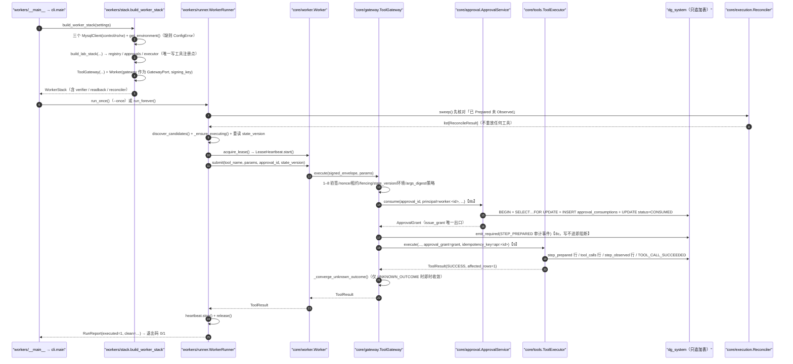
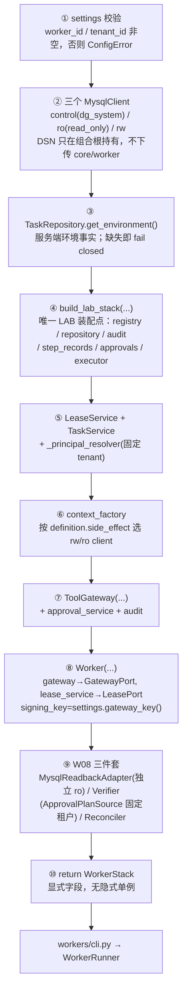
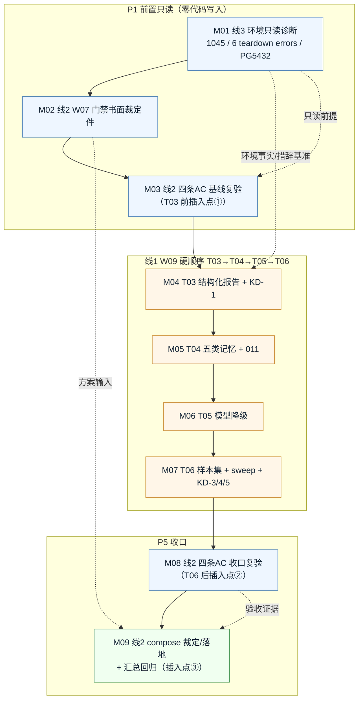

# W09 补遗｜W07 Worker 载体增量设计 与 三条线合并总任务列表

- 架构师：高见远（Bob / software-architect）｜阶段：W09 补遗（任务 #2）｜语言：简体中文
- 唯一交付物：本文件 `docs/w09/08-worker-design-and-tasks.md`。**未改任何 `.py` / `.sql` / `docker-compose.yml` / 现有 docs；未执行 git commit / checkout / reset；未改数据库、未改账号、未执行 DELETE。**
- 现场：`D:/DBGuaredian`，Python 3.14.7（`.venv/Scripts/python.exe`），git HEAD `2850eca W09 T02: 全链路脱敏接入`，tag `w07-close` / `w08-close`。工作区 3 份已修改未提交的文档 `docs/w09/02-design.md`、`03-task-cards.md`、`06-qa-report.md` **只读引用，未 revert / 覆盖 / 重写**。

---

## 0. 依据、冻结口径与表述禁令

### 0.1 本设计先读、不得推翻的基线

| # | 依据 | 本文件如何遵守 |
|---|---|---|
| 1 | `docs/w09/03-task-cards.md`：T01→T02→T03→T04→T05→T06 硬顺序、`:27-36` 文件所有权表、`:6-12` 全局纪律、`:728-736` 环境约束 | 总任务列表逐卡保持硬顺序；§B.1 以所有权表为唯一裁决基准，冲突时以该表为准并显式指出 |
| 2 | `docs/w09/02-design.md` §4 报告 / §5 记忆 / §6 降级 / §7 KD 承接 / §8 迁移；`:67` 已知限制 `KD-W09-03` | 不改动任何设计结论；`KD-W09-03` 作为既有声明限制原样承接 |
| 3 | `docs/w06/02-design.md:163`（legacy `call_tool` 不新增审批入口）、`:302`（legacy `/tasks/{id}/tools/{name}` 对 R2 仍拒绝且无消费入口）；`adapters/lab_assembly.py:83-85` | **执行链唯一生产入口在独立 Worker 侧；不给 API 新增 `execute`/`consume` 端点**；`consume()` 是唯一生产消费入口 |
| 4 | `docs/w07/02-design.md`、`docs/w07/07-gate-review.md` | 门禁结论、KD-1…KD-5、NV-1…NV-4、§6 对外表述禁令原样引用 |
| 5 | `core/worker/worker.py`、`workers/`、`docker-compose.yml:112-162`、`apps/api/routes/`、`deploy/Dockerfile.worker` | 全部只读核对，结论见 §1 |
| 6 | `docs/w08/07-gate-review.md`、`docs/w09/06-qa-report.md` | W08 结论与环境阻塞数据原样引用，不外推 |

### 0.2 冻结口径（不得改写）

`payload_hash` / `redacted_payload_hash` / `action_digest` / `ToolStatus` / `redaction_version=redaction-v2` / 迁移 `009` 表结构（11 列，`json_path`/`start`/`end` 只内嵌于 `unresolved_spans_json`）；不新增第三方依赖、不新增 API 端点、不扩大写能力（**PG 仍只读；写动作仍只有 `mysql_lab_update_order_note`/`1.0`**）、不绕过 `ToolGateway`。

### 0.3 表述禁令（全文强制）

| 禁止 | 必须写为 |
|---|---|
| 「W08 已通过」「W08 已收口」 | 「W08 仍是**有条件放行**（`docs/w08/07-gate-review.md:10`）」 |
| 「W07 门禁通过 / W07 已收口」 | 「W07 **GR-0 有条件放行（QA 最终复核确认，2026-11-11 23:56）**；代码完整、门禁未通过」 |
| 「回归全绿」「环境已可复现清零」 | 「`DG_ADMIN_DSN` root **1045 未解**；全量回归**不可判可信**（W08 C-2：900s 仅推进 77%）」 |
| 「QA 独立实跑通过」 | 「**只读数据复核通过（依赖工程师实跑产物）**」（W07 GR-4） |
| 「容器网络隔离已验证」 | 「compose 配置层已实测解析；容器运行态 `NOT_VERIFIED`（没跑过，不是跑不了）」 |
| 「Gateway 为独立部署组件」 | 「Gateway 与 Worker **同进程装配**（`workers/stack.py`）；`tool_gateway` 为遗留占位（KD-2）」 |

---

## 1. 现状核对与差异登记（**必读：与任务书的实测差异**）

> 本节是本次设计的**事实地基**。任务书描述「Worker 载体未落地（`workers/` 只有 `.gitkeep`、`core/worker/worker.py` 无 `__main__`、compose 的 `tool_gateway` 是 placeholder），导致 W07 门禁不通过」。经只读核对（`git status --short` / `git ls-files workers/` / `git log -1` / 逐文件读取），**与实测不符**。如实登记如下，不按任务书字面重写现场。

### 1.1 实测事实

| # | 实测 | 证据 |
|---|---|---|
| F1 | `workers/` **不是只有 `.gitkeep`**：HEAD `2850eca` 已跟踪 9 个文件 —— `.gitkeep`、`README.md`、`__init__.py`、`__main__.py`、`cli.py`、`discovery.py`、`heartbeat.py`、`runner.py`、`stack.py` | `git ls-files workers/` |
| F2 | `python -m workers` 进程入口**已存在**：`workers/__main__.py` → `workers/cli.py::main()`，五个 flag（`--once` / `--self-check` / `--dry-run` / `--worker-id` / `--tenant`）、退出码 0/1/2、SIGINT/SIGTERM → `runner.request_stop()` | `workers/__main__.py:1-10`、`workers/cli.py:38-73,197-252` |
| F3 | `workers/stack.py::build_worker_stack()` 已引用 `build_lab_stack`（`:26` import、`:231` 调用）与 `ToolGateway`（`:35` import、`:260` 构造），并在 `:272` 把 `gateway` 注入 `Worker` 作为 `GatewayPort` | `workers/stack.py:174-316` |
| F4 | `core/worker/worker.py` **确实无 `__main__`**，但按分层契约本就不该有：领域层只持有签名密钥与 `GatewayPort`/`LeasePort`，进程入口在组合根 `workers/` | `core/worker/worker.py:1-6`、`workers/__init__.py:1-13`、`tests/unit/test_worker_layering.py:97-121` |
| F5 | compose **`worker` service 已存在**（`:129-153`，`control_net`+`lab_net`、不含 `model_net`、`DG_MODEL_PROVIDER: disabled`、`DG_GATEWAY_SIGNING_KEY` 显式注入）；`deploy/Dockerfile.worker` 已存在（`CMD ["python","-m","workers"]`、无 EXPOSE）；`pyproject.toml:30` 已含 `"workers*"` | `docker-compose.yml`、`deploy/Dockerfile.worker`、`pyproject.toml` |
| F6 | compose **`tool_gateway` 占位服务属实**：`:155-162`，`profiles: ["future"]` + `command: print('tool_gateway placeholder; W05 implemented')`，默认 `docker compose up` 不会启动它 | `docker-compose.yml:155-162` |
| F7 | `api` 仍挂 `control_net` + `lab_net` 双网（`:112-115`），属 W07 **KD-1 已知偏离**；门禁明令**不得**把「摘 api 的 lab_net」写成前置项 | `docs/w07/07-gate-review.md:101`、`docs/w07/02-design.md:859-864` |
| F8 | W07 门禁**不是「不通过」**：`docs/w07/07-gate-review.md:11` 唯一结论行 = **GR-0「有条件放行（QA 最终复核确认，2026-11-11 23:56）」**；GR-1…GR-3 PASS、GR-4 有条件关闭；`w07-close` tag 已建立 | `docs/w07/07-gate-review.md:11-31,47-65` |
| F9 | 四条 AC 的**实现与测试均已落地**：`tests/integration/test_worker_process.py` 4 例（工程师实跑）、`tests/unit/test_worker_layering.py` AC④ 静态守护、`tests/unit/test_worker_runner.py` 生命周期；GR-4 由 QA 只读数据复核（非独立实跑） | `docs/w07/07-gate-review.md:51-65,148-158` |
| F10 | W07 门禁 **KD-2** 明文记载：`tool_gateway` 占位是「按 team-lead 在 W07 收口任务书中的明文指令（**本轮不删，避免误伤**）**有意保留**，非实现侧遗漏」；处置列入 **W08-2** | `docs/w07/07-gate-review.md:102,121`、`docs/w07/02-design.md:866-872` |

### 1.2 差异逐条定性

| # | 任务书描述 | 实测 | 定性 |
|---|---|---|---|
| D1 | `workers/` 只有 `.gitkeep` | 9 个文件，全部已跟踪（F1） | **描述失实**；载体代码完整，非缺口 |
| D2 | `core/worker/worker.py` 无 `__main__` → 载体未落地 | 属实，但入口在 `workers/__main__.py`（F2/F4） | **不是缺口，是分层设计**；给领域层加 `__main__` 反而会破坏 `test_worker_layering.py` 反向守护 |
| D3 | `tool_gateway` 是 placeholder | 属实（F6） | **属实**，但已被 W07 KD-2 定性为「既定指令、有意保留」，且默认不启动 |
| D4 | 导致 W07 门禁不通过 | GR-0 = 有条件放行，四条 AC 已 PASS（F8/F9） | **描述失实**；门禁未通过的原因是 C-1…C-4 / NV / KD 与 `05-freeze.md` 缺件（KD-5），**不是**「载体未落地」 |
| D5 | 本轮要求「compose placeholder 替换方案」 | W07 KD-2 明令「本轮不删」，W08-2 才列处置（F10） | **存在指令冲突**，需主理人裁定（→ §B.7 裁定点 2） |

### 1.3 由此得到「任务 A」的重新定性（不推翻基线，只校准定位）

> **结论**：W07 Worker 载体**不需要重新实现**。本轮「线2」的增量应收敛为三件**零代码写入**的事：
> 1. 以既有实现为对象，给出**可复核的增量设计说明**（本文 Part A：入口形态 / 组合根顺序 / `consume()` 衔接 / 一次性 grant 边界 / Reconciler 分工 / compose 替换设计 / 测试落点）；
> 2. **四条 AC 的定向只读复验**（基线 + 收口各一次），不改任何 `.py`；
> 3. **W07 门禁书面件 + KD-2 compose 替换方案裁定**（书面件由 PM/主理人定稿，方案只写设计、不改 `docker-compose.yml`）。
>
> 若主理人另有「增量编码」意图，则必须先扩卡：`workers/stack.py` 归 T02、`workers/runner.py` 归 T06、`core/approval/service.py` 归 T03（`03-task-cards.md:32-36`），任何写入都会与所有权表冲突 → 见 §B.1 与 §B.7 裁定点 1。

---

# Part A｜W07 Worker 载体增量设计

## A.1 设计目标与硬边界

四条最小可测 AC（任务书原样）：

| AC | 内容 | 本设计的满足形态 |
|---|---|---|
| ① | 可从**独立 Worker 进程**调用 `consume()` 的入口 | `python -m workers` → `WorkerRunner` → `Worker.submit()` → `ToolGateway.execute()` 第 8b 步 → `ApprovalService.consume()`。⚠ **不是** Worker 直接调 `consume()`：`consume()` 是唯一生产消费入口，只能由 Gateway 在策略判定之后调用（`docs/w06/02-design.md:163,302`） |
| ② | 执行经 `ToolGateway` 且由**一次性 `ApprovalGrant`** 放行 | Gateway 8b 消费 → `issue_grant()` 唯一出口 → 8c `STEP_PREPARED` 门禁 → 9 `executor.execute(approval_grant=grant, idempotency_key=f"apr:{id}")` |
| ③ | 端到端可断言 `step_prepared` / `step_observed` / `approval_consumptions` 各 1 行且 `tool_calls = 1` | `tests/integration/test_worker_process.py::test_worker_process_executes_approved_repair_once`（`:286-331`） |
| ④ | **生产装配点**出现 `build_lab_stack` / `ToolGateway` 的真实引用 | `workers/stack.py:26/35/231/260`，静态守护 `tests/unit/test_worker_layering.py`（`:64-89`） |

**不得设计成**：HTTP 新增路由（不给 API 加 `execute`/`consume` 端点，W06 冻结）；不得扩大写能力（PG 仍只读，唯一写工具仍 `mysql_lab_update_order_note`）；不得绕过 `ToolGateway`（`GatewayPort.execute()` 与 `ToolGateway.execute()` 签名一致，直接注入，无适配器、无跨进程协议）；不得新增第三方依赖；不得新增第二个写工具注册点（`tests/unit/test_worker_layering.py:80` 断言 `ToolRegistry()` 不出现在 `stack.py`）。

## A.2 四条 AC 与既有实现的逐条映射（现状已满足，非待实现）

| AC | 落地文件（当前快照，以符号名为准） | 断言锚点（用例名） | 现状 |
|---|---|---|---|
| ① | `workers/__main__.py` / `cli.py::main` / `stack.py::build_worker_stack` / `runner.py::run_once` / `core/worker/worker.py::submit` / `core/gateway/tool_gateway.py::execute` | `test_worker_process.py::test_help_lists_worker_flags`、`::test_self_check_returns_zero_when_stack_is_available`、`tests/unit/test_worker_runner.py` 周期用例 | 已落地（W07 GR-1/GR-2） |
| ② | `core/gateway/tool_gateway.py:250-334`（8b/8c）、`core/approval/service.py::consume:563-887`、`adapters/mysql/lab_repair.py` | `tests/integration/test_w07_repair_e2e.py`、`test_approval_consume.py`、W07 六类拒绝矩阵 | 已落地（W07 GR-2/GR-4） |
| ③ | `tests/integration/test_worker_process.py:286-331` | `step_prepared==1` / `step_observed==1` / `approval_consumptions==1` / `tool_calls==1` / `outcome=success` / `approvals.status=CONSUMED` / `tasks.status=EXECUTING` 且 `state_version+1`；dry-run 三表 0 行（`:263-283`） | 已落地（工程师实跑 4 passed；QA **只读数据复核**，非独立实跑） |
| ④ | `workers/stack.py:26,35,231,260` | `test_worker_layering.py::test_stack_module_imports_lab_assembly_and_tool_gateway`、`::test_stack_is_the_only_module_building_the_gateway`（`builders == ["stack.py"]`）、`::test_workers_package_references_lab_assembly_and_gateway` | 已落地（W07 GR-2） |

> **GR-2 口径注（必须沿用，不得写成「全仓唯一」）**：`ToolGateway(` / `build_lab_stack(` 在测试夹具中另有构造（`test_w07_repair_e2e.py`、`test_worker_gateway.py`、`test_w06_acceptance.py`、`test_approval_consume.py`），`adapters/lab_assembly.py:72` 是 `build_lab_stack` 定义处。正确表述是「**生产运行时装配点唯一，测试夹具另计**」（`docs/w07/07-gate-review.md:56`）。

## A.3 进程入口形态：模块路径 / `__main__` / CLI / 生命周期与租约

### A.3.1 入口与 CLI

| 项 | 设计（= 既有实现的固化说明） |
|---|---|
| 模块路径 | `python -m workers` → `workers/__main__.py`（`sys.exit(main())`）→ `workers/cli.py::main()`。**不在 `core/worker/` 加 `__main__`**：领域层零数据库依赖由 `test_worker_layering.py:97-121` 守护 |
| CLI 参数 | `--once`（一轮后退出，验收/定时用）、`--self-check`（装配+连接自检，打印 JSON 后退出）、`--dry-run`（只发现候选，不领租约 / 不提交 / 不写审计）、`--worker-id`（覆盖 `DG_WORKER_ID`）、`--tenant`（覆盖 `DG_DEFAULT_TENANT_ID`） |
| 输出与退出码 | 全部输出经 `core.logging.redact_text` 脱敏，只打印参数**键名与数量**，不打印参数值 / DSN / 签名密钥；`0` 干净退出、`1` 有在途未收敛（持锁/拒绝/失败/结果未知）、`2` 配置或自检失败 |
| 装配失败 | `build_worker_stack()` 抛 `ConfigError`/`DBGuardianError`/`OSError`/`ValueError` → **fail closed，不进入轮询**，绝不「半可用」地跑起来（`cli.py:209-216`） |
| 常驻模式 | `run_forever()` + `_install_signal_handlers()`（SIGINT/SIGTERM → `runner.request_stop()`，仅主线程）；停止后**在当前任务收敛后**退出，不领新租约 |
| 部署面 | `deploy/Dockerfile.worker` `CMD ["python","-m","workers"]`、**无 EXPOSE**、`USER dguser`(uid 10001)；compose `worker` 服务 `control_net`+`lab_net`、**绝不接 `model_net`**、`DG_MODEL_PROVIDER: disabled`；`DG_GATEWAY_SIGNING_KEY` 必须显式注入（dev 默认进程内随机值，跨进程/跨重启验签必败） |
| 并发 | `worker_max_concurrency` 固定 1（`core/config.py` `ge=1 le=1`），循环严格串行；**绝不能跑两个 Worker 抢同一任务**（租约+fencing 兜底是兜底，不是设计意图） |

### A.3.2 生命周期与租约（顺序是硬约束）

`WorkerRunner._execute()`（`workers/runner.py:436-562`）单候选顺序：

1. `discover_candidates()`：候选只取 `WAITING_APPROVAL` + 无活动租约 + 存在 `APPROVED` 未过期审批；参数只从 `task_steps.params_json` 还原（`workers/discovery.py:20-27`）；
2. `_ensure_executing()`：`WAITING_APPROVAL → EXECUTING`，随后**重新读取** `state_version`（迁移会 +1，用旧值建信封必被 Gateway 第 5 步判 `StateConflictError`）；漏这步会让 `UNKNOWN_OUTCOME` 因状态机无 `WAITING_APPROVAL → NEEDS_RECONCILIATION` 边而静默不落账；
3. `acquire_lease()` → `LeaseHeartbeat.start()`（daemon 线程，`interval_s < ttl_s`，失败置 `lost=True` **永不复位**，`Worker.heartbeat()` 内部同时把租约置空 → 后续 `submit()` 立即抛 `WorkerLeaseInvalidError`，双保险）；
4. `worker.submit(...)` → `ToolGateway.execute(...)`（唯一执行链）；
5. `finally`：`heartbeat.stop(timeout_s=shutdown_grace_s)` → `_release_quietly()`；
6. **不重试**：任何异常都不重试工具调用（写可能已生效，重试 = 二次写入）；`WorkerConflictError` 只跳过该候选，不换任务、不延时重试。

### A.3.3 端到端时序（AC① ② ③ 一条链）



> **两张表不要混**：`STEP_PREPARED` 是 Gateway 8c 用 `emit_required` 写入 `task_events` 的**审计事件**；AC③ 断言的 `step_prepared` 是 `core/tools/executor.py::_prepare_step` 写入 `dg_system.step_prepared` 的**表行**。两者同名不同物，缺一都会让 AC③ 转红。

## A.4 组合根装配顺序（`build_worker_stack`，`workers/stack.py:174-316`）



**装配纪律（逐条可静态断言）**：

1. 写工具**只能**经 `build_lab_stack()` 拿到；`workers/stack.py` 不得出现 `ToolRegistry()`（`test_worker_layering.py:80`）——否则开出第二条写入口；
2. `core/worker/` 零数据库/适配层依赖（`test_worker_layering.py:97-102` 禁用串扫描），`workers/` 不得写裸 SQL / 直连驱动（`:105-115`）；
3. **不装配 `ModelGateway`**：Worker 不调用模型（`DG_MODEL_PROVIDER=disabled`），`core/models/` 零改动；
4. **不新增 API 端点**：执行链不向 HTTP 暴露（`docs/w06/02-design.md:163,302`）；
5. `ToolGateway.execute()` 与 `core/worker/client.py::GatewayPort.execute()` 签名一致 → **直接注入，无需适配器、无需跨进程协议**（跨进程再包一层会让「谁验签」变模糊并新增信任边界）；
6. **W09 现状注记**：`WorkerStack` 已有 `redaction: RedactionGate | None = None` 字段（T02 追加，`workers/stack.py:126-129`），当前 `build_worker_stack()` 返回时**未显式传该字段**（默认 `None`）；按 T02 卡口径，各通道内部会就地构造**恒开**默认闸门，字段只影响「事件/隔离落点」，**不构成可关闭开关**，也不影响 W07 四条 AC。本设计**不建议**改 `workers/stack.py`（该文件归 T02 所有权，见 §B.1）。

## A.5 与 `ApprovalService.consume()` 的衔接 + 一次性 grant 消费边界

### A.5.1 衔接位置（唯一生产入口）

`ToolGateway.execute()` 第 8b 步（`core/gateway/tool_gateway.py:250-310`）：策略 `decision.required_approval=True`（R2）时，永不直接放行；无 `approval_id` → `APPROVAL_REQUIRED` 结构化拒绝；`approval_service` 未装配 → 同样拒绝；否则调用 `ApprovalService.consume(...)`，把 `AuditUnavailableError` 向上传播（必须阻断），其余 `DBGuardianError` 转 `ToolResult(DENIED)` + `GATEWAY_EXECUTION_DENIED`。

> **`consume()` 是唯一生产消费入口**：Worker 进程**不直接调用**它，API 也**不新增** `consume`/`execute` 端点。这是 W06/W07 冻结口径，本设计不改。

### A.5.2 九项校验 → 原子消费 → 唯一 grant

`core/approval/service.py::consume`（`:563-887`）顺序固定，**不得重排/绕过**（T03 只在其第 2 步之前补一条 `COMPENSATION_DENIED`，见 A.5.4）：

| 步 | 校验 | 失败 |
|---|---|---|
| 1 | 存在且租户匹配（跨租户按不存在处理） | `ApprovalNotFoundError` |
| 2 | `status is APPROVED` | `error_for_status`（已消费 → `APPROVAL_ALREADY_CONSUMED`） |
| 3 / 3b | 未过期 + `canonical_digest(action_descriptor) == action_digest` | `ApprovalExpiredError` / `DESCRIPTOR_DIGEST_MISMATCH` |
| 4–7 | 任务/环境/引擎一致、环境指纹重算、策略版本、工具名+版本 | 分通道 `_mismatch` |
| 8 | 重算参数 → 目标对象 → 整体摘要（`action_digest` / `parameters_digest` / `target_objects_digest` 三比） | `APPROVAL_DIGEST_MISMATCH`（`channel` 可定位） |
| 9 | 前置条件摘要（控制面重算 + 目标库观测沿用登记值） | `prerequisites` 不符即拒 |
| 事务 | `BEGIN` → `lock_row(...FOR UPDATE)` → 锁内状态/过期/11 列逐列 TOCTOU 比对（含 `disclosure_digest`）→ `INSERT approval_consumptions` → 条件 `UPDATE ... WHERE status='APPROVED'`（`affected != 1` 即按当前状态报错）→ `COMMIT` | 事务回滚，**不插消费行、不迁状态** |
| 出口 | `APPROVAL_CONSUMED` 事件 + `issue_grant(...)` | **唯一 `ApprovalGrant` 出口**（`:874`） |

### A.5.3 一次性消费的边界（必须写清的 5 条）

1. **双唯一键兜底**：`approval_consumptions` 的 `approval_id` / `nonce_hash` 唯一键撞键 → `ApprovalAlreadyConsumedError(reason=CONSUMPTION_EXISTS)`；配合锁内 `status` 二次检查与条件 `UPDATE`，并发 N=8 消费同一审批恰好 1 成功（`docs/w06/02-design.md:302`）。
2. **grant 与参数绑定**：grant 内带 `action_digest` / `prerequisites_digest` / `policy_version` / `tool_name` / `tool_version`；Gateway 8c 的 `STEP_PREPARED` 事件原样落这些摘要；Executor 用 `idempotency_key=f"apr:{grant.approval_id}"` —— **一张审批只允许一次写**（`tool_gateway.py:405-407`）。
3. **grant 不得跨进程/跨重启复用**：`DG_GATEWAY_SIGNING_KEY` 必须显式注入（compose `:143`）；dev 默认「进程内随机值」，拆容器后 Worker 与任何外部验签方不共享密钥，验签必败（`workers/README.md:100-101`）。
4. **补偿不是复用**：补偿是独立 R2 动作，须新的 Prepare、新的 `approval_id` 与新审批（`docs/w07/02-design.md:425`）；复用原 `approval_id` 执行补偿在第 2 步被 `APPROVAL_ALREADY_CONSUMED` 拒绝。
5. **审计门禁在 grant 之后、工具之前**：8c 用 `emit_required`，`STEP_PREPARED` 写不进去即 `AUDIT_UNAVAILABLE` 阻断，**工具不得被调用**（`tool_calls` 保持 0）。

### A.5.4 与 W09 T03（KD-1）的接口边界

T03 将在 `consume()` 第 2 步（`core/approval/service.py:581-582`）`status is CONSUMED` 时，用新增的 `find_compensation_for()` 反查；命中则**先发** `COMPENSATION_DENIED(reason=COMPENSATION_REUSES_ORIGINAL_APPROVAL, deny_code=APPROVAL_ALREADY_CONSUMED, ...)` 再抛错（`try_emit`，拒绝优先，写失败不改判定）。

> Worker 载体侧**零改动**：只是 `consume()` 的调用方，不重排、不绕过任何一项校验。`core/approval/service.py` 归 **T03 独占**（`03-task-cards.md:33`），线2 不得写入 → §B.1。

## A.6 失败 / 未知结果如何交由 Reconciler（分工不重叠）

| 场景 | 谁处理 | 动作 | 禁止 |
|---|---|---|---|
| `ToolResult.status == UNKNOWN_OUTCOME` | `ToolGateway._converge_unknown_outcome()`（`tool_gateway.py:413-457`）**即时收敛** | 立即 `update_task_status(NEEDS_RECONCILIATION, expected_state_version=...)` + `TASK_STATE_CHANGED(source=gateway_immediate)`；`can_transition` 不合法或并发已推进则 `return`（不覆盖、不重放） | 不等待外部 sweep、不重试工具（P0-18） |
| 崩溃窗口（审批已 `CONSUMED`、`step_prepared` 有、`step_observed` 无） | `Reconciler.sweep()`（`core/execution/reconciler.py:73-104`）下一轮**统一落账** | 分页 `find_unobserved` → `_reconcile_one()`：二次确认无 Observed → 状态可迁移则推进，否则 `MANUAL_INTERVENTION`；`emit_required(RECONCILIATION_REQUIRED)` payload 带 `replay_attempted: False` | 不写 `step_observed`、不持有 `ToolRegistry` → **结构上不可能重放工具** |
| 参数还原失败（`STEP_NOT_FOUND` / `STEP_TOOL_MISMATCH` / `NO_UNFINISHED_STEP`） | `workers/discovery.py::_reject_params()`（`:160-193`） | `try_emit(RECONCILIATION_REQUIRED, payload.action="DO_NOT_EXECUTE")` + 结构化告警 `WORKER_PARAMS_UNRESOLVED`；候选被丢弃 | **绝不猜参数**（猜错 = 绕过审批对象） |
| `sweep()` 本身抛错 | `WorkerRunner._sweep_once()`（`runner.py:309-340`） | 写 `RECONCILIATION_FAILED`、该轮 `clean=False`、**不中断主循环**；核对失败计入 `failed`（W09 T06 增 `reconcile_failed` 子集） | 绝不向上抛（一轮 DB 抖动不得打挂整个 Worker） |
| Worker 侧 | `WorkerRunner._execute()` | 只如实记录 `unknown_outcome` / `failed` / `skipped`；`finally` 停心跳 + 释放租约 | **不做补偿、不做重放、不做状态回滚**（`workers/README.md:51-61`） |

> **调度顺序固定**：`run_once()` **先 `sweep()` 核对历史、后 `discover_candidates()` 发现新候选**（W08 AC-17）；`sweep()` 每轮恰好一次。两者与「本轮新候选」无交集（已消费的审批不会再被选中），因此 Gateway 的「即时收敛」与 Reconciler 的「统一落账」**不重复、不互相替代**（`tool_gateway.py:416-420`）。

## A.7 compose 中 `tool_gateway` placeholder 的替换方案（**只写设计，不改文件**）

### A.7.1 现状与危害

`docker-compose.yml:155-162`：

```yaml
  # W01 仅定义占位轮廓；W05/W07 引入真实 Worker/Policy/Tool Gateway。
  tool_gateway:
    profiles: ["future"]
    image: python:3.14-slim
    command: ["python", "-c", "print('tool_gateway placeholder; W05 implemented')"]
    networks: [control_net, lab_net]
```

- 默认 `docker compose up` **不会启动它**（`profiles: ["future"]`），`worker` 服务（`:129-153`）才是真实载体；
- **命名与装配事实相反**：Gateway 跑在 **worker 进程内**（`workers/stack.py:260/272`），由 `test_worker_layering.py:83-89` 锁死 `builders == ["stack.py"]`；
- **危害（非命名洁癖）**：后来者若据服务名理解为「api → gateway 容器」而新写跨进程协议，会**直接推翻 `GatewayPort` 进程内契约**（`docs/w07/02-design.md:869-871`）。

### A.7.2 两个方案（对应 W07 门禁 W08-2 的两个选项）

| 方案 | 设计 | 影响面 | 评价 |
|---|---|---|---|
| **A（推荐，最小改动）** | 把 `tool_gateway` **改名** `gateway_legacy_placeholder`，保留 `profiles: ["future"]` 与 `image/command/networks` 不变；把 `:155` 注释改为：「遗留占位，**非执行入口**；Gateway 与 Worker 同进程装配于 `workers/stack.py`，本服务默认不启动，保留仅为避免误伤既有编排（W07 KD-2）」 | 只改 `docker-compose.yml` 的 **1 个 service 名 + 1 行注释**；不改任何 `.py` / 端点 / 协议 / 网络拓扑 | 消除「独立 Gateway 容器」误读，零运行态风险；与 KD-2「本轮不删」精神一致 |
| **B（更彻底）** | **删除**整个 `tool_gateway` 占位块 | 同左；另需复核 `test_worker_layering.py:148` 的切块 `split("  worker:")[1].split("\n  model_service:")[0]` —— 该切块目前**包含** `tool_gateway` 块（W07 gate-review W08-6 已登记此断言强度问题）；删除后切块变干净，`control_net`/`lab_net` 仍在、`model_net` 仍不在、断言**仍成立** | 更干净，但与 W07 KD-2「本轮不删」明文指令正面冲突，且改动 W07 冻结期的部署面 |

**共同约束**：两方案都**不得**新增 `build` / `healthcheck` / 端口 / 环境变量 / 跨进程协议；**不得**把 `api` 的 `lab_net` 摘掉（KD-1）；**不得**让占位服务进入默认 `profiles`。若采用 B，须同步在 `test_worker_layering.py` 增一条「compose 中不存在名为 `tool_gateway` 的服务」的静态断言 —— 但该测试文件**不在** `03-task-cards.md` 所有权表内，可写；此断言属**新增**守护，不是放宽既有断言。

### A.7.3 落地时点与冲突裁定

- 本轮硬约束「**只写这一份文档，不改 `docker-compose.yml`**」→ **本设计不落地**，仅作为方案交付；
- W07 门禁 KD-2 明示「本轮不删，避免误伤」，W08-2 才把处置列为动作 → 本轮的「替换方案」要求与 KD-2 **存在指令冲突**，须主理人裁定（§B.7 裁定点 2）；
- **建议落地时点**：T06 之后、所有逐卡验收结束的收口期（M09），避免把部署面改动混进 T03–T06 的逐卡验收证据；落地时只做 `docker compose config`（只读、exit 0）与 `test_worker_layering.py` 定向复跑。

## A.8 测试落点（文件 + 用例名 + 断言要点）

| AC | 测试文件 | 用例名 | 断言要点 |
|---|---|---|---|
| ① 进程入口 | `tests/integration/test_worker_process.py` | `test_help_lists_worker_flags` | `--help` rc=0 且含五个 flag；**不依赖 DB** |
| ① 装配自检 | 同上 | `test_self_check_returns_zero_when_stack_is_available` | `event=worker_self_check`、`checks.control.ok is True`、`checks.discovery.ok is True`、rc=0（需真实 LAB，不可达则 skip 带原因） |
| ① 生命周期/租约 | `tests/unit/test_worker_runner.py` | `test_install_signal_handlers_forwards_to_request_stop`、`test_runner_request_stop_prevents_new_work`、`test_run_forever_stops_after_request_stop`、`test_candidate_task_statuses_is_waiting_approval_only` | handler 接线 / 停止语义 / 候选只取 `WAITING_APPROVAL`；**NV-2**：Windows 无 POSIX 信号，只声明「接线 + 语义」两层 |
| ② Gateway + grant | `tests/unit/test_worker_layering.py` | `test_stack_module_imports_lab_assembly_and_tool_gateway`、`test_stack_is_the_only_module_building_the_gateway` | `build_lab_stack(` / `ToolGateway(` 是**调用**不是导入即忘；`builders == ["stack.py"]`；无 `ToolRegistry()` |
| ② 拒绝优先 | `tests/integration/test_w07_rejection_matrix.py`、`test_approval_consume.py` | 六类拒绝矩阵 / 并发消费 | 无 `approval_id` → `APPROVAL_REQUIRED` 且 `tool_calls=0`；N=8 并发恰好 1 成功；复用原审批 → `APPROVAL_ALREADY_CONSUMED`（T03 后补 `COMPENSATION_DENIED`） |
| ③ dry-run 零副作用 | `tests/integration/test_worker_process.py` | `test_dry_run_lists_candidate_without_executing` | `tool_calls` / `approval_consumptions` / `worker_leases` 三表 **0 行**；只暴露 `param_keys`，不暴露参数值 |
| ③ 端到端各 1 行 | 同上 | **`test_worker_process_executes_approved_repair_once`** | `step_prepared==1`、`step_observed==1`、`approval_consumptions==1`、`tool_calls==1`；`step_observed.outcome=success`、`tool_calls.status=success`、LAB `seed_orders.note` 真被改、`approvals.status=CONSUMED`、`tasks.status=EXECUTING` 且 `state_version == waiting+1` |
| ④ 部署面 | `tests/unit/test_worker_layering.py` | `test_worker_dockerfile_uses_module_entrypoint`、`test_pyproject_ships_workers_package`、`test_docker_compose_declares_worker_without_model_network` | `CMD ["python","-m","workers"]` / `"workers*"` 入包 / worker 块含 `control_net`+`lab_net`、不含 `model_net`、`DG_MODEL_PROVIDER: disabled`、含 `DG_GATEWAY_SIGNING_KEY` |
| 分层反向守护 | `tests/unit/test_worker_isolation.py`、`test_worker_layering.py` | `test_core_worker_remains_free_of_database_dependencies`、`test_workers_contain_no_raw_sql`、`test_worker_domain_layer_does_not_import_workers_package` | 领域层零 DB 依赖；组合根无裸 SQL / 无驱动直连；无反向依赖 |

**AC③ 的环境诚实边界**：`test_worker_process.py` 的 `approved_repair` fixture 需要真实 MySQL LAB 与 `admin_client` 清理；本机 `DG_ADMIN_DSN` root **1045 不可用**，清理降级为 `warnings.warn`（`test_worker_process.py:228-241`），残留按 `docs/w07/worker-residue.md` 如实登记，**绝不 `DELETE`**、绝不断言「表已清空」。W07 GR-4 的口径是「工程师实跑 4 passed + QA **只读数据复核**」，**不得**写成「QA 独立实跑通过」。

## A.9 线2 的真实剩余缺口（不是「载体未落地」）

| # | 缺口 | 性质 | 本轮处置 |
|---|---|---|---|
| G1 | `docs/w07/05-freeze.md`、`06-conformance-audit.md` 缺件（KD-5） | 书面件缺失 | 由 PM 任务 #1 / 主理人定稿；本文件只登记 |
| G2 | NV-1：`docker build -f deploy/Dockerfile.worker` + `compose up worker` 容器运行态从未跑（0 容器） | 运行态 `NOT_VERIFIED`（没跑过，不是跑不了） | 本轮硬约束「不改系统配置 / 只写一份文档」→ **不列入本轮实施**，只登记；W08 E-4 亦挂 W11 |
| G3 | NV-2：POSIX `SIGTERM` 真实信号路径（Windows `TerminateProcess`） | 平台限制 | 只声明 handler 接线 + `request_stop()` 语义 |
| G4 | NV-4：`tests/integration/test_worker_gateway.py` 因 admin 1045 未跑通 | 环境阻塞 | **未声称通过**；与线2 改动无交集 |
| G5 | KD-2 compose 占位命名误导 | 已确定的配置偏离 | 只写替换设计（A.7），落地需裁定 |
| G6 | GR-0 仍是「有条件放行」、C-3 残留 7 条 | 门禁状态 | 如实登记，**不得**表述为「W07 已收口 / 门禁通过」 |

---

# Part B｜三条线合并的有序总任务列表

## B.1 编排原则与文件所有权冲突裁定

### B.1.1 基准：`docs/w09/03-task-cards.md:27-36` 文件所有权表（**冲突时以此表为准**）

| 卡 | 独占文件（原表逐字） | 本轮状态 |
|---|---|---|
| T01 | `core/redaction/{__init__,models,payload_text,rules,engine}.py`、`core/errors.py`、`core/audit/events.py` | ✅ 已实现并提交 |
| T02 | `core/redaction/gate.py`、`core/evidence/{models,service,repository}.py`、`core/diagnosis/evidence_mapping.py`、`core/context/{builder,contracts}.py`、`core/tools/{contracts,executor}.py`、`core/models/gateway.py`、`core/agent/trajectory.py`、**`workers/stack.py`**、`database/migrations/009_*` | ✅ 已实现并提交（`2850eca`） |
| **T03** | `core/report/{__init__,models,validate,render,export,builder,repository}.py`、**`core/approval/{service,repository}.py`**、`database/migrations/010_*` | 本轮待做 |
| **T04** | `core/memory/*`、`database/migrations/011_*` | 本轮待做 |
| **T05** | `core/models/{degradation,factory}.py`、`core/report/brief.py`、`core/agent/loop.py`、`apps/api/routes/agent.py` | 本轮待做 |
| **T06** | `core/execution/reconciler.py`、**`workers/runner.py`**、`core/audit/service.py`、`core/report/samples.py`、**`tests/unit/test_worker_scheduler.py`** | 本轮待做 |

### B.1.2 线2 × 所有权表冲突矩阵（**全部以所有权表为准，显式指出**）

| # | 若线2 要写的文件 | 与所有权表 | 实测结论 | 裁定 |
|---|---|---|---|---|
| X1 | `workers/stack.py`（加 `build_lab_stack`/`ToolGateway` 真实引用，AC④） | **冲突：T02 独占** | 引用**已存在**（`:26/35/231/260`），静态守护已绿 | **零写入**，冲突消解；`workers/stack.py` 仍归 T02，本轮只读 |
| X2 | `workers/runner.py`（端到端 `--once`） | **冲突：T06 独占** | 主循环已实现且 T06 将改 `RunReport`/节流 | **零写入**；线2 只**复跑** `test_worker_process.py`（该文件不在所有权表内） |
| X3 | `core/approval/service.py`（`consume()` 衔接，AC②） | **冲突：T03 独占** | Worker 只是 `consume()` 的**调用方**；T03 将在第 2 步补 KD-1 | **零写入**；KD-1 属 T03 独占范围，线2 不改 |
| X4 | `tests/unit/test_worker_scheduler.py`（想加载体用例） | **冲突：T06 独占（只加用例、不改既有断言）** | — | **禁止**线2 写入；线2 测试落点只用 W07 既有文件（`test_worker_layering.py` / `test_worker_isolation.py` / `test_worker_runner.py` / `test_worker_process.py`），**均不在所有权表内** |
| X5 | `docker-compose.yml`（placeholder 替换） | **不在所有权表内 → 无表内冲突** | 但与 W07 **KD-2「本轮不删」** 及本轮硬约束「不改 compose」冲突 | 只写设计（A.7）；落地须主理人裁定（§B.7-2），且放在收口期 |
| X6 | `core/execution/reconciler.py`（失败/未知结果） | **冲突：T06 独占** | 分工已实现（A.6） | **零写入**；线2 只描述分工 |

> **结论**：线2 在本轮是**零代码写入轨道**，与 T03–T06 不存在「同时改同一文件」的可能。这是「Worker 载体插在哪里最安全」的第一层答案。

### B.1.3 Worker 载体的插入位置（正式结论）

> **采用「两次只读复验 + 一次收口裁定」的三点插入，不占用任何实现窗口；不与 T03–T06 同时改同一文件。**
>
> | 插入点 | 位置 | 理由 |
> |---|---|---|
> | ① **基线复验 M03** | **T03 之前**（M04 之前） | T03 会改 `core/approval/service.py`（`consume` 第 2 步）、T06 会改 `workers/runner.py`（`RunReport` / 节流 / 调度事件租户），两者都会改变 `--once` 的运行面。**改造前先锁定四条 AC 基线**；若收口复验转红，可明确归因于 T03–T06 改动，而非载体本身 |
> | ② **收口复验 M08** | **T06 之后**（M07 之后） | 同一批定向命令重跑，断言「T03–T06 未破坏 W07 载体」 |
> | ③ **compose 裁定/落地 M09** | **M08 之后（全部逐卡验收结束）** | 改 compose 会影响 `test_worker_layering.py::test_docker_compose_declares_worker_without_model_network` 静态断言；放在收口期，避免把部署面改动混进逐卡验收证据 |
>
> **明确不做**：不在 T03–T06 任一卡的实施窗口内写 `workers/stack.py` / `workers/runner.py` / `core/approval/service.py` / `tests/unit/test_worker_scheduler.py` / `docker-compose.yml`。

## B.2 总任务列表（主表，按实现顺序；**共 9 条**）

> 说明：本表是**三条线合并的项目编排清单**，不是系统级「实现任务分解」。W09 六卡的粒度与硬顺序由 `03-task-cards.md` 冻结，**不得压缩合并**；§B.3 另给 5 阶段归并视图以对齐架构模板的 5 任务上限精神。任务 #1（PM）与 #3（QA）在表内为**编排条目**，架构师不认领、不直连。

| ID | 线 | 优先级 | 任务 | 依赖 | 输入 | 输出 | 独占文件 / 写入范围 |
|---|---|---|---|---|---|---|---|
| **M01** | 线3 | P0 | 环境阻塞**只读诊断**：`DG_ADMIN_DSN` 1045、`test_evidence_service.py` 6 个 teardown errors、PG 5432 | — | `06-qa-report.md`（只读）、`docs/w08/07-gate-review.md` §5、`tests/integration/test_evidence_service.py`、`test_w03_integrity.py` | 只读诊断结论（如实登记，不改配置） | **零写入**；不改系统配置 / 账号 / 数据库 / 不执行 DELETE / 不新建文档 |
| **M02** | 线2 | P0 | W07 门禁旧账复核与**书面裁定件**（PM 任务 #1） | M01 | `docs/w07/07-gate-review.md`（GR-0 / C-1…C-4 / KD-1…KD-5 / NV-1…NV-4）、`workers/` 现状、`git rev-parse w07-close` | 门禁书面裁定件（文件名由 PM/主理人定）；如实写「有条件放行」 | PM 指定的 `docs/w07/` 书面件（**不在** `03-task-cards.md` 所有权表内）；本轮架构师不写 |
| **M03** | 线2 | P0 | Worker 载体四条 AC **基线复验**（T03 前，只读） | M01、M02 | 本文 Part A、`workers/`、`tests/unit/test_worker_layering.py` / `test_worker_isolation.py` / `test_worker_runner.py`、`tests/integration/test_worker_process.py`、`deploy/Dockerfile.worker`、`docker-compose.yml` | 四条 AC 改造前基线记录（AC①–④ 逐条状态，含「GR-0 有条件放行」措辞） | **零写入**（只读源码 + 定向 pytest） |
| **M04** | 线1 | P0 | **W09 T03**：结构化报告（引用校验 / 两组六态 / 安全渲染 / 导出）+ KD-1 补偿拒绝事件 | M03；且严格承接已提交的 T02 | `03-task-cards.md` T03 卡、`02-design.md` §4/§7/§8.3 | T03 卡全部交付物与完成判据 | `core/report/*`、`core/approval/{service,repository}.py`、`database/migrations/010_*` + rollback、T03 三个测试文件（**T03 独占，逐字依 `03-task-cards.md:33`**） |
| **M05** | 线1 | P0 | **W09 T04**：五类记忆 + `KnowledgeEntry` + 冲突解析器（迁移 011） | M04 | T04 卡、`02-design.md` §5/§8.4 | T04 卡交付物 | `core/memory/*`、`database/migrations/011_*` + rollback、T04 两个测试文件（**`:34`**） |
| **M06** | 线1 | P0 | **W09 T05**：模型降级（状态机 / 一次重试 / 规则简报 / `disabled` 装配） | M05（T05 卡另依赖 T02，已完成） | T05 卡、`02-design.md` §6 | T05 卡交付物 | `core/models/{degradation,factory}.py`、`core/report/brief.py`、`core/agent/loop.py`、`apps/api/routes/agent.py`、T05 两个测试文件（**`:35`**；`agent.py` 只改 `_build_loop` 装配，**不加端点**） |
| **M07** | 线1 | P0 | **W09 T06**：脱敏回归样本集 + 训练样本 + `sweep()` 扫描总数 + KD-3/4/5 | M06（T06 卡另依赖 T03=M04） | T06 卡、`02-design.md` §7 | T06 卡交付物；`sweep()` 签名/返回类型**不变** | `core/execution/reconciler.py`、`workers/runner.py`、`core/audit/service.py`、`core/report/samples.py`、`tests/unit/test_worker_scheduler.py`（**`:36`**，只加用例不改既有断言）+ T06 两个新测试文件 |
| **M08** | 线2 | P0 | Worker 载体四条 AC **收口复验**（T06 后，只读） | M07 | 同 M03 + M04–M07 的改动面 | 「T03–T06 未破坏载体」结论；若转红按 §B.9-R4 归因 | **零写入** |
| **M09** | 线2 | P1 | compose placeholder 替换方案**裁定**；若授权则落地（A.7 方案 A/B）；安排收口汇总回归 | M02、M08 | 本文 A.7、W07 KD-2 / W08-2 | 裁定记录；（若授权）`docker-compose.yml` 1 处改名或删块 + 注释 | **本轮不改 `docker-compose.yml`**；落地时独占该文件（**不在所有权表内**），禁止同批改 `.py` |

**顺序摘要**：`M01（环境只读诊断） → M02（门禁书面件） → M03（载体基线复验） → M04 T03 → M05 T04 → M06 T05 → M07 T06 → M08（载体收口复验） → M09（compose 裁定 / 收口汇总）`。
线1 内部严格 `T03→T04→T05→T06` 硬顺序逐卡验收；**任一时刻不得有两张卡改同一个文件**（`03-task-cards.md:5`）。M01/M02/M03 为前置只读轨道，M08/M09 为收口轨道。

## B.3 5 阶段归并视图（对齐架构模板「≤5 任务」精神）

| 阶段 | 归并任务 | 一句话目标 |
|---|---|---|
| **P1 前置只读** | M01 + M02 + M03 + A.7 设计定稿 | 锁定环境事实、门禁书面口径与 W07 载体改造前基线；零代码写入 |
| **P2** | M04（W09 T03） | 结构化报告 + KD-1 |
| **P3** | M05（W09 T04） | 五类记忆 + 冲突解析器 |
| **P4** | M06（W09 T05） | 模型降级 |
| **P5 收口** | M07（W09 T06） + M08 + M09 | 样本/sweep/KD-3-4-5 → 载体收口复验 → compose 裁定与汇总回归安排 |

> 归并只为「顶层阶段数 ≤5」的呈现；**不改变主表 9 条的逐条验收粒度**，也不改变 W09 六卡冻结的硬顺序。

## B.4 验收命令清单（统一口径）

### B.4.1 统一口径与禁令

- `python` 一律用 **`.venv/Scripts/python.exe -m pytest ... -o addopts="" -q -p no:cacheprovider`**（`pyproject.toml:35` 的 `addopts="-q"` 需被 `-o addopts=""` 覆盖，否则叠加成 `-qq` 吞掉汇总行；`06-qa-report.md:22` 同口径）。
- **禁止全量 pytest**：不得执行无路径 `pytest`、`pytest tests/`、`pytest tests/integration` 等全量调用（日志记载全量会挂起约 14 分钟无输出；W08 GR-2 记载 `pytest tests/integration` 900s 仅推进 77%）。`tests/unit` 全量虽在 W09 QA 报告中 5–6s 完成，但**本轮一律不列入逐卡命令**；`03-task-cards.md` 各卡内的 `python -m pytest tests/unit -q` 属卡内回归项，由 team-lead 在 M09 统一安排一次汇总回归（→ §B.7 裁定点 4）。
- **需要 DB 的定向集成文件单独跑并加 timeout**：`requirements.lock.txt` 仅 `pytest==8.4.2`，**未装 `pytest-timeout`** → 不得写 `--timeout=`；用 Git Bash 外层 **`timeout 180s`** 包裹。DB 用例可加 `-rs` 显式显示 skip 原因；DB 不可用时应 `skipped 且带原因，不得 failed`。
- 需要 DB 的用例只做 `INSERT`（追加），**不清理**；不调用 `DG_ADMIN_DSN` / admin 清理；不断言「表已清空」；残留按环境项如实登记。
- 非 pytest 的只读冒烟仍用同一 venv 解释器：`.venv/Scripts/python.exe -m workers --help`。

### B.4.2 逐任务命令

| ID | 验收命令（逐条可照跑） |
|---|---|
| **M01** | `timeout 120s .venv/Scripts/python.exe -m pytest tests/integration/test_evidence_service.py -o addopts="" -q -p no:cacheprovider -rs`<br/>`timeout 120s .venv/Scripts/python.exe -m pytest tests/integration/test_w03_integrity.py -o addopts="" -q -p no:cacheprovider -rs`<br/>只读核对：`git status --short`（确认 3 份未提交文档仍在）／`git log -1 --oneline`／`git tag`<br/>**预期如实登记**：`6 passed + 6 teardown errors`（root 1045）、`1 failed / 2 passed / 3 errors`（同源 1045）；**不得判为通过、不得 DELETE** |
| **M02** | 无代码验收。只读：`git rev-parse w07-close`、`git status --short`；书面件措辞核对 §0.3 表述禁令表 |
| **M03 / M08** | `.venv/Scripts/python.exe -m workers --help`（AC① 冒烟，不需 DB）<br/>`.venv/Scripts/python.exe -m pytest tests/unit/test_worker_layering.py -o addopts="" -q -p no:cacheprovider`（AC④）<br/>`.venv/Scripts/python.exe -m pytest tests/unit/test_worker_isolation.py -o addopts="" -q -p no:cacheprovider`<br/>`.venv/Scripts/python.exe -m pytest tests/unit/test_worker_runner.py -o addopts="" -q -p no:cacheprovider`（AC① 生命周期）<br/>`timeout 180s .venv/Scripts/python.exe -m pytest tests/integration/test_worker_process.py -o addopts="" -q -p no:cacheprovider -rs`（AC③ 端到端；**DB 定向单独跑**；1045 未解时 teardown 降级为 warning，如实登记）<br/>只读：`docker compose config`（exit 0；**不改文件**） |
| **M04（T03）** | `.venv/Scripts/python.exe -m pytest tests/unit/test_w09_report_schema.py -o addopts="" -q -p no:cacheprovider`<br/>`.venv/Scripts/python.exe -m pytest tests/unit/test_w09_compensation_denied.py -o addopts="" -q -p no:cacheprovider`<br/>`timeout 180s .venv/Scripts/python.exe -m pytest tests/integration/test_w08_compensation.py -o addopts="" -q -p no:cacheprovider -rs`（W08 既有，必须仍绿 / DB 不可用 skipped 带原因）<br/>`timeout 180s .venv/Scripts/python.exe -m pytest tests/integration/test_w09_report_evidence_ref.py -o addopts="" -q -p no:cacheprovider -rs` |
| **M05（T04）** | `.venv/Scripts/python.exe -m pytest tests/unit/test_w09_memory_models.py -o addopts="" -q -p no:cacheprovider`<br/>`timeout 180s .venv/Scripts/python.exe -m pytest tests/integration/test_w09_conflict_resolver.py -o addopts="" -q -p no:cacheprovider -rs`<br/>只读核对：`python scripts/migrate.py` 输出含 `011_w09_memory`（DDL 只追加，无 `UPDATE`/`DELETE`） |
| **M06（T05）** | `.venv/Scripts/python.exe -m pytest tests/unit/test_w09_model_degradation.py -o addopts="" -q -p no:cacheprovider`<br/>`.venv/Scripts/python.exe -m pytest tests/unit/test_model_gateway.py tests/unit/test_model_isolation.py -o addopts="" -q -p no:cacheprovider`（既存，必须仍绿）<br/>`timeout 180s .venv/Scripts/python.exe -m pytest tests/integration/test_w09_degrade_audit.py -o addopts="" -q -p no:cacheprovider -rs` |
| **M07（T06）** | `.venv/Scripts/python.exe -m pytest tests/unit/test_w09_redaction_samples.py -o addopts="" -q -p no:cacheprovider`<br/>`.venv/Scripts/python.exe -m pytest tests/unit/test_w09_sweep_scanned.py -o addopts="" -q -p no:cacheprovider`<br/>`.venv/Scripts/python.exe -m pytest tests/unit/test_worker_scheduler.py -o addopts="" -q -p no:cacheprovider`（既有 22 例逐字仍绿，只加用例）<br/>`.venv/Scripts/python.exe -m pytest tests/unit/test_write_tool_gate.py tests/unit/test_tools_contracts.py -o addopts="" -q -p no:cacheprovider`（AC-21：PG 工具集仍 7 个且全 `read`，写工具仍 `LAB+mysql` 单一） |
| **M09** | `.venv/Scripts/python.exe -m pytest tests/unit/test_worker_layering.py -o addopts="" -q -p no:cacheprovider`（若 compose 已授权落地，复跑部署面断言）<br/>只读：`docker compose config`、`git status --short`<br/>汇总回归由 team-lead 统一安排**一次**，不写进逐卡命令 |

> **M04–M07 的完成判据**逐字以 `03-task-cards.md` 各卡「完成判据 / 禁止项 / 验收命令」为准；上表只把 `python` 换成 venv 解释器、补 `-o addopts="" -q -p no:cacheprovider`、给 DB 定向文件加外层 `timeout`、并把卡内的 `tests/unit` 全量项移出逐卡命令。**这不是放宽任何断言、删用例或改卡，是 team-lead 本轮验收口径的适配。**

## B.5 共享知识 / 跨文件约定

| 主题 | 约定 |
|---|---|
| 执行链唯一入口 | **独立 Worker 侧**：`python -m workers` → `ToolGateway.execute()` → `ApprovalService.consume()`。**不给 API 新增 `execute`/`consume` 端点**（`docs/w06/02-design.md:163,302`）；`build_lab_stack()` / `ToolGateway` 在**生产运行时**只在 `workers/stack.py` 装配（测试夹具另计） |
| 一次性 grant | `consume()` 九项校验 → 事务内 `FOR UPDATE` + 双唯一键 + 条件 `UPDATE` → `issue_grant()` 唯一出口；`idempotency_key=f"apr:{approval_id}"`；`STEP_PREPARED` 用 `emit_required` 且写不进即阻断 |
| 结果未知 | Gateway **即时收敛**（`source=gateway_immediate`）+ Reconciler **统一落账**（`RECONCILIATION_REQUIRED`, `replay_attempted=False`）；两者不重复；Worker **不重试 / 不补偿 / 不重放 / 不回滚** |
| 只追加 | `evidence` / `task_events` / `step_prepared` / `step_observed` / `approval_consumptions` / `worker_leases` / `execution_envelopes` 均无 `UPDATE`/`DELETE`（`dg_ctl`）；新表/新列只追加；测试残留**不得 DELETE** |
| 脱敏冻结 | `payload_hash` / `redacted_payload_hash` / `action_digest` / `ToolStatus` / `redaction_version=redaction-v2` / 迁移 `009` 11 列结构（span 只内嵌 `unresolved_spans_json`）逐字不变；`KD-W09-03` 为已声明限制，W10 再议 |
| 写能力 | PG 仍只读；唯一写动作 `mysql_lab_update_order_note`/`1.0`；`build_adapter_registry()` / `build_observer_registry()` 的 write 集合恒为空 |
| 时间与摘要 | 服务端 `utc_now()`，入库 naive UTC；`action_digest` 类用 `canonical_digest`，载荷哈希用 `canonical_payload_text` + sha256，**两套不得混用** |
| 门禁措辞 | W08 **「有条件放行」**；W07 **「有条件放行（QA 最终复核确认，2026-11-11 23:56）」**；环境 1045 未解 → **禁止「回归全绿」**；NV-1 三段式；「QA 只读数据复核通过（依赖工程师实跑产物）」 |
| 测试纪律 | 不许为让测试变绿而放宽断言 / 删用例 / 加 `skip` / 改 `xfail` / 缩小参数化范围；认为断言错必须先回报 team-lead；每个 PR 只改本卡「涉及文件」 |
| 文件所有权 | 以 `03-task-cards.md:27-36` 为唯一裁决基准；线2 本轮**零代码写入**；`docker-compose.yml` 不在表内但受 W07 KD-2 与本轮硬约束约束 |

## B.6 依赖包清单（**不新增第三方依赖**）

| 需要 | 复用既有 | 备注 |
|---|---|---|
| 测试执行 | `pytest==8.4.2`（`requirements.lock.txt` 唯一测试依赖） | **未装 `pytest-timeout`** → timeout 用 Git Bash 外层 `timeout 180s` |
| CLI / 信号 / 线程 / JSON | 标准库 `argparse` / `signal` / `threading` / `json` | `workers/cli.py`、`workers/heartbeat.py` |
| MySQL 访问 | 既有 `pymysql` 传送层 + `database/mysql/connection.py::MysqlClient` | DSN 只在 `workers/` 组合根持有 |
| 契约模型 / 摘要 | 既有 `pydantic`（`BaseModel`）、`core/security/canonical.py::canonical_digest`、`jsonschema` | 不改版本 |
| 容器/编排校验 | 既有 Docker CLI `docker compose config`（只读，exit 0） | 不引入 docker SDK |

**明确不做**：不引入 `celery` / `apscheduler` / `redis` / `pytest-timeout` / `psutil` / `docker` SDK；`requirements.lock.txt` 与 `pyproject.toml` **零改动**；不新增前端、不新增 API 端点。

## B.7 待明确事项 / 请主理人裁定（**7 点**）

| # | 事项 | 架构师默认建议（可否决） |
|---|---|---|
| **1** | **现状差异（§1）**：`workers/` 已完整实现、W07 是「有条件放行」而非「未通过」。线2 是否收敛为「只读复验 + 书面件 + compose 设计」（零代码写入）？若主理人另需「增量编码」，必须先扩卡（X1/X2/X3 与所有权表冲突） | **建议收敛为零写入**；先裁定差异登记是否采信 |
| **2** | **W07 KD-2 指令冲突**：门禁记载「本轮不删 placeholder，避免误伤」为主理人明文指令，本轮又要求「替换方案」。请裁定：本轮只产出设计（不改文件，A.7），还是授权后续落地？落地选方案 A（改名）还是 B（删除）？ | **本轮只出设计**；落地放 M09，选 **A（改名 `gateway_legacy_placeholder`）** |
| **3** | **分工重叠**：任务 #1（PM「W07 门禁旧账复核与书面裁定」）与线2 的「门禁书面件」是同一产出。按要求本轮未与 PM 直连。请指定书面件**唯一产出人与文件名**，避免两份冲突 | 由 PM 产出 `docs/w07/` 书面件；本文只提供事实与措辞基准 |
| **4** | **验收命令口径**：`03-task-cards.md` 各卡含 `python -m pytest tests/unit -q`（单元全量）；本轮按「禁止全量 pytest」未列入逐卡命令。请确认「单元全量回归」由 team-lead 在 M09 统一安排一次，还是逐卡仍需跑 | **M09 统一安排一次**；逐卡只跑定向文件 |
| **5** | **NV-1 容器运行态**：W07/W08 门禁均把 `docker build` + `compose up worker` 列为未验证（0 容器）。本轮硬约束「不改系统配置 / 只写一份文档」、1045 未解。是否列入本轮？ | **不列入本轮**，只登记；W08 E-4 挂 W11 |
| **6** | **KD-5 冻结件**：`docs/w07/05-freeze.md` / `06-conformance-audit.md` 缺件（W07 门禁明令「本轮不补，如实登记 + W08 首日承接」）。本轮是否补？ | **不补**，按 W07 KD-5 如实登记；由 M02 书面件承接 |
| **7** | **环境诊断结论落点**：QA（任务 #3）只读诊断若需落文档，由谁指定文件名？本轮架构师未新建除本文外的任何文档 | 由 team-lead 指定；本文不预设 |

## B.8 任务依赖图



> 硬约束：`M04→M05→M06→M07` 逐卡串行、逐卡验收（T05 卡依赖 T02+T04，T06 卡依赖 T03+T05，均已由该顺序满足）。虚线为只读信息流，不构成文件写入依赖。

## B.9 风险登记

| # | 风险 | 影响 | 缓解 / 如实标注 |
|---|---|---|---|
| **R1** | **现场认知偏差**：若按「载体未落地」重新实现，会在 `workers/` 重复造已有轮子，并**必然**写入 `workers/stack.py`(T02 独占) / `workers/runner.py`(T06 独占) / `core/approval/service.py`(T03 独占)，直接违反 `03-task-cards.md:5` 与所有权表 | 高，可能污染整批 W09 证据 | §1 差异登记 + §B.1 冲突矩阵 + 裁定点 1；线2 本轮**零代码写入** |
| **R2** | **指令冲突**：本轮「compose 替换方案」vs W07 KD-2「本轮不删，避免误伤」 | 中，可能被误读为已授权改 compose | A.7 只写设计、不改文件；落地放 M09 且需裁定点 2 |
| **R3** | **环境阻塞**：`DG_ADMIN_DSN` 1045、`test_evidence_service.py` 6 个 teardown errors、PG 5432 不可达；只追加表无 DELETE，残留持续堆积 | 高，端到端 AC③ 与 DB 定向用例的清理不可用 | M01 只读诊断、不改配置/账号/不 DELETE；DB 定向用例 `-rs` 显式 skip 原因；**禁止「回归全绿」「环境已清零」** |
| **R4** | **归因混淆**：T06 改 `workers/runner.py`（`RunReport` / 节流 / 调度事件租户）会改变 `--once` 运行面；若只在收口后复验，转红时无法区分是载体问题还是 T06 引入 | 中 | M03 基线复验（T03 前）+ M08 收口复验（T06 后）双时点对照 |
| **R5** | **NV-1 容器运行态从未跑**（0 容器）；`docker compose config` 只证明配置层可解析 | 中，生产装配只在 in-process 验证 | 如实标注「容器运行态 `NOT_VERIFIED`（没跑过，不是跑不了）」；本轮不列入实施（裁定点 5） |
| **R6** | **门禁表述漂移**：W07/W08 均为「有条件放行」，KD-5 缺件、C-3 残留 7 条未清 | 中，书面件若写「已通过 / 已收口」即失真 | §0.3 表述禁令表 + M02 书面件逐条核对；W08 结论**不得**写成「已通过」 |
| **R7** | **分工重叠**：PM 任务 #1 与线2「门禁书面件」可能产出两份冲突文书 | 低 | 裁定点 3 指定唯一产出人；本轮未与 PM 直连 |
| **R8** | **测试断言被放宽**：为让 DB 定向用例变绿而加 `skip` / 改 `xfail` / 缩小参数化 | 高，违反 `03-task-cards.md:7` 全局纪律 | M04–M07 完成判据逐字依冻结卡；DB 不可用按「skipped 带原因，不得 failed」；认为断言错先回报 team-lead |
| **R9** | **`workers/stack.py` 未显式装配 `RedactionGate` 实例**（字段为 `None`） | 低：按 T02 卡口径各通道就地构造恒开默认闸门，不构成可关闭开关，不影响 W07 四条 AC | A.4 注记如实登记；**不改**该文件（T02 独占），留待后续裁定 |

---

## 附：本轮读写范围自检

| 项 | 状态 |
|---|---|
| 新建文件 | **仅** `docs/w09/08-worker-design-and-tasks.md`（本文件） |
| 修改 `.py` / `.sql` / `docker-compose.yml` / 现有 docs | **0** |
| `docs/w09/02-design.md` / `03-task-cards.md` / `06-qa-report.md` | **只读引用**，未 revert / 覆盖 / 重写；`git status --short` 三份 `M` 保持不变 |
| git commit / checkout / reset / add | **0** |
| 数据库写入 / 账号改动 / DELETE | **0** |
| 新增第三方依赖 / 新增 API 端点 / 扩大写能力 / 绕过 ToolGateway | **0** |
| 与其他成员直连通信 | **0**（仅回传 team-lead） |
