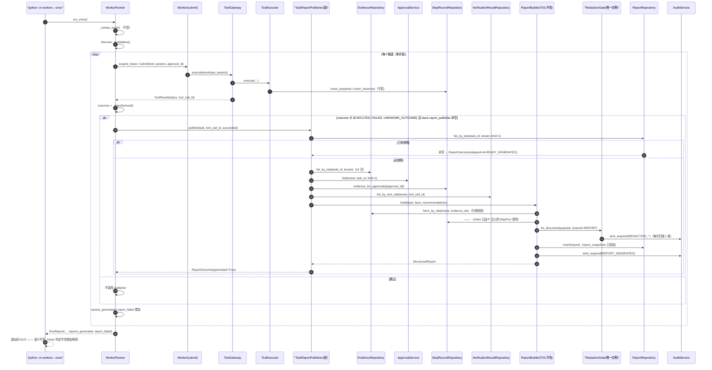
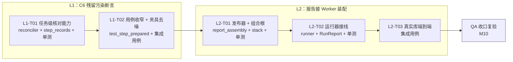
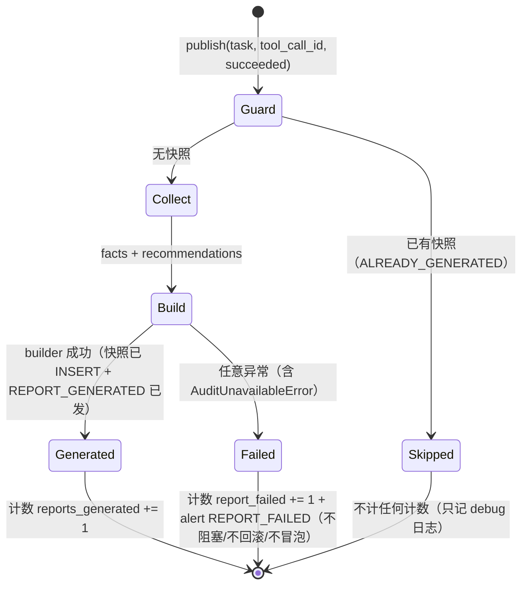

# W09 收口增量设计｜L1（C6 环境残留污染断言）+ L2（报告组件接 Worker 生产装配）

- 作者：高见远（架构师）｜语言：简体中文｜本文件是**本轮唯一交付物**
- 现场：`D:/DBGuaredian`，`git HEAD = 2850eca`，全部 W09 T03–T06 改动**未提交**（14 个已跟踪文件 `+884/−61` + 23 项新增）
- 上游依据（不得推翻）：`docs/w09/10-lead-rulings.md`（裁定台账）、`docs/w09/12-w09-qa-closeout.md`（§④ C6 判定、§⑧ 遗留）、`docs/w09/03-task-cards.md`（T01–T06 卡 + 所有权表 `:27-36`）、`docs/w09/02-design.md`（§0 A1–A10、§4–§8、§9.2）、`docs/w09/11-worker-ac-baseline.md`（sha256 锚 `§6.3`）
- 只读核查手段：`Read` / `Grep` / `pytest --collect-only`（零写库）。**本文件之外未改任何 `.py` / SQL / 配置 / 既有 docs**；未连库写；未 `git commit/add/checkout/reset`

---

## 1. 结论速览

### L1：C6「环境残留污染断言」——**给生产加「任务级核对」能力，把 8 处用例的扫描范围收窄到本任务；断言文本零改动**

| 项 | 结论 |
|---|---|
| 改什么 | ① `StepRecordRepository.find_unobserved()` 增**可选** `task_id`（SQL 走既有索引 `idx_prepared_task (tenant_id, task_id, prepared_at)`）；② `Reconciler` **新增** `sweep_task()`（`sweep()` / `sweep_detailed()` 签名**逐字不动**）；③ `tests/integration/test_step_prepared.py` 的 8 处 scan 调用加 `task_id=task.task_id`；④ 该文件 `created_tasks` 夹具去掉 `admin_client` DELETE（E-2 的 1045 是 2 个 teardown error 的唯一来源） |
| 为什么 | 两条用例的断言（`results == []`、`len(results) == 1`）假设「租户内只有本用例的行」，而 `sweep(tenant_id=...)` 按设计扫**全租户**；`tenant_local` 有 101 条历史未观测残留且**单调增长**（QA §4.2 实测 101→102），旧实现同样返回 102 条（QA §4.3 实证），因此**不存在**「不改扫描范围而让断言成立」的任何路径（删残留被全局纪律禁止且残留本身是合法证据） |
| 风险等级 | **中低**。改的是「查询条件」而非「判定逻辑」：`_reconcile_one()` AST 零改动、`sweep()` 返回类型与参数表零改动、判定结论逐条不变（QA §4.3 已证新旧等价）。风险集中在两处所有权越界（T06 独占文件 / W06 遗留文件）与夹具去噪的取证方式 |

### L2：报告组件接 Worker 生产装配——**输出侧接一条装配线，不改任何 `core/report/**`，失败不阻塞执行**

| 项 | 结论 |
|---|---|
| 改什么 | ① 新建 `workers/report_assembly.py`（`TaskReportPublisher` + 3 个端口适配器）；② `workers/stack.py` 增第 11 步装配（唯一 `RedactionGate` 实例 + `ReportRepository` + `EvidenceRepository` → `WorkerStack.redaction` / `WorkerStack.report_publisher`）；③ `workers/runner.py` 在**拿到 `ToolResult` 之后**挂一次 `publish()`，`RunReport` 增 `reports_generated` / `report_failed`（`merged` / `to_public_dict` 同步） |
| 为什么 | 这是 `02-design.md:684`（§9.2）**早已裁定给 T02 但未落地**的最后一项（`workers/stack.py`：「装配 `DataRedactionEngine`/`RedactionGate`/`ReportBuilder` 并注入」）；QA §⑧-8 登记 `ReportBuilder` / `build_report` 在 `apps/`、`workers/` **零引用**，AC-12 只到组件级。补做该装配项**不是新设计**，是把已裁定事项做完 |
| 风险等级 | **中**。触点是 R2 执行链下游（拿过 `ToolResult` 之后），不改变 Gateway 八步管线、不新增写工具、不新增端点；主要风险是「生产装配新增一处可抛错路径」→ 用「publish 全包 try/except + 不阻塞执行 + 稳定计数」把风险关在报告侧 |

---

## 2. L1 方案对比与逐条论证

### 2.1 三个候选方案

| 维度 | **A**：给 `sweep()`/`sweep_detailed()` 增可选 `task_id` | **A′（推荐）**：新增 `Reconciler.sweep_task()` + 仓储可选 `task_id` | **B**：只改两条历史用例的调用/断言范围 | **C**：给用例注入替身仓储 / 只在 `find_unobserved` 加过滤 |
|---|---|---|---|---|
| 生产是否获得新能力 | 是 | **是** | 否（纯测试侧） | 否（纯测试侧） |
| 向后兼容 | 语义兼容，**但本仓不等价于兼容**：`tests/unit/test_w09_sweep_scanned.py:292-297` 用 `inspect.signature(Reconciler.sweep)` 逐字断言参数表 `["self","tenant_id","older_than_s"]` → 加参数**必红** | **完全兼容**：`sweep` / `sweep_detailed` 的参数表、默认值、返回类型逐字不变；新方法纯增量 | 无接口变更 | 无接口变更 |
| 是否算「为让测试变绿而改测试」 | 不算（但会先破一条既有断言，得改那条断言 → **落地时必然变成"改测试"**） | **不算**：断言文本零改动，只把"查哪个范围"换成生产已有语义 | **算**：`assert results == []` 必须重写成 `assert [r for r in results if r.task_id == ...] == []`，断言文本被改，审计上无法与"放宽断言"区分 | **算**：两条集成用例失去真实库覆盖（P0-16/P0-18 的价值就在真 SQL + 真 FK） |
| 影响面 | `reconciler.py` + `step_records.py` + 1 条既有断言（**被迫改**） | `reconciler.py` + `step_records.py`（+ 新增 2 个测试文件） | 仅 1 个测试文件，但**改断言** | 3 个测试文件 |
| 文件所有权 | `reconciler.py`=T06 独占、`step_records.py`=W06（W09 表外） | 同 A（但不动任何既有断言） | `test_step_prepared.py`=W03 遗留 | 同 B |
| 每轮运行写放大 | 1 条结论（任务级） | 1 条结论（任务级） | 仍 102 条结论 → 每次 102 条 `RECONCILIATION_REQUIRED` + 可能迁移 102 个残留任务（**污染加速器**） | 0（但不写真实库） |

### 2.2 推荐：**A′**

**推荐理由（逐条对应主理人五问）**

**① 哪种改法不是「为让测试变绿而改测试」？**

A′。判据不是"改了测试文件没有"，而是"被改的是**断言的判定对象**还是**断言的查询范围**"：

- 两条用例的**被测命题**始终是「本任务那条 prepared 调用被核对**恰好一次**（或**零次**）」。这个命题在 101 条无关残留面前无法用"租户全量结果集"表达，但**不改变命题本身**。
- A′ 落地后，用例里 `assert results == []`（`:211`）、`assert len(results) == 1`（`:385`）、`assert unobserved == []`（`:196`）、`assert len(...) == 1`（`:242`）**一个字符都不改**；只把 `sweep(tenant_id=..., older_than_s=0)` 改成 `sweep_task(tenant_id=..., task_id=task.task_id, older_than_s=0)`。
- 反过来，B 必须重写断言表达式；C 会把真实库用例改成替身用例，二者都无法通过"断言集合逐字一致"的复核。

**② 加 `task_id` 会让 `sweep()` 契约漂移吗？（A6 的准确边界）**

- A6 原文（`02-design.md:19`）：「`Reconciler.sweep()` **签名与返回类型不变**」，理由列全部是**返回值用法**（`len(results)` / `results[0]` / `results == []`）。主理人的理解（"A6 冻结的是返回类型，不是参数永不增加"）与 A6 的**立法意图**一致。
- 但**本仓存在比 A6 更硬的机器约束**：T06 交付的 `tests/unit/test_w09_sweep_scanned.py:292-297` 用 `inspect.signature` 逐字断言 `list(signature.parameters) == ["self","tenant_id","older_than_s"]`，并且该项断言的注释就是"签名冻结"。给 `sweep()` 加参数 = 这条断言必红；唯一"修法"是改这条断言 → 直接违反 W09 全局纪律第 1 条。
- 结论：**A 在语义上向后兼容，在本仓的测试契约上前提不成立**。A′ 用「新增方法、不动既有方法」的形态——这与 A6 自己创造的先例（`sweep_detailed()` 是新增而非改 `sweep()`）完全同构，**契约漂移风险归零**。
- 兼容性论证（A′）：`sweep()` / `sweep_detailed()` 的 `inspect.signature` 输出、默认值、返回类型、行为逐字不变；所有既有调用点（`workers/runner.py:431/435`、`test_w06_acceptance.py:996/1049`、`test_w09_sweep_scanned.py`、`test_step_prepared.py` 其余 8 处）不受影响。

**③ 仓储层 `find_unobserved` / SQL 是否需要改？是否跨文件所有权？**

- **需要改**（A′ 的一部分）：`find_unobserved` 增可选 `task_id`，SQL 增一个可选谓词 `AND p.task_id = %s`。理由：
  1. 索引现成——`006_w06_approval_audit.sql:111` 的 `KEY idx_prepared_task (tenant_id, task_id, prepared_at)` 与「tenant + task + prepared_at ≤ cutoff」完全对齐，加谓词不引入新索引、不新增迁移；
  2. 若把过滤放在 Python 侧（先取全租户再滤），`scanned_total`（KD-2 的"真实扫描行数"）会变成"扫了 102 行却只判 1 行"，任务级调用方拿到的是**租户级成本**，口径不符合 KD-2 的立法目的。
- **跨文件所有权：是**。`core/execution/step_records.py` 不在 `03-task-cards.md:27-36` 的所有权表内（属 W06 交付），需主理人**显式授权**（同 `workers/stack.py` 在本卡的授权形态）。
- 兼容实现要点：`Reconciler` 内部**仅在 `task_id is not None` 时才把 `task_id` 传给仓储**（条件分派）。原因不是风格：T06 单测替身 `tests/unit/test_w09_sweep_scanned.py:_FakeStepRecords.find_unobserved` 的形参表不含 `task_id`，且它把每次调用的 `kwargs` 记进 `self.calls` 被逐字断言（`:202` / `:225` / `:242-243`）——无条件透传会让 T06 的 10 条用例变红。这一处 4 行的条件分派是**保住"零改 T06 测试文件"的唯一成本**，必须在代码里写清原因。

**④ 改完两条用例的「最小改动」是什么？**

| 行 | 现状 | 改为 | 断言是否变 |
|---|---|---|---|
| `:152` | `find_unobserved(tenant_id=task.tenant_id, older_than_s=0)` | `+ task_id=task.task_id` | 否（`:153` 逐字不变） |
| `:155` | `sweep(tenant_id=task.tenant_id, older_than_s=0)` | `sweep_task(tenant_id=task.tenant_id, task_id=task.task_id, older_than_s=0)` | 否（`:156-161` 不变） |
| `:181` | 同上 | 同上 | 否（`:182-184` 不变） |
| `:195` | `find_unobserved(...)` | `+ task_id=task.task_id` | 否（`:196` 不变） |
| `:210` | `sweep(...)` | `sweep_task(...)` | 否（`:211` **`assert results == []` 原样保留**） |
| `:241` | `find_unobserved(tenant_id=..., older_than_s=60)` | `+ task_id=task.task_id` | 否 |
| `:242` | `find_unobserved(tenant_id=..., older_than_s=0)` | `+ task_id=task.task_id` | 否（`:242` 的 `== 1` 原样） |
| `:384` | `sweep(...)` | `sweep_task(...)` | 否（`:385` **`assert len(results) == 1` 原样**） |
| `:534`（建议同改，非必需） | `sweep(tenant_id=..., older_than_s=0)` + `mine = [...]` | `sweep_task(...)` | 否（`mine` 过滤仍在，`len(mine) == 1` 仍成立） |

**只动「扫描范围」，所有 `assert` 语句文本逐字不变**（含 `:211` / `:385` 两条主判据）。`:534` 是 P2 建议项：它当前不红（已用 `mine` 过滤），但每次跑 10 个参数化迭代各扫全租户 → 1010 条审计事件/轮，是残留"越跑越多"的放大器之一。

> **必须同时做的第 9 项**：`created_tasks` 夹具（`:54-70`）仍用 `admin_client` 对 11 张表 `DELETE`，而 `DG_ADMIN_DSN` root 1045 从未可用（E-2）→ 即使用例本体全部 passed，整个文件仍是 `2 passed, 2 errors`。按主理人 `10-lead-rulings.md` §4 对 M01 的既有裁定（**测试侧去噪、不 DELETE、只断言本用例范围内事实**）同法处理，才能把 C6 从「2 failed, 2 errors」推到「2 passed, 0 errors」。**这不是 L1 的可选项，否则本卡等于没修完。**

**⑤ C6 之外还有哪些用例被残留污染？（只读 grep 全量清单）**

| 文件 | 行 | 形态 | 当前是否红 | 处置 |
|---|---|---|---|---|
| `tests/integration/test_step_prepared.py` | `152-153` | `find_unobserved` 租户全量 + `== [tool_call_id]` | **红**（`-k` 未选中，QA 未见到） | L1-T02 必修 |
| 同上 | `155-156`、`181-184` | `sweep` 租户全量 + `len(results)==1` / `again[0]` | **红**（同上；`again[0]` 会取到最老的残留结论） | L1-T02 必修 |
| 同上 | `195-196` | `find_unobserved` + `== []` | **红** | L1-T02 必修 |
| 同上 | `210-211` | `sweep` + `== []` | **红**（C6 主判据之一） | L1-T02 必修 |
| 同上 | `241-242` | `find_unobserved(older_than_s=60)` + `== []` / `== 1` | **红** | L1-T02 必修 |
| 同上 | `384-385` | `sweep` + `len(results)==1` | **红**（C6 主判据之二） | L1-T02 必修 |
| 同上 | `534-536` | `sweep` 全租户 + `mine` 过滤 | 绿（但写放大 1010 事件/轮） | P2 建议同改 |
| `tests/integration/test_w06_acceptance.py` | `996-1000` | `sweep` + `mine` 过滤 + `assert mine` | 绿（写放大 101 事件/轮） | P2 建议同改 |
| `tests/integration/test_w06_acceptance.py` | `1041-1046` | `find_unobserved` 仅作 set 成员判定 | 绿 | 不改 |
| `tests/integration/test_w06_acceptance.py` | `1049` | `sweep` 返回值被丢弃 | 绿 | 不改 |
| `tests/unit/test_w09_sweep_scanned.py` | 全部 | 内存替身，不连库 | 绿 | 不改（**T06 冻结**） |
| `tests/unit/test_observed_evidence.py` | 全部 | 内存替身 | 绿 | 不改 |

> **口径更正（须主理人知悉）**：QA 只跑了 `-k "sweep or reconcile"`（选中 2 / 收集 20），因此只看到 2 条红。**静态核查显示整个文件在同一根因下共 5 个用例不可通过**（`:145`、`:187`、`:202`、`:222`、`:373`）。若 L1 只修 2 条，QA 下次跑整文件会得到 `3 failed` —— 这不是新缺陷，而是同一缺陷的其余 3 条。**L1 必须一次修完 8 处**，否则"变绿"只是把红藏进未选中的用例里。

### 2.3 为什么**不**用「给 `sweep()` 加 `task_id`」（A）——一句话结论

> A 会让 `tests/unit/test_w09_sweep_scanned.py:292-297` 的签名冻结断言变红，而该断言是 A6 的机器化表达；为了让它变绿必须改该断言 → 正是 W09 全局纪律第 1 条禁止的动作。**A 的"向后兼容"在语言语义上成立，在本仓的测试契约上不成立。**

---

## 3. L1 精确改动清单

### 3.1 `core/execution/step_records.py`（W06 归属，需授权）

**位置：`find_unobserved`，现状 `:218-251`**

```python
# 改后（签名 + 条件 SQL）
    def find_unobserved(
        self,
        *,
        tenant_id: str,
        older_than_s: float,
        limit: int = 50,
        offset: int = 0,
        task_id: str | None = None,   # 新增（可选）：任务级收窄；None 时 SQL 与历史逐字一致
    ) -> list[StepPrepared]:
        ...
        if task_id is not None and not str(task_id).strip():
            raise RequestInvalidError("task_id 不能为空字符串", details={"task_id": task_id})
        cutoff = to_db_time(utc_now() - timedelta(seconds=older_than_s))
        conditions = ["p.tenant_id = %s", "o.tool_call_id IS NULL", "p.prepared_at <= %s"]
        params: list[Any] = [tenant_id, cutoff]
        if task_id is not None:
            # 走既有索引 idx_prepared_task (tenant_id, task_id, prepared_at)（migration 006:111）
            conditions.append("p.task_id = %s")
            params.append(task_id)
        rows = self._client.fetch_all(
            "SELECT p.* FROM dg_system.step_prepared p "
            "LEFT JOIN dg_system.step_observed o ON o.tool_call_id = p.tool_call_id "
            f"WHERE {' AND '.join(conditions)} "
            "ORDER BY p.prepared_at ASC, p.prepared_id ASC LIMIT %s OFFSET %s",
            (*params, limit, offset),
            max_rows=limit,
        )
```

不变项（硬保护）：`limit ∈ 1..500` 与 `offset >= 0` 的校验、`older_than_s < 0` 的校验、`ORDER BY prepared_at ASC, prepared_id ASC`（分页稳定性）、`max_rows=limit`（防窗口被绕过）、返回类型 `list[StepPrepared]`、`_to_prepared` 映射。占位符顺序必须与 `params` 元组顺序一致（`tenant/cutoff[/task]/limit/offset`）。docstring 增 2 行说明"任务级收窄供 `Reconciler.sweep_task()` 使用；缺省不改变任何既有行为"。

### 3.2 `core/execution/reconciler.py`（T06 独占，需授权）

| 位置 | 改动 |
|---|---|
| 模块 docstring `:9-21` | 末尾追加一段「W10 L1 增量」：新增 `sweep_task()`，讲清 `sweep()`/`sweep_detailed()` 签名零变、为什么用新方法而不是加参数（引 `test_w09_sweep_scanned.py:292-297`） |
| `:114-129` `sweep()` | **逐字不变**（含 docstring；`return list(self.sweep_detailed(...).conclusions)` 保留） |
| `:131-170` `sweep_detailed()` | 签名逐字不变；**函数体改为一行委托**：`return self._sweep(tenant_id=tenant_id, older_than_s=older_than_s, task_id=None)` |
| 新增 `_sweep()` | 原 `sweep_detailed()` 主体搬迁（`page_size=500`、`tenant_id` 为空时 `_tenants_with_prepared()`、`scanned_total += len(batch)` **过滤前计数**、`offset += len(batch)`、`if len(batch) < page_size: break` 全部逐字保留），唯一差别：分页调用改为 `self._find_page(...)`，并把 `task_id` 透传 |
| 新增 `sweep_task()` | 公开方法（新能力出口，见下方代码块 A） |
| 新增 `_find_page()` | 私有分页适配（条件透传 `task_id`，见下方代码块 B） |
| import | 增 `from core.errors import RequestInvalidError`（与既有 `StateConflictError, TaskNotFoundError` 同一行合并） |
| `__all__` | 不变（`sweep_task` 是方法名，不是模块级导出名） |

**代码块 A：`sweep_task()`（新增公开方法）**

```python
def sweep_task(
    self, *, task_id: str, tenant_id: str | None = None, older_than_s: float = 60.0
) -> list[ReconcileResult]:
    """只核对**指定任务**的未观测调用；返回类型与 `sweep()` 相同。

    与 `sweep()` 的唯一区别是扫描范围：仓储层按 `(tenant_id, task_id)` 过滤。
    用途：① 崩溃恢复只关心当前任务时，避免被历史残留挤出分页窗口；
          ② 运维按任务重放核对（本仓 UI/API 未暴露，仅进程内使用）。
    `sweep()` 的参数表是 T06 冻结契约（`tests/unit/test_w09_sweep_scanned.py:292-297`），
    因此本能力以**新方法**提供，不改既有方法签名与返回类型。
    """
    if not str(task_id or "").strip():
        raise RequestInvalidError("task_id 不能为空", details={"task_id": task_id})
    return list(
        self._sweep(
            tenant_id=tenant_id, older_than_s=older_than_s, task_id=task_id
        ).conclusions
    )
```

**代码块 B：`_find_page()`（私有，条件透传的原因写在代码里）**

```python
def _find_page(
    self,
    *,
    tenant_id: str,
    older_than_s: float,
    limit: int,
    offset: int,
    task_id: str | None,
) -> list[StepPrepared]:
    # 仅在 task_id 非空时才传该关键字参数：T06 单测替身
    # `_FakeStepRecords.find_unobserved`（tests/unit/test_w09_sweep_scanned.py:102-119）
    # 的形参表不含 task_id，且它把每次调用的 kwargs 记进 self.calls，
    # 被 :202 / :225 / :242-243 逐字断言——无条件透传会让 T06 的 10 条用例红，
    # 那属于"为让代码过而改测试"，明确避免。
    if task_id is None:
        return self._step_records.find_unobserved(
            tenant_id=tenant_id, older_than_s=older_than_s, limit=limit, offset=offset
        )
    return self._step_records.find_unobserved(
        tenant_id=tenant_id,
        task_id=task_id,
        older_than_s=older_than_s,
        limit=limit,
        offset=offset,
    )
```

**冻结校验（写进验收命令）**

```python
inspect.signature(Reconciler.sweep).parameters           # 必须 == ["self","tenant_id","older_than_s"]
inspect.signature(Reconciler.sweep_detailed).parameters  # 必须 == ["self","tenant_id","older_than_s"]
inspect.signature(Reconciler.sweep_task).parameters      # ["self","task_id","tenant_id","older_than_s"]
```

### 3.3 `tests/integration/test_step_prepared.py`（W03 遗留，需授权）

**（a）9 处调用点**：按 §2.2 ④ 表格逐行改（8 处必需 + `:534` 建议）。

**（b）夹具去噪（`:54-70`）**

```python
@pytest.fixture()
def created_tasks(control_client, monkeypatch):
    """记录本用例创建的任务，用例结束后做**只读**核对。

    为何不再清理（`10-lead-rulings.md` §4 对 M01 的同法裁定）：
    - `DG_ADMIN_DSN` root 1045 在本机从未可用（E-2），`admin_client.execute(DELETE ...)`
      建连即抛 → teardown 升级为 ERROR；
    - 即便凭据可用也不得执行 DELETE：`step_prepared` / `step_observed` / `task_events`
      是只追加证据表，W09 全局纪律与 `dg_ctl` 授权都禁止删除历史残留；
    - 因此改为「只断言本用例范围内事实」：任务行必须仍可读（证明用例确实落库），
      残留行继续留存、不再尝试清理。
    """
    tracked: list[Task] = []
    original = TaskService.create_task

    def tracked_create(self, goal, **kwargs):
        task = original(self, goal, **kwargs)
        tracked.append(task)
        return task

    monkeypatch.setattr(TaskService, "create_task", tracked_create)
    yield tracked
    repository = TaskRepository(control_client)
    for task in tracked:
        assert repository.get_task(task.task_id, tenant_id=task.tenant_id).task_id == task.task_id
```

- 硬保护：`_CLEANUP_TABLES`（`:37-49`）**保留**（历史清理清单，加一行注释说明本轮起不再执行），**不删**；`admin_client` 不再被本文件引用 → 1045 不再触发。
- `created_tasks` 的产出类型由 `list[str]` 变为 `list[Task]`：已逐条核查，本文件 **没有任何用例读取该夹具的值**（只作形参），故不影响任何断言。
- 断言集合变化：**测试函数体内断言数 HEAD = 改后（逐字）**；模块断言总数 **+1**，且新增的 1 条位于夹具内（与 M01 被 QA 接受的口径一致，必须由 QA 独立复核）。

### 3.4 新建 `tests/unit/test_w09_sweep_task_scope.py`（不连库）

断言要点（每条都直接对应一条设计约束）：

| # | 用例 | 断言 |
|---|---|---|
| 1 | `sweep_task` 只传 `task_id` 给仓储 | 替身的 `calls` 记录里 `task_id` == 目标任务；`tenant_id`/`limit`/`offset` 与 `sweep()` 一致 |
| 2 | `sweep()` **不**传 `task_id`（向后兼容） | 替身收到的 kwargs **不含** `task_id` 键（逐字证明 T06 替身不会被喂新参数） |
| 3 | `sweep_task` 只产出本任务结论 | 3 个任务的 prepared 中，结果集 `{r.task_id} == {目标}`，`scanned_total`（经 `_sweep` 内部）只计本任务行 |
| 4 | `sweep()` / `sweep_detailed()` 签名冻结 | `list(inspect.signature(...).parameters)` 逐字等于旧值 |
| 5 | `sweep_task()` 空 `task_id` | 抛 `RequestInvalidError`（fail closed） |
| 6 | `sweep_task` 与 `sweep` 结论一致（同任务） | 同一数据下 `[r.to_public_dict() for r in sweep_task()] == [r for r in sweep() if r.task_id == ...]` |

### 3.5 新建 `tests/integration/test_w09_sweep_task_scope.py`（真实库）

- 建 2 个任务（真实 `TaskService`），各插 1 条 `StepPrepared`（`prepared_at` 早于现在 5 分钟）；
- `reconciler.sweep_task(tenant_id=TENANT, task_id=A, older_than_s=0)` → **只**返回 A 的 1 条结论；B 的状态保持不动；
- 与「租户内 101 条历史残留共存」这一现实同跑（不清理、不断言残留数），证明过滤在 SQL 层生效；
- 只 INSERT（task / step_prepared / task_events），无 DELETE、无 `DG_ADMIN_DSN`、无 PG。

---

## 4. L2 装配设计

### 4.1 触发点判定（先回答"什么时候生成"）

**结论：在 `_execute()` 内、拿到 `ToolResult` 之后（≈ `step_observed` 落账之后）触发一次，不是"任务终态"、不是"`run_once` 末尾"。**

| 候选触发点 | 判定 | 依据（可复核） |
|---|---|---|
| 任务进入终态后 | **不可行** | Worker 从不把任务推到终态：`tests/integration/test_worker_process.py:330` 断言执行成功后 `tasks.status == "EXECUTING"`；终态由验证/人工链路产生 → 该触发点在本进程内**永不发生** |
| `step_observed` 之后（= 拿到 `ToolResult` 之后） | **采用** | 这是唯一同时持有 `task`、`result.tool_call_id`、`outcome` 三件事的位置：`task` 供 `ReportBuilder.build(task=...)`（要 `environment_id`/`run_id`）、`tool_call_id` 供验证端口定位 `verification_results`；且"每个执行事实恰一份报告"的语义最清晰 |
| 每个 `run_once` 末尾统一生成 | 不采用 | 需要重新发现"本轮执行过哪些任务"（再查库或引入新状态），并丢失 `tool_call_id` 锚点；与 `RunReport` 的 per-candidate 计数结构不合 |

**触发判定树（`_execute` 内、`outcome = _classify(result)` 之后）**

```
outcome = _classify(result)            # 已经过 worker.submit() 且拿到 ToolResult
│
├─ stack.report_publisher is None ─────────────────► 不生成（历史单测替身；零行为变化）
│
├─ outcome == SKIPPED / DENIED ────────────────────► 不生成（无执行事实；拒绝事实已在
│                                                    GATEWAY_EXECUTION_DENIED / TOOL_CALL_DENIED 落账）
│
├─ outcome ∈ {EXECUTED, FAILED, UNKNOWN_OUTCOME} ──► 进入 publish()
│     │
│     ├─ reports.list_by_task(task_id, tenant, limit=1) 非空 ──► 跳过（幂等：ALREADY_GENERATED）
│     │
│     ├─ 采集事实：evidence.list_by_task(...)（≤5 页，250 条上限）
│     │              approvals.list(task_id, limit=1) + step_records.evidence_for_approvals(...)
│     │              verification_results.list_by_tool_call(tenant, result.tool_call_id) 取最后一条
│     │
│     ├─ ReportBuilder.build(task, facts, recommendations)
│     │     ├─ 成功  ──► reports_generated += 1（报告已 INSERT + REPORT_GENERATED 已发）
│     │     └─ 抛错  ──► report_failed += 1 + 结构化日志 alert=REPORT_FAILED；**不回滚、不阻塞、不冒泡**
│     │
│     └─ 返回 ReportOutcome（不改变 `_execute` 的返回码）
│
└─ 注：`worker.submit()` 抛 DBGuardianError 的路径（:649-660 `return OUTCOME_FAILED`）**不生成报告**
      —— 该路径没有 ToolResult，无 `tool_call_id` 可锚定，且该情形的事实（提交失败）已在
      `SUBMIT_FAILED_NO_RETRY` 日志与审计事件里；不为了"覆盖全部分支"而伪造 tool_call_id。
```

**"不误生成"的三条硬约束**

1. **无执行事实不生成**（`SKIPPED` / `DENIED` / `submit` 异常路径）；
2. **无证据也生成，但如实记为 `UNKNOWN`**（见风险 R1 与待裁定 Q5）；
3. **快照已存在不生成**（幂等守卫，见 §4.6）。

### 4.2 时序图（真实生产链路）



### 4.3 依赖注入表（`TaskReportPublisher` 的每个端口取 stack 里哪个对象）

| `ReportBuilder.__init__` 形参 | 注入对象 | 来源 | 说明 |
|---|---|---|---|
| `evidence: ReportEvidencePort` | `EvidenceRepository(control_client)` | `core/evidence/repository.py:205 fetch_by_ids(tenant_id, ids)` **已满足协议**（`core/report/validate.py:42-47`） | 不新建端口适配器，直接复用 |
| `verifications: VerificationPort` | **每次 publish 新建** `_VerificationForCall(results=VerificationResultRepository(control_client), tenant_id, tool_call_id)` | `core/verification/repository.py:50 list_by_tool_call(tenant, tool_call_id)` 取**最后一条** | 该仓储只有「按 tool_call 查」没有「按 task 查」；本卡**不改** `core/verification/**`，故以本轮 `ToolResult.tool_call_id` 锚定 |
| `steps: StepPort` | `_ChainAdapter(approvals=ApprovalService, step_records=StepRecordRepository, tenant_id)` | `ApprovalService.list(tenant_id, task_id, limit=1)` → `status`；`StepRecordRepository.evidence_for_approvals([approval_id])` → `{step_prepared, step_observed_outcome}` | 两次单行查询，均为只读；`StepChain` 直接复用 `core/report/builder.py:64-70` 的 dataclass，**不改 builder** |
| `audit: AuditPort` | `stack.audit`（`AuditService`） | `adapters/lab_assembly.py:94` 构造、`stack.py:240` 取出 | `REPORT_GENERATED` 经 `emit_required`（必成功语义，T03 既有） |
| `gate: RedactionGate` | **`stack.redaction`（唯一实例）** | `stack.py` 新增 `RedactionGate(DataRedactionEngine(), audit=audit)`，同时写入 `WorkerStack.redaction` 与 publisher | 见下方"同一实例"专项 |
| `reports: ReportSink` | `ReportRepository(control_client)` | `core/report/repository.py:59 insert` / `:93 list_by_task` | 只追加；`dg_ctl` 对该表有 schema 级 SELECT/INSERT（QA §6.1） |
| `policy_version` / `database_id` | `settings.policy_version` / `settings.database_id` | `core/config.py:98/36` | 不再吃 builder 的缺省常量，改为配置事实 |

**「必须与闸门②同一实例」的准确答复（含现状事实，不粉饰）**

- 事实一：**Worker 进程内不存在闸门②的实例**。`EvidenceService`（闸门②的调用点）根本不在 `build_worker_stack` 的装配里，`adapters/lab_assembly.py` 也不构造它；`ToolExecutor`（`lab_assembly.py:107-109`）构造时**没有传** `redaction_gate` → 它内部 `core/tools/executor.py:103` 自建 `RedactionGate(DataRedactionEngine())`（`audit=None`）。生产装配至今**没有任何地方**给闸门传 `audit`/`quarantine`。
- 事实二：`WorkerStack.redaction`（`stack.py:126-129`）自 T02 起就是**空槽位**，全仓无赋值点、无测试断言它（已 grep 确认）。
- 本卡落法：在 `build_worker_stack` 里**只创建一个** `RedactionGate` 实例（带 `audit=audit`，`quarantine=None`），同时写入 `WorkerStack.redaction` 并注入 `ReportBuilder.gate` → 报告通道与**未来**在 Worker 内装配的闸门②可用**同一对象**（用 `is` 断言锁定，见 §5 单测）。
- 不做的事（及原因）：**不**把该实例下沉进 `build_lab_stack`（需改 `adapters/lab_assembly.py` 的签名/返回字典，跨所有权，且会改变执行/证据链路的既有行为）；`quarantine=None` 与**当前生产口径一致**，`REVIEW_REQUIRED` 时闸门会在事件里写 `quarantine_skipped: true`（`core/redaction/gate.py:_record`），**留痕不丢**（丢的是隔离行，不是证据）。
- 由此产生的口径：报告通道的事件落点与执行/证据通道**一致**（同一个 `AuditService`）、`redaction_version` 一致（同一引擎版本），差异仅在隔离行落点。登记为风险 R3 + 待裁定点 Q4。

### 4.4 `workers/report_assembly.py` 结构与签名（新建）

```python
"""W09 收口 L2：报告发布器（Worker 生产装配的唯一出口）。

只做三件事：**取事实 → 调 T03 的 ReportBuilder → 如实计数**。
不改 `core/report/**`、不新增 API 端点、不发新事件类型、不持有 DSN、
不写裸 SQL（数据只经既有仓储）。

失败语义（设计 §4.5）：报告是执行事实**下游**的物化产物，
失败不回滚任务状态、不阻塞主循环、不冒泡，只用结构化日志 + RunReport 计数如实登记。
"""

ALERT_REPORT_FAILED = "REPORT_FAILED"
REASON_ALREADY_GENERATED = "ALREADY_GENERATED"
REASON_EVIDENCE_TRUNCATED = "EVIDENCE_TRUNCATED"
#: 建议文本必须避开 AC-11 的完成措辞黑名单（已修复/已执行/已完成/已恢复/已解决/fixed/resolved/already applied）
RECOMMENDATION_EXECUTED = "建议人工核对目标库当前状态与验证结论，再决定后续处置"
RECOMMENDATION_UNKNOWN = "建议先补齐执行回执与验证结论，再判断动作是否生效"
MAX_EVIDENCE_PAGES = 5           # 5 × 50 = 250 条上限，超出记 alert 截断，不伪造 id

@dataclass(frozen=True)
class ReportOutcome:
    generated: bool
    failed: bool = False
    skipped_reason: str | None = None

class _ChainAdapter:            # StepPort
    def chain_for_task(self, *, task_id: str, tenant_id: str) -> StepChain: ...

class _VerificationForCall:     # VerificationPort（每次 publish 新建，绑定本轮 tool_call_id）
    def latest_for_task(self, *, task_id: str, tenant_id: str) -> Any | None: ...

class TaskReportPublisher:
    def __init__(self, *, evidence, reports, approvals, step_records, verifications,
                 audit, gate, tenant_id: str, policy_version: str, database_id: str): ...
    @property
    def redaction(self) -> Any:      # 供 `is stack.redaction` 断言
        return self._gate
    #: `succeeded` 由调用方按本轮 `ToolResult.status is ToolStatus.SUCCESS` 传入，
    #: 只用于选一条**不含完成措辞**的建议文本（AC-11），不参与任何状态推导。
    def publish(self, task: Task, *, tool_call_id: str, succeeded: bool) -> ReportOutcome: ...

def build_report_publisher(*, settings, tenant_id: str, control_client, audit,
                           gate, approvals, step_records) -> TaskReportPublisher: ...
```

**`publish()` 内部顺序（幂等与失败隔离的关键）**

1. `existing = reports.list_by_task(task.task_id, tenant_id, limit=1)`；非空 → `ReportOutcome(generated=False, skipped_reason=ALREADY_GENERATED)`；
2. 采 facts：`evidence.list_by_task(task_id, tenant_id, limit=50)` 逐页（≤5 页），`supporting_evidence_ids = [e.evidence_id ...]`，`contradicting_evidence_ids=[]`（`evidence` 表无"支持/反证"列，本卡不臆造）；
3. 构造 per-call `ReportBuilder`（`verifications=_VerificationForCall(...)`、`steps=self._chain`、`gate=self._gate`）并 `build(task=task, facts=facts, recommendations=[Recommendation(text=RECOMMENDATION_EXECUTED if succeeded else RECOMMENDATION_UNKNOWN)])`（`succeeded` 只决定建议文本，**不参与状态推导**——`ActionState`/`FactStatus` 仍完全由 `StepPort` + `ReportEvidencePort` 的事实推导，AC-11/AC-09 不因本卡放宽）；
4. 成功 → `ReportOutcome(generated=True)`；任何异常 → 记 `alert=REPORT_FAILED` + `code`/`error_type`/`message_digest`（`canonical_digest`，不打原文）→ `ReportOutcome(generated=False, failed=True)`。

**`workers/` 静态守护必须仍满足**（`tests/unit/test_worker_layering.py`）：
`report_assembly.py` 内**不得**出现 `ToolGateway(`（`:83-89` 的 `builders == ["stack.py"]`）、不得出现 `ToolRegistry()`（`:80` 只对 stack.py，但同一纪律）、不得 import 驱动（`pymysql`/`psycopg`）、**不得出现裸 SQL 特征**（`:43-49` 的 `SELECT ... FROM` / `INSERT INTO` / `UPDATE dg_system` / `DELETE FROM` / `CREATE TABLE`，**含 docstring**）→ 文档里写"只追加写入 report_snapshots"，不写 SQL 片段。

### 4.5 失败语义（③）

| 问题 | 结论 | 论证 |
|---|---|---|
| 报告生成失败是否阻塞任务状态推进？ | **不阻塞、不回滚、不冒泡** | 执行事实在 `submit()` 返回时就已固化（`step_prepared`/`step_observed`/`tool_calls`/`tasks.status` 全部落账）；报告是其后的只读物化产物。回滚需要 `UPDATE tasks`——`dg_ctl` 无 UPDATE 授权、且违反只追加纪律 |
| 是否写 `REPORT_GENERATED` 之外的事件（如 `REPORT_FAILED`）？ | **不新增事件类型** | 新增需改 `core/audit/events.py`（**T01 独占**），且 A10 已把 W09 事件表冻结为 6 条；`task_events.event_type` 虽是 `VARCHAR(64)`（migration `001:67`）不阻碍，但扩事件词表属于"扩权"，本卡不做。替代：结构化日志 `alert=REPORT_FAILED` + `RunReport.report_failed` + `to_public_dict()` 暴露 |
| 是否 fail-closed？ | **不 fail-closed** | fail-closed 在 W09 只用于「执行前置条件」（`insert_prepared` 写不进去就不得执行、`emit_required` 失败即抛）。报告是**执行之后**的输出物，把下游失败升级为执行失败会污染 `failed`/`clean` 的既有语义 |
| 与 `emit_required` / `try_emit` 口径的关系 | 严格分层：`REPORT_GENERATED` 仍由 **builder 内部** `emit_required` 发（必成功语义，抛错 → 由 publisher 捕获计入 `report_failed`）；**publisher 自身不发任何审计事件**，因此不需要 `try_emit`，也不会把调度层的降级口径混进业务事件 | 与 `_emit_scheduler_event`（`runner.py:518-550`，"调度事件不是 R2 前置条件，用 try_emit 降级"）分区清晰 |

### 4.6 幂等性（⑥）

- `report_id = new_id("rpt")`（`core/tasks/models.py:36-37`：`f"{prefix}_{uuid4().hex}"`）→ **非确定性**，因此 **PK 不能承担幂等**。
- 幂等判据 = 「该任务是否已有快照」：`reports.list_by_task(task_id, tenant_id, limit=1)` 非空即跳过（`ALREADY_GENERATED`）。这是**读已存在事实**，不是"猜是否重复"。
- 重复 `run_once` 的实际路径已被执行侧封死（审批一次性 `CONSUMED` + 租约 + `state_version`），加上本守卫形成双保险；`run_forever` 多轮亦不会重复 INSERT。
- 竞态窗口：两个 Worker 进程同时对同一任务 publish → 各插一行（PK 是 `report_id`，不会冲突报错）。实际不可达（`worker_max_concurrency=1` + 租约独占 + 审批一次性），登记为理论风险 R6。
- **已知限制**：快照"存在即不再生成新版本"（无 `report_version` 递增、无重生成入口）。需要"验证后再生成一版"必须另立卡（属 W11 的 `Verifier` 生产接线范畴）。

### 4.7 `RunReport` 增量（④）

```python
@dataclass(frozen=True)
class RunReport:
    ...
    reconciled: int = 0
    reconcile_failed: int = 0
    reconcile_scanned_total: int = 0
    #: W10 L2：本轮成功落库并发出 REPORT_GENERATED 的报告数。
    reports_generated: int = 0
    #: W10 L2：本轮报告生成失败数（**不进入 `failed`、不影响 `clean`**，见设计 §4.5）。
    report_failed: int = 0
```

- `merged()`：两项相加；`to_public_dict()`：两项新增键。
- `clean` 判定**逐字不变**（只含 `denied/skipped/failed/unknown_outcome`）——与 `test_worker_scheduler.py:505-509`「`reconciled` 单独计不把报告变不干净」的既有口径同构。
- 既有断言安全：`test_worker_runner.py:954-958` 与 `test_worker_scheduler.py:505-509` 用**显式字段列表**遍历 `clean` 语义，加带默认值的字段不影响；`RunReport()` 无参构造仍成立。

### 4.8 退出码语义（⑤）

**不变**：`EXIT_OK=0` / `EXIT_OUTSTANDING=1` / `EXIT_CONFIG_ERROR=2`（`workers/cli.py:35-37`）三者取值与判据（`report.clean and outstanding == 0`）逐字不变。

理由：`clean` 的立法定义是"**执行侧**全部收敛（无 denied/skipped/failed/unknown_outcome）"；报告是执行之后的下游产物，把它塞进 `clean` 会让 `--once` 的运维语义从"任务都执行完了"漂移成"报告也都生成了"，等于**改掉被冻结的字段语义**（主理人硬约束明确禁止）。

可见性补偿（三层，均可被 CI/运维断言）：
1. `to_public_dict()` 的 `report_failed`（`--once` 的 JSON 输出已 `payload.update(report.to_public_dict())`，`cli.py:_report_payload`）；
2. 结构化日志 `alert=REPORT_FAILED`（含 `reason_code` / `error_type` / `message_digest`）；
3. `logger.info("报告已生成")` 与 `report_id`（可用 grep 对账）。

> 若主理人裁定"报告失败必须让 `--once` 退非 0"，最小改法是把它并入 `failed`（与 `reconcile_failed` 同法，`runner.py:340`）——**不建议**，因为它会改 `--once` 的既有语义且与"下游不污染上游"的分层冲突。列入待裁定点 Q3。

---

## 5. L2 精确改动清单

### 5.1 新建 `workers/report_assembly.py`（约 190 行，见 §4.4 结构）

要点清单：`ReportOutcome` / `ALERT_REPORT_FAILED` / 两条建议常量 / `_ChainAdapter` / `_VerificationForCall` / `TaskReportPublisher.publish` / `build_report_publisher` / `__all__`。零裸 SQL、零驱动 import、零 `ToolGateway(`。

### 5.2 修改 `workers/stack.py`（T02 独占，**本卡显式授权**）

| 位置 | 改动 |
|---|---|
| import 区 `:26-50` | 增：`from core.redaction.engine import DataRedactionEngine`、`from core.report.repository import ReportRepository`、`from core.evidence.repository import EvidenceRepository`、`from workers.report_assembly import TaskReportPublisher, build_report_publisher` |
| `WorkerStack` 字段 `:129` 之后 | 增 `report_publisher: TaskReportPublisher | None = None`（带 docstring：「W10 L2：报告发布器；`None` 表示未装配（历史替身），`run_once` 不做任何报告动作」） |
| `build_worker_stack` `:293` reconciler 之后 | 新增第 11 步（唯一的 gate 实例 + publisher）：<br>`redaction_gate = RedactionGate(DataRedactionEngine(), audit=audit)`<br>`report_publisher = build_report_publisher(settings=settings, tenant_id=resolved_tenant, control_client=control_client, audit=audit, gate=redaction_gate, approvals=approvals, step_records=step_records)` |
| `return WorkerStack(...)` `:295-316` | 增两个关键字实参：`redaction=redaction_gate`、`report_publisher=report_publisher` |
| 模块 docstring `:11-18` | 装配纪律补第 5 条：「报告发布器只读既有仓储 + 只追加 `report_snapshots`；不新增写工具、不新增端点」 |

不变项：`build_lab_stack(` / `ToolGateway(` / `Worker(` / `Reconciler(` 的构造逐字不变；**不出现** `ToolRegistry()`；`docker-compose.yml` / `deploy/**` 不动（`test_worker_layering.py:145-152` 的部署面断言不受影响）。

> ⚠️ 该文件 sha256 由 `a09dfbf5…` 变为新值：`11-worker-ac-baseline.md:196/206` 要求「M08 若发现其 hash 变化须立即回报主理人」→ 本卡落地后 QA 必须按「L2 授权改动」登记，且 `test_worker_layering.py` / `test_worker_isolation.py` / `test_worker_runner.py` / `test_worker_process.py` 四个基线文件 hash **必须仍为 SAME**。

### 5.3 修改 `workers/runner.py`（T06 独占，需授权）

| 位置 | 改动 |
|---|---|
| `RunReport` `:137-196` | 增 `reports_generated: int = 0` / `report_failed: int = 0`；`merged()` 与 `to_public_dict()` 同步；`clean` **不动** |
| `__init__` `:252-262` | 增 `self._reporter = getattr(stack, "report_publisher", None)`（与 `:253` 的 `getattr(stack, "reconciler", None)` 同法）；`self._reports_generated = 0`、`self._report_failed = 0` |
| `run_once` `:316-347` | 开头重置两个计数（`self._reports_generated = 0; self._report_failed = 0`）；`RunReport(...)` 增两个实参 |
| `_execute` `:665` 之后（`outcome = _classify(result)` 与末尾 `logger.info` 之间/之后） | 增：<br>`if outcome in (OUTCOME_EXECUTED, OUTCOME_FAILED, OUTCOME_UNKNOWN):`<br>`    self._publish_report(task, tool_call_id=result.tool_call_id, succeeded=result.status is ToolStatus.SUCCESS)`<br>**在 `return outcome` 之前，返回值与签名不变** |
| 新增 `_publish_report` | 全包 `try/except Exception`（`# noqa: BLE001`，理由同 `:402` 的 sweep 兜底）：成功 `self._reports_generated += 1` 并 `logger.info("报告已生成", extra={task_id, report_id})`；失败 `self._report_failed += 1` 并 `logger.error(alert=REPORT_FAILED, reason_code/error_type/message_digest)`；**绝不 raise**（不中断主循环、不影响 `outcome`） |
| 模块 docstring `:31-46` | 追加「W10 L2」段：触发点（拿到 `ToolResult` 之后）、三项不生成条件、失败不阻塞、`clean` 与退出码不变 |

不变项（硬保护）：`_execute` 的返回码集合与语义；`_sweep_once` / `_invoke_sweep` / `_emit_reconciliation_*` 全部不动；`failed`/`clean` 计算不动。

### 5.4 新建 `tests/unit/test_w09_report_assembly.py`（全假端口，不连库）

| # | 用例 | 断言要点 |
|---|---|---|
| 1 | 装配 `is` 一致性 | `publisher.redaction is stack.redaction`；`publisher` 的 gate 与 stack 槽位同一对象 |
| 2 | 正常发布 | `generated=True`；`reports.insert` 恰 1 次；`audit.emit_required` 收到 `REPORT_GENERATED`；`publish` 只读不写其它表 |
| 3 | 幂等 | `list_by_task` 返回非空 → `generated=False, skipped_reason=ALREADY_GENERATED`，`insert` 0 次 |
| 4 | 失败隔离 | builder 抛 `DBGuardianError` → `failed=True` 且 **不冒泡**；断言日志 `alert=REPORT_FAILED`（`caplog`） |
| 5 | 事实投影 | 给定 3 条 evidence + 1 条 approval(CONSUMED) + 1 条 observed → `facts.supporting_evidence_ids` 顺序稳定、`_ChainAdapter` 返回 `has_step_prepared/observed=True`、`VerificationPort` 命中最后一条 |
| 6 | 建议文本合规 | 两条 `RECOMMENDATION_*` 常量均能通过 `Recommendation(text=...)`（不触 AC-11 黑名单） |
| 7 | 无证据任务 | facts 为空 → 仍 `generated=True`；报告 `fact_status == UNKNOWN`（风险 R1 / 待裁定 Q5 的机器化表达） |

### 5.5 新建 `tests/unit/test_worker_report_hook.py`（假 stack + 假 publisher）

| # | 用例 | 断言要点 |
|---|---|---|
| 1 | EXECUTED 触发 | `publish` 调用 1 次；`reports_generated == 1`；`run_once` 返回码与无 reporter 时逐字相同 |
| 2 | UNKNOWN / FAILED 触发 | 同上（各 1 次） |
| 3 | SKIPPED / DENIED 不触发 | `publish` 调用 0 次 |
| 4 | `stack.report_publisher is None` | 零调用、零计数、零异常（**历史替身零行为变化**） |
| 5 | 失败不阻塞 | `publish` 抛异常 → `report_failed == 1`、`failed`/`clean` 与基线逐字相同、`run_once` 不抛 |
| 6 | `RunReport` 增量 | `merged` 相加；`to_public_dict()` 含两键；`RunReport().clean is True`；`RunReport(report_failed=9).clean is True` |

### 5.6 新建 `tests/integration/test_w09_report_publish_chain.py`（真实库一条端到端）

- 复用 `tests/integration/test_worker_process.py` 的夹具形态（`build_worker_stack` + `env_mysql_local`）+ `EvidenceService.create` 造 1 条证据（走闸门②，`redaction_version` 非空）；
- 断言：① `report_snapshots` 本任务恰 1 行；② `report_id` 前缀 `rpt_`、`redaction_version` 与引擎一致；③ `task_events` 里 `REPORT_GENERATED` 恰 1 条且 payload 含四个状态字段；④ **重复 `publish` 不新增行**（幂等）；⑤ 任务 `status` / `state_version` 未因发布而改变（只读证明）；
- 纪律：只 INSERT、不 DELETE、不依赖 `DG_ADMIN_DSN`、不依赖 PG；外层 `timeout 180`。

---

## 6. 两张卡的有序任务列表

### 6.1 独占文件矩阵（防并行冲突）

| 文件 | 卡/任务 | 归属 | 授权状态 |
|---|---|---|---|
| `core/execution/reconciler.py` | L1-T01 | **T06 独占** | **需主理人授权**（Q1） |
| `core/execution/step_records.py` | L1-T01 | W06 交付（W09 表外） | **需主理人授权**（Q1） |
| `tests/unit/test_w09_sweep_task_scope.py` | L1-T01 | 新建 | — |
| `tests/integration/test_step_prepared.py` | L1-T02 | **W03 遗留用例** | **需主理人授权**（Q2，参照 M01 先例） |
| `tests/integration/test_w09_sweep_task_scope.py` | L1-T02 | 新建 | — |
| `tests/integration/test_w06_acceptance.py` | L1-T02（P2 可选） | W06 | **需授权才动**（Q2b）；不动亦可通过验收 |
| `workers/report_assembly.py` | L2-T01 | 新建 | — |
| `workers/stack.py` | L2-T01 | **T02 独占** | **本卡已显式授权** |
| `tests/unit/test_w09_report_assembly.py` | L2-T01 | 新建 | — |
| `workers/runner.py` | L2-T02 | **T06 独占** | **需主理人授权**（Q1） |
| `tests/unit/test_worker_report_hook.py` | L2-T02 | 新建 | — |
| `tests/integration/test_w09_report_publish_chain.py` | L2-T03 | 新建 | — |

**零写入清单（两张卡都必须保持 SAME）**：`tests/unit/test_worker_layering.py`、`tests/unit/test_worker_isolation.py`、`tests/unit/test_worker_runner.py`、`tests/unit/test_worker_scheduler.py`、`tests/integration/test_worker_process.py`、`tests/conftest.py`、`docker-compose.yml`、`deploy/Dockerfile.worker`、`database/migrations/001–011`（含 rollback）、`core/report/**`（全部）、`core/redaction/**`、`core/evidence/**`、`core/gateway/**`、`core/tools/**`、`core/audit/events.py`、`core/verification/**`、`core/tasks/state_machine.py`、`adapters/**`、`apps/**`。

> L1 与 L2 **不得并行**：L1 改 `reconciler.py`/`step_records.py`，L2 改 `stack.py`/`runner.py`，四者无交集但 `runner.py` 的改法依赖 L1 收口后的 `sweep` 形态（`_invoke_sweep` 引用）。建议顺序 **L1-T01 → L1-T02 → L2-T01 → L2-T02 → L2-T03**，逐卡验收。

### 6.2 L1 卡（2 个任务）

| ID | 任务 | 源文件 | 依赖 | 优先级 |
|---|---|---|---|---|
| **L1-T01** | 任务级核对能力（仓储可选过滤 + `sweep_task` + 单测） | `core/execution/step_records.py`、`core/execution/reconciler.py`、`tests/unit/test_w09_sweep_task_scope.py`（3 文件） | — | P0 |
| **L1-T02** | 用例收窄 + 夹具去噪 + 真实库覆盖 | `tests/integration/test_step_prepared.py`、`tests/integration/test_w09_sweep_task_scope.py`（2 文件）；（可选）`tests/integration/test_w06_acceptance.py` | L1-T01 | P0 |

**L1-T01 验收命令**

```bash
.venv/Scripts/python.exe -m pytest tests/unit/test_w09_sweep_task_scope.py -o addopts="" -q -p no:cacheprovider
.venv/Scripts/python.exe -m pytest tests/unit/test_w09_sweep_scanned.py -o addopts="" -q -p no:cacheprovider   # 10 passed（T06 冻结，不得变）
.venv/Scripts/python.exe -m pytest tests/unit/test_worker_scheduler.py -o addopts="" -q -p no:cacheprovider   # 35 passed
.venv/Scripts/python.exe -m pytest tests/unit -o addopts="" -q -p no:cacheprovider                            # 既有 1294 条 + 新增，全部 passed
```
另需机器取证：`inspect.signature(Reconciler.sweep).parameters == ["self","tenant_id","older_than_s"]`（写进新单测用例 4）。

**L1-T02 验收命令**

```bash
# ① 收集清单不变（改前/改后各一次，逐行 diff 必须为空）
.venv/Scripts/python.exe -m pytest tests/integration/test_step_prepared.py --collect-only -q -o addopts="" -p no:cacheprovider
# ② C6 主判据
timeout 180 .venv/Scripts/python.exe -m pytest tests/integration/test_step_prepared.py -k "sweep or reconcile" -o addopts="" -q -p no:cacheprovider
#    期望：2 passed, 0 errors（现状 2 failed, 18 deselected, 2 errors）
# ③ 整文件（含 :145/:187/:222 三条 QA 未见的红）
timeout 420 .venv/Scripts/python.exe -m pytest tests/integration/test_step_prepared.py -o addopts="" -q -p no:cacheprovider
#    期望：20 passed, 0 errors
# ④ 新增真实库过滤用例
timeout 180 .venv/Scripts/python.exe -m pytest tests/integration/test_w09_sweep_task_scope.py -o addopts="" -q -p no:cacheprovider
# ⑤ M01 不倒退（同源夹具改动）
timeout 180 .venv/Scripts/python.exe -m pytest tests/integration/test_evidence_service.py -o addopts="" -q -p no:cacheprovider   # 6 passed
```
取证要求：断言集合 AST 比对（测试函数体内断言数 HEAD == 改后；模块总数 +1 且仅位于夹具内，与 M01 口径一致），由 QA 独立复核。

### 6.3 L2 卡（3 个任务）

| ID | 任务 | 源文件 | 依赖 | 优先级 |
|---|---|---|---|---|
| **L2-T01** | 报告发布器 + 组合根装配 | `workers/report_assembly.py`、`workers/stack.py`、`tests/unit/test_w09_report_assembly.py`（3 文件） | L1-T02（建议） | P0 |
| **L2-T02** | 运行器接线 + `RunReport` 增量 | `workers/runner.py`、`tests/unit/test_worker_report_hook.py`（2 文件） | L2-T01 | P0 |
| **L2-T03** | 真实库端到端 + 基线复核 | `tests/integration/test_w09_report_publish_chain.py`（1 文件） | L2-T02 | P0 |

**L2-T01 验收命令**

```bash
.venv/Scripts/python.exe -m pytest tests/unit/test_w09_report_assembly.py -o addopts="" -q -p no:cacheprovider
.venv/Scripts/python.exe -m pytest tests/unit/test_worker_layering.py -o addopts="" -q -p no:cacheprovider   # 10 passed（builders == ["stack.py"]）
.venv/Scripts/python.exe -m pytest tests/unit/test_worker_isolation.py -o addopts="" -q -p no:cacheprovider   # 2 passed
```

**L2-T02 验收命令**

```bash
.venv/Scripts/python.exe -m pytest tests/unit/test_worker_report_hook.py -o addopts="" -q -p no:cacheprovider
.venv/Scripts/python.exe -m pytest tests/unit/test_worker_runner.py -o addopts="" -q -p no:cacheprovider        # 38 passed（不得变）
.venv/Scripts/python.exe -m pytest tests/unit/test_worker_scheduler.py -o addopts="" -q -p no:cacheprovider     # 35 passed（不得变）
.venv/Scripts/python.exe -m pytest tests/unit -o addopts="" -q -p no:cacheprovider
```

**L2-T03 验收命令**

```bash
timeout 180 .venv/Scripts/python.exe -m pytest tests/integration/test_w09_report_publish_chain.py -o addopts="" -q -p no:cacheprovider
timeout 180 .venv/Scripts/python.exe -m pytest "tests/integration/test_worker_process.py::test_worker_process_executes_approved_repair_once" -o addopts="" -q -p no:cacheprovider
#   期望：1 passed, 1 warning（warning 仍为 DG_ADMIN_DSN 清理降级，属环境项）
```

### 6.4 任务依赖图



---

## 7. 风险登记（≥6）与待主理人裁定点

### 7.1 风险

| # | 风险 | 触发条件 | 影响 | 缓解 |
|---|---|---|---|---|
| **R1** | 空证据报告被 `published=True` 误读为"已确证" | Worker 执行链**不写 `evidence` 行**（已核实：只有 `apps/api` / `core/diagnosis` 写证据）→ `supporting_evidence_ids=[]` → `fact_status=UNKNOWN`；而 builder 的 `published` 判据只排除 `STALE`，故 `UNKNOWN` 会得到 `published=True` | 下游可能把"UNKNOWN 已发布"当作可信结论 | ① 报告本体 `fact_status/confidence_band=UNKNOWN` 属六态之一（AC-09 要求两态不等价），语义诚实；② **不改 builder**（`core/report/**` 禁改），改为在集成用例里显式断言"无证据 → UNKNOWN + published 取值"把事实钉死；③ 列入待裁定 Q2，若主理人要求"无证据不生成"，则改在 publisher 侧跳过（策略层），不动 builder |
| **R2** | 「快照已落、`REPORT_GENERATED` 未发」窗口不可自愈 | builder 内部顺序是**先 `reports.insert` 再 `emit_required`**（`core/report/builder.py:261-262`）；若发事件失败，快照已存在 → 幂等守卫会永久跳过重试 | 该任务永久缺 `REPORT_GENERATED` 事件 | 本卡**不改 builder**（禁改）；如实登记为已知限制，建议 W11 以 outbox/先事件后快照方式修；运维侧可用 `report_snapshots` 与 `task_events` 对账发现缺口 |
| **R3** | 报告通道闸门与执行/证据闸门**非同一实例**；`quarantine=None` | Worker 内没有闸门②实例（`EvidenceService` 不在 `build_worker_stack` 里） | `REVIEW_REQUIRED` 时**不写隔离行**，事件里记 `quarantine_skipped: true` | 同一 `AuditService` 落点 + 同一引擎版本 → 事件与版本留痕不丢；差异只在隔离行。**需主理人裁定**是否授权 W10 把 `redaction_gate` 作为 `build_lab_stack` 可选入参（Q4） |
| **R4** | L1 改 W03 遗留用例 → 审计上疑似"为绿改测试" | 任何只看 `git diff` 的复核 | 结论被误判为违反全局纪律第 1 条 | 硬取证：①断言文本逐字不变（`git diff` 里 `assert` 行数 0 变化）；②`--collect-only` 20 条 node id 逐行一致；③AST 断言计数（函数体内不变、模块 +1 在夹具内）；④改动理由落在"查询范围 vs 判定对象"的区分上（§2.2 ①） |
| **R5** | 残留单调增长（101→） | 每跑一次集成用例就 +N 条未观测行（含 `test_step_prepared.py:222` 的 `older_than_s=60` 用例） | 长稳阶段 `find_unobserved` 分页行数上升；`sweep()` 全租户调用的写放大继续增长 | ① L1 后本文件的 sweep 全部任务级（写放大 101×10 → 1×10）；② `test_w06_acceptance.py:996/1049` 仍全租户（P2 建议同改）；③ **不得 DELETE**：残留是合法证据，清理须由运维手册 + 人工审批（挂 W11），不得进测试夹具 |
| **R6** | 幂等竞态：两进程同任务各插一行 | 需要两 Worker 同时执行同一任务 | 快照重复（不报错，PK 是 `report_id`） | 执行侧已封死（租约独占 + 审批一次性 + `worker_max_concurrency=1`）；**不加**分布式锁（会引入新写面），登记为理论风险 |
| **R7** | `find_unobserved` 新增 `task_id` 与 W06 文档不一致 | `docs/w06/02-design.md:245` 记录的是旧签名 | 文档与实现漂移 | 历史文档**不改写**；在 `docs/w09/13`（本文件）登记为正式口径，W10 设计档引用时并列 |
| **R8** | `workers/stack.py` sha256 变更 | L2-T01 落地 | `11-worker-ac-baseline.md:206` 要求"hash 变化须立即回报" | QA 在收口复验里按「L2 显式授权」登记 DIFF 及文件级理由，并确认四个基线测试文件 hash 仍 SAME |
| **R9** | `publish` 每任务 5 次读 + 1 次写 + 2 次事件 | 每个被执行的任务 | 长稳阶段控制库读放大（单任务一次性，非轮询） | 计数器 `reports_generated` 可审计近零/异常高；若需降读，后续可把 `list_by_task` 守卫改为 `count_for_task`（本卡不做，避免新增仓储方法） |
| **R10** | `sweep_task` 被误用为全量核对 | 调用方不传 `task_id` | `RequestInvalidError`（关键参数缺失） | 签名把它设为**必填 keyword-only**，缺失即抛错（fail closed），不可能静默退化 |

### 7.2 待主理人裁定点

| # | 待裁定 | 我的建议 |
|---|---|---|
| **Q1** | 授权改 **T06 独占** 的 `core/execution/reconciler.py`、`workers/runner.py`，以及 W06 交付的 `core/execution/step_records.py` | **批准**。三者改动均为"新增可选能力/新增字段"，不修改任何既有断言与既有语义；且 `runner.py` 的 L2 改动是 `02-design.md:684` 早已裁定给 T02 的装配项余量 |
| **Q2** | 授权改 **W03 遗留用例** `tests/integration/test_step_prepared.py`（9 处调用形态 + 1 处夹具） | **批准**，并按 M01 先例执行取证（断言文本零改动 + collect-only 一致 + AST 断言计数） |
| Q2b | 是否顺带改 `tests/integration/test_w06_acceptance.py:996/1049`（P2） | **可选**。不改也能通过全部验收；改可把每轮 101 条事件的写放大降到 1 条。若求"本轮零额外风险"，**建议不动** |
| **Q3** | 报告失败是否应让 `python -m workers --once` 退非 0（并入 `failed`） | **不并入**。保持 `clean`/退出码语义逐字不变；用 `report_failed` + `alert=REPORT_FAILED` 三层可见性补偿 |
| **Q4** | 是否授权 W10 把 `redaction_gate` 作为 `build_lab_stack(...)` 的**可选**入参，使闸门②/⑤真正同实例 | **本轮不做**（跨所有权且改变既有链路行为）。先在 L2 用"唯一 gate 实例 + `is` 断言"锁定报告侧，把同实例诉求留给 W10 一并处理 |
| **Q5** | 「无证据时是否跳过生成」（R1） | **默认生成**（UNKNOWN 是合法结论，跳过会制造"执行了却没有报告"的无痕缺口）。若主理人要求跳过，改在 publisher 策略层加一条判据并同步 `test_w09_report_assembly.py::用例7` |
| **Q6** | L1-T02 的 `timeout` 口径 | `-k` 子集与外层集成用 `timeout 180`；**整文件**（20 条含 10 个点子进程参数化）实测可能超 180s，批准用 `timeout 420` 并记录实际耗时（**仍不写 `--timeout=`**） |

---

## 8. 冻结口径与表述禁令自查

### 8.1 本轮冻结口径（逐条对齐上游）

1. **`sweep()` / `sweep_detailed()` 签名与返回类型**：`inspect.signature` 参数表逐字不变（T06 `test_w09_sweep_scanned.py:292-297`）；新能力以 `sweep_task()` 增量提供。
2. **`_reconcile_one()` 判定逻辑零改动**：结论集合、`reason` 取值、`transitioned` 语义与 HEAD 逐字一致（QA §4.3 的 `AST identical: True` / `102 == 102` 证据继续成立）。
3. **`scanned_total` 口径**（KD-2）：仍在 `_reconcile_one()` 过滤**前**按 `len(batch)` 累加；任务级调用下它是"该任务被扫到的行数"，不得与租户级混淆。
4. **`RunReport.failed` / `clean`**：逐字不变；`reconcile_failed` 仍是 `failed` 子集；新增两项不进 `clean`。
5. **退出码 0/1/2**：判据与取值不变。
6. **`ReportBuilder` / `StructuredReport` / 六态 / 渲染 / 导出**：零改动（`core/report/**` 全禁）。
7. **写能力**：PG 只读；唯一写工具仍 `mysql_lab_update_order_note`/`1.0`；`dg_ctl` 授权不变；不新增表/迁移/端点。
8. **历史残留 101 条**：**不 DELETE、不 UPDATE、不 TRUNCATE**；`DG_ADMIN_DSN`（root 1045）不改、不修、不依赖。
9. **W08 `workers/stack.py` 基线**：hash 变更必须登记为「L2 显式授权」，四个基线测试文件 hash 必须仍 SAME。
10. **测试纪律**：不放宽断言、不删用例、不加 `skip`/`xfail`、不缩小参数化范围、不写 `--timeout=`、禁止无路径全量 pytest、pytest 串行（3.14.7 并发触发 access violation / exit 139）。

### 8.2 表述自律（本文件已自查）

- W08 一律写「**有条件放行**」，未写「已通过 / 已收口」。
- W07 一律写「**有条件放行；门禁通过：否**」，未写「已通过 / 已能在线修复数据库」。
- 环境项保留固定口径：C6 现状 `2 failed, 18 deselected, 2 errors`；101 条残留为**环境项**，`DG_ADMIN_DSN` root 1045 **未解决**。
- **未写**「回归全绿」「W09 已实现」「W09 已收口」；本文件结论只到「L1/L2 设计与任务分解已出，尚未实施」。
- L1 落地后的预期口径将写为「`test_step_prepared.py` C6 子集 `2 passed, 0 errors`，**仅表示残留污染不再导致该文件用例失败**；**不代表**残留已清、`DG_ADMIN_DSN` 已修、整体回归通过」。
- 未事后补造任何 W07 冻结件；未前移/重建 `w07-close`；未执行任何 git 写操作。

### 8.3 环境与命令口径（直接抄给工程师/QA）

```bash
PY=.venv/Scripts/python.exe
COMMON='-o addopts="" -q -p no:cacheprovider'
# 不连库
$PY -m pytest <定向文件> $COMMON
# 连库（串行、不并发）
timeout 180 $PY -m pytest <定向文件> $COMMON
# 只读收集（改前/改后比对用）
$PY -m pytest <定向文件> --collect-only -q $COMMON
```
- **禁止**：无路径全量 `pytest`、`--timeout=`（未装 pytest-timeout）、并发执行（`-n` / xdist）、`pytest tests/integration`（整目录）。
- **串行硬要求**：Python 3.14.7 并发跑 pytest 会触发 access violation（exit 139）。
- **写库只允许**：测试固有 INSERT（`tasks` / `step_prepared` / `step_observed` / `task_events` / `report_snapshots`）。
- **禁止**：`DG_ADMIN_DSN` 相关修复、DELETE/UPDATE/TRUNCATE/ALTER、rollback 脚本、`dg_ctl` 授权变更。

---

## 附录 A：L2 类图（仅新增部分，T03 组件以虚线表示"只复用不改"）

```mermaid
classDiagram
    class WorkerStack {
        +Settings settings
        +str tenant_id
        +MysqlClient control_client
        +TaskRepository repository
        +TaskService task_service
        +ApprovalService approvals
        +AuditService audit
        +StepRecordRepository step_records
        +ToolGateway gateway
        +Reconciler reconciler
        +RedactionGate redaction  «本轮由 None 变为 唯一实例»
        +TaskReportPublisher report_publisher  «本轮新增»
    }

    class TaskReportPublisher {
        -ReportEvidencePort evidence
        -ReportSink reports
        -StepPort chain
        -VerificationResultRepository verifications
        -AuditPort audit
        -Any gate
        -str tenant_id
        -str policy_version
        -str database_id
        +redaction() Any
        +publish(task: Task, tool_call_id: str, succeeded: bool) ReportOutcome
    }

    class ReportOutcome {
        <<frozen dataclass>>
        +bool generated
        +bool failed
        +str skipped_reason
    }

    class _ChainAdapter {
        +chain_for_task(task_id, tenant_id) StepChain
    }

    class _VerificationForCall {
        -str tool_call_id
        +latest_for_task(task_id, tenant_id) Any
    }

    class WorkerRunner {
        -TaskReportPublisher reporter
        -int reports_generated
        -int report_failed
        +run_once() RunReport
        -_publish_report(task, tool_call_id) None
    }

    class RunReport {
        <<frozen dataclass>>
        +int cycles
        +int executed
        +int failed
        +int reconciled
        +int reconcile_failed
        +int reconcile_scanned_total
        +int reports_generated  «本轮新增»
        +int report_failed  «本轮新增»
        +clean() bool
        +merged(other) RunReport
        +to_public_dict() dict
    }

    class ReportBuilder {
        <<T03 既有，零改动>>
        +build(task, facts, recommendations) StructuredReport
    }
    class ReportRepository {
        <<T03 既有>>
        +insert(report) StructuredReport
        +list_by_task(task_id, tenant_id, limit) list
    }
    class EvidenceRepository {
        <<T02 既有>>
        +fetch_by_ids(tenant_id, ids) list
        +list_by_task(task_id, tenant_id, limit) tuple
    }
    class RedactionGate {
        <<T02 既有>>
        +for_document(payload, channel, task_id, tenant_id) tuple
    }
    class ApprovalService {
        +list(tenant_id, status, task_id, limit, cursor) tuple
    }
    class StepRecordRepository {
        <<W06，本轮 L1 增可选 task_id>>
        +find_unobserved(tenant_id, older_than_s, limit, offset, task_id) list
        +evidence_for_approvals(ids) dict
    }
    class VerificationResultRepository {
        +list_by_tool_call(tenant_id, tool_call_id) list
    }
    class Reconciler {
        +sweep(tenant_id, older_than_s) list
        +sweep_detailed(tenant_id, older_than_s) SweepReport
        +sweep_task(task_id, tenant_id, older_than_s) list  «本轮新增»
        -_sweep(tenant_id, older_than_s, task_id) SweepReport
        -_find_page(..., task_id) list
    }

    WorkerStack --> TaskReportPublisher : 「持有一个」
    TaskReportPublisher --> ReportOutcome : 「返回」
    TaskReportPublisher --> ReportBuilder : 「每次 publish 构造」
    TaskReportPublisher --> ReportRepository : 「幂等守卫 + 只追加」
    TaskReportPublisher --> EvidenceRepository : 「取 facts」
    TaskReportPublisher --> _ChainAdapter
    TaskReportPublisher --> _VerificationForCall
    TaskReportPublisher --> RedactionGate : 「gate is stack.redaction」
    _ChainAdapter --> ApprovalService
    _ChainAdapter --> StepRecordRepository
    WorkerRunner --> TaskReportPublisher : 「可选（getattr）」 : reporter
    WorkerRunner --> RunReport : 「产出」
    Reconciler --> StepRecordRepository : 「find_unobserved(task_id=...)」
```

## 附录 B：`publish()` 失败语义状态机（与 `emit_required` / `try_emit` 口径对齐）


