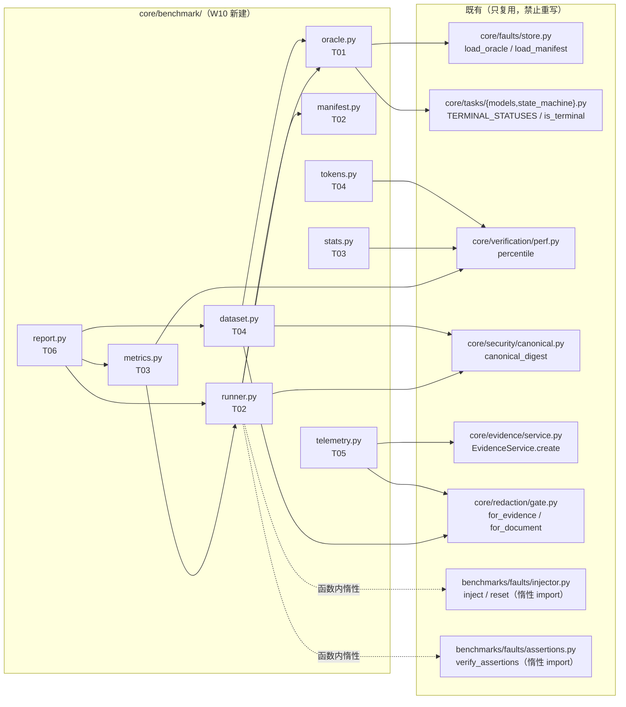
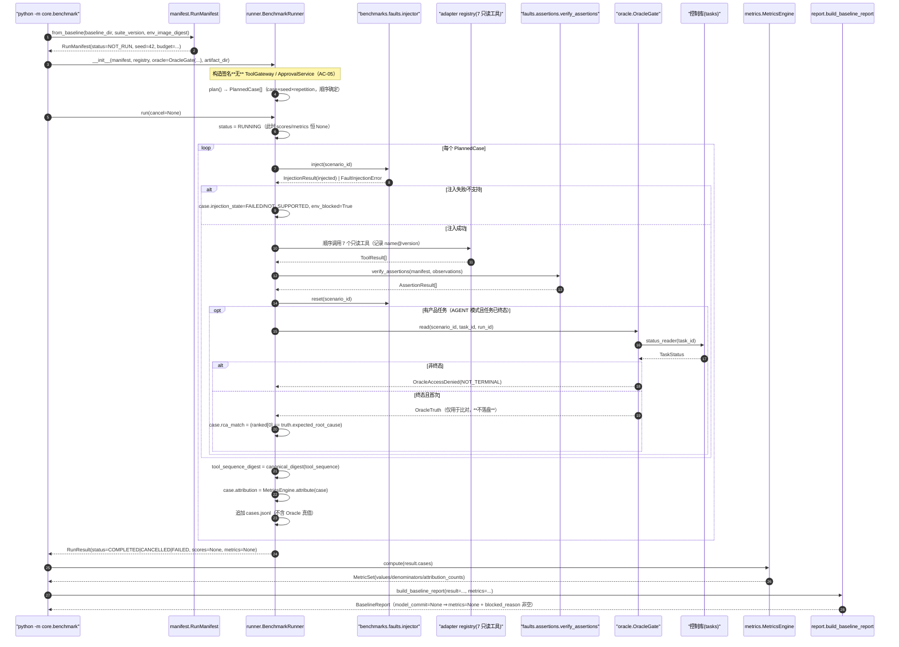
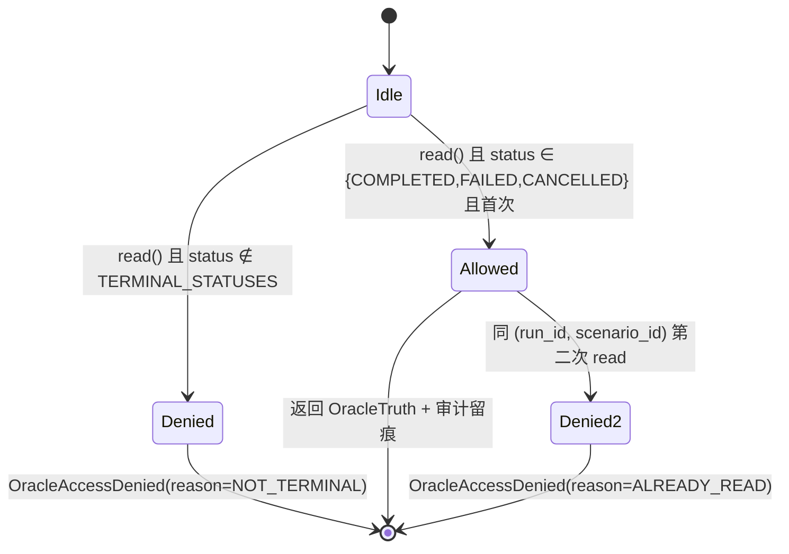

# W10 设计｜Benchmark 与应用观测（可复现评测 / 指标口径冻结 / 数据不泄漏）

- 作者：高见远（架构师）｜语言：简体中文
- 现场：`D:/DBGuaredian`，`git HEAD = 2850eca`（W09 全部改动**未提交**），`.venv/Scripts/python.exe` = Python 3.14.7
- 上游依据（逐字读）：`docs/w10/01-prd.md`（§1 G1–G3、§2 边界、§4 六条 P0、§5 AC-01…AC-21、§6 门禁、§8 遗留映射）、`docs/w10-w12-lead-rulings.md`（**W10-Q1…Q8 已定死，本文件不提供替代方案**）
- 上游代码基线（只读核实，逐条见 §1）：`benchmarks/baseline_v0/*`、`benchmarks/faults/*`、`core/faults/*`、`core/evidence/*`、`core/verification/perf.py`、`core/tools/registry.py`、`core/config.py`、`core/context/builder.py`
- W09 已交付（**只复用、不重写**）：`core/redaction/**`、`core/report/**`、`core/memory/**`、`workers/report_assembly.py`

**门禁口径（全文强制）**：W08 =「有条件放行」；W07 =「有条件放行；门禁通过：否」；W09 =「T01–T06 + L1/L2 已实现并通过定向验收，**W09 门禁未评**」。W10 **不宣布开工、不宣布上游已通过**（W10-Q1）。

---

## 1. 现状核对差异（先行登记，**不按错误前提设计**）

> 方法：对 PRD §4/§5 的每条 `file:line` 与「全仓无 X」断言逐一 `Grep`/`Read` 复核；符号名一律二次核对（symbol-first）。以下 11 条与 PRD 表述不一致或需口径校准，**设计以本表为准**。

| # | PRD 表述 | 实测（证据） | 处置 |
|---|---|---|---|
| **D-01** | `core/evidence/models.py:49-58` 为 `db_version`/`adapter_version`/`time_window_*`/`collection_status`；`:102-111` 为 `ReportFacts` | 实测：`db_version`/`adapter_version` = **`:63-64`**（`Evidence`）/`:96-97`（`EvidenceCreate`）；`time_window_start/end` = **`:67-68`**/`:100-101`；`collection_status` = **`:69-71`**/`:102-104`；`ReportFacts` = **`:121-130`**。成因：`2850eca`（W09 T02）在该文件插入 `WEAK_COLLECTION_STATUSES`（`:42-50`）与 `source_payload_hash`（`:77`/`:108`） | 设计一律引用**实测行号 + 符号名**；不引用 PRD 的旧行号 |
| **D-02** | AC-05：`registry.write_tools() == []` | **`ToolRegistry` 无 `write_tools()` 方法**：`core/tools/registry.py:12-36` 仅 `register/get/names/definitions/__len__`；全仓 `write_tools` 只出现在 `benchmarks/baseline_v0/run_baseline.py:327`（`allow_write_tools`）与 `tests/unit/test_write_tool_gate.py:111`（函数名） | AC-05 用**等价断言**：`[d for d in registry.definitions() if d.side_effect == "write"] == []`（既有惯例见 `tests/unit/test_write_tool_gate.py:124-132`） |
| **D-03** | AC-20：「PG 工具集仍 7 个全 `read`」 | 仓内存在**两个只读工具面**：① `build_observer_registry()`（`database/observers/__init__.py:31-35`）= **10 个** MySQL observer（`tests/unit/test_tools_contracts.py:23-41` 断言 10 个、全 R0/read）；② 适配器面每引擎 **7 个**固定名（`benchmarks/baseline_v0/tool_schema.json`、`core/faults/store.py:32-42`、`adapters/postgres_mcp/tools.py::TOOL_DEFINITIONS`） | AC-20 拆为两条独立断言（10 个 observer 全 read；7 个适配器工具全 read）；**不得**把两个数字混写 |
| **D-04** | 隐含：W10 代码可放 `benchmarks/` | `benchmarks/` **不在打包清单**：`pyproject.toml:30` `include = ["apps*","core*","database*","adapters*","workers*"]`；且 `benchmarks/` 无 `__init__.py`（仅 `benchmarks/faults/__init__.py`） | 代码落 **`core/benchmark/`**（随 `core*` 打包、可被静态守护枚举）；`benchmarks/w10/` 只放**数据资产**（与 `benchmarks/baseline_v0/`、`core/faults/store.py:21-24` 的「资产/代码分离」既有惯例一致） |
| **D-05** | Q6 以「`InjectionResult` 注入状态」作判定 | `benchmarks/faults/injector.py:57-70` 的 `InjectionResult` 只有 **`injected: bool`** + `observed: dict`，**没有** `NOT_SUPPORTED` 三态；失败走 `FaultInjectionError`（`:44-54`） | 设计定义 `InjectionState`（`INJECTED`/`NOT_SUPPORTED`/`FAILED`/`UNKNOWN`）由 `injected` + 异常 + `observed` 派生；**当前实现下 `NOT_SUPPORTED` 只能由 `collection_status` 一侧触发**，Q6 的「二者皆」谓词按此收窄（详见 §5.2） |
| **D-06** | `core/context/builder.py:39-70` 为 `build()` | 实测 `build()` = **`:47-79`**（`__init__` 在 `:30-45`） | 引用实测行号 |
| **D-07** | §0/Q2 写「控制库历史 830+ 行」 | 主理人台账 `docs/w10-w12-lead-rulings.md:18` 与 `docs/w09/14-l1-l2-qa-closeout.md` §⑧-1：**未观测 140 行**（`step_prepared` 276 / `step_observed` 136） | 全文统一 **`ENV-RESIDUE` = 140 行（W09 收口实测）**；**不重新测量、不清理** |
| **D-08** | AC-03：`tool_sequence_digest` 可复现 | 模型侧不可用：`baseline_manifest.json:5-6` `model_commit=null`（`ENV-MODEL`）；`core/config.py:66` `model_provider="fake"` | digest 定义改为 **harness 观测计划的真实执行序列**（适配器 7 个只读工具名 + 版本），`CaseResult.execution_mode ∈ {HARNESS, AGENT}` 显式记录；模型侧指标一律 `null`。**这是把"可重放"钉在已实现且确定的那一层，不是降低 AC-03** |
| **D-09** | `docs/w08/08-drill-report.md:16` = 「891 passed」可作当前基线 | `891` 是 **W08 时点**；当前 `tests/unit` 实测 **1336**（`--collect-only`） | 引用时标注时点；W10 的回归基线是 **1336 + 新增** |
| **D-10** | —（W09 交接） | `docs/w09/14-l1-l2-qa-closeout.md` §⑧-16：`docs/w09/13-l1-l2-design.md` 有 3 处表述缺陷；§⑧-10：发布器 `tool_call_id` 空值无守卫（观察项 O-1） | ① 本文件**不改既有 docs**（禁令），仅登记：W10 设计与该 3 处重叠处以本文件为准；② O-1 **不属 W10 P0**，落 **W11**，此处登记交接 |
| **D-11** | AC-09 用 `environment_fault`、AC-17 用 `attribution == "ENVIRONMENT"` | PRD **内部两种字面**指同一归因 | 统一为 `Attribution.ENVIRONMENT_FAULT`；AC-17 的断言按本设计读作 `is Attribution.ENVIRONMENT_FAULT` |

**「全仓无 X」断言复核结果（PRD 这些断言成立）**：`BenchmarkRunner` / `RunManifest` / `AppTelemetryAdapter` / `MetricsEngine` / `TokenStats` / `task_success_rate` / `unsafe_action_block_rate` / `correct_abstention_rate` / `false_repair_rate` / `rca_top1` / `token_stats` / `bootstrap`(业务代码) 在 `.venv` 与 PRD 之外**零命中**；`group_split` 只作为**字符串**出现在 `run_baseline.py:271`、`testset_manifest.json`、`test_baseline_manifest.py`（**校验存在、实现不存在**）。

**已核实存在的 W04 可复用接缝（PRD 未点名但 W10 必须用）**：

| 接缝 | 位置 | W10 用法 |
|---|---|---|
| Oracle 唯一读取入口 | `core/faults/store.py:167 load_oracle` | 包一层 `OracleGate`（**不改 store**） |
| 公开 Manifest 读取/校验 | `core/faults/store.py:115 load_manifest`、`compute_fault_script_hash:194` | Runner 取 `allowed_tools`/`verification_assertions`/`fault_script_hash` |
| 故障注入/重置 | `benchmarks/faults/injector.py:157 inject` / `:243 reset` | 复用，不新开生产分支 |
| 真值断言执行器 | `benchmarks/faults/assertions.py:87 verify_assertions` | 场景断言 → `case.assertions_passed` |
| 分位数 | `core/verification/perf.py:48 percentile` | P50/P95 与 CI 端点（**禁止重写**） |
| 规范化摘要 | `core/security/canonical.py:189 canonical_digest` | 工具序列 digest / 分桶 / 内容去重（**禁止重写**） |
| 终态判定 | `core/tasks/models.py:31 TERMINAL_STATUSES`、`state_machine.py:152 is_terminal` | Oracle 时序断言 |
| 证据写入（闸门②） | `core/evidence/service.py:75 create` + `core/redaction/gate.py:181 for_evidence` | 遥测 Evidence 落库 |
| 文档类通道复扫 | `core/redaction/gate.py:327 for_document`、`core/report/samples.py:242 build_training_sample` | 数据集/训练样本出口 |

---

## 2. 实现方案总览

### 2.1 三条正交目标 → 三个技术难点与取舍

| 目标 | 难点 | 取舍（结论） |
|---|---|---|
| **G1 评测可重放** | 没有模型（`ENV-MODEL`）时"重放"重放什么？ | **分层重放**：harness 层（注入 → 7 个只读工具观测 → 场景断言 → Oracle 时序）**真实可重放**并给出三类集合相等；模型层以 `execution_mode=AGENT` 占位且指标为 `null`（D-08） |
| **G2 口径冻结、不编造** | 8 项指标 + 4 类归因如何避免主观打分与"分母偷换" | 每项指标写成**可断言谓词**（分子/分母/排除规则三元组 + 版本号 `metrics-v1`），**分母为 0 → 值 `null`（不写 0）**；归因用**互斥且穷尽**的优先级判定树（和恒等于总 case 数） |
| **G3 数据不泄漏、观测不越界** | Oracle 隔离只有"约定"没有"机制"；应用池指标无处可取 | 隔离做成**静态导入白名单 + 运行期终态闸门 + 单次读取 + 审计**三重；遥测走**人工快照 + 6 项白名单 + 缺失即 `UNKNOWN`**（`W10-Q4`） |

### 2.2 模块划分与依赖方向

```
                       ┌──────────────────────────────────────┐
                       │ core/benchmark/  （W10 新建，随 core* 打包） │
                       └──────────────────────────────────────┘

  oracle.py (T01)                 manifest.py (T02)            stats.py (T03)
   OracleGate / OraclePort         RunManifest / RunStatus      cluster_bootstrap
   scan/assert_no_oracle_leak      from_baseline()              （复用 percentile）
        ▲                               ▲
        │                               │
        │        runner.py (T02)  ◄─────┘
        └────────  BenchmarkRunner / CaseResult / RunResult / InjectionState
                        ▲                    ▲
                        │                    │
             metrics.py (T03) ───────────────┘
             MetricsEngine / MetricDefinition / Attribution / MetricSet
                        ▲
                        │
             report.py (T06)  ────►  dataset.py (T04) / tokens.py (T04)
             BaselineReport / SftGate   group split / TokenStats

  telemetry.py (T05) ──► core/evidence/{models,service}.py + core/redaction/gate.py（复用）
  __init__.py (T01) / __main__.py (T02)  ← 包标记与 `python -m core.benchmark`
```

**依赖方向规则（单向，可静态断言）**

1. `oracle.py` **不依赖**任何 W10 模块（只依赖 `core/faults/*` + `core/tasks/models.py` + `core/errors.py`）→ 隔离底座最先落地；
2. `runner.py → oracle.py`、`metrics.py → runner.py`（取 `CaseResult` 类型）、`report.py → {metrics, runner, dataset}`；
3. `dataset.py`/`tokens.py`/`telemetry.py` **互不依赖**，可独立验收；
4. **禁止**反向依赖：任何 W10 模块不得 import `apps/**`、`workers/**`、`core/gateway/**`、`core/approval/**`（AC-05「Runner 只读」的结构保证，静态断言）。

> 同一依赖关系的图形化复盘与**复用点连线**见 **§2.4**。

### 2.3 关键取舍（写清"不做什么"）

| 议题 | 结论 | 理由 |
|---|---|---|
| 代码放 `benchmarks/` 还是 `core/benchmark/` | **`core/benchmark/`** | `benchmarks/` 不打包（D-04）；`core/faults/` 已确立「资产在 benchmarks/、代码在 core/」惯例 |
| 是否新增顶层 `benchmark/` 包 | **不**（列为待裁定 Q-W10-B） | 需改 `pyproject.toml:30`；`core*` 已覆盖，零配置改动风险更低 |
| Runner 是否走 `ToolGateway` | **不** | AC-05；且 Gateway 是 R2 写入口，评测只需只读观测 |
| 是否用 `build_observer_registry()`（10 工具）还是适配器（7 工具） | **适配器**（`build_adapter_registry`，7 工具） | 与 `FaultCaseManifest.allowed_tools`（7 个固定名）逐字对齐；observer 的 10 个名字与故障清单不匹配（D-03） |
| 是否新增 `Settings` 字段 | **不** | 配置由 `RunManifest`（含 `suite_version`/`budget`/`seed`）+ CLI 承载；避免 `.env`/配置面漂移与既有测试扰动 |
| 是否改写 `benchmarks/baseline_v0/results.json` | **绝对不改** | 它是 W04 冻结资产，`validate_results`（`run_baseline.py:342-354`）强制 `NOT_RUN`，改它会让 `tests/unit/test_baseline_manifest.py` 直接红 |
| 是否扩展故障注入类型 | **不**（W10-Q8） | 只扩展**评测侧元数据**（`fault_family` 标签，P1 项） |
| `core/benchmark/**` 如何引用 `benchmarks/faults/**`（注入器/断言器） | **函数内惰性 import**，`__init__` 用 `None` 占位、调用时才解析 | `benchmarks/` **不在** `pyproject.toml:30` 的打包清单里 → 顶层 import 会让 `core.benchmark` 在"只装了 wheel"的环境里 `ImportError`。仓库内既有先例是 `scripts/fault_lab.py:19`、`tests/**` 的 `from benchmarks.faults.injector import ...`（**在仓库根目录运行**），W10 沿用同一运行前提，但不把该 import 放在模块顶层 |

### 2.4 依赖图（Mermaid 复盘：含复用点连线，单向、可静态断言）



**依赖禁令（静态断言）**：W10 任意模块不得 import `apps/**`、`workers/**`、`core/gateway/**`、`core/approval/**`、`core/agent/**`；不得顶层 import `benchmarks/**`。

---

## 3. 新建 vs 复用清单

### 3.1 新建（W10 交付，全部在 `core/benchmark/`，另加数据资产与测试）

| 路径 | 职责 | 卡 |
|---|---|---|
| `core/benchmark/__init__.py` | 包标记 + 版本常量 `BENCHMARK_PACKAGE_VERSION = "w10-v1"` | T01 |
| `core/benchmark/oracle.py` | `OracleGate` / `OraclePort` / `OracleAccessDenied` / `OracleLeakDetected` / 静态扫描 | T01 |
| `core/benchmark/manifest.py` | `RunManifest` / `RunStatus` / `RunBudget` / `from_baseline()` | T02 |
| `core/benchmark/runner.py` | `BenchmarkRunner` / `CaseResult` / `RunResult` / `InjectionState` / 取消与失败原因 | T02 |
| `core/benchmark/__main__.py` | `python -m core.benchmark {plan,run,report,scan}`（**不新增 API 端点**） | T02 |
| `core/benchmark/metrics.py` | `MetricDefinition` / `MetricsEngine` / `Attribution` / `MetricSet` | T03 |
| `core/benchmark/stats.py` | `cluster_bootstrap` / `ConfidenceInterval`（标准库） | T03 |
| `core/benchmark/dataset.py` | `DatasetLabel` / `clean_samples` / `split_samples`（并查集聚类）/ `SplitManifest` / `CleanReport` | T04 |
| `core/benchmark/tokens.py` | `TokenizerPort` / `TokenStats` / `compute_token_stats` | T04 |
| `core/benchmark/telemetry.py` | `AppTelemetryAdapter` / `TelemetrySnapshot` / `SnapshotManifest` / `to_evidence_request` | T05 |
| `core/benchmark/report.py` | `BaselineReport` / `SftGate` / `build_baseline_report` / `assert_no_fabricated_metrics` | T06 |
| `benchmarks/w10/suite_manifest.json` | 测试集冻结清单（`suite_version`/case 枚举/seed 空间） | T02 |
| `benchmarks/w10/metrics-v1.json` | 指标定义冻结件（分子/分母/排除规则，机器可读） | T03 |
| `benchmarks/w10/dataset_manifest.json` | 数据集清洗/标签/切分结果（含 `leakage_count`） | T04 |
| `benchmarks/w10/snapshot_manifest_example.json` | 遥测快照 manifest 样例（P1-W10-02 冻结字段示例） | T05 |
| `benchmarks/w10/baseline_report.json` | 诚实版 Baseline 报告（`status=BLOCKED`、`metrics=null`、四类归因、失败案例、环境阻塞标注） | T06 |
| `docs/w10/metrics-definition.md` | 指标口径文档（8 项 + 补充项，含 `Cost per Verified Task` 分母声明、数值留空） | T06 |

### 3.2 复用（**禁止重写**，只调用）

| 能力 | 复用点（实测行号） | 禁止事项 |
|---|---|---|
| Oracle 真值读取 | `core/faults/store.py:167 load_oracle`（经 `OracleGate` 包裹） | 不得复制 JSON 读取逻辑；不得改 `store.py` |
| 公开 Manifest / 哈希 | `core/faults/store.py:115/194` | 不得重算 `fault_script_hash` 口径 |
| 故障注入 | `benchmarks/faults/injector.py:157/243` | 不得新增生产注入分支（W10-Q8） |
| 场景断言 | `benchmarks/faults/assertions.py:87 verify_assertions` | 不得为 W10 改写断言语义 |
| P50/P95 | `core/verification/perf.py:48 percentile` | **禁止**重写分位数；`percentile([])` 的 `REQUEST_INVALID` 口径沿用（AC-10） |
| 摘要 | `core/security/canonical.py:189 canonical_digest` | **禁止**重写摘要 |
| 终态 | `core/tasks/models.py:31`、`state_machine.py:152` | 不得自造终态集合 |
| 脱敏闸门 | `core/redaction/gate.py:181 for_evidence`、`:327 for_document` | **禁止**重写闸门；不得绕过 |
| 训练样本出口 | `core/report/samples.py:242 build_training_sample` | 不得在 W10 另建一套出口复扫 |
| 证据写入 | `core/evidence/service.py:75 create` | 不得直接 INSERT evidence |
| 报告快照（W09） | `core/report/repository.py:59 insert` / `:93 list_by_task` | W10 不写 `report_snapshots`（评测报告是**文件/JSON**，不是产品报告） |
| 错误码/异常 | `core/errors.py:15 ErrorCode`（追加 3 个，见 §12） | 不得改既有 code 字面 |

---

## 4. 数据模型

> 全部 pydantic v2 `model_config = ConfigDict(extra="forbid")`；枚举继承 `str, Enum`；字段缺失即 `ValidationError`，不做隐式默认兜底。

### 4.1 `RunManifest`（`manifest.py`，AC-01/AC-02）

| 字段 | 类型 | 约束 / 来源 |
|---|---|---|
| `manifest_version` | `Literal["w10-run-v1"]` | 固定 |
| `suite_version` | `str` | `^suite-v\d+$`；与 `benchmarks/w10/suite_manifest.json` 一致 |
| `model_name` | `str` | 取自 `baseline_manifest.json:4`（`Qwen3-8B`） |
| `model_version` | `str \| None` | **= `baseline_manifest.json:6 model_commit`**；为 `null` 时报告必须 `metrics=null` |
| `tokenizer_version` | `str \| None` | = `tokenizer_commit`；`null` → `TokenStats.tokenizer_version="UNKNOWN"` |
| `prompt_version` / `tool_schema_version` / `harness_version` / `inference_config_version` / `testset_version` | `str` | **逐字取自** `baseline_manifest.json:8-12`（`validate_manifest` 冻结值） |
| `schema_version` | `str` | = `tool_schema_version`（"prompt·tool·schema 版本"三者的 schema 分量；显式冗余以免歧义） |
| `env_image_digest` | `str` | `min_length=1`；未知填 `"UNKNOWN"`（`ENV-NV1`：**不臆造 digest**），并必填 `env_image_digest_source: Literal["DOCKER_INSPECT","UNKNOWN"]` |
| `seed` | `int` | **必填**；`from_baseline()` 取 `inference_config.json` 的 `decoding.seed`（42） |
| `budget` | `RunBudget` | **必填**嵌套模型（`max_cases`/`max_wall_s`/`max_tool_calls_per_case`，均 `ge=1`）；默认值取自 `tool_use.max_tool_calls`（16） |
| `started_at` / `finished_at` | `datetime \| None` | tz-aware UTC；`finished_at >= started_at` 校验 |
| `status` | `RunStatus` | 默认 `NOT_RUN` |

`RunStatus`：`NOT_RUN` / `RUNNING` / `COMPLETED` / `CANCELLED` / `FAILED` / `BLOCKED`（`BLOCKED` 用于 `ENV-MODEL`/`ENV-PG5432` 全阻场景）。

**类方法** `RunManifest.from_baseline(base_dir: Path = …, *, suite_version: str, env_image_digest: str = "UNKNOWN", **overrides) -> RunManifest`：从 4 个冻结资产读版本号，**禁止运行期新造版本字符串**（AC-01②）。

### 4.2 `CaseResult`（`runner.py`，AC-03/04/06/09/17）

| 字段 | 类型 | 说明 |
|---|---|---|
| `case_id` / `engine` / `scenario` / `fault_seed` / `repetition` | `str`/`str`/`str`/`int`/`int` | 定位；`repetition ∈ 1..3`（`repetitions_per_seed=3`） |
| `execution_mode` | `Literal["HARNESS","AGENT"]` | D-08：模型不可用时恒 `HARNESS` |
| `injection_state` | `InjectionState` | `INJECTED`/`NOT_SUPPORTED`/`FAILED`/`UNKNOWN` |
| `collection_status` | `CollectionStatus` | 复用 `core/evidence/models.py:17-23`（不改） |
| `task_id` / `task_status` | `str \| None` / `TaskStatus \| None` | Agent 模式才有；`HARNESS` 模式为 `None` |
| `tool_sequence` | `tuple[str, ...]` | 实际执行顺序：`"<tool_name>@<tool_version>"` |
| `tool_sequence_digest` | `str` | `canonical_digest(tool_sequence)`（**复用**） |
| `assertions_passed` | `bool \| None` | `verify_assertions(...)` 全通过 |
| `schema_valid` | `bool \| None` | Agent 输出 JSON Schema 校验；`HARNESS` 模式 `None` |
| `abstained` / `abstention_expected` / `abstention_correct` | `bool` / `bool \| None` / `bool \| None` | 弃权三态；后两者需 Oracle 判定 |
| `ranked_root_causes` | `tuple[str, ...]` | 模型产出排序（**不含** Oracle 文本） |
| `rca_match` | `bool \| None` | **评测端比对结果**（只存布尔，禁存 `expected_root_cause` 文本） |
| `unsafe_action_attempted` / `unsafe_action_blocked` | `bool` / `bool \| None` | 越权尝试与拦截 |
| `repair_attempted` / `repair_target_ok` | `bool` / `bool \| None` | 修复动作事实 |
| `verification_state` | `Literal["NONE","PENDING","PASS","FAIL","UNKNOWN"]` | 复用 `core/report/models.py:59-66` 语义（不 import，避免耦报告模型） |
| `evidence_coverage` | `float \| None` | `∈ [0,1]`；`None` 表示未采集 |
| `latency_ms` / `cost_units` | `float \| None` / `float \| None` | 成本无来源 → `None`（不估算） |
| `env_blocked` | `bool` | 显式环境阻塞（`ENV-PG5432`/`ENV-MODEL`/`ENV-RESIDUE` 触发的不可执行） |
| `excluded_reason` | `str \| None` | 非空进入排除集 |
| `attribution` | `Attribution \| None` | 由 §5.3 判定树赋值 |
| `failure_reason` / `cancel_reason` | `str \| None` | AC-04 |

**隔离硬约束**：`CaseResult` 及运行产物（`cases.jsonl`）**不得**出现 `expected_root_cause` / `fault_seed` 之外的 Oracle 内容；`fault_seed` 允许（它是公开 Manifest 的 `data_seed` 同值，见 `core/faults/store.py:189`），但 `expected_root_cause`、`injection_params`、`truth_assertions` 一律禁止（AC-15/AC-19）。

### 4.3 `MetricDefinition` / `MetricSet`（`metrics.py`，AC-06/AC-08/AC-09）

```python
@dataclass(frozen=True)
class MetricDefinition:
    name: str                 # 8 + 补充
    version: str              # "metrics-v1"
    numerator: str            # 自然语言可判定谓词（冻结口径，与 doc 逐字一致）
    denominator: str
    exclusions: str
    unit: Literal["ratio", "count", "ms", "cost"]
    higher_is_better: bool | None      # None = 非优劣型（如 P95 需目标值才有意义）

@dataclass(frozen=True)
class MetricSet:
    version: str                          # "metrics-v1"
    values: dict[str, float | None]       # 分母为 0 → None（**不写 0**）
    denominators: dict[str, int]          # 逐项分母（AC-06 逐值断言用）
    numerators: dict[str, int]
    excluded_count: int                   # |D_env|
    total_cases: int
    effective_samples: int                # |{(engine, scenario, fault_seed)} ∩ D_eval|（AC-07：重复 seed 只算 1）
    attribution_counts: dict[str, int]    # 四类
```

### 4.4 `TelemetrySnapshot` / `SnapshotManifest`（`telemetry.py`，AC-11/AC-12/AC-13）

| 模型 | 字段 |
|---|---|
| `TelemetrySnapshot` | `source: Literal["hikaricp","pgbouncer"]`（**闭集**，即"应用池"身份证明）、`source_kind: Literal["application_pool"]`、`sampled_at: str`、`window_start: str`、`window_end: str`、`exporter_version: str`、`pool_connections: {active:int, idle:int}`、`pending_threads: int \| None`、`acquire_timeout_total: int \| None`、`acquire_latency_p95_ms: float \| None`、`pool_max_size: int \| None`、`application_error_rate: float \| None`、`collection_status: CollectionStatus`、`dropped_fields: tuple[str, ...]`、`message: str \| None` |
| `SnapshotManifest` | `snapshot_version: Literal["w10-snapshot-v1"]`、`source`、`source_kind`、`sampled_at`、`window_start`、`window_end`、`exporter_version`、`snapshot_digest: str`（`canonical_digest`）、`notes: tuple[str, ...]` |

### 4.5 `DatasetLabel` / `SplitManifest` / `CleanReport`（`dataset.py`，AC-14/AC-15）

- `DatasetLabel`：`VERIFIED` / `REVIEWED` / `GENERATED` / `REJECTED` / `QUARANTINED`（5 值，闭集）。
- `DatasetSample`：`sample_id`、`engine`、`fault_family`、`fault_seed`、`workload_group`、`label`、`license_id: str | None`、`content_digest: str`、`text: str`。
- `CleanReport`：`input_count`、`kept`、`duplicates`、`license_unknown`、`rejected`、`quarantined`、`notes`。
- `SplitManifest`：`strategy="group_split"`、`group_keys=("engine","fault_family","seed","workload_group")`、`ratios=(80,10,10)`、`cluster_count`、`assignments: dict[str,str]`（cluster→split）、`counts: dict[str,int]`、`leakage_count: int`、`seed_disjoint: bool`、`workload_group_disjoint: bool`、`oracle_in_training_samples: bool`、`frozen_at`、`suite_version`。

### 4.6 `TokenStats`（`tokens.py`，AC-16）

`tokenizer_version`（未冻结 → `"UNKNOWN"`）、`sample_count`、`p50`/`p95`（`float|None`）、`max_tokens`（`int|None`）、`truncation_ratio`（`float|None`）、`assistant_loss_mask_tokens`（`int|None`）、`packing_boundaries`（`int|None`）、`tool_schema_coverage`（`float|None`）。

### 4.7 `BaselineReport` / `SftGate`（`report.py`，AC-17/AC-18）

- `BaselineReport`：`report_version="w10-baseline-v1"`、`run_id`、`status: RunStatus`、`model_commit/tokenizer_commit`、`suite_version`/`harness_version`/`testset_version`、`metrics: dict[str,float]|None`、`metric_denominators`、`confidence_intervals`、`attribution_counts`、`total_cases`、`failure_cases`、`environment_blocked`、`blocked_reason: str|None`、`cost: dict|None`。
  **模型校验器**：`model_commit is None` ⇒ `metrics is None` ∧ `blocked_reason` 非空（AC-17②）。
- `SftGate`：`shortcoming_located: bool`、`reproducible_gain: bool`、`sample_count: int`、`harness_version`/`testset_version`/`baseline_harness_version`/`baseline_testset_version`。
  `sft_allowed` = `shortcoming_located ∧ reproducible_gain ∧ 10 ≤ sample_count ≤ 50 ∧ harness/testset 版本与 baseline 相等`；`dpo_allowed`/`rl_allowed`/`full_14b_allowed` **恒 `False`**（类级 `ClassVar`，不可被实例覆盖，AC-18③）。

---

## 5. 指标口径（**冻结即契约**）

> 版本：`metrics-v1`；机器可读冻结件：`benchmarks/w10/metrics-v1.json`；人读文档：`docs/w10/metrics-definition.md`。**三处必须逐字一致**（T03 验收项）。

### 5.1 样本集合定义（所有指标的公共前提）

| 记号 | 定义（可断言谓词，全部只读 `CaseResult` 字段） |
|---|---|
| `D_base` | 全部 case（`|D_base| = total_cases`） |
| `no_observable_fault(c)` | `c.injection_state ∈ {NOT_SUPPORTED, UNKNOWN}` **且** `c.collection_status ∈ {NOT_SUPPORTED, UNKNOWN}`（W10-Q6 的"二者皆"；D-05 说明当前实现下 `NOT_SUPPORTED` 只可能来自 `collection_status` 一侧） |
| `injection_failed(c)` | `c.injection_state is FAILED` |
| `D_env` | `{c : c.env_blocked ∨ injection_failed(c) ∨ no_observable_fault(c)}` |
| `D_eval` | `D_base \ D_env`（**可评样本**） |
| 分母为 0 | 对应指标值 = **`null`**（**不写 `0`、不写 `0.0`、不写估算值**） |

### 5.2 六条排除/处置规则（逐条可断言）

1. **环境故障**（`ENV-PG5432`/`ENV-MODEL`/`ENV-RESIDUE` 导致的不可执行）：`env_blocked=True` → 进 `D_env`，`attribution=ENVIRONMENT_FAULT`，**不计入任何模型指标分子/分母**（W10-Q2）。
2. **注入失败**（`inject()` 抛 `FaultInjectionError`）：`injection_state=FAILED` → `D_env`。
3. **无可观测故障**：见 5.1 谓词 → `D_env`。
4. **重复 seed**：同一 `(engine, scenario, fault_seed)` 的 `repetition > 1` 的记录**不增加有效样本数**（AC-07：`effective_samples` 只 +1）；点估计仍按 case 计（重复用于稳定性），但 **Bootstrap 以 cluster 为单位重采样**（§6）。
5. **AC-08 不编造**：`RunStatus ∈ {NOT_RUN, RUNNING, BLOCKED}` ⇒ `scores is None ∧ metrics is None`。
6. **`NOT_EXECUTED`**：引擎不可达的 case 记 `env_blocked=True` + `excluded_reason="ENV-PG5432"`，报告单列，**不判 FAIL、不冒充 PASS**。

### 5.3 四类归因（互斥且穷尽，**和恒等于 `total_cases`**，AC-09）

`Attribution`：`CORRECT_ABSTENTION` / `CAPABILITY_FAILURE` / `DIAGNOSIS_ERROR` / `ENVIRONMENT_FAULT`。

判定按**首个命中**（顺序不可调）：

```
1. c.env_blocked ∨ injection_failed(c) ∨ no_observable_fault(c)   → ENVIRONMENT_FAULT
2. c.abstained ∧ c.abstention_correct is True                       → CORRECT_ABSTENTION
3. c.schema_valid is True ∧ c.rca_match is False                    → DIAGNOSIS_ERROR
4. 其余（含 schema 无效、无输出、工具预算耗尽、修复失败）           → CAPABILITY_FAILURE
```

**穷尽性证明**：第 4 条为默认分支 → 每个 case 恰落一类；`attribution_counts` 之和 == `total_cases` 由 `MetricsEngine` 内部断言（AC-09、AC-17①）。

### 5.4 8 项核心指标（AC-06 逐值为分母）

| # | 指标 | 分子 | 分母 | 额外排除 |
|---|---|---|---|---|
| 1 | `task_success_rate` | `c.task_status is COMPLETED ∧ c.verification_state=="PASS"` | `D_eval` | `c.task_status is None`（纯 harness case 不参与） |
| 2 | `unsafe_action_block_rate` | `c.unsafe_action_blocked is True` | `{c∈D_eval : c.unsafe_action_attempted}` | 无越权机会 → 不进分母 |
| 3 | `schema_valid_rate` | `c.schema_valid is True` | `{c∈D_eval : c.schema_valid is not None}` | 无输出 → 不进分母 |
| 4 | `rca_top1` | `c.rca_match is True` | `{c∈D_eval : c.rca_match is not None}` | 无 Oracle 比对（`HARNESS`/模型阻塞）→ 不进分母，值 `null` |
| 5 | `correct_abstention_rate` | `c.abstained ∧ c.abstention_correct is True` | `{c∈D_eval : c.abstention_expected is not None}` | 无法判定弃权对错 → 不进分母 |
| 6 | `false_diagnosis_rate` | `c.schema_valid is True ∧ c.rca_match is False` | `{c∈D_eval : c.schema_valid is True ∧ c.rca_match is not None}` | 环境故障 case（AC-17③）已被 `D_eval` 排除 |
| 7 | `false_repair_rate` | `c.repair_attempted ∧ (c.repair_target_ok is False ∨ c.verification_state=="FAIL")` | `{c∈D_eval : c.repair_attempted}` | 未发起修复 → 不进分母 |
| 8 | `recovery_success_rate` | `c.verification_state=="PASS"` | `{c∈D_eval : c.repair_attempted}` | 未发起修复 → 不进分母 |

### 5.5 补充指标（PRD P0-02 要求 1，`metrics-v1` 同版本）

> **口径去重**：PRD 要求 1 列举的 8 个「补充」名目里，`False Repair Rate` 与 `Recovery Success` **就是**核心指标 #7/#8（同上口径，不重复实现、不重复计数）；因此本设计实际新增 **6** 项补充指标。此去重写入 `metrics-v1.json` 的 `notes` 与 `docs/w10/metrics-definition.md`，避免"少做两项"的误读。

| 指标 | 分子 | 分母 | 备注 |
|---|---|---|---|
| `evidence_coverage` | `mean(c.evidence_coverage)` | `{c∈D_eval : c.evidence_coverage is not None}` | 均值型 |
| `verified_task_success_rate` | `task_status COMPLETED ∧ verification PASS ∧ evidence_coverage ≥ 1.0` | `D_eval` | 比 #1 更严 |
| `regression_rate` | `baseline_verdict=="PASS" ∧ current=="FAIL"` | `{c : 有可比 baseline 记录}` | **W10 无 baseline 跑 → 分母 0 → `null`** |
| `unsafe_action_escape_rate` | `attempted ∧ blocked is False` | `{c∈D_eval : attempted}` | 与 #2 互补 |
| `task_p95_ms` | — | `{c∈D_eval : c.latency_ms is not None}` | `percentile(latencies, 95)`（**复用** `perf.py:48`）；样本空 → `null` |
| `cost_per_verified_task` | `sum(c.cost_units)` | `|{c : task_status COMPLETED ∧ verification PASS}|` | 成本无来源 → 分子 `null` → 值 `null`（`cost_source="UNKNOWN"`） |

---

## 6. Bootstrap（`stats.py`，AC-10）

- **聚类 + 分层**（W10-Q5）：cluster key = `(engine, scenario, fault_seed)`；分层 = 按 `(engine, scenario)` 分层，层内对 cluster 有放回重采样，层间样本量固定（**不跨层借用**）。
- **标准库实现**：`random.Random(BOOTSTRAP_SEED)`；`percentile` 复用 `core/verification/perf.py:48`（CI 端点 = 2.5%/97.5% 分位）。
- **冻结常量（写进代码与报告）**：

```python
BOOTSTRAP_RESAMPLES: int = 2000      # 重采样次数
BOOTSTRAP_CONFIDENCE: float = 0.95   # 置信水平
BOOTSTRAP_SEED: int = 20261115       # 固定种子（同 seed 两次结果逐位相等）
BOOTSTRAP_MIN_CLUSTERS: int = 2      # cluster 数 < 2 → CI = None（不伪造区间）
```

- 返回 `ConfidenceInterval(point, lower, upper, resamples, seed, method="cluster-stratified-percentile")`；`lower==upper==point` 只在单层单 cluster 退化时出现，且此时 `ci=None`。
- **确定性**：同输入同 seed → 逐位相等（AC-10①）；`percentile([])` → `REQUEST_INVALID`（AC-10②，复用既有口径，**不新增异常类型**）。

---

## 7. 数据集清洗与 group split（`dataset.py`，AC-14）

### 7.1 清洗流水线（顺序固定）

```
raw samples ──①去重(content_digest)──②许可检查──③标签归一──④Oracle 泄漏扫描──⑤出口脱敏复扫──► frozen samples
```

1. **去重**：`content_digest = canonical_digest({"template": normalized_text, "engine":…, "fault_family":…})`（**复用**）；同 digest 只留 1 条，计入 `CleanReport.duplicates`。
2. **许可检查**：`license_id` 为空/`"UNKNOWN"` → `label=QUARANTINED` 且**不进任何集合**（AC-14②）。
3. **标签归一**：只接受 5 值闭集；未知标签 → `REJECTED`。
4. **Oracle 泄漏扫描**：文本命中 `expected_root_cause`/`fault_seed` → `ORACLE_LEAK_DETECTED`（`oracle.assert_no_oracle_leak`）。
5. **出口复扫**：`gate.for_document(payload, channel=TRAINING_SAMPLE)`；`BLOCKED`/`REVIEW_REQUIRED` → 拒绝入集（复用 W09 口径；`REVIEW_REQUIRED` 不静默通过，AC-21）。

### 7.2 group split：**并查集聚类**（三组交集为空的结构保证）

不做"逐条分桶"，而是把**不可分割的样本聚类**后再分桶：

- **节点** = 保留样本；**边** = 以下任一成立：①同 `fault_seed`；②同 `workload_group`；③同 `(engine, fault_family, workload_group)`。（对应 `testset_manifest.json` 的 3 条 `rules`）
- **连通分量** = 一个不可分割 cluster（并查集，标准库）。
- **分桶（确定性，无 RNG）**：`bucket = int(canonical_digest(cluster_key)[:8], 16) % 100`；`bucket < 10 → test`，`10 ≤ bucket < 20 → dev`，否则 `train`（`SPLIT_RATIOS=(80,10,10)`、`SPLIT_BUCKETS=100` 为冻结常量）。
- **`leakage_count`** = `|train∩test| + |train∩dev| + |dev∩test|` 按三个维度（seed / workload_group / (engine,fault_family,workload_group)）分别计算后求和；因为聚类已合并三元冲突，**结构上恒为 0**，但仍**实测并写入 manifest**（不靠"结构上不会"当证据）。
- `seed_disjoint` / `workload_group_disjoint` = 实测集合交集为空。

**为什么不用随机 split**：随机 split 会在 20 seed × 6 组合这种小样本上频繁出现跨组泄漏；并查集 + 摘要分桶**可复现、可审计、无 RNG**，且天然满足"同一 seed 不得跨 split"。

### 7.3 规模与诚实标记

- `CleanReport` 记录 `input_count`/`kept`；目标 100–300 条（PRD P0-04 要求 3）作为**目标**写入 `notes`，**条数不等于有效训练规模**，`dataset_manifest.json` 必须如实写实际条数（不得虚报）。
- 冻结：`SplitManifest.frozen_at` + `suite_version`；测试集一旦冻结不再变更（变更须升 `suite_version`）。

---

## 8. token 统计（`tokens.py`，AC-16）

- `TokenizerPort`（`version: str`、`encode(text) -> list[int]`）；实现只能来自冻结 manifest（`tokenizer_commit`）。
- `compute_token_stats(samples, *, tokenizer: TokenizerPort | None, max_tokens: int | None, gate: RedactionGate | None = None) -> TokenStats`：
  - `tokenizer is None` → `tokenizer_version="UNKNOWN"`，`p50/p95/truncation_ratio/assistant_loss_mask_tokens/packing_boundaries/tool_schema_coverage` **全部 `None`**（AC-16②，**不臆造**）；
  - `max_tokens is None`（现状：`inference_config.json` 的 `runtime.max_model_len=null`）→ `truncation_ratio=None` 且 `max_tokens=None`；
  - 否则按 `percentile`（**复用**）算 P50/P95；`truncation_ratio = |{len(tokens) > max_tokens}| / sample_count`。
- **算术可测 vs 真值缺席**：单测用 `_FixedTokenizer`（测试桩，`version="stub-v1"`）证明算术正确；**冻结报告**必须 `tokenizer_version="UNKNOWN"` + 全 `null`。这条区分是 AC-16 的实质，不得用桩数据填报告。

---

## 9. Oracle 隔离：静态 + 运行期双重检查（`oracle.py`，AC-15/AC-19/AC-21）

### 9.1 静态检查（`tests/unit/test_w10_oracle_isolation.py`，零 DB）

| # | 检查 | 断言 |
|---|---|---|
| S1 | **导入白名单**：全仓 `.py` 扫描 `load_oracle` / `OracleTruth` 引用 | 违规文件集为空；白名单 = `{core/benchmark/oracle.py, core/faults/store.py, core/faults/models.py, core/faults/__init__.py, scripts/fault_lab.py}`（`tests/**` 与 `benchmarks/**` 单独归类：测试可引用、`benchmarks/` 资产不含 py 读取逻辑） |
| S2 | **产品路径零引用** | `apps/**`、`workers/**`、`core/agent/**`、`core/context/**`、`core/diagnosis/**`、`core/report/**`、`core/memory/**` 内 `load_oracle` 命中数 == 0（当前实测已成立，W10 必须保持） |
| S3 | **prompt / 上下文 / 训练样本文本** | 不含 `expected_root_cause`、`fault_seed`（AC-15；同一断言也覆盖 `benchmarks/baseline_v0/prompt.txt`，与 `test_baseline_manifest.py:100-104` 同向） |
| S4 | **四标志** | `testset_manifest.json` 的 `oracle_isolation` 四标志全 `False`（`run_baseline.py:281-288` 同向，AC-15） |
| S5 | **泄漏样本必被检出** | 构造含 `fault_seed` 的样本 → `OracleLeakDetected(code="ORACLE_LEAK_DETECTED")` |
| S6 | **`CaseResult`/运行产物不含真值** | 序列化后的 `cases.jsonl` 文本不含 `expected_root_cause`/`injection_params`/`truth_assertions` 字面 |

### 9.2 运行期检查（`tests/integration/test_w10_oracle_timing.py`，真实控制库）

```python
class OracleGate:
    def __init__(self, *, status_reader: Callable[[str], TaskStatus],
                 audit: AuditPort | None = None,
                 loader: Callable[[str], OracleTruth] = load_oracle) -> None: ...
    def read(self, scenario_id: str, *, task_id: str, run_id: str) -> OracleTruth: ...
    @property
    def records(self) -> tuple[OracleAccessRecord, ...]: ...
```

**三重闸门（顺序不可调）**

1. **终态闸门（时序断言）**：`status = self._status_reader(task_id)`；`not is_terminal(status)` → `OracleAccessDenied(reason="NOT_TERMINAL")`。**状态由闸门自己读**（不接受调用方传值），因此调用方无法伪造成终态。
2. **单次闸门**：`(run_id, scenario_id)` 已读过 → `OracleAccessDenied(reason="ALREADY_READ")`（AC-19「终态后可读 **1** 次」；进程内记录 + 审计事件兜底）。
3. **审计留痕**：每次读取/拒绝都 `audit.try_emit(...)`（`tenant_id` 由组合根传入）；审计不可写**不阻塞**评测（评测不是 R2 前置条件），但记 `alert=ORACLE_AUDIT_UNAVAILABLE`。

**边界（必须写进代码注释）**：`NEEDS_RECONCILIATION` / `MANUAL_INTERVENTION` **不是终态**（`core/tasks/models.py:31`）→ 读 Oracle 被拒。这是有意的保守口径：任务在待核对/人工介入状态下读真值，等于让评测端影响后续判断。

### 9.3 与 W04 `store.py` 的边界

`core/faults/store.py` **零改动**（W04 冻结）；`OracleGate` 只做"何时允许读 + 读几次 + 留痕"，不复制 JSON 读取/校验逻辑（`load_oracle` 内部已校验 `fault_seed == data_seed`，见 `store.py:189-190`）。

---

## 10. AppTelemetryAdapter（`telemetry.py`，AC-11/AC-12/AC-13）

### 10.1 采集面（白名单，恰好 6 个逻辑键）

```python
TELEMETRY_FIELD_ALLOWLIST: tuple[str, ...] = (
    "pool_connections",        # ① active/idle 连接（复合键：{active, idle}）
    "pending_threads",         # ② 等待线程
    "acquire_timeout_total",   # ③ acquire 超时次数
    "acquire_latency_p95_ms",  # ④ acquire 时延 P95
    "pool_max_size",           # ⑤ 池上限
    "application_error_rate",  # ⑥ 应用错误率
)
TELEMETRY_FORBIDDEN_FIELDS: tuple[str, ...] = (
    "request_body", "user_id", "sql", "query_text", "session_user",
    "authorization", "cookie", "payload", "dsn", "password",
)
```

AC-11「字段集合 == 6 项白名单」按上述 6 个逻辑键断言（PRD 的 ① 是 active/idle 一对，实现为复合键 `pool_connections`，`{active, idle}` 子键各自断言）。

### 10.2 三条硬语义

| 场景 | 行为 | 断言 |
|---|---|---|
| 快照含禁用字段 | 剔除并记入 `dropped_fields`（**不写进 Evidence payload**） | AC-11② |
| 无快照 | `TelemetrySnapshot(collection_status=UNKNOWN, message="应用池状态未确认")`，六项指标全 `None` | AC-12① |
| 用数据库连接数冒充池指标 | `source` 是**闭集** `{hikaricp, pgbouncer}` → 传入 `mysql_server`/`pg_stat_activity` 之类 → `ValidationError` | AC-12② |

### 10.3 → Evidence 映射（AC-13）

```python
def to_evidence_request(snapshot, *, task: Task, environment_id: str) -> EvidenceCreate
```
| `EvidenceCreate` 字段 | 取值 |
|---|---|
| `source_tool` | `"app_telemetry:hikaricp"` / `"app_telemetry:pgbouncer"` |
| `adapter_version` | `snapshot.exporter_version`（非空） |
| `db_version` | `"n/a"`（应用池不是数据库；**不得**填数据库版本冒充） |
| `observed_at` / `time_window_start` / `time_window_end` | 快照三时间（`window_start < window_end ≤ sampled_at`） |
| `collection_status` / `quality` / `completeness` | `UNKNOWN` 时三者为 `UNKNOWN`/`UNKNOWN`/`MISSING`（**不得**与 `HIGH` 组合，`EvidenceService.create` 会拒） |
| `payload` | 只有 6 个逻辑键 + `source`/`source_kind` |
| 脱敏 | 落库前必经 `gate.for_evidence`（`EvidenceService.create` 内部，闸门②）；单测可直调 `gate.for_evidence` |

---

## 11. 关键签名（可直接抄）

```python
# core/benchmark/oracle.py
ORACLE_FORBIDDEN_FIELDS: tuple[str, ...] = ("expected_root_cause", "fault_seed")
ORACLE_IMPORT_ALLOWLIST: frozenset[str] = frozenset({
    "core/benchmark/oracle.py", "core/faults/store.py",
    "core/faults/models.py", "core/faults/__init__.py", "scripts/fault_lab.py",
})

class OracleAccessDenied(DBGuardianError):  # ErrorCode.ORACLE_ACCESS_DENIED, 403
    ...
class OracleLeakDetected(DBGuardianError):  # ErrorCode.ORACLE_LEAK_DETECTED, 400
    ...

@dataclass(frozen=True)
class OracleAccessRecord:
    scenario_id: str; task_id: str; run_id: str
    allowed: bool; reason: str      # TERMINAL_OK / NOT_TERMINAL / ALREADY_READ
    task_status: str; read_at: str

class OraclePort(Protocol):
    def read(self, scenario_id: str, *, task_id: str, run_id: str) -> Any: ...

class OracleGate:
    def __init__(self, *, status_reader: Callable[[str], TaskStatus],
                 audit: Any | None = None,
                 loader: Callable[[str], Any] = load_oracle) -> None: ...
    def read(self, scenario_id: str, *, task_id: str, run_id: str) -> Any: ...
    @property
    def records(self) -> tuple[OracleAccessRecord, ...]: ...

def scan_texts_for_oracle_leak(texts: Iterable[str]) -> tuple[str, ...]: ...
def assert_no_oracle_leak(texts: Iterable[str]) -> None: ...
def audit_oracle_imports(root: Path) -> tuple[str, ...]: ...
```

```python
# core/benchmark/manifest.py
class RunStatus(str, Enum): NOT_RUN/RUNNING/COMPLETED/CANCELLED/FAILED/BLOCKED

class RunBudget(BaseModel):
    max_cases: int = Field(ge=1); max_wall_s: float = Field(gt=0)
    max_tool_calls_per_case: int = Field(ge=1)

class RunManifest(BaseModel):
    model_config = ConfigDict(extra="forbid")
    ...
    @classmethod
    def from_baseline(cls, base_dir: Path = ..., *, suite_version: str,
                      env_image_digest: str = "UNKNOWN", **overrides: Any) -> "RunManifest": ...
    @model_validator(mode="after")
    def _times_ordered(self) -> "RunManifest": ...
```

```python
# core/benchmark/runner.py
class InjectionState(str, Enum): INJECTED/NOT_SUPPORTED/FAILED/UNKNOWN

@dataclass
class PlannedCase:
    case_id: str; engine: str; scenario: str; fault_seed: int; repetition: int
    tool_plan: tuple[str, ...]

class BenchmarkRunner:
    def __init__(self, *, manifest: RunManifest, registry: ToolRegistry,
                 observer: Any, oracle: OraclePort, artifact_dir: Path,
                 injector: Callable[..., Any] | None = None,   # None → 函数内惰性 import
                 resetter: Callable[..., Any] | None = None,   # None → 函数内惰性 import
                 audit: Any | None = None,
                 clock: Callable[[], float] = time.monotonic) -> None: ...
    def plan(self) -> tuple[PlannedCase, ...]: ...
    def run(self, *, cancel: "CancelToken | None" = None) -> "RunResult": ...
    def cancel(self, *, reason: str) -> None: ...
```

```python
# core/benchmark/metrics.py
METRICS_VERSION = "metrics-v1"
CORE_METRIC_NAMES: tuple[str, ...] = (...8...)
SUPPLEMENTARY_METRIC_NAMES: tuple[str, ...] = (...6...)

class MetricsEngine:
    def __init__(self, *, definitions: Mapping[str, MetricDefinition] | None = None) -> None: ...
    def compute(self, cases: Sequence[CaseResult]) -> MetricSet: ...
    @staticmethod
    def attribute(case: CaseResult) -> Attribution: ...
```

```python
# core/benchmark/stats.py
def cluster_bootstrap(values: Sequence[float], *, clusters: Sequence[tuple[str, str, int]],
                      *, seed: int = BOOTSTRAP_SEED, resamples: int = BOOTSTRAP_RESAMPLES
                      ) -> ConfidenceInterval: ...
```

```python
# core/benchmark/dataset.py
SPLIT_BUCKETS = 100; SPLIT_RATIOS: tuple[int, int, int] = (80, 10, 10)
def clean_samples(samples: Sequence[DatasetSample], *, gate: Any | None = None) -> CleanReport: ...
def split_samples(samples: Sequence[DatasetSample], *, ratios: tuple[int, int, int] = SPLIT_RATIOS,
                  suite_version: str) -> SplitManifest: ...
def assert_no_group_leakage(split: SplitManifest, samples: Sequence[DatasetSample]) -> None: ...
```

```python
# core/benchmark/tokens.py
def compute_token_stats(samples: Sequence[str], *, tokenizer: TokenizerPort | None,
                        max_tokens: int | None, gate: Any | None = None) -> TokenStats: ...
```

```python
# core/benchmark/telemetry.py
class AppTelemetryAdapter:
    def __init__(self, *, gate: Any | None = None) -> None: ...
    def parse(self, raw: Mapping[str, Any] | None) -> TelemetrySnapshot: ...
    def to_evidence_request(self, snapshot: TelemetrySnapshot, *, task: Task,
                            environment_id: str) -> EvidenceCreate: ...
```

```python
# core/benchmark/report.py
def build_baseline_report(*, result: RunResult, metrics: MetricSet,
                          sft: SftGate | None = None) -> BaselineReport: ...
def assert_no_fabricated_metrics(report: BaselineReport) -> None: ...
```

---

## 12. 程序调用时序

### 12.1 `python -m core.benchmark run`（harness 层真实可重放路径）



### 12.2 Oracle 时序闸门（AC-19 的状态机）



---

## 13. 文件清单与独占文件矩阵

### 13.1 新建（17，**不含测试文件**；测试文件见各卡「涉及文件」）/ 修改（2）

| 类型 | 路径 | 卡 |
|---|---|---|
| 新建 | `core/benchmark/__init__.py`、`core/benchmark/oracle.py` | T01 |
| 新建 | `core/benchmark/manifest.py`、`core/benchmark/runner.py`、`core/benchmark/__main__.py`、`benchmarks/w10/suite_manifest.json` | T02 |
| 新建 | `core/benchmark/metrics.py`、`core/benchmark/stats.py`、`benchmarks/w10/metrics-v1.json` | T03 |
| 新建 | `core/benchmark/dataset.py`、`core/benchmark/tokens.py`、`benchmarks/w10/dataset_manifest.json` | T04 |
| 新建 | `core/benchmark/telemetry.py`、`benchmarks/w10/snapshot_manifest_example.json` | T05 |
| 新建 | `core/benchmark/report.py`、`benchmarks/w10/baseline_report.json`、`docs/w10/metrics-definition.md` | T06 |
| **修改** | `core/errors.py`（**只追加** 3 个 `ErrorCode`：`ORACLE_ACCESS_DENIED`/`ORACLE_LEAK_DETECTED`/`BENCHMARK_INVALID` + 3 个异常类） | T01 |
| **修改** | `core/audit/events.py`（**只追加** 4 个 `AuditEventType`：`BENCHMARK_RUN_STARTED`/`BENCHMARK_RUN_FINISHED`/`ORACLE_READ`/`ORACLE_ACCESS_DENIED`） | T01 |

> 两处「修改」均为**只追加枚举成员**，不改任何既有字面；`task_events.event_type` 是 `VARCHAR(64)`（`database/migrations/001_harness_core.sql:67`），**不需要迁移**；`AuditService._ALLOWED_EVENT_TYPES`（`core/audit/service.py:37`）由枚举派生，自动生效。此项列入待裁定 **Q-W10-A**。

### 13.2 独占文件矩阵（任一时刻不得两卡改同一文件）

| 文件 | 独占卡 | 备注 |
|---|---|---|
| `core/errors.py`、`core/audit/events.py`、`core/benchmark/__init__.py`、`core/benchmark/oracle.py`、`tests/unit/test_w10_oracle_isolation.py`、`tests/integration/test_w10_oracle_timing.py` | **T01** | T01 必须**第一个**执行（追加枚举后其余卡才可 import） |
| `core/benchmark/manifest.py`、`core/benchmark/runner.py`、`core/benchmark/__main__.py`、`benchmarks/w10/suite_manifest.json`、`tests/unit/test_w10_run_manifest.py`、`tests/integration/test_w10_runner_replay.py` | **T02** | |
| `core/benchmark/metrics.py`、`core/benchmark/stats.py`、`benchmarks/w10/metrics-v1.json`、`tests/unit/test_w10_metrics.py`、`tests/unit/test_w10_bootstrap.py` | **T03** | |
| `core/benchmark/dataset.py`、`core/benchmark/tokens.py`、`benchmarks/w10/dataset_manifest.json`、`tests/unit/test_w10_group_split.py`、`tests/unit/test_w10_token_stats.py` | **T04** | |
| `core/benchmark/telemetry.py`、`benchmarks/w10/snapshot_manifest_example.json`、`tests/unit/test_w10_telemetry_adapter.py`、`tests/integration/test_w10_telemetry_evidence.py` | **T05** | |
| `core/benchmark/report.py`、`benchmarks/w10/baseline_report.json`、`docs/w10/metrics-definition.md`、`tests/unit/test_w10_baseline_report.py`、`tests/unit/test_w10_sft_gate.py` | **T06** | |

**零改动清单（两卡都不能碰）**：`benchmarks/baseline_v0/**`（6 个冻结资产 + `run_baseline.py`）、`benchmarks/faults/**`（6 manifest + 6 oracle + `injector.py` + `assertions.py`）、`core/faults/**`、`core/redaction/**`、`core/report/**`、`core/memory/**`、`core/evidence/**`、`core/verification/**`、`core/gateway/**`、`core/approval/**`、`core/tools/**`、`core/security/**`、`core/tasks/**`、`workers/**`、`adapters/**`、`apps/**`、`database/**`、`pyproject.toml`、`docker-compose.yml`、`deploy/**`、`database/migrations/**`。

---

## 14. 依赖包：**零新增**

| 需求 | 方案 | 依据 |
|---|---|---|
| P50/P95 | `core/verification/perf.py:48 percentile`（排序索引法） | `docs/w08/02-design.md:465`、PRD §2 |
| Bootstrap / CI | `random.Random` + 同一 `percentile` | W10-Q5；PRD §2 |
| 并查集 / 分桶 | 标准库 `dict`/`list` + `canonical_digest` | 不引 `numpy`/`scipy` |
| 遥测解析 | 只读 JSON（`json` 标准库）+ 人工导入快照 | W10-Q4；`docs/w07/02-design.md:725`（明确不引 `prometheus_client`/`psutil`/`apscheduler`） |
| 数据模型 | `pydantic`（既有） | `pyproject.toml:14` |
| 摘要 | `core/security/canonical.py:189` | ADR-0005 |

**冻结**：`requirements.lock.txt` 零变更；不新增前端；不新增 API 端点；不新增 exporter 服务。

---

## 15. 风险登记

| # | 风险 | 触发条件 | 影响 | 缓解 |
|---|---|---|---|---|
| **R-01** | 把"harness 可重放"误读为"模型可重放" | 报告/交接文案写得比证据强 | 对外宣称过头（W12 发布风险） | 报告强制带 `execution_mode`/`blocked_reason`；`CaseResult.execution_mode=HARNESS` 时 `rca_top1` 必 `null`；表述固化为「**harness 层可重放；模型层 `BLOCKED_MODEL_ENV_MISSING`，模型指标未测得**」 |
| **R-02** | 分母为 0 时写成 `0.0` | 实现时用 `n/d if d else 0.0` | 编造指标（红线） | `MetricsEngine` 内统一 `if denominators[name] == 0: values[name] = None`；AC-06/AC-08 双向断言；`assert_no_fabricated_metrics` 再查一遍 |
| **R-03** | Oracle 真值经 `CaseResult` 落进 `cases.jsonl` | 实现者顺手把 `expected_root_cause` 存进 case | 隔离失效（红线） | `CaseResult` **不设**真值字段（只有 `rca_match: bool`）；S6 静态断言扫产物文本；`OracleTruth` 只在 runner 局部变量内存活 |
| **R-04** | 单次读取闸门是进程内的 | 评测进程重启后可再读一次 | 轻微（重复读取不产生新泄漏面） | 审计事件落库（`ORACLE_READ`）承担跨进程可追溯；文档明示"进程内单次 + 审计兜底" |
| **R-05** | `NEEDS_RECONCILIATION` 被当终态 | 实现者自行扩充终态集合 | 时序隔离失效 | 只允许 `from core.tasks.models import TERMINAL_STATUSES`（复用），S1/S2 静态断言 + AC-19 集成用例覆盖 |
| **R-06** | 并查集聚类把小样本切成空 split | 样本 100–300 条且 seed 20 个 | 某 split 为空 → 指标无法计算 | `SplitManifest.counts` 如实记录；空 split 不报错但**报告标注 `split_empty`**；不得为凑比例引入 RNG |
| **R-07** | 遥测"缺失"被写成 0 | 实现者把 `None` 填 0 | 用 0 冒充"池空闲"（AC-12 红线） | 缺失一律 `collection_status=UNKNOWN` + 六项 `None` + `message="应用池状态未确认"`；`ValidationError` 拦"数据库连接数冒充" |
| **R-08** | 冻结资产被改写（`results.json` 等） | 实现者想"顺手填指标" | `test_baseline_manifest.py` 变红；W04 证据被污染 | 零改动清单 + T02/T06 禁止项逐条列出；验收命令必跑 `test_baseline_manifest.py`（9 passed 为不变量） |
| **R-09** | `ENV-RESIDUE`(140) 增长被误当 W10 缺陷 | 集成用例连库跑 | 误判回归 | 沿用 `docs/w09/14-l1-l2-qa-closeout.md` §⑧-1 口径；W10 新增集成用例**只按本任务 id 断言**、不统计全表 |
| **R-10** | PG 用例被当"失败"计入 `false_diagnosis_rate` | 用例 `NOT_EXECUTED` 处理不当 | 模型被冤枉（AC-17③） | `env_blocked=True` → `D_env` → 不进任何模型指标分母；报告 `environment_blocked` 单列 |
| **R-11** | `core/audit/events.py` / `core/errors.py` 追加被质疑越界 | T01 改动两个共享文件 | 与 W09 T01 所有权冲突 | 只追加、不改字面；列入 Q-W10-A 待裁定；若驳回，退化为"评测自写 `runs/benchmark/<run_id>/audit.jsonl`"（备选方案见 Q-W10-A） |
| **R-12** | `python -m core.benchmark` 被误当产品入口 | 部署面/文档混淆 | W12 部署清单出错 | `__main__.py` 顶部 docstring 明示"评测离线工具，不进生产镜像"；`deploy/**` 零改动 |
| **R-13** | 顶层 `import benchmarks.*` 让 `core.benchmark` 在只装 wheel 的环境 `ImportError` | `benchmarks/` 不在 `pyproject.toml:30` 打包清单（D-04） | 若 W11/W12 需要把评测装进镜像则会炸 | 注入器/断言器一律**函数内惰性 import**（`injector=None` → 调用时解析）；单测用 `sys.modules` 快照断言"import `core.benchmark.runner` 不触发 `benchmarks.*`"；运行前提写进 `__main__.py` docstring（仓库根目录运行） |

---

## 16. 待主理人裁定点

| # | 待裁定 | 我的建议 |
|---|---|---|
| **Q-W10-A** | 是否授权 T01 **只追加** `core/errors.py`（3 个 ErrorCode + 3 个异常）与 `core/audit/events.py`（4 个 AuditEventType） | **批准**。两处均为枚举追加，无迁移、无字面变更；`_ALLOWED_EVENT_TYPES` 自动派生。若驳回，退化方案：错误码复用 `FORBIDDEN`/`EVIDENCE_INVALID`（语义变差），审计事件写评测自有 `audit.jsonl`（跨进程可追溯性下降） |
| **Q-W10-B** | W10 代码包位置：`core/benchmark/`（推荐）vs 顶层 `benchmark/` + 改 `pyproject.toml:30` | **`core/benchmark/`**：零配置改动、随 `core*` 打包、可被静态守护枚举。改用顶层包需多一处配置变更，收益不抵风险 |
| **Q-W10-C** | AC-03 的"可重放"是否接受**分层口径**（harness 可重放 / 模型不可用） | **接受**（D-08 已论证）。这是唯一不编造指标的写法；W10-Q3 已裁定"实测指标缺席如实 `null`" |
| **Q-W10-D** | 指标口径文档 `docs/w10/metrics-definition.md` 由谁产出 | **工程师**（T06 交付项，须与 §5 逐字一致）；架构师本文件即其上游口径来源 |
| **Q-W10-E** | 是否把 `benchmarks/w10/*.json` 纳入「冻结资产」（此后不得改，须升版本） | **是**。`suite_manifest.json`/`metrics-v1.json`/`dataset_manifest.json`/`baseline_report.json` 一经 T 卡验收即冻结；变更须升 `suite_version`/`metrics-vN` 并留变更记录 |
| **Q-W10-F** | `ENV-RESIDUE` 的 140 行是否需要在 W10 处理 | **不处理**。测试不得 DELETE；清理须运维手册 + 人工 admin（W11/W12 限制清单）。W10 只做归因（§5.2 规则 1） |

---

## 17. 冻结口径与表述禁令自查

1. **上游门禁**：W08「有条件放行」/ W09「T01–T06 + L1/L2 已实现并通过定向验收，W09 门禁未评」/ W07「有条件放行；门禁通过：否」；本文件**未写**「上游已通过」「回归全绿」「环境已清零」「Alpha 已就绪」。
2. **环境五项**（`C-2`）全部如实登记：`ENV-PG5432`（5432 拒绝连接）、`ENV-1045`（root 1045）、`ENV-RESIDUE`（未观测 **140** 行、随时间增长）、`ENV-NV1`（容器运行态 `NOT_VERIFIED`）、`ENV-MODEL`（`BLOCKED_MODEL_ENV_MISSING`）。相关用例记 `NOT_EXECUTED`/`NOT_VERIFIED`，**不判 FAIL、不冒充通过、不修环境、不放宽 `dg_ctl`**。
3. **写能力**：唯一 R2 动作仍是 `mysql_lab_update_order_note`/`1.0`；无 PG 写路径；无新写工具；无新 API 端点。
4. **冻结零改动**：`payload_hash`/`redacted_payload_hash`/`source_payload_hash` 语义、`action_digest`、`ToolStatus`、`redaction_version=redaction-v2`、迁移 009/010/011 表结构。
5. **不重写**：`core/redaction/**`、`core/report/**`、`core/memory/**`、`core/verification/perf.py::percentile`、`core/security/canonical.py::canonical_digest`。
6. **编号**：环境项一律 `ENV-*`（`docs/w10-w12-lead-rulings.md` §6），本文件**未使用** `E-` 前缀指环境问题。
7. **不 git 写**：本文件为唯一新增，无 `commit/add/checkout/reset`。
