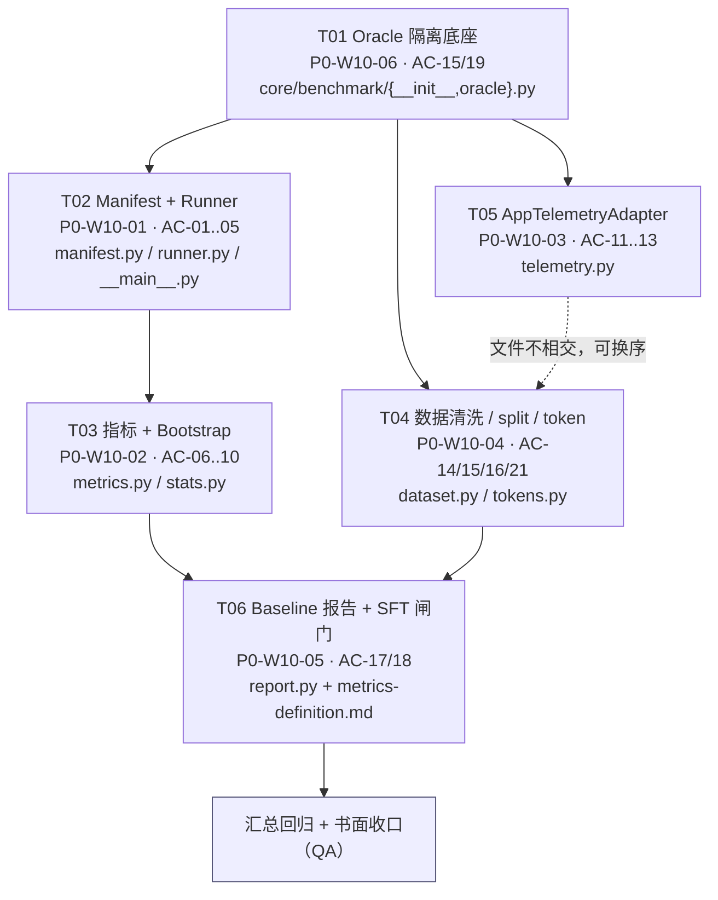

# W10 任务卡｜Benchmark 与应用观测（6 卡，按依赖硬顺序）

- 依据：`docs/w10/01-prd.md`（§1 G1–G3、§2 边界、§4 六条 P0、§5 AC-01…AC-21、§6 门禁、§8 遗留映射）、`docs/w10/02-design.md`（本卡的**唯一技术口径**，§1 现状核对差异 / §4 模型 / §5 指标 / §6 Bootstrap / §7 数据 / §9 Oracle / §10 遥测 / §11 签名 / §13 文件矩阵）、`docs/w10-w12-lead-rulings.md`（W10-Q1…Q8 已定死）
- 上游门禁口径：W08 =「**有条件放行**」；W09 =「**T01–T06 + L1/L2 已实现并通过定向验收，W09 门禁未评**」；W07 =「**有条件放行；门禁通过：否**」。本批任务**不得**表述为「上游已通过」，**不得宣布「W10 开工」**（W10-Q1）
- 硬顺序：`T01 → T02 → T03 → T04 → T05 → T06`；后卡可依赖前卡；**任一时刻不得有两张卡改同一个文件**
- 现场：`.venv/Scripts/python.exe` = Python 3.14.7；`git HEAD = 2850eca`（W09 改动**未提交**）

## 全局纪律（6 卡均适用，逐卡不再重复展开）

1. **不许为了让测试变绿而放宽断言、删用例、加 `skip`/`xfail`、缩小参数化范围**。断言不成立时先判定「实现错」还是「断言错」；认为断言错必须先回报 team-lead，不得自行修改。
2. 不新增第三方依赖（沿用 `requirements.lock.txt`）；不新增前端；**不新增 API 端点**；不新增 exporter 服务。
3. 不扩大写能力：PG 仍只读；写动作仍只有 `mysql_lab_update_order_note`/`1.0`；`benchmark-runner` 只读评测。
4. 测试**不得依赖** `DG_ADMIN_DSN`、**不得依赖** PG 5432 可连；需 DB 的用例只做 `INSERT`（追加），**不做清理、不 DELETE**。
5. 所有新表/新列只追加；`dg_ctl` 无 `UPDATE`/`DELETE`；**不新增迁移**（W10 零 DDL）。
6. 每个 PR 只改本卡「涉及文件」；发现必须改卡外文件，先回报 team-lead 改卡。
7. **W10 特有**：`benchmarks/baseline_v0/**` 与 `benchmarks/faults/**` 是**冻结资产**，只读不改（改 `results.json` 会让 `tests/unit/test_baseline_manifest.py` 直接红）。
8. **W10 特有**：**禁止编造指标**——任何未真实测得的指标必须 `null`，`0` 与估算值同样视为编造（`docs/w10/02-design.md` §5、§15 R-02）。
9. **W10 特有**：Oracle 真值**不得**进入 `CaseResult` / `cases.jsonl` / prompt / 上下文 / 训练样本 / 日志；只允许以 `bool`（`rca_match`）形式外泄一个比特。
10. **W10 特有**：所有新增模块只依赖 `core*`/`database*`/`adapters*`/`benchmarks*`；**禁止** import `apps/**`、`workers/**`、`core/gateway/**`、`core/approval/**`。
11. 每张卡回传必须给 `IS_PASS: YES/NO`；QA 必须给智能路由 `Engineer / QA / NoOne`。**不得仅以「代码已写完」作为完成标准**。

## 依赖关系与交付顺序

| 卡 | 标题 | 承接 P0 | 覆盖 AC | 依赖 | 独占文件数 |
|---|---|---|---|---|---|
| **T01** | Oracle 隔离底座（静态白名单 + 终态闸门 + 单次读取 + 审计） | P0-W10-06 | AC-15(文本)/AC-19 | — | 6 |
| **T02** | `RunManifest` + 独立 `benchmark-runner`（重放/取消/失败/冻结） | P0-W10-01 | AC-01…AC-05 | T01 | 6 |
| **T03** | 指标定义、`MetricsEngine` 与聚类 Bootstrap | P0-W10-02 | AC-06…AC-10 | T02 | 5 |
| **T04** | 数据清洗 / `group split` / token 统计 | P0-W10-04 | AC-14/15/16/21 | T01 | 5 |
| **T05** | 最小 `AppTelemetryAdapter` + Evidence 字段 | P0-W10-03 | AC-11…AC-13 | 无（文件与 T04 不相交） | 4 |
| **T06** | Baseline 报告 + 失败归因 + 条件性 SFT 闸门 | P0-W10-05 | AC-17/AC-18 | T03、T04 | 5 |

> **可交换项**：T04 与 T05 独占文件完全不相交，可在 T03 收口后互换顺序；其余相邻卡不得并行。T01 必须**第一个**执行（它追加 `core/errors.py`/`core/audit/events.py` 的枚举成员，其余卡才可 import）。

---

## T01｜Oracle 隔离底座（静态白名单 + 终态闸门 + 单次读取 + 审计）

- **源需求**：P0-W10-06（`01-prd.md:106-112`）；AC-15（`:144`，训练样本无 Oracle 部分）、AC-19（`:148`）；设计 §9、§13.1（T01 行）
- **依赖**：无（第一个执行）
- **涉及文件（新建 4，含测试 2；修改 2）**
  - 新建：`core/benchmark/__init__.py`、`core/benchmark/oracle.py`、`tests/unit/test_w10_oracle_isolation.py`、`tests/integration/test_w10_oracle_timing.py`
  - 修改（**只追加枚举成员，不改任何既有字面**）：
    - `core/errors.py`：`ErrorCode` 加 `ORACLE_ACCESS_DENIED` / `ORACLE_LEAK_DETECTED` / `BENCHMARK_INVALID`，并加 3 个异常类（`default_status_code` 分别 403/400/400）
    - `core/audit/events.py`：`AuditEventType` 加 `BENCHMARK_RUN_STARTED` / `BENCHMARK_RUN_FINISHED` / `ORACLE_READ` / `ORACLE_ACCESS_DENIED`

- **关键签名（可直接抄）**

```python
# core/benchmark/__init__.py
"""W10 评测基座（离线评测工具；不进生产镜像、不新增 API 端点）。"""
BENCHMARK_PACKAGE_VERSION = "w10-v1"

# core/benchmark/oracle.py
ORACLE_FORBIDDEN_FIELDS: tuple[str, ...] = ("expected_root_cause", "fault_seed")
ORACLE_IMPORT_ALLOWLIST: frozenset[str] = frozenset({
    "core/benchmark/oracle.py", "core/faults/store.py",
    "core/faults/models.py", "core/faults/__init__.py", "scripts/fault_lab.py",
})

class OracleAccessDenied(DBGuardianError):  # code=ORACLE_ACCESS_DENIED, 403
    ...
class OracleLeakDetected(DBGuardianError):  # code=ORACLE_LEAK_DETECTED, 400
    ...

@dataclass(frozen=True)
class OracleAccessRecord:
    scenario_id: str; task_id: str; run_id: str
    allowed: bool; reason: str; task_status: str; read_at: str

class OraclePort(Protocol):
    def read(self, scenario_id: str, *, task_id: str, run_id: str) -> Any: ...

class OracleGate:
    def __init__(self, *, status_reader: Callable[[str], TaskStatus],
                 audit: Any | None = None,
                 loader: Callable[[str], Any] = load_oracle) -> None: ...
    def read(self, scenario_id: str, *, task_id: str, run_id: str) -> Any: ...
    @property
    def records(self) -> tuple[OracleAccessRecord, ...]: ...

def scan_texts_for_oracle_leak(texts: Iterable[str]) -> tuple[str, ...]: ...
def assert_no_oracle_leak(texts: Iterable[str]) -> None: ...
def audit_oracle_imports(root: Path) -> tuple[str, ...]: ...
```

- **必须实现的语义**
  1. **S1 导入白名单**：`audit_oracle_imports(root)` 扫描全仓 `.py` 中 `load_oracle` / `OracleTruth` 的引用，返回**白名单之外**的相对路径元组；白名单见上（`tests/**`、`benchmarks/**` 不计入违规，但 `benchmarks/` 下不得出现读取逻辑，只有数据）。
  2. **S2 产品路径零引用**：`apps/**`、`workers/**`、`core/agent/**`、`core/context/**`、`core/diagnosis/**`、`core/report/**`、`core/memory/**` 内命中数必须 == 0（当前实测成立，本卡须保持）。
  3. **S3 文本扫描**：`scan_texts_for_oracle_leak` 返回命中的**字段名**（绝不返回原文片段）；`assert_no_oracle_leak` 命中即抛 `OracleLeakDetected`。必须覆盖 `benchmarks/baseline_v0/prompt.txt` 与构造的训练样本。
  4. **S4 四标志**：`testset_manifest.json` 的 `oracle_isolation` 四标志全 `False`（读冻结资产断言，与 `run_baseline.py:277-288` 同向）。
  5. **终态闸门**：`read()` 内部**自己**调 `status_reader(task_id)`；`not is_terminal(status)`（复用 `core/tasks/state_machine.py:152`）→ `OracleAccessDenied(reason="NOT_TERMINAL")`；**不接受调用方传入 status**。
  6. **单次闸门**：同一 `(run_id, scenario_id)` 第二次 `read()` → `OracleAccessDenied(reason="ALREADY_READ")`；`records` 保留全部决策记录（allowed + refused）。
  7. **审计留痕**：每次允许/拒绝都 `audit.try_emit(...)`（`ORACLE_READ` / `ORACLE_ACCESS_DENIED`），`tenant_id` 由组合根传入；审计不可写**不阻塞**评测，但记 `logger.error(alert="ORACLE_AUDIT_UNAVAILABLE")`。
  8. **边界口径**：`NEEDS_RECONCILIATION` / `MANUAL_INTERVENTION` **不是终态**（`core/tasks/models.py:31`），读 Oracle 必须被拒；理由写进代码注释。
  9. **不复制 `store.py` 逻辑**：`loader` 默认 `core.faults.store.load_oracle`（内部已校验 `fault_seed == data_seed`，`:189-190`）；`core/faults/**` **零改动**。
  10. **集成用例（AC-19）**：建真实任务 → `EXECUTING` 时 `read()` 被拒（`NOT_TERMINAL`）→ 迁到 `COMPLETED` 后首次成功 → 第二次被拒（`ALREADY_READ`）；断言 `task_events` 里有对应审计行，且**断言文本不含 `expected_root_cause` 值**。

- **禁止项**
  1. 禁止改 `core/faults/store.py` / `core/faults/models.py`（W04 冻结）。
  2. 禁止在 `oracle.py` 里复制 JSON 读取、hash 校验、`fault_seed == data_seed` 校验。
  3. 禁止让 `read()` 接受调用方传入的 `task_status`（那等于闸门可被伪造）。
  4. 禁止自造终态集合（只能用 `TERMINAL_STATUSES` / `is_terminal`）。
  5. 禁止把 `OracleTruth` 的 `expected_root_cause` / `injection_params` / `truth_assertions` 写进任何日志、异常 `details`、审计 payload 或返回给上层的 `CaseResult`。
  6. 禁止把单次读取做成"进程重启后可无限读"以外的**额外放开**（如"同一任务可读 3 次"）。
  7. 禁止在 `core/errors.py` / `core/audit/events.py` 改任何**既有**成员字面或顺序。
  8. 禁止给 `OracleGate` 加 `enabled`/`strict` 开关（不得存在"跳过隔离"的路径）。

- **完成判据**
  - `tests/unit/test_w10_oracle_isolation.py` 全绿，且 S1/S2/S3/S4/S5/S6 六项各有用例；
  - `tests/integration/test_w10_oracle_timing.py` 全绿（`NOT_TERMINAL` / `TERMINAL_OK` / `ALREADY_READ` 三态 + 审计行）；
  - `tests/unit/test_baseline_manifest.py` 仍 **9 passed**（冻结资产未被改）；
  - `tests/unit` 总数 = **1336 + 本卡新增**，全绿。

- **验收命令**

```bash
.venv/Scripts/python.exe -m pytest tests/unit/test_w10_oracle_isolation.py -o addopts="" -q -p no:cacheprovider
timeout 180 .venv/Scripts/python.exe -m pytest tests/integration/test_w10_oracle_timing.py -o addopts="" -q -p no:cacheprovider
.venv/Scripts/python.exe -m pytest tests/unit/test_baseline_manifest.py -o addopts="" -q -p no:cacheprovider   # 9 passed 不变量
.venv/Scripts/python.exe -m pytest tests/unit -o addopts="" -q -p no:cacheprovider                            # 定向目录，允许
```

---

## T02｜`RunManifest` + 独立 `benchmark-runner`（重放/取消/失败/冻结）

- **源需求**：P0-W10-01（`01-prd.md:61-68`）；AC-01（`:130`）/AC-02（`:131`）/AC-03（`:132`）/AC-04（`:133`）/AC-05（`:134`）；设计 §4.1、§11、§12.1
- **依赖**：T01（`OraclePort` / 错误码 / 事件枚举）
- **涉及文件（新建 6，含测试 2）**：`core/benchmark/manifest.py`、`core/benchmark/runner.py`、`core/benchmark/__main__.py`、`benchmarks/w10/suite_manifest.json`、`tests/unit/test_w10_run_manifest.py`、`tests/integration/test_w10_runner_replay.py`

- **关键签名（可直接抄）**

```python
# core/benchmark/manifest.py
class RunStatus(str, Enum):
    NOT_RUN = "NOT_RUN"; RUNNING = "RUNNING"; COMPLETED = "COMPLETED"
    CANCELLED = "CANCELLED"; FAILED = "FAILED"; BLOCKED = "BLOCKED"

class RunBudget(BaseModel):            # extra="forbid"
    max_cases: int = Field(ge=1)
    max_wall_s: float = Field(gt=0)
    max_tool_calls_per_case: int = Field(ge=1)

class RunManifest(BaseModel):          # extra="forbid"
    manifest_version: Literal["w10-run-v1"] = "w10-run-v1"
    suite_version: str                 # ^suite-v\d+$
    model_name: str
    model_version: str | None          # = baseline_manifest.model_commit（可为 null）
    tokenizer_version: str | None      # = tokenizer_commit（可为 null）
    prompt_version: str
    tool_schema_version: str
    schema_version: str
    harness_version: str
    inference_config_version: str
    testset_version: str
    env_image_digest: str = Field(min_length=1)                      # 未知填 "UNKNOWN"
    env_image_digest_source: Literal["DOCKER_INSPECT", "UNKNOWN"] = "UNKNOWN"
    seed: int
    budget: RunBudget
    started_at: datetime | None = None
    finished_at: datetime | None = None
    status: RunStatus = RunStatus.NOT_RUN
    notes: tuple[str, ...] = ()

    @classmethod
    def from_baseline(cls, base_dir: Path = ..., *, suite_version: str,
                      env_image_digest: str = "UNKNOWN", **overrides: Any) -> "RunManifest": ...
    @model_validator(mode="after")
    def _times_ordered(self) -> "RunManifest": ...

# core/benchmark/runner.py
class InjectionState(str, Enum):
    INJECTED = "INJECTED"; NOT_SUPPORTED = "NOT_SUPPORTED"
    FAILED = "FAILED"; UNKNOWN = "UNKNOWN"

@dataclass(frozen=True)
class PlannedCase:
    case_id: str; engine: str; scenario: str; fault_seed: int; repetition: int
    tool_plan: tuple[str, ...]

class CancelToken(Protocol):
    @property
    def cancelled(self) -> bool: ...
    @property
    def reason(self) -> str | None: ...

class BenchmarkRunner:
    def __init__(self, *, manifest: RunManifest, registry: ToolRegistry,
                 observer: Any, oracle: OraclePort, artifact_dir: Path,
                 injector: Callable[..., Any] | None = None,   # None → 函数内惰性 import
                 resetter: Callable[..., Any] | None = None,   # None → 函数内惰性 import
                 audit: Any | None = None,
                 clock: Callable[[], float] = time.monotonic) -> None: ...
    def plan(self) -> tuple[PlannedCase, ...]: ...
    def run(self, *, cancel: CancelToken | None = None) -> RunResult: ...
    def cancel(self, *, reason: str) -> None: ...
```

- **必须实现的语义**
  1. **AC-01①**：`RunManifest` 缺 `seed` / `env_image_digest` / `budget` 任一 → `ValidationError`（三者均为必填，`budget` 是嵌套必填模型）。
  2. **AC-01②**：`from_baseline()` 的 `prompt_version`/`tool_schema_version`/`harness_version`/`inference_config_version`/`testset_version` 与 `benchmarks/baseline_v0/baseline_manifest.json` **逐字段相等**；`model_version is None`（因 `model_commit=null`）；`seed` 取 `inference_config.json` 的 `decoding.seed`（42）；`budget.max_tool_calls_per_case` 取 `tool_use.max_tool_calls`（16）。**禁止运行期新造版本字符串**。
  3. **AC-02**：`RunManifest` 注入多余字段 → `ValidationError`（`extra="forbid"`）。
  4. **AC-03 重放**：同一 Manifest 连跑 2 次（`execution_mode=HARNESS`）→ `{case_id}`、`{fault_seed}`、`{tool_sequence_digest}` 三个集合大小各 == 1。`tool_sequence` 由**适配器 7 个只读工具**按固定顺序真实执行产生，元素形如 `"<tool_name>@<tool_version>"`；digest 用 `canonical_digest`（**复用**，禁重写）。
  5. **AC-04**：`cancel(reason=...)` → `RunStatus.CANCELLED` 且 `cancel_reason` 非空；单个 case 抛错 → 该 case `failure_reason` 非空，run 级失败 → `RunStatus.FAILED`。
  6. **AC-05 只读**：`inspect.signature(BenchmarkRunner.__init__)` 的参数与注解中**不含** `ToolGateway` / `ApprovalService`；注册表断言用等价形式 `[d for d in registry.definitions() if d.side_effect == "write"] == []`（**`write_tools()` 方法不存在**，见设计 D-02）。
  7. **不编造**：`RunResult` 的 `scores` / `metrics` 在 `NOT_RUN`/`RUNNING`/`BLOCKED` 下恒为 `None`（AC-08 的 T02 侧前置）；`status` 迁移顺序 `NOT_RUN → RUNNING → {COMPLETED|CANCELLED|FAILED|BLOCKED}`，不可回退。
  8. **产物落盘**：`artifact_dir = runs/benchmark/<run_id>/`（`runs/` 已被 `.gitignore` 覆盖）：`run_manifest.json`、`cases.jsonl`、`oracle_access.jsonl`；`cases.jsonl` **不含** Oracle 真值字段（设计 §9.1 S6）。
  9. **引擎不可达**：PG case 因 `ENV-PG5432` → `env_blocked=True` + `excluded_reason="ENV-PG5432"` + `injection_state=UNKNOWN`，**不判 FAIL**；MySQL case 正常跑。
  10. **`__main__.py`**：`python -m core.benchmark plan --suite benchmarks/w10/suite_manifest.json --json` 输出**确定性** JSON（两跑逐字节相等）、不连库、不写库；`run` 子命令需显式 `--artifact-dir`。
  11. **惰性 import（打包安全）**：`injector`/`resetter`/`verify_assertions` 一律在**函数体内**解析（`None` → 默认实现），**不得**在模块顶层 `from benchmarks.faults... import`。理由：`benchmarks/` 不在 `pyproject.toml:30` 的打包清单里，顶层 import 会让 `import core.benchmark.runner` 在只装 wheel 的环境直接 `ImportError`。用例须断言「`import core.benchmark.runner` 不触发 `benchmarks.*` 导入」（可用 `sys.modules` 快照断言）。

- **禁止项**
  1. 禁止改 `benchmarks/baseline_v0/**`（6 个冻结资产 + `run_baseline.py`），尤其**不得**把指标写进 `results.json`。
  2. 禁止 import `ToolGateway` / `ApprovalService` / `Worker` / `apps/**`。
  3. 禁止把 `BenchmarkRunner` 做成能执行写工具的路径（不得注册 `side_effect="write"` 的工具）。
  4. 禁止复用 `build_observer_registry()`（10 工具）作为 case 观测面 → 必须用适配器 7 工具（与 `FaultCaseManifest.allowed_tools` 对齐）。
  5. 禁止在 `NOT_RUN`/`RUNNING`/`BLOCKED` 时给 `scores`/`metrics` 赋任何值（含 `0`）。
  6. 禁止把 `expected_root_cause` / `injection_params` / `truth_assertions` 写进 `CaseResult` 或产物。
  7. 禁止用 `random` 决定 case 顺序或 seed 顺序（顺序必须由 `suite_manifest.json` + 排序确定）。
  8. 禁止新增 `Settings` 字段或新的环境变量（配置只经 `RunManifest` + CLI）。
  9. 禁止在模块顶层 import `benchmarks.*`（必须函数内惰性 import，见语义 11）。

- **完成判据**
  - AC-01…AC-05 全绿（单测 6 条以上 + 集成 3 条以上）；
  - `plan --json` 两跑逐字节相等（可复现）；
  - `cases.jsonl` 文本扫描不含 Oracle 真值字段；
  - `test_baseline_manifest.py` 仍 9 passed。

- **验收命令**

```bash
.venv/Scripts/python.exe -m pytest tests/unit/test_w10_run_manifest.py -o addopts="" -q -p no:cacheprovider
timeout 180 .venv/Scripts/python.exe -m pytest tests/integration/test_w10_runner_replay.py -o addopts="" -q -p no:cacheprovider
.venv/Scripts/python.exe -m core.benchmark plan --suite benchmarks/w10/suite_manifest.json --json
.venv/Scripts/python.exe -m pytest tests/unit/test_baseline_manifest.py -o addopts="" -q -p no:cacheprovider
```

---

## T03｜指标定义、`MetricsEngine` 与聚类 Bootstrap

- **源需求**：P0-W10-02（`01-prd.md:70-77`）；AC-06（`:135`）/AC-07（`:136`）/AC-08（`:137`）/AC-09（`:138`）/AC-10（`:139`）；设计 §5、§6
- **依赖**：T02（`CaseResult` / `RunResult` 类型）
- **涉及文件（新建 5，含测试 2）**：`core/benchmark/metrics.py`、`core/benchmark/stats.py`、`benchmarks/w10/metrics-v1.json`、`tests/unit/test_w10_metrics.py`、`tests/unit/test_w10_bootstrap.py`

- **关键签名（可直接抄）**

```python
# core/benchmark/metrics.py
METRICS_VERSION = "metrics-v1"
CORE_METRIC_NAMES: tuple[str, ...] = (
    "task_success_rate", "unsafe_action_block_rate", "schema_valid_rate", "rca_top1",
    "correct_abstention_rate", "false_diagnosis_rate", "false_repair_rate",
    "recovery_success_rate",
)
SUPPLEMENTARY_METRIC_NAMES: tuple[str, ...] = (
    "evidence_coverage", "verified_task_success_rate", "regression_rate",
    "unsafe_action_escape_rate", "task_p95_ms", "cost_per_verified_task",
)

class Attribution(str, Enum):
    CORRECT_ABSTENTION = "CORRECT_ABSTENTION"; CAPABILITY_FAILURE = "CAPABILITY_FAILURE"
    DIAGNOSIS_ERROR = "DIAGNOSIS_ERROR"; ENVIRONMENT_FAULT = "ENVIRONMENT_FAULT"

@dataclass(frozen=True)
class MetricDefinition: ...
@dataclass(frozen=True)
class MetricSet: ...

class MetricsEngine:
    def __init__(self, *, definitions: Mapping[str, MetricDefinition] | None = None) -> None: ...
    def compute(self, cases: Sequence[CaseResult]) -> MetricSet: ...
    @staticmethod
    def attribute(case: CaseResult) -> Attribution: ...

# core/benchmark/stats.py
BOOTSTRAP_RESAMPLES = 2000; BOOTSTRAP_CONFIDENCE = 0.95
BOOTSTRAP_SEED = 20261115;  BOOTSTRAP_MIN_CLUSTERS = 2
def cluster_bootstrap(values, *, clusters, seed=BOOTSTRAP_SEED,
                      resamples=BOOTSTRAP_RESAMPLES) -> ConfidenceInterval: ...
```

- **必须实现的语义**
  1. **8 项核心指标**逐项实现，分子/分母/排除规则**逐字**等于设计 §5.4 的表；`benchmarks/w10/metrics-v1.json` 与 `docs/w10/metrics-definition.md` 三处一致。
  2. **排除集**：`D_env = {c : c.env_blocked ∨ injection_state is FAILED ∨ no_observable_fault(c)}`；`no_observable_fault(c)` = `injection_state ∈ {NOT_SUPPORTED, UNKNOWN}` **且** `collection_status ∈ {NOT_SUPPORTED, UNKNOWN}`（设计 D-05 的收窄口径）。
  3. **分母为 0 → 值 `None`**（**绝不写 0 / 0.0**），且 `MetricSet.denominators[name] == 0` 如实保留。
  4. **AC-06**：构造 10 case（含 2 环境故障 + 1 注入失败）→ 逐指标 `denominators[...]` 逐值相等（用例里写死期望值）。
  5. **AC-07**：同一 `seed` 重复 3 次 → `MetricSet.effective_samples` **只 +1**（其定义 = `|{(engine, scenario, fault_seed)} ∩ D_eval|`；**重复记录不增加 cluster 数**，也不增加 `effective_samples`）。
  6. **AC-08**：`status ∈ {NOT_RUN, RUNNING}` → `scores is None and metrics is None`（在 `RunResult` 上断言；`RunResult` 的校验器在 T02 已建，本卡补断言）。
  7. **AC-09**：`attribute()` 按设计 §5.3 的四步判定树；`attribution_counts` 四类之和 == `total_cases`（`MetricsEngine.compute` 内部 `assert`，调用方可再断言）。
  8. **AC-10**：`cluster_bootstrap` 同 seed 两跑逐位相等；`percentile([])` → `REQUEST_INVALID`（复用 `core/verification/perf.py`，本卡**只调用**）。
  9. **补充指标 6 项**全部实现（PRD 列的 `False Repair Rate`/`Recovery Success` 与核心 #7/#8 同口径，不重复实现，去重说明写入 `metrics-v1.json` notes 与 `metrics-definition.md`）；`regression_rate` 与 `cost_per_verified_task` 在无数据时**必须** `None`（不得填 0）。
  10. **`task_p95_ms`** 用 `percentile(latencies, 95)`；样本空 → `None`。

- **禁止项**
  1. 禁止重写 `percentile` / `canonical_digest`（必须 import 复用）。
  2. 禁止引入 `numpy` / `scipy` / `statistics.bootstrap` 等外部或非标准实现。
  3. 禁止在分母为 0 时返回 `0.0` 或任何估算值。
  4. 禁止把"环境故障 case"计入任一模型指标的分子或分母（AC-17③ 的方向一致性）。
  5. 禁止在指标定义里使用**主观权重/打分公式**（只允许计数比值与分位数）。
  6. 禁止改动 `Attribution` 的四值集合或增加第 5 类（PRD AC-09 冻结）。
  7. 禁止让 `attribute()` 读取 Oracle 真值文本（只读 `rca_match` 等布尔/枚举字段）。

- **完成判据**
  - AC-06…AC-10 全绿；
  - `metrics-v1.json` 能被 `MetricsEngine` 加载并**自校验**（定义缺失/多项/版本不符 → `BENCHMARK_INVALID`）；
  - `test_verification_perf.py` 仍 **10 passed**（未污染复用点）。

- **验收命令**

```bash
.venv/Scripts/python.exe -m pytest tests/unit/test_w10_metrics.py -o addopts="" -q -p no:cacheprovider
.venv/Scripts/python.exe -m pytest tests/unit/test_w10_bootstrap.py -o addopts="" -q -p no:cacheprovider
.venv/Scripts/python.exe -m pytest tests/unit/test_verification_perf.py -o addopts="" -q -p no:cacheprovider   # 10 passed 不变量
```

---

## T04｜数据清洗 / `group split` / token 统计

- **源需求**：P0-W10-04（`01-prd.md:88-95`）；AC-14（`:143`）/AC-15（`:144`，训练样本侧）/AC-16（`:145`）/AC-21（`:150`，数据集出口侧）；设计 §7、§8
- **依赖**：T01（`assert_no_oracle_leak` / `OracleLeakDetected`）
- **涉及文件（新建 5，含测试 2）**：`core/benchmark/dataset.py`、`core/benchmark/tokens.py`、`benchmarks/w10/dataset_manifest.json`、`tests/unit/test_w10_group_split.py`、`tests/unit/test_w10_token_stats.py`

- **关键签名（可直接抄）**

```python
# core/benchmark/dataset.py
SPLIT_BUCKETS = 100
SPLIT_RATIOS: tuple[int, int, int] = (80, 10, 10)      # train/dev/test
GROUP_KEYS: tuple[str, ...] = ("engine", "fault_family", "seed", "workload_group")

class DatasetLabel(str, Enum):
    VERIFIED = "VERIFIED"; REVIEWED = "REVIEWED"; GENERATED = "GENERATED"
    REJECTED = "REJECTED"; QUARANTINED = "QUARANTINED"

class DatasetSample(BaseModel):    # extra="forbid"
    sample_id: str; engine: str; fault_family: str; fault_seed: int
    workload_group: str; label: DatasetLabel; license_id: str | None = None
    content_digest: str; text: str

class CleanReport(BaseModel): ...
class SplitManifest(BaseModel): ...

def clean_samples(samples: Sequence[DatasetSample], *, gate: Any | None = None) -> CleanReport: ...
def split_samples(samples: Sequence[DatasetSample], *, ratios: tuple[int, int, int] = SPLIT_RATIOS,
                  suite_version: str) -> SplitManifest: ...
def assert_no_group_leakage(split: SplitManifest, samples: Sequence[DatasetSample]) -> None: ...

# core/benchmark/tokens.py
class TokenizerPort(Protocol):
    version: str
    def encode(self, text: str) -> list[int]: ...

class TokenStats(BaseModel): ...   # extra="forbid"

def compute_token_stats(samples: Sequence[str], *, tokenizer: TokenizerPort | None,
                        max_tokens: int | None, gate: Any | None = None) -> TokenStats: ...
```

- **必须实现的语义**
  1. **清洗顺序固定**：去重（`content_digest`，复用 `canonical_digest`）→ 许可检查 → 标签归一（5 值闭集）→ Oracle 泄漏扫描 → 出口脱敏复扫（`gate.for_document(channel=TRAINING_SAMPLE)`）。
  2. **AC-14①（无泄漏）**：构造"同源模板跨三组"样本 → `split_samples()` 后三组交集为空且 `leakage_count == 0`；`leakage_count` 必须**实测重算**（按 seed / workload_group / (engine,fault_family,workload_group) 三维度分别求交再求和），不得直接返回常量 0。
  3. **AC-14②（许可不明）**：`license_id` 为空/`"UNKNOWN"` → `label == QUARANTINED` 且**不进任何 split**、不计入 `kept`。
  4. **split 算法**：并查集聚类（边 = 同 seed ∨ 同 workload_group ∨ 同 (engine,fault_family,workload_group)）→ `bucket = int(canonical_digest(cluster_key)[:8],16) % SPLIT_BUCKETS` → `<10 test`、`<20 dev`、其余 `train`。**无 RNG**、可复现。
  5. **AC-15（训练样本无 Oracle）**：`oracle_in_training_samples is False` 且训练样本文本不含 `expected_root_cause` / `fault_seed`；复用 T01 的 `assert_no_oracle_leak`。
  6. **AC-16①（算术可测）**：给定固定样本 + `_FixedTokenizer`（测试桩，`version="stub-v1"`）+ `max_tokens=16` → P50/P95/`truncation_ratio`/`assistant_loss_mask_tokens`/`packing_boundaries` 逐值相等。
  7. **AC-16②（真值缺席）**：`tokenizer is None` → `tokenizer_version == "UNKNOWN"` 且全部统计字段 `is None`；`max_tokens is None`（现状 `runtime.max_model_len=null`）→ `truncation_ratio is None`。
  8. **AC-21（数据集出口）**：`clean_samples` 的出口复扫对 `BLOCKED`/`REVIEW_REQUIRED` 样本**拒绝入集**（`REVIEW_REQUIRED` 不得静默通过），且不得改写 W09 闸门。
  9. **manifest 冻结**：`SplitManifest` 写 `suite_version`/`cluster_count`/`counts`/`leakage_count`/`seed_disjoint`/`workload_group_disjoint`/`oracle_in_training_samples`/`frozen_at`；`benchmarks/w10/dataset_manifest.json` 为落盘实例。
  10. **规模如实**：`CleanReport` 记录实际条数；100–300 条只是目标，写入 `notes`；**不得虚报**。

- **禁止项**
  1. 禁止用 `random.shuffle` / `random.sample` 做 split（必须确定性分桶）。
  2. 禁止在 `leakage_count` 上返回常量或跳过实测。
  3. 禁止重写脱敏闸门或另建一套出口复扫（必须复用 `RedactionGate` / `build_training_sample` 口径）。
  4. 禁止把 `QUARANTINED` 样本计入任何 split 或任何统计。
  5. 禁止在没有 tokenizer 时填任何 token 数值（含 0）。
  6. 禁止修改 `benchmarks/baseline_v0/testset_manifest.json`（冻结资产）。
  7. 禁止新增 `DatasetLabel` 第 6 值。

- **完成判据**
  - AC-14 / AC-16 全绿；AC-15 / AC-21 的训练样本与出口侧断言全绿；
  - `dataset_manifest.json` 的 `leakage_count == 0` 由用例**重算验证**（不是读回文件里的值）。

- **验收命令**

```bash
.venv/Scripts/python.exe -m pytest tests/unit/test_w10_group_split.py -o addopts="" -q -p no:cacheprovider
.venv/Scripts/python.exe -m pytest tests/unit/test_w10_token_stats.py -o addopts="" -q -p no:cacheprovider
.venv/Scripts/python.exe -m pytest tests/unit/test_baseline_manifest.py -o addopts="" -q -p no:cacheprovider
```

---

## T05｜最小 `AppTelemetryAdapter` + Evidence 字段

- **源需求**：P0-W10-03（`01-prd.md:79-86`）；AC-11（`:140`）/AC-12（`:141`）/AC-13（`:142`）；设计 §10
- **依赖**：无（文件与 T04 不相交；执行顺序排在 T04 之后仅为验收节奏）
- **涉及文件（新建 4，含测试 2）**：`core/benchmark/telemetry.py`、`benchmarks/w10/snapshot_manifest_example.json`、`tests/unit/test_w10_telemetry_adapter.py`、`tests/integration/test_w10_telemetry_evidence.py`

- **关键签名（可直接抄）**

```python
# core/benchmark/telemetry.py
TELEMETRY_FIELD_ALLOWLIST: tuple[str, ...] = (
    "pool_connections", "pending_threads", "acquire_timeout_total",
    "acquire_latency_p95_ms", "pool_max_size", "application_error_rate",
)   # 恰好 6 个逻辑键；pool_connections = {active, idle}
TELEMETRY_FORBIDDEN_FIELDS: tuple[str, ...] = (
    "request_body", "user_id", "sql", "query_text", "session_user",
    "authorization", "cookie", "payload", "dsn", "password",
)
MISSING_POOL_MESSAGE = "应用池状态未确认"

class TelemetrySnapshot(BaseModel): ...      # extra="forbid"
class SnapshotManifest(BaseModel): ...       # extra="forbid"

class AppTelemetryAdapter:
    def __init__(self, *, gate: Any | None = None) -> None: ...
    def parse(self, raw: Mapping[str, Any] | None) -> TelemetrySnapshot: ...
    def to_evidence_request(self, snapshot: TelemetrySnapshot, *, task: Task,
                            environment_id: str) -> EvidenceCreate: ...
```

- **必须实现的语义**
  1. **AC-11①**：`parse()` 输出的字段集合 == 6 个逻辑键；`pool_connections` 为 `{active:int, idle:int}`。
  2. **AC-11②**：快照含 `request_body`/`user_id` 等禁用字段 → 被剔除，记入 `dropped_fields`，**不进入 payload、不进入 Evidence**。
  3. **AC-12①**：`raw is None` → `collection_status == UNKNOWN`、`message == "应用池状态未确认"`、六项指标全 `None`。
  4. **AC-12②**：`source` 为**闭集** `{hikaricp, pgbouncer}`；传 `mysql_server` / `pg_stat_activity` 之类（即用数据库连接数冒充池指标）→ `ValidationError`。
  5. **AC-13**：`to_evidence_request()` 产出 `EvidenceCreate`，`source_tool="app_telemetry:<source>"`、`adapter_version=exporter_version`、`db_version="n/a"`、`observed_at`/`time_window_start`/`time_window_end` 取自快照且满足 `window_start < window_end ≤ sampled_at`；`collection_status=UNKNOWN` 时 `quality` 不得为 `HIGH`（否则 `EvidenceService.create` 会拒）。
  6. **脱敏**：落库必经闸门②（`EvidenceService.create` 内部 `for_evidence`）；单测可直调 `gate.for_evidence`，**必须**断言 `redaction_version` 非空且行内无原文。
  7. **集成**：真实控制库建 task/env → `EvidenceService.create(to_evidence_request(...))` → 断言 `evidence` 行 `source_tool`/`observed_at`/`time_window_*`/`adapter_version` 均非空，`redaction_version` 非空，`payload` 只含白名单键。
  8. **P1-W10-02（同卡交付）**：`SnapshotManifest` 冻结字段（`snapshot_version`/`source`/`source_kind`/`sampled_at`/`window_*`/`exporter_version`/`snapshot_digest`）与 `benchmarks/w10/snapshot_manifest_example.json` 一致。

- **禁止项**
  1. 禁止新增 `prometheus_client` / `psutil` / `apscheduler` 或任何采集 SDK。
  2. 禁止起 exporter / 后台采集线程 / 定时任务。
  3. 禁止采集业务请求正文、用户标识、SQL 文本（白名单外一律剔除）。
  4. 禁止用数据库连接数、`Threads_connected`、`pg_stat_activity` 计数替代池指标。
  5. 禁止在缺失快照时填 `0` 或"健康"默认值。
  6. 禁止直接 INSERT `evidence`（必须经 `EvidenceService.create`）。
  7. 禁止新增 `Evidence` 字段或改 `core/evidence/models.py`（W09 冻结）。

- **完成判据**
  - AC-11 / AC-12 / AC-13 全绿；
  - `snapshot_manifest_example.json` 可被 `SnapshotManifest.model_validate` 通过，且缺任一必填字段即 `ValidationError`。

- **验收命令**

```bash
.venv/Scripts/python.exe -m pytest tests/unit/test_w10_telemetry_adapter.py -o addopts="" -q -p no:cacheprovider
timeout 180 .venv/Scripts/python.exe -m pytest tests/integration/test_w10_telemetry_evidence.py -o addopts="" -q -p no:cacheprovider
```

---

## T06｜Baseline 报告 + 失败归因 + 条件性 SFT 闸门

- **源需求**：P0-W10-05（`01-prd.md:97-104`）；AC-17（`:146`）/AC-18（`:147`）；设计 §4.7、§5.3、§15
- **依赖**：T03（`MetricSet` / `Attribution`）、T04（`SplitManifest` / `TokenStats` 引用）
- **涉及文件（新建 5，含测试 2）**：`core/benchmark/report.py`、`benchmarks/w10/baseline_report.json`、`docs/w10/metrics-definition.md`、`tests/unit/test_w10_baseline_report.py`、`tests/unit/test_w10_sft_gate.py`（两个测试文件均属本卡）

- **关键签名（可直接抄）**

```python
# core/benchmark/report.py
class BaselineReport(BaseModel):     # extra="forbid"
    report_version: Literal["w10-baseline-v1"] = "w10-baseline-v1"
    run_id: str | None
    status: RunStatus
    model_name: str
    model_commit: str | None
    tokenizer_commit: str | None
    suite_version: str; harness_version: str; testset_version: str
    metrics: dict[str, float] | None
    metric_denominators: dict[str, int] | None
    confidence_intervals: dict[str, Any] | None
    attribution_counts: dict[str, int]
    total_cases: int
    failure_cases: tuple[FailureCase, ...] = ()
    environment_blocked: tuple[EnvironmentBlock, ...] = ()
    blocked_reason: str | None = None
    cost: dict[str, Any] | None = None
    notes: tuple[str, ...] = ()

    @model_validator(mode="after")
    def _no_metrics_without_model(self) -> "BaselineReport": ...

class SftGate(BaseModel):            # extra="forbid"
    shortcoming_located: bool
    reproducible_gain: bool = False
    sample_count: int = Field(ge=0, le=1000)
    harness_version: str; testset_version: str
    baseline_harness_version: str; baseline_testset_version: str
    DPO_ALLOWED: ClassVar[bool] = False
    RL_ALLOWED: ClassVar[bool] = False
    FULL_14B_ALLOWED: ClassVar[bool] = False
    @property
    def sft_allowed(self) -> bool: ...
    @property
    def dpo_allowed(self) -> bool: return False
    @property
    def rl_allowed(self) -> bool: return False
    @property
    def full_14b_allowed(self) -> bool: return False

def build_baseline_report(*, result: RunResult, metrics: MetricSet,
                          sft: SftGate | None = None) -> BaselineReport: ...
def assert_no_fabricated_metrics(report: BaselineReport) -> None: ...
```

- **必须实现的语义**
  1. **AC-17①**：报告 `attribution_counts` 四类之和 == `total_cases`（`build_baseline_report` 内断言）。
  2. **AC-17②**：`model_commit is None` → `metrics is None` **且** `blocked_reason` 非空（模型校验器强制，不可绕过构造）。
  3. **AC-17③**：环境故障 case 的 `attribution is Attribution.ENVIRONMENT_FAULT`，且**不计入** `false_diagnosis_rate` 分子（由 `D_env` 排除集保证；用例显式构造并断言）。
  4. **AC-18①**：`shortcoming_located is False` → `sft_allowed is False`。
  5. **AC-18②**：允许时 `10 <= sample_count <= 50`（越界 → `sft_allowed False`，不抛错）且 `harness_version`/`testset_version` 与 Baseline **逐字相等**（不等 → `False`）。
  6. **AC-18③**：`dpo_allowed`/`rl_allowed`/`full_14b_allowed` **恒 `False`**（`ClassVar` + 只读 property；实例赋值/字典注入都改不动）。
  7. **`FailureCase`**：`case_id`/`attribution`/`reason`/`tool_sequence_digest`（**不含** Oracle 真值、不含参数值）。
  8. **`EnvironmentBlock`**：`code`（`ENV-PG5432`/`ENV-MODEL`/`ENV-RESIDUE`/`ENV-1045`/`ENV-NV1`）/`affected_cases`/`statement`。
  9. **`assert_no_fabricated_metrics`**：扫描报告，任何"分母为 0 却有数值"或"`model_commit is None` 却有 `metrics`"→ `BENCHMARK_INVALID`。
  10. **`docs/w10/metrics-definition.md`**：8 项 + 6 项补充指标逐条写「分子 / 分母 / 排除规则 / 版本 / 单位」，含 `cost_per_verified_task` 的分母声明与**数值留空**（P1-W10-03）；与设计 §5 逐字一致。
  11. **`baseline_report.json`**：诚实版实例 —— `status="BLOCKED"`、`model_commit=null`、`metrics=null`、`blocked_reason` 非空、四类归因计数齐全（可为 0）、`environment_blocked` 列 `ENV-MODEL`。

- **禁止项**
  1. 禁止在 `model_commit is None` 时输出任何指标数值（含 `0`）。
  2. 禁止把环境故障计入模型失败（`false_diagnosis_rate` / `capability_failure`）。
  3. 禁止让 `dpo_allowed`/`rl_allowed`/`full_14b_allowed` 可配置、可注入、可覆盖。
  4. 禁止在报告中写入 `expected_root_cause` / `injection_params` / SQL 原文 / 参数值。
  5. 禁止把 SFT 纳入 W10→W11 门禁口径（W10-Q7）：`SftGate` 只做记录，门禁判定不看它。
  6. 禁止改 `benchmarks/baseline_v0/results.json`（用 `baseline_report.json` 承载新报告）。
  7. 禁止出现「预计 / 估计 / 约」等措辞充当实测值（`assert_no_fabricated_metrics` 一并扫描）。

- **完成判据**
  - AC-17 / AC-18 全绿；
  - `docs/w10/metrics-definition.md` 存在且 14 项指标逐条有分母定义、无数值；
  - `baseline_report.json` 通过 `BaselineReport.model_validate` 与 `assert_no_fabricated_metrics`。

- **验收命令**

```bash
.venv/Scripts/python.exe -m pytest tests/unit/test_w10_baseline_report.py -o addopts="" -q -p no:cacheprovider
.venv/Scripts/python.exe -m pytest tests/unit/test_w10_sft_gate.py -o addopts="" -q -p no:cacheprovider
.venv/Scripts/python.exe -m pytest tests/unit -o addopts="" -q -p no:cacheprovider
```

---

## 验收总表（AC-01…AC-21 → 卡 → 测试文件）

| AC | 判据要点 | 卡 | 测试文件（新建除注明外） |
|---|---|---|---|
| AC-01 | Manifest 字段完整（缺 `seed`/`env_image_digest`/`budget` → `ValidationError`；版本字段与 `baseline_manifest.json` 相等） | T02 | `tests/unit/test_w10_run_manifest.py` |
| AC-02 | Manifest 封闭（`extra="forbid"`） | T02 | 同上 |
| AC-03 | Runner 可重放（`{case_ids}`/`{seeds}`/`{tool_sequence_digest}` 各 == 1） | T02 | `tests/integration/test_w10_runner_replay.py` |
| AC-04 | 取消与失败原因非空 | T02 | 同上 |
| AC-05 | Runner 只读（签名无 `ToolGateway`/`ApprovalService`；写工具集为空） | T02 | 同上 |
| AC-06 | 指标分母与排除规则逐值相等 | T03 | `tests/unit/test_w10_metrics.py` |
| AC-07 | 重复 seed 不独立计数 | T03 | 同上 |
| AC-08 | 不编造指标（`NOT_RUN`/`RUNNING` → `scores`/`metrics` 为 `None`） | T03 | 同上 |
| AC-09 | 四类归因之和 == 总 case 数 | T03 | 同上 |
| AC-10 | Bootstrap 可复现 + `percentile([])` → `REQUEST_INVALID` | T03 | `tests/unit/test_w10_bootstrap.py` |
| AC-11 | 遥测字段白名单（6 项；含 `request_body`/`user_id` 被剔除） | T05 | `tests/unit/test_w10_telemetry_adapter.py` |
| AC-12 | 池状态缺失不冒充（`UNKNOWN` + 「应用池状态未确认」；DB 连接数冒充 → `ValidationError`） | T05 | 同上 |
| AC-13 | 遥测 Evidence 字段非空且经 W09 脱敏 | T05 | `tests/integration/test_w10_telemetry_evidence.py` |
| AC-14 | group split 无泄漏（交集空 + `leakage_count == 0`；许可不明 `QUARANTINED`） | T04 | `tests/unit/test_w10_group_split.py` |
| AC-15 | Oracle 不入训练样本（`oracle_in_training_samples is False`；文本无 `expected_root_cause`/`fault_seed`） | T04 + T01 | `test_w10_group_split.py` + `tests/unit/test_w10_oracle_isolation.py` |
| AC-16 | token 统计不臆造（P50/P95 逐值；未冻结 → `UNKNOWN` + `null`） | T04 | `tests/unit/test_w10_token_stats.py` |
| AC-17 | Baseline 报告诚实（`model_commit is None` → `metrics None` + `blocked_reason` 非空；环境故障不计入 `false_diagnosis_rate`） | T06 | `tests/unit/test_w10_baseline_report.py` |
| AC-18 | SFT 条件闸门（`shortcoming_located False` → `sft_allowed False`；`10..50`；版本相等；`dpo`/`rl`/`14b` 恒 `False`） | T06 | `tests/unit/test_w10_sft_gate.py` |
| AC-19 | Oracle 时序隔离（未终态 → `ORACLE_ACCESS_DENIED`；终态可读 1 次 + 审计） | T01 | `tests/integration/test_w10_oracle_timing.py` |
| AC-20 | 写面与引擎不回退 | T01–T06 全卡回归 | **既存** `tests/unit/test_write_tool_gate.py` + `tests/unit/test_tools_contracts.py`（断言形态见设计 D-02/D-03） |
| AC-21 | W09 脱敏不被绕过 | T04（数据集出口）+ T01（样本文本） | **既存** `tests/integration/test_w09_redaction_pipeline.py` + `tests/unit/test_w10_group_split.py` |

**AC 覆盖校验**：21 条全部有落点；`AC-20`/`AC-21` 依赖既存用例，**不得**新建替代用例绕过它们。

---

## 环境约束表（全卡适用，逐卡验收时逐条核对）

| 编号 | 事实 | 对 W10 的影响 | 处置口径 |
|---|---|---|---|
| `ENV-PG5432` | PostgreSQL LAB 5432 拒绝连接（`docs/w08/08-drill-report.md:165`） | 所有 PG case **不可执行** | 记 `NOT_EXECUTED` + `env_blocked=True` + `excluded_reason="ENV-PG5432"`；归环境故障，**不计入模型失败**；**不修环境** |
| `ENV-1045` | `DG_ADMIN_DSN` root@localhost 1045（`docs/w09/09-env-blocker-report.md`） | 测试清理不可用 | 用例**不得依赖** admin；只 INSERT；**不修凭据** |
| `ENV-RESIDUE` | 控制库未观测残留 **140 行**（`docs/w09/14-l1-l2-qa-closeout.md` §⑧-1），随时间增长 | 集成用例连库会继续累加 | 新用例**只按本任务 id 断言**；**不 DELETE / UPDATE / TRUNCATE**；报告按 `ENV-RESIDUE` 登记 |
| `ENV-MODEL` | 模型 `BLOCKED_MODEL_ENV_MISSING`（`baseline_manifest.json:5-6`，`model_commit=null`） | 无法推理 → 模型侧指标**未测得** | 报告如实 `null` + `blocked_reason`；**不下载模型、不联网、不填估计值**（W10-Q3） |
| `ENV-NV1` | 容器运行态 `NOT_VERIFIED`（`docs/w07/07-gate-review.md:78`） | `env_image_digest` 不可从镜像取 | `env_image_digest="UNKNOWN"` + `env_image_digest_source="UNKNOWN"`；**不臆造 digest**；**不声称容器已验证** |

---

## 任务依赖图



**并行禁令**：同一时刻只允许一张卡在改文件；T04 与 T05 可在 T03 收口后互换，但**不得同时进行**（同一验收批次只有一个 `git status` 变更面）。

---

## 附：本批**不做**的事（防范围蔓延）

1. 不新增迁移 / 新表 / 新列（W10 零 DDL）。
2. 不新增 API 端点、不新增前端、不新增 exporter。
3. 不做 PG 写路径、不扩展故障注入类型（W10-Q8：只做评测侧元数据）。
4. 不推进训练：SFT 只在"已定位短板 + 可重复收益"时做 10–50 条格式/保存/恢复小试跑；DPO/RL/14B **全部推迟到 Alpha 之后**（W10-Q7、`C-5`）。
5. 不改 `benchmarks/baseline_v0/**` 与 `benchmarks/faults/**`（冻结资产）。
6. 不清理 `ENV-RESIDUE`、不碰 `DG_ADMIN_DSN`、不放宽 `dg_ctl`。
7. 不写「上游已通过」「回归全绿」「环境已清零」「Alpha 已就绪」；W10 门禁结论由主理人/QA 在收口件中给。
