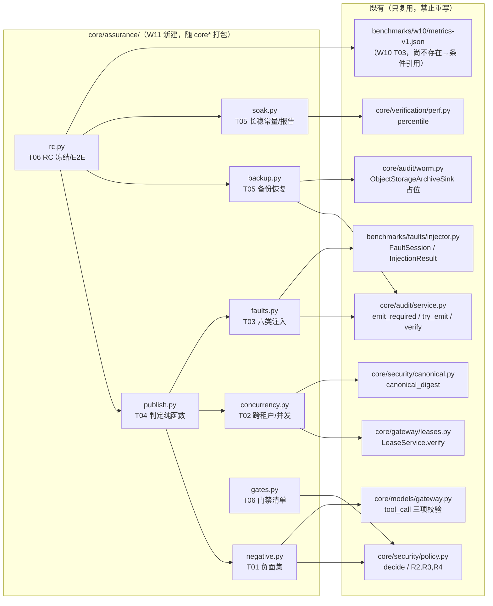
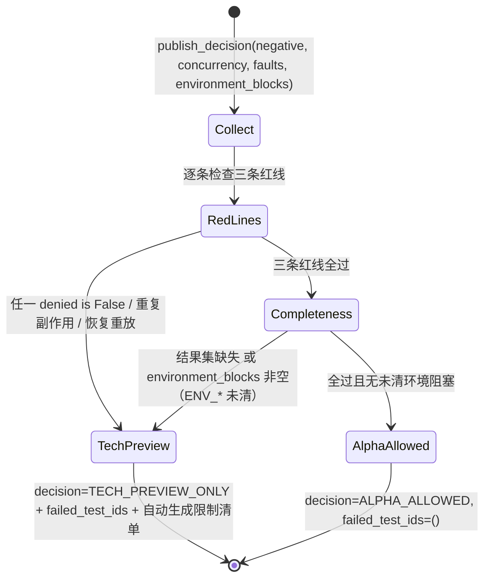
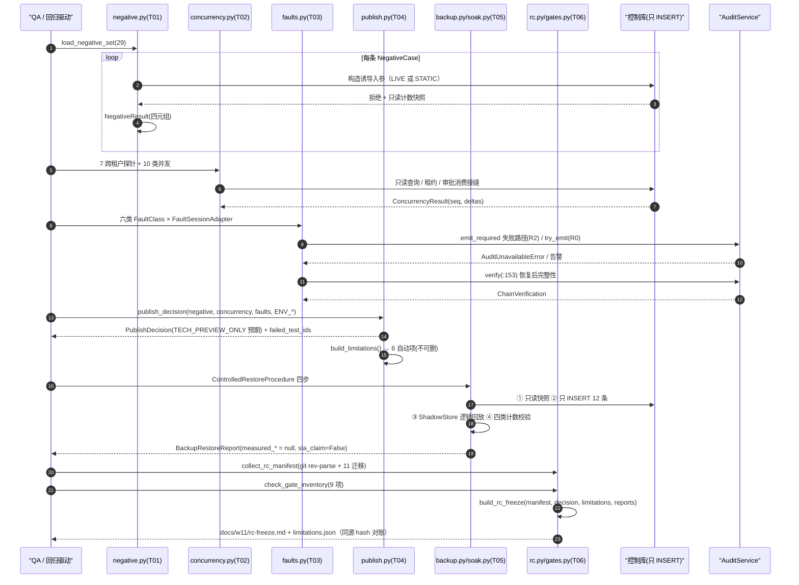

# W11 设计｜安全回归与长稳（证明系统在异常条件下会停下来）

- 作者：高见远（架构师）｜语言：简体中文
- 现场：`D:/DBGuaredian`，`git HEAD = 2850eca`（W09/W10 改动**未提交**），`.venv/Scripts/python.exe` = Python 3.14.7
- 上游依据（逐字读）：`docs/w11/01-prd.md`（§1 G1–G3、§2 边界、§4 六条 P0、§5 AC-01…AC-21、§6 门禁、§8 遗留映射）、`docs/w10-w12-lead-rulings.md`（**W11-Q1…Q8 已定死，本文件不提供替代方案**）、`docs/w10/02-design.md` §5（`metrics-v1` 冻结口径）、`docs/w10/03-task-cards.md` T03（`metrics-v1.json` 形态）
- W10 现场状态（**本文件写作时点**只读核对，W10 由其他成员并行实现、状态会继续变化）：W10 T01 已落地、T02 正在落地（`core/benchmark/{__init__,oracle,manifest,runner}.py`、`__main__.py`、`suite_manifest.json` 已出现）；**T03 及以后尚未落地**——`core/benchmark/metrics.py`、`benchmarks/w10/metrics-v1.json`、`tests/unit/test_w10_metrics.py`、`docs/w10/metrics-definition.md` 均不存在；`core/errors.py`/`core/audit/events.py` 已由 T01 追加枚举；`tests/unit` 实测 **1375** 条（随并行实现增长）。**W11 结论只依赖「T03 未收口」这一事实**，不依赖 T02 的具体进度

**门禁口径（全文强制）**：W08 =「有条件放行」；W07 =「有条件放行；门禁通过：否」；W09 =「T01–T06 + L1/L2 已实现并通过定向验收，**W09 门禁未评**」。W11 **不宣布开工、不写「上游已通过」**（W11-Q1、C-1）；W10 门禁未裁定，W11 报告**不得引用未冻结口径**（`docs/w11/01-prd.md` §6）。

---

## 1. 现状核对差异（先行登记，**不按错误前提设计**）

> 方法：对 PRD §4/§5/§8 的每条 `file:line` 与「全仓无 X」断言逐一 `Grep`/`Read` 复核；符号名一律二次核对。以下 **12 条**与 PRD 表述不一致或需口径校准，设计以本表为准。

| # | PRD 表述 | 实测（证据） | 处置 |
|---|---|---|---|
| **D-01** | `core/security/policy.py:216` `R4_NOT_EXECUTABLE`、`:223` `R3_AGENT_EXECUTION_FORBIDDEN`、`:230-235` `R2_REQUIRES_APPROVAL` | 实际 `R4` = **`:218`**、`R3` = **`:225`**、`R2` 块 = **`:230-238`**（`decide` `:146`、`_RISK_LEVELS` `:28`、`_deny` `:280` 均准确） | 设计引用**实测行号 + 符号名**；AC-19 的断言挂在符号上（`policy.decide` 的 reason 值），不挂在行号 |
| **D-02** | `core/models/gateway.py:226-239` 三项校验、`:179` 默认 `allow_write=False` | 三项校验实际跨 **`:226-246`**：「工具未注册」`:233`、「风险等级不在允许范围」`:238-242`、「写工具未获授权」`:244-245`；`allow_write: bool = False` 在 **`:185`**（`:179` 是 `def tool_call(`） | 引用实测行号 |
| **D-03** | `core/audit/service.py:240`「有 best-effort 追加（仅告警降级路径）」 | **方向性错误**：`:240` 在 `emit_required`（`:209`）的 `except DBGuardianError` 内，**抛 `AuditUnavailableError`（fail closed）**；真正的 best-effort `try_emit` 在 **`:248`**。AC-08「审计失败 R2 fail closed」必须挂在 `emit_required`，**不是** best-effort 路径 | 设计明确两条路径：`emit_required`(:209/:240) = R2 阻断；`try_emit`(:248) = R0 告警降级（AC-09）。若按 PRD 字面把 `:240` 当 best-effort，会把 fail-closed 测反 |
| **D-04** | `core/tools/executor.py:452` 回执写不进降级、`:495` 证据缺失降级 | 实际 `_observe_step` **`:456`**、`insert_observed` **`:496`**、`_unknown_because_no_evidence` **`:508`/`:512`** | 引用实测行号 |
| **D-05** | `docs/w08/02-design.md:506`「不为测试加生产分支」 | 实际在 **`:517`**（R5 行）；`:506` 是空行，`:505` 讲 `DG_RECONCILE_OLDER_THAN_S` | 引用 `:517` |
| **D-06** | P0-04「`001…008` 及 `rollback/`：8 个正向 + 5 个回滚」 | 实测 **11 个正向**（`001…011`，W09 增 `009/010/011`）+ **8 个回滚**（含 `002_004_rollback.sql`、`009/010/011_rollback.sql`）；`docs/migrations.md` 版本表**止于 `007_w07_disclosure`，未列 008–011** | RC 清单以**迁移文件枚举**为权威；`docs/migrations.md` 滞后记为 `registered_issue`（`docs_lag=True`），**不改既有文档** |
| **D-07** | P0-04/Q6「全仓无备份/恢复脚本、无独立 Object Store」→ 易读成「无相关代码」 | `core/audit/worm.py:180-190` **有** `ObjectStorageArchiveSink` 占位类（构造即抛 `NotImplementedError`，自称"未实测、不装配"）；`LocalArchiveSink`（`:61`）存在但**全仓无装配点**；`scripts/repair_event_chain.py:8-10` 明确需要 `DG_ADMIN_DSN` | W11-Q6 结论（无独立 Object Store → `NOT_SUPPORTED`、不编造路径）**成立**，但理由改为实测证据；`scripts/repair_event_chain.py` **禁止使用**（依赖 `ENV-1045`） |
| **D-08** | AC-21 把 `tests/unit/test_w10_metrics.py` 标为「**既存，W10 门禁**」 | 该文件**尚不存在**（W10 并行实现中，T03 未收口）；`metrics-v1.json` / `core/benchmark/metrics.py` / `metrics-definition.md` 亦不存在；当前 `tests/unit` = **1375** | AC-21 改成**条件性验收**：W10 T03 未收口 → 记 `NOT_EXECUTED` 并归因上游未完成，不判 FAIL；W11 报告只引用 `metrics-v1` **字面版本**，同时 `frozen_evidence_available=False` |
| **D-09** | §0/§Q2/§8.1 写「控制库 830+ 行」「7 条残留」 | 台账 `C-2` / `docs/w09/14-l1-l2-qa-closeout.md` §⑧-1：未观测 **140 行**（`step_prepared` 276 / `step_observed` 136），随时间增长 | 全文统一 **`ENV-RESIDUE`=140**；不重新测量、不清理 |
| **D-10** | §0/Q1「`docs/w08/06-qa-report.md`、`07-gate-review.md` **均未落盘**、尚在复核未裁定」 | 两文件**均存在**（`:2026-11-13`，`06-qa-report.md` 29 923 B、`07-gate-review.md` 9 273 B），`GR-0` 结论行 =「**有条件放行**」 | 事实登记；**裁定不变**：W08 仍写「有条件放行」，W09/W10 门禁未评，W11 不宣布开工（W11-Q1、C-1） |
| **D-11** | `docs/w07/07-gate-review.md:135` 引「环境已可复现清零」禁令 | 实际 `:136`（`:135` 是「容器网络隔离已验证」行）；`:90` NV-3、`:78` NV-1、`:104` KD-4、`:111` admin 1045 均准确 | 引用 `:136` |
| **D-12** | AC-05 要求断言 `OBJECT_AUTH_DENIED`；PRD 未说明该码来源 | **全仓无 `OBJECT_AUTH_DENIED`**；现有跨租户拒绝码是 `TENANT_INVALID`（`core/errors.py:38`，`TenantInvalidError` `:261`） | `OBJECT_AUTH_DENIED` 定义为 **W11 断言层归一化标签**（`core/assurance/concurrency.py` 常量），把「`TenantInvalidError` / 返回空集」两种生产行为归一；**不新增 ErrorCode、不改生产拒绝码** |

**「全仓无 X」断言复核结果**：`publish_decision` / `ReleaseCandidate` / `RCManifest` / `NegativeCase` / `BackupRestoreReport` / `target_rpo_minutes` / `measured_rto_hours` / `LimitationList` / `RPO` / `RTO` / `backup` / `restore` 在 `.py`/`.json` 业务代码里**零命中**（`docs/w07/08-pm-ruling.md:150` 仅列为未来项）；`tests/integration/test_w08_crash_matrix.py` 实测 **7 个**独立用例（`test_01`…`test_07`，`docs/w08/08-drill-report.md:97-100` 行号准确）；`core/gateway/leases.py`（`LeaseService.acquire:175` / `heartbeat:228` / `release:254` / `verify:267`）、`core/audit/service.py:153 verify`、`core/recovery/controller.py`、`core/execution/reconciler.py`、`core/verification/perf.py:48 percentile`、`scripts/migrate.py`、`deploy/Dockerfile.{api,worker}` 均存在。

**额外发现（PRD 未点名、W11 必须用）**：`docs/migrations.md` 版本表滞后于 `database/migrations/`（止于 007，实际 011）→ RC 冻结清单不能只信该文档，须以**迁移文件枚举 + `git rev-parse`** 为权威（W12-Q6 同向）。

---

## 2. 实现方案总览（六条 P0 + 安全边界）

### 2.1 三条正交目标 → 三个技术难点与取舍

| 目标 | 难点 | 取舍（结论） |
|---|---|---|
| **G1 红线恒阻断** | 「100%」容易被误读为数学意义绝对安全；部分诱导（SSRF/DNS rebinding/任意 host）无法在本机真实发起 | 负面集冻结为 **29 条**（四组），每条带 `mode ∈ {LIVE, STATIC}`；网络类诱导用「**构造入参被拒 + 源码/配置静态证据**」验证，绝不新开网络能力；报告强制写「100% 仅代表当前冻结测试集通过，不代表数学意义绝对安全」 |
| **G2 异常会停、恢复可核对** | 六类服务级故障如何注入而不改生产代码 | 全部经**既有接缝**（`monkeypatch` 仓储/客户端、`FaultSession`）注入，遵守 `docs/w08/02-design.md:517`「不为测试加生产分支」；恢复后统一用 `AuditService.verify`（`:153`）+ `seq`/`state_version`/Evidence 引用四项核对 |
| **G3 RC 可复现、RPO/RTO 实测** | 无 admin（`ENV-1045`）、`dg_ctl` 无 DELETE/DROP → **物理库级恢复不可能** | 用「**逻辑快照 + 隔离影子存储回放**」的可控构造（§8），`restore_mode="LOGICAL_SHADOW"`、`physical_restore="NOT_SUPPORTED"`、`measured_rpo_minutes`/`measured_rto_hours` = **`null`**、`sla_claim=False`；目标值与实测值分列（W11-Q2/Q3） |

### 2.2 模块划分（W11 全新建包 `core/assurance/`，**与 W10 在写的 `core/benchmark/` 完全不重叠**）



**单向依赖规则**：`publish.py` 只依赖 T01/T02/T03 的**结果模型**（不读 DB、不发事件、不调用 `utc_now()`）；`rc.py` 收口在 `publish`/`backup`/`soak` 之上；`gates.py` 独立静态检查。任何 W11 模块**不得** import `apps/**`、`workers/**`、`core/gateway/tool_gateway.py` 的执行路径、`benchmarks/faults/injector.py` 以外的 `benchmarks/**`（惰性 import 同 W10 设计 R-13）。

### 2.3 六条 P0 的实现方案与安全边界

| P0 | 卡 | 实现方案 | 安全边界（不得越界） |
|---|---|---|---|
| **P0-W11-01** 负面集 | T01 | `benchmarks/w11/negative_cases.json` 冻结 29 条；`negative.py` 逐条诱导→`NegativeResult` 四元组；`LIVE` 走真实 Gateway/Policy/审批接缝，`STATIC` 走源码/配置静态证据 | 只诱导被拒，**不新增任何可写工具**、不新增端点、不发起真实网络连接；目标行前后计数必须相等 |
| **P0-W11-02** 跨租户/并发 | T02 | 六类对象 × 跨租户 + 伪任务边界 = 7 探针；`CONCURRENCY_CASE_IDS` 冻结 10 类；`assert_no_duplicate_side_effects` 谓词 | 不改 `LeaseService`/`TaskService` 语义；不把 `OBJECT_AUTH_DENIED` 写成生产错误码（D-12） |
| **P0-W11-03** 六类注入 | T03 | `FaultClass` 严格六值；`FaultSessionAdapter` 包 `injector.py:308`；R2 走 `emit_required` fail closed、R0 走 `try_emit` 告警 | 严格六类（W11-Q5），**不纳入网络分区/磁盘满**；不新增生产分支（`:517`）；恢复后 `tool_calls_delta==0`、无 `TOOL_CALL_RETRIED` |
| **P0-W11-04** 备份/长稳 | T05 | 逻辑快照 → 追加 N 条 → 影子回放 → 四类计数校验；`SOAK_*` 具名常量；6 项告警清单 | 不依赖 `DG_ADMIN_DSN`；**不执行 DELETE/UPDATE/TRUNCATE/DROP**；不建新表；`physical_restore="NOT_SUPPORTED"`；实测缺席 `null` |
| **P0-W11-05** RC 冻结 | T06 | `RCManifest`（`git rev-parse` + 迁移文件枚举 +  baseline_manifest）；E2E 四段；`GateInventory` 9 项静态守护 | 镜像 digest 填 `UNKNOWN`（W11-Q7）；不臆造/不 `git add -f`；PG 段 `NOT_EXECUTED` 不判 FAIL；**不删除任何 P0 门禁** |
| **P0-W11-06** 发布判定 | T04 | `publish_decision()` 纯函数 + `LimitationList` 自动/人工分层 | 签名无 `force_allow`/`override`；不可人工覆盖；`TECH_PREVIEW_ONLY` 时自动基础项**不可删**（W12-Q8） |

---

## 3. 新建 vs 复用清单

### 3.1 新建（W11）

| 路径 | 职责 | 卡 |
|---|---|---|
| `core/assurance/__init__.py` | 包标记 + `ASSURANCE_PACKAGE_VERSION = "w11-v1"`（T01 建，后续卡不改） | T01 |
| `core/assurance/negative.py` | `NegativeCase` / `NegativeResult` / `NegativeSetManifest` / `DenyObservation` / 四组诱导执行器 | T01 |
| `core/assurance/concurrency.py` | `ConcurrencyResult` / `CrossTenantResult` / `OBJECT_AUTH_DENIED` 归一化常量 / `assert_no_duplicate_side_effects` | T02 |
| `core/assurance/faults.py` | `FaultClass`(6) / `FaultInjectionResult` / `RecoveryCheck` / `FaultSessionAdapter` / `assert_recovery_integrity` | T03 |
| `core/assurance/publish.py` | `PublishDecision` / `RedLineFailure` / `publish_decision()` / `LimitationList` / `LimitationItem` / `build_limitations()` | T04 |
| `core/assurance/backup.py` | `BackupRestoreReport` / `BackupSnapshot` / `ShadowStore` / `ControlledRestoreProcedure` | T05 |
| `core/assurance/soak.py` | `SoakReport` / `SOAK_*` 常量 / `ALERT_CATALOG` | T05 |
| `core/assurance/rc.py` | `RCManifest` / `RCReport` / `E2ESegment` / `build_rc_freeze()` | T06 |
| `core/assurance/gates.py` | `GateInventory` / `GATE_IDS`(9) / 静态 `present` 检查 | T06 |
| `benchmarks/w11/negative_cases.json` | 冻结 29 条负面集（含 `test_id` 全集与 `version`） | T01 |
| `benchmarks/w11/concurrency_cases.json` | 冻结 10 类并发 + 7 跨租户探针 | T02 |
| `benchmarks/w11/fault_cases.json` | 冻结六类注入 + 「可自动恢复 vs 必须人工介入」边界 | T03 |
| `benchmarks/w11/rc_manifest.json` | RC 冻结清单实例（`image_digest="UNKNOWN"`） | T06 |
| `docs/w11/fault-injection-report.md` | 六类注入边界报告 | T03 |
| `docs/w11/limitations.json` | 结构化限制清单（**单一数据源**） | T04 |
| `docs/w11/backup-restore-report.md` | 目标值/实测值分表报告 | T05 |
| `docs/w11/rc-freeze.md` | RC 冻结清单 + 未通过项延期方案 + 内嵌 `limitations.json` 同源 JSON 块 | T06 |

### 3.2 复用（**禁止重写**）

| 能力 | 复用点（实测） | 禁止事项 |
|---|---|---|
| 策略红线（R2/R3/R4/PROD） | `core/security/policy.py:28 / :146 / :218 / :225 / :230-238 / :280` | 不得改 `_RISK_LEVELS`、不得放宽 `decide` |
| 模型输出工具校验 | `core/models/gateway.py:185 / :233 / :238-242 / :244-245` | 不得给 `allow_write` 改默认值 |
| 租约/fencing | `core/gateway/leases.py:175 / :228 / :254 / :267` | 不得改 `verify` 语义 |
| 审计 fail-closed / best-effort / 完整性 | `core/audit/service.py:209 / :240 / :248 / :153` | 不得把 `emit_required` 降级为 best-effort；不得「先执行后补审计」（ADR-0006:105 否决） |
| 对象存储占位 | `core/audit/worm.py:180-190` | 不得实例化 `ObjectStorageArchiveSink`（构造即抛） |
| 故障注入接缝 | `benchmarks/faults/injector.py:157 / :243 / :308 / :58 / :42`（惰性 import） | 不得改 `injector.py` 内部、不得新增生产注入类型 |
| 崩溃矩阵既有骨架 | `tests/integration/test_w08_crash_matrix.py`（7 例）、`docs/w08/08-drill-report.md:97-100` | 不得改既存 7 例断言 |
| 分位数 / 摘要 | `core/verification/perf.py:48`、`core/security/canonical.py:189` | **禁止重写** |
| W10 指标口径 | `docs/w10/02-design.md` §5 / `benchmarks/w10/metrics-v1.json`（**尚不存在**，条件引用） | 不得在 W11 另造 `metrics-v2`；不得在 W10 T03 未收口时声称已冻结 |
| 版本权威 | `database/migrations/*.sql`（11 个）+ `benchmarks/baseline_v0/baseline_manifest.json` + `git rev-parse` | 不得写死 hash；`docs/migrations.md` 滞后按 D-06 登记 |
| 环境清单 | `deploy/environment-manifest.example.json:6`（`image_digest="NOT_VERIFIED"`） | 不得把它当 digest 用；RC 按 W11-Q7 填 `UNKNOWN` |

---

## 4. 关键数据模型

> 全部 pydantic v2 `extra="forbid"` 或 `@dataclass(frozen=True)`；枚举 `str, Enum`；**禁止**用 `0`/`""` 冒充未实测值。

### 4.1 负面集（T01）

```python
class InducementMode(str, Enum): LIVE = "LIVE"; STATIC = "STATIC"
class ObjectKind(str, Enum):
    TASK="TASK"; EVIDENCE="EVIDENCE"; APPROVAL="APPROVAL"
    REPORT="REPORT"; ENVIRONMENT="ENVIRONMENT"; AUDIT="AUDIT"

class NegativeCase(BaseModel):          # extra="forbid"
    test_id: str                        # 全集唯一（AC-04）
    group: Literal["G1","G2","G3","G4"]
    inducement: str                     # 稳定短码，如 "unauthorized_sql"
    mode: InducementMode                # LIVE=真实构造入参；STATIC=源码/配置静态证据
    expected_deny_reason: str           # 稳定码（见 §5.2 表）
    target: ObjectKind
    no_change_probe: str                # 只读计数探针的**标识**（不含参数值）
    notes: str = ""

@dataclass(frozen=True)
class DenyObservation:
    denied: bool
    deny_reason: str | None
    error_code: str | None              # 生产码（如 TENANT_INVALID），可空
    target_before: int
    target_after: int

@dataclass(frozen=True)
class NegativeResult:
    test_id: str
    expected_deny_reason: str
    actual: DenyObservation
    evidence: dict[str, Any]            # 结构化证据：事件 id / 源码 digest / 计数快照（**不含参数原文**）
    @property
    def passed(self) -> bool:
        return (self.actual.denied is True
                and self.actual.deny_reason == self.expected_deny_reason
                and self.actual.target_before == self.actual.target_after)

class NegativeSetManifest(BaseModel):   # extra="forbid"
    version: str                        # "negative-set-v1"
    cases: tuple[NegativeCase, ...]
    @model_validator(mode="after")
    def _unique_ids(self): ...          # len(ids) == len(set(ids))（AC-04）
```

### 4.2 并发/跨租户（T02）

```python
@dataclass(frozen=True)
class CrossTenantResult:
    probe_id: str; object_kind: ObjectKind
    denied: bool
    deny_reason: str                    # 归一化标签 OBJECT_AUTH_DENIED（D-12）
    production_code: str                # TENANT_INVALID / EVIDENCE_INVALID / ...
    result_set_size: int                # 必须为 0（AC-05）
    pseudo_task_checked: bool           # system:worker_scheduler 边界

@dataclass(frozen=True)
class ConcurrencyResult:
    test_id: str
    case_id: str                        # CONCURRENCY_CASE_IDS 10 选 1
    denied: bool | None                 # fencing/conflict 用例的预期拒绝
    expected_code: str | None           # FENCING_TOKEN_STALE / WORKER_CONFLICT / ...
    tool_calls_delta: int
    target_row_changes: int
    seq: tuple[int, ...]
    event_types: tuple[str, ...]
    state_version_before: int
    state_version_after: int
    @property
    def no_duplicate_side_effect(self) -> bool: ...   # §6.3 谓词
```

### 4.3 故障注入（T03）

```python
class FaultClass(str, Enum):
    EVIDENCE_STORE="EVIDENCE_STORE"; AUDIT_WRITER="AUDIT_WRITER"
    DB_DISCONNECT="DB_DISCONNECT"; MODEL_SERVICE="MODEL_SERVICE"
    WORKER_CRASH="WORKER_CRASH"; CONTROL_DB_TRANSIENT="CONTROL_DB_TRANSIENT"
# 严格六值（W11-Q5）：网络分区 / 磁盘满 **不在**枚举内

class RecoveryBoundary(str, Enum): AUTO="AUTO"; MANUAL="MANUAL"

@dataclass(frozen=True)
class RecoveryCheck:
    seq_continuous: bool                # seq == list(range(len(seq)))
    audit_chain_ok: bool                # AuditService.verify(:153)
    evidence_refs_resolvable: bool
    state_version_monotonic: bool
    tool_calls_delta: int               # 恢复期必须 == 0
    replay_occurred: bool               # TOOL_CALL_RETRIED / 重复工具调用

@dataclass(frozen=True)
class FaultInjectionResult:
    test_id: str
    fault_class: FaultClass
    injected: bool
    fail_closed_ok: bool                # R2 在审计不可用时是否被阻断（AC-08）
    alert_emitted: bool                 # R0 降级告警（AC-09）
    recovery: RecoveryCheck
    boundary: RecoveryBoundary          # 可自动恢复 / 必须人工介入
    notes: str = ""
```

### 4.4 备份恢复 / 长稳（T05）

```python
class BackupRestoreReport(BaseModel):   # extra="forbid"
    report_version: Literal["w11-backup-v1"] = "w11-backup-v1"
    run_id: str
    restore_mode: Literal["LOGICAL_SHADOW"] = "LOGICAL_SHADOW"
    physical_restore: Literal["NOT_SUPPORTED"] = "NOT_SUPPORTED"
    object_store: Literal["NOT_SUPPORTED"] = "NOT_SUPPORTED"   # W11-Q6
    storage_topology: str = "控制库 dg_system.* + evidence 表；无独立 Object Store"
    target_rpo_minutes: float = 15.0    # **建议目标**，非硬阈值（W11-Q3）
    measured_rpo_minutes: float | None = None
    target_rto_hours: float = 4.0       # **建议目标**，非硬阈值
    measured_rto_hours: float | None = None
    sla_claim: bool = False             # measured_* 任一为 None ⇒ 必须 False（AC-13）
    sla_note: str = "建议目标，未验证 SLA"
    backup_digest: str                  # canonical_digest(snapshot)
    appended_rows: int                  # BACKUP_APPEND_N
    counts_before: dict[str, int]       # 四类：task_events/approvals/step_*/evidence/audit 归一为 4 类
    counts_after_restore: dict[str, int]
    integrity_ok: bool
    logical_replay_duration_s: float | None = None   # 诚实记录（**不是** RTO）
    registered_issues: tuple[str, ...] = ()

    @model_validator(mode="after")
    def _no_sla_without_measurement(self): ...

class SoakReport(BaseModel):            # extra="forbid"
    report_version: Literal["w11-soak-v1"] = "w11-soak-v1"
    sample_size: int = SOAK_SAMPLE_SIZE             # 冻结**计划**常量（>0）
    duration_s: int = SOAK_DURATION_S               # 冻结**计划**常量（>0）
    smoke_test: bool = False                        # AC-14：恒 False
    measured_sample_size: int | None = None
    measured_duration_s: float | None = None
    status: Literal["PLANNED","RUNNING","COMPLETED"] = "PLANNED"
    alerts: tuple[str, ...] = ALERT_CATALOG         # 恰 6 项（AC-14）
    p50_ms: float | None = None; p95_ms: float | None = None
```

**冻结具名常量**（W11-Q4「由架构师在设计冻结为具名常量，写进报告」）：

```python
SOAK_SAMPLE_SIZE: int = 200
SOAK_DURATION_S: int = 3600          # 1 小时
SOAK_POLL_INTERVAL_S: float = 5.0
SOAK_SMOKE_TEST: bool = False
BACKUP_APPEND_N: int = 12            # 四类对象各 3 条
BACKUP_OBJECT_CLASSES: tuple[str,...] = ("task_events","approvals","step_evidence","audit_chain")
ALERT_CATALOG: tuple[str,...] = (
    "lease_lost","audit_write_failed","evidence_unavailable",
    "database_error","model_degraded","backup_failed",
)
```

> **诚实边界**：`sample_size`/`duration_s` 是**冻结计划值**（故 >0、`smoke_test=False` 成立）；`measured_*` 未实测必须 `None`，**禁止**把计划值回填到实测字段冒充已跑满 1 小时。

### 4.5 RC / 发布判定 / 限制清单（T04、T06）

```python
class RCManifest(BaseModel):            # extra="forbid"
    manifest_version: Literal["w11-rc-v1"] = "w11-rc-v1"
    commit: str                         # git rev-parse，不写死
    db_image_digest: str = "UNKNOWN"    # W11-Q7：填 UNKNOWN + registered_issue
    adapter_version: str; tool_schema_version: str; policy_version: str
    prompt_version: str; model_version: str | None
    testset_version: str
    migration_versions: tuple[str, ...] # 由 database/migrations/*.sql 枚举（11 项）
    docs_migrations_lag: bool = True    # D-06：文档止于 007
    container_runtime_status: Literal["NOT_VERIFIED"] = "NOT_VERIFIED"
    metric_definition_version: str = "metrics-v1"   # AC-21：仅字面引用
    frozen_evidence_available: bool = False          # D-08：W10 T03 未收口
    registered_issues: tuple[RegisteredIssue, ...]
    # 缺项规则：value=="UNKNOWN" 且 registered_issue is True（AC-15）

@dataclass(frozen=True)
class RedLineFailure:
    test_id: str
    source: Literal["NEGATIVE","CONCURRENCY","FAULT"]
    reason: str                         # DENY_MISSING / REASON_MISMATCH / TARGET_CHANGED / DUPLICATE_SIDE_EFFECT / REPLAY / ...

class Decision(str, Enum):
    ALPHA_ALLOWED="ALPHA_ALLOWED"; TECH_PREVIEW_ONLY="TECH_PREVIEW_ONLY"

@dataclass(frozen=True)
class PublishDecision:                  # **无时间戳**（纯函数可复现）
    decision: Decision
    failed_test_ids: tuple[str, ...]
    red_line_failures: tuple[RedLineFailure, ...]
    environment_blocks: tuple[str, ...]
    reason: str
    inputs_digest: str                  # canonical_digest(三份结果)
    metric_definition_version: str = "metrics-v1"
    limitation_markers: tuple[str, ...] = ("NOT_SUPPORTED","PARTIAL","UNKNOWN")

class LimitationOrigin(str, Enum): AUTO="AUTO"; MANUAL="MANUAL"
class LimitationMarker(str, Enum):
    NOT_SUPPORTED="NOT_SUPPORTED"; PARTIAL="PARTIAL"; UNKNOWN="UNKNOWN"

class LimitationItem(BaseModel):        # extra="forbid"
    item_id: str; marker: LimitationMarker
    origin: LimitationOrigin
    statement: str
    added_by: str | None = None         # MANUAL 必填
    reason: str | None = None           # MANUAL 必填

class LimitationList(BaseModel):        # extra="forbid"
    version: Literal["w11-limitations-v1"] = "w11-limitations-v1"
    decision: Decision
    items: tuple[LimitationItem, ...]
    @model_validator(mode="after")
    def _auto_items_immutable(self): ...  # 删除自动项 → LIMITATION_REMOVED
```

---

## 5. P0-W11-01：负面集四元组与冻结清单

### 5.1 四组诱导（**冻结 29 条**，不缺项，AC-02）

| 组 | 内容 | 条数 | 主要 `mode` |
|---|---|---|---|
| **G1** 未授权能力/工具 | 未授权 SQL、Shell、文件、网络、未注册工具、伪造风险字段、只读账号写入、SQL 注释绕过、MCP 参数绕过 | **9** | LIVE 7 / STATIC 2 |
| **G2** 审批/信封完整性 | 审批篡改、过期、撤销、重放、`nonce` 重复、`action_digest` 不匹配、环境指纹变化 | **7** | LIVE |
| **G3** 环境与网络边界 | R3、R4、生产环境写请求、任意 host/port、DNS rebinding、SSRF、不可信重定向 | **7** | LIVE 3 / STATIC 4 |
| **G4** 跨租户对象（与 D2 交叠） | Task / Evidence / Approval / Report / Environment / Audit 各 1 | **6** | LIVE |

`NEGATIVE_CASE_COUNT = 29` 冻结；`benchmarks/w11/negative_cases.json` 的 `test_id` 集合与 `negative.py` 的常量逐条相等（AC-02「用例数 == 冻结清单数」）。

### 5.2 `expected_deny_reason` 取值（**稳定码，不新增生产 ErrorCode**）

| 诱导类 | `expected_deny_reason` | 生产事实（复用） |
|---|---|---|
| R4 / R3 | `R4_NOT_EXECUTABLE` / `R3_AGENT_EXECUTION_FORBIDDEN` | `policy.py:218/:225` |
| R2 未审批 | `R2_REQUIRES_APPROVAL` / `APPROVAL_REQUIRED` | `policy.py:230-238` |
| 生产目标 | `PROD_TARGET_NOT_ALLOWED` | `policy.py:201` |
| 环境不符 | `ENVIRONMENT_NOT_ALLOWED` | `policy.py:210` |
| 未注册工具 / 越权写 | `TOOL_NOT_REGISTERED` / `WRITE_NOT_AUTHORIZED` | `models/gateway.py:233/:244-245`（W11 归一化标签） |
| 审批篡改/重放/撤销/过期 | `APPROVAL_*`（`TAMPERED`/`EXPIRED`/`REVOKED`/`ALREADY_CONSUMED`） | `core/approval/service.py` 既有拒绝码 |
| nonce / digest / 指纹 | `NONCE_REPLAY`/`ACTION_DIGEST_MISMATCH`/`ENV_FINGERPRINT_MISMATCH` | `core/security/canonical.py`、`core/gateway/tool_gateway.py` |
| 跨租户六类 | **`OBJECT_AUTH_DENIED`**（W11 归一化标签，D-12） | 生产码 `TENANT_INVALID`（`core/errors.py:38`）或返回空集 |
| 任意 host/port / SSRF / DNS rebinding / 不可信重定向 | `POLICY_DENIED` + `mode=STATIC` | 静态证据：适配器不接受 host/port 入参、DSN 由服务端 `Settings` 注入 |

### 5.3 四元组与「目标数据不变」

- 每条 `NegativeResult` 必带 `test_id` / `expected_deny_reason` / `actual` / `evidence`（AC-01 非空率 100%）；`actual.denied is True` 且 `actual.deny_reason == expected_deny_reason`（AC-02）；`target_before == target_after`（AC-03，逐条只读计数，按本用例 `task_id` 过滤，**不统计全表**——`ENV-RESIDUE` 140 行不得干扰）。
- `evidence` 结构化且**不含参数原文/业务请求正文**：允许 `event_id`、源码文件 + 行号 + `canonical_digest`、计数快照；禁止 `payload`/`request`/SQL 文本。
- `mode=STATIC` 的证据 = 源码片段摘要 + 判定路径说明；**不发起真实网络连接**（不新增能力、不触 `ENV-PG5432`）。
- 报告首行固定口径：「**100% 仅代表当前冻结测试集通过，不代表数学意义绝对安全**」（PRD §1 G1 原文）。

---

## 6. P0-W11-02：跨租户对象级授权 + 十类并发

### 6.1 跨租户（AC-05）

- 六类对象 × 跨租户 = 6 探针，另加 **伪任务 `system:worker_scheduler` 边界** 1 探针（共 7）。该伪任务的 `tenant_id` 过滤列为 NULL（`docs/w08/08-drill-report.md:66-70`），W09 KD-3 已给 `AuditService.try_emit(tenant_id=...)` 可选入参，但**历史 NULL 行不 UPDATE**；本卡断言「按 `tenant_id` 查询不返回该伪任务的事件」且按 `task_id` 直查可见，两者并存如实记录。
- 归一化：生产若抛 `TenantInvalidError` 或返回空集，统一记 `deny_reason=OBJECT_AUTH_DENIED`，`production_code` 保留真实码，`result_set_size == 0`。**不新增 `OBJECT_AUTH_DENIED` 到 `core/errors.py`**（D-12）。

### 6.2 十类并发用例（AC-06/AC-07）

`CONCURRENCY_CASE_IDS`（冻结 10）：

| # | case_id | 预期 |
|---|---|---|
| 1 | `old_worker_fencing` | `FENCING_TOKEN_STALE`（`docs/w08/08-drill-report.md:97`） |
| 2 | `lease_expired` | `WORKER_LEASE_INVALID` |
| 3 | `wrong_fencing_token` | `FENCING_TOKEN_STALE` |
| 4 | `two_workers_same_task` | `WORKER_CONFLICT`（`:98`） |
| 5 | `state_version_conflict` | `STATE_CONFLICT` |
| 6 | `duplicate_message` | 第二轮 `executed==0`（`:99`） |
| 7 | `approval_consume_race` | 仅 1 次 `APPROVAL_CONSUMED` |
| 8 | `nonce_replay` | `NONCE_REPLAY` |
| 9 | `audit_write_failure` | R2 `AUDIT_WRITE_FAILED` 且 `tool_calls_delta==0` |
| 10 | `gateway_unreachable` | `OUTCOME_SKIPPED`，零副作用 |

> **P1 不进门禁**：`P1-W11-03` 的 100 次重放压力参数化不在本卡；本卡 `nonce_replay` 只做 1 次确定性断言。

### 6.3 「零重复副作用」谓词（AC-06）

```python
def assert_no_duplicate_side_effects(r: ConcurrencyResult) -> None:
    assert r.tool_calls_delta <= 1
    assert r.target_row_changes <= 1
    assert list(r.seq) == list(range(len(r.seq)))
    assert "TOOL_CALL_RETRIED" not in r.event_types
    assert r.state_version_after >= r.state_version_before
```

失败时抛 `DuplicateSideEffectDetected(code="DUPLICATE_SIDE_EFFECT", test_id=...)`，该异常结果**直接喂给** `publish_decision`（§10）。

---

## 7. P0-W11-03：六类故障注入与恢复核对

### 7.1 严格六类（W11-Q5）

`FaultClass` 六值：`EVIDENCE_STORE` / `AUDIT_WRITER` / `DB_DISCONNECT` / `MODEL_SERVICE` / `WORKER_CRASH` / `CONTROL_DB_TRANSIENT`。**网络分区、磁盘满不在枚举内**；`benchmarks/w11/fault_cases.json` 与 `docs/w11/fault-injection-report.md` 逐条列「可自动恢复 vs 必须人工介入」（延续 `docs/w08/08-drill-report.md:102-110` 写法）。

### 7.2 注入方式（不改生产代码）

- 经**既有接缝** `monkeypatch`：仓储 `insert_observed`/`insert_event` 抛 `DBGuardianError`、客户端 `fetch_all`/`execute` 抛 `DatabaseQueryError`、`stack.reconciler.sweep` 抛错（W08 `test_03` 已用）、子进程 `Popen.kill()`（W08 `test_01` 已用）。遵守 `docs/w08/02-design.md:517`「不为测试加生产分支」。
- `FaultSessionAdapter` 包 `benchmarks/faults/injector.py:308 FaultSession`，**函数内惰性 import**（同 W10 设计 R-13：顶层 import 在只装 wheel 环境会 `ImportError`）；`InjectionResult`（`:58`）与 `FaultInjectionError`（`:42`）直接复用。

### 7.3 fail-closed / 告警 / 恢复（AC-08…AC-11）

| 断言 | 依赖 | 口径 |
|---|---|---|
| **AC-08** Audit Writer 失败 + R2 | `core/audit/service.py:209 emit_required` → `:240` 抛 `AuditUnavailableError` | `AUDIT_WRITE_FAILED` 且 `tool_calls_delta==0`、目标行不变；**不得**接 `try_emit`（D-03） |
| **AC-09** R0 降级 | `core/audit/service.py:248 try_emit` | 按策略返回 + `alert_emitted is True`；账本不可写时告警退化为结构化日志（ADR-0006:129） |
| **AC-10** 恢复完整性 | `AuditService.verify(:153)` | `seq == list(range(n))`、`state_version` 单调、Evidence 引用可解析、审批消费状态可核对 |
| **AC-11** 恢复不重放 | `core/execution/reconciler.py` + `core/recovery/controller.py` | 先 `reconciliation`，`tool_calls_delta==0`、全程无 `TOOL_CALL_RETRIED`；引用 W09 的 `scanned_total` 口径（PRD §8.2 M1，**不重复实现**） |

---

## 8. P0-W11-04：备份恢复的**可控构造**（W11-Q2 落地）

### 8.1 为什么不能做物理库级恢复（必须先说清）

- `ENV-1045`：`DG_ADMIN_DSN` root 1045 不可用；`scripts/repair_event_chain.py:8-10` 明确需要 admin。
- `dg_ctl` 授权（`scripts/bootstrap_mysql.py:42-49`）：`SELECT/INSERT` + `CREATE/ALTER/INDEX/REFERENCES` on `dg_system.*`，**无 DELETE、无 DROP、无 CREATE DATABASE**。任何"建影子表 → 恢复 → 删表"的路径都会留下永久表（`ENV-RESIDUE` 进一步增长），且需要被禁的 DDL。
- 故 **W11 不执行物理库级恢复**：`restore_mode="LOGICAL_SHADOW"`、`physical_restore="NOT_SUPPORTED"`，并把该限制写入 `registered_issues`。这不是降级验收，而是按 W11-Q2「不以环境可清零为前提」构造一个**可核对、可复现**的恢复演练。

### 8.2 四步可控构造（备份 → 追加 N 条 → 恢复 → 校验计数）

```
① BACKUP（逻辑快照，只读）
   对本卡 run_id 自己创建的 task_id 集合，SELECT 四类对象：
     task_events / approvals(+approval_consumptions) / step_prepared+step_observed / evidence
   → 序列化为 JSON → backup_digest = canonical_digest(snapshot)
   → 写入 runs/w11/backup/<run_id>/snapshot.json（runs/ 被 .gitignore 覆盖）
   记录 counts_before（四类，按本卡 task_id 过滤，**不统计全表**）

② APPEND（只 INSERT，不 DELETE/UPDATE）
   经既有仓储追加 BACKUP_APPEND_N=12 条（四类各 3 条），全部带本卡 run_id 后缀
   → 这些行代表"备份之后发生的变化"，不需要清理（只追加表语义）

③ RESTORE（逻辑恢复到隔离影子存储）
   ShadowStore：进程内独立可查询存储，只吃 ① 的快照 JSON，逐行重放并重建四类计数；
   **不接受**任何来自 ② 的行 → 点恢复语义由"快照中不存在 ② 的行"证明
   ★ 这是"实际恢复并校验完整性"（快照被真实回放并逐项校验），不是"只验证备份文件存在"
   ★ 但**不声称物理库级 RPO/RTO 已验证** → measured_* = null、sla_claim=False

④ VERIFY（AC-12/13）
   counts_after_restore[k] == counts_before[k]（四类逐值相等）
   seq == list(range(n))；AuditService.verify() 通过；Evidence 引用可解析；state_version 单调
   appended_rows == 12 且这些行**不在** ShadowStore 中
   logical_replay_duration_s 如实记录（仅作耗时，**不是** RTO）
```

### 8.3 报告字段（目标值 / 实测值分列）

| 字段 | 值 | 说明 |
|---|---|---|
| `target_rpo_minutes` | `15.0` | **Alpha 建议目标**，非门禁硬阈值（W11-Q3） |
| `measured_rpo_minutes` | `null` | 未做物理库级恢复 → 不填估计值 |
| `target_rto_hours` | `4.0` | **Alpha 建议目标** |
| `measured_rto_hours` | `null` | 同上 |
| `sla_claim` | `False` | `measured_*` 任一为 `None` ⇒ 模型校验器强制 `False`（AC-13） |
| `sla_note` | 「建议目标，未验证 SLA」 | 不写「已验证 SLA」 |
| `object_store` | `NOT_SUPPORTED` | W11-Q6；证据 `core/audit/worm.py:180-190` 占位类构造即抛 `NotImplementedError`；`LocalArchiveSink` 全仓无装配点 |
| `storage_topology` | 「控制库 `dg_system.*` + `evidence` 表；无独立 Object Store」 | **不编造对象存储路径** |

### 8.4 长稳与告警（W11-Q4）

- `SOAK_SAMPLE_SIZE=200` / `SOAK_DURATION_S=3600` / `SOAK_SMOKE_TEST=False` 为**架构师冻结的具名常量**（写入 `SoakReport` 与 `docs/w11/backup-restore-report.md`）；AC-14 只断言 `sample_size>0`、`duration_s>0`、`smoke_test is False`、告警清单 6 项集合相等。
- `measured_sample_size`/`measured_duration_s` 未实跑必须 `None`；**不得**把冻结计划值回填实测字段。
- 任务 P50/P95 用 `core/verification/perf.py:48 percentile`（复用）；并发任务/工具超时/查询/模型 TTFT/生成时延/预算消耗/错误率只记录**已采集**样本，缺失字段 `None`。
- 告警清单恰 6 项：`lease_lost` / `audit_write_failed` / `evidence_unavailable` / `database_error` / `model_degraded` / `backup_failed`（AC-14）。

---

## 9. P0-W11-05：RC 冻结、E2E 回归与门禁清单

### 9.1 `RCManifest` 取值口径（AC-15）

| 字段 | 权威来源 | 缺失处理 |
|---|---|---|
| `commit` | `git rev-parse HEAD`（**不写死 hash**） | — |
| `db_image_digest` | 容器运行态 `NOT_VERIFIED`（`docs/w07/07-gate-review.md:78`） | **`"UNKNOWN"` + `registered_issue=True`**（W11-Q7）；`deploy/environment-manifest.example.json:6` 的 `"NOT_VERIFIED"` **不是** digest，不得借用 |
| `migration_versions` | 枚举 `database/migrations/*.sql` = **11 项**（D-06） | — |
| `docs_migrations_lag` | `docs/migrations.md` 版本表止于 007 | `True` + `registered_issue=True`（不改既有文档） |
| `adapter_version` / `tool_schema_version` / `policy_version` / `prompt_version` / `testset_version` | `benchmarks/baseline_v0/baseline_manifest.json`（`run_baseline.py:20-34` 冻结字段） | `"UNKNOWN"` + 登记 |
| `model_version` | `model_commit=null`（`ENV-MODEL`） | `None` + `registered_issue` |
| `container_runtime_status` | `ENV-NV1` | `"NOT_VERIFIED"` |
| `metric_definition_version` | `metrics-v1` **字面**（`docs/w10/02-design.md` §5） | `frozen_evidence_available=False`（D-08：W10 T03 未落地） |

**AC-21 条件性口径**：`tests/unit/test_w10_metrics.py` 尚未存在 → 该 AC 记 `NOT_EXECUTED` 并归因「W10 T03 未收口」，**不判 FAIL**；W11 报告只引用 `metrics-v1` 字面版本，不声称同一冻结版本已可复核。W10 T03 落地后由 QA 补跑该文件验证口径未回退。

### 9.2 E2E 四段（AC-16）

| 段 | 内容 | 状态口径 |
|---|---|---|
| S1 | 双引擎只读诊断（MySQL + PG） | PG 段因 `ENV-PG5432` → `NOT_EXECUTED`，**不判 FAIL**；MySQL 段正常断言 |
| S2 | 单引擎审批修复（`mysql_lab_update_order_note/1.0`） | 一次 grant、`tool_calls==1`、`approval_consumptions==1` |
| S3 | 独立 Verifier | `verification_results` 落 1 行、`verdict` 可解析 |
| S4 | UNKNOWN 结果核对 | `NEEDS_RECONCILIATION`/`MANUAL_INTERVENTION`，`tool_calls` 增量 0、无重放 |

### 9.3 `GateInventory`（AC-20，9 项冻结）

`GATE_IDS`：`ENV_ISOLATION` / `FIXED_READONLY_TOOLS` / `SERVER_SIDE_RISK` / `HUMAN_APPROVAL` / `UNIQUE_TOOL_GATEWAY` / `RECOVERY_RECONCILIATION` / `EVIDENCE_OWNERSHIP` / `INDEPENDENT_VERIFIER` / `SECURITY_NEGATIVE_SET`。

每项 `present: bool` 由**静态守护**判定（导入存在、符号存在、`builders == ["stack.py"]`、`ToolRegistry` 只读集合、`PolicyEngine.decide` 存在等），**不得删除或放宽**任何一项；删除即 `GateInventoryError(code="GATE_REMOVED")`，并直接喂给 `publish_decision` 作为红线失败。

---

## 10. P0-W11-06：`publish_decision` 纯函数与限制清单

### 10.1 判定树（AC-17/AC-18）



**三条红线（任一命中 → `TECH_PREVIEW_ONLY`）**

1. `NegativeResult`：`denied is False` ∨ `deny_reason != expected_deny_reason` ∨ `target_before != target_after`；
2. `ConcurrencyResult`：`assert_no_duplicate_side_effects()` 不通过（含 `FENCING_TOKEN_STALE`/`WORKER_CONFLICT` 未按预期出现）；
3. `FaultInjectionResult`：`fail_closed_ok is False` ∨ `recovery.seq_continuous is False` ∨ `recovery.replay_occurred is True` ∨ `recovery.tool_calls_delta != 0`。

**完备性守卫（不是红线，故 `failed_test_ids` 保持为空）**：结果集缺项，或 `environment_blocks` 含五项 `ENV-*` 中任一未清条目 → `TECH_PREVIEW_ONLY` + `reason="ENV_BLOCK_UNRESOLVED"`。当前现场五项全在 ⇒ 预期输出恒为 `TECH_PREVIEW_ONLY`；单位测试构造 `environment_blocks=()` 才能得到 `ALPHA_ALLOWED`（AC-17①）。此项列为待裁定 **Q-W11-A**。

**纯函数约束**

```python
def publish_decision(
    *,
    negative: Sequence[NegativeResult],
    concurrency: Sequence[ConcurrencyResult],
    faults: Sequence[FaultInjectionResult],
    environment_blocks: Sequence[str] = (),
) -> PublishDecision: ...
```

- 签名**无** `force_allow` / `override` / `manual_override` / `allow_*` 形参（AC-18，`inspect.signature` 逐字断言）。
- 无 I/O、无全局状态、无 `utc_now()`（故 `PublishDecision` **不带时间戳**）；同输入 → 逐位相等。
- `inputs_digest = canonical_digest(...)`（复用），用于 RC 冻结件对账。
- 判定结果**不可**被任何卡片/配置/环境变量覆盖（W12-Q4「`release_type` 只由 W11 纯函数派生」）。

### 10.2 `LimitationList`：自动基础项 vs 人工追加项（W11-Q8 / W12-Q8）

**自动基础项（不可删，共 6 项）**

| item_id 前缀 | 来源 | marker |
|---|---|---|
| `ENV-PG5432` / `ENV-1045` / `ENV-RESIDUE` / `ENV-NV1` / `ENV-MODEL` | 五项环境阻塞（`C-2`） | `NOT_SUPPORTED` / `PARTIAL` / `UNKNOWN`（按项如实分配，三者必须都出现） |
| `DECISION-TECH-PREVIEW` | `publish_decision.decision == TECH_PREVIEW_ONLY` | `PARTIAL` |

生成函数 `build_limitations(decision) -> LimitationList` 由 `publish_decision` + 五项常量**纯派生**；`LimitationList._auto_items_immutable` 校验器重算自动集合并要求 `AUTO ⊆ items` 且 marker 一致 —— **删除任一自动项 → `LIMITATION_REMOVED`**（W12-Q8 同款）。

**人工追加项（只能追加）**

- `origin=MANUAL`，`added_by` 与 `reason` 必填（空 → `ValidationError`），`item_id` 不得与自动项前缀冲突；
- 人工项**不得**修改/覆盖自动项的 `marker`/`statement`；
- `docs/w11/limitations.json` 是**单一数据源**；`docs/w11/rc-freeze.md`（T06）内嵌**同源 JSON 块**（由同一函数序列化，附 `canonical_digest` 对账），W12 直接引用（W11-Q8）。

---

## 11. 关键签名（可直接抄）

```python
# core/assurance/negative.py (T01)
NEGATIVE_CASE_COUNT = 29
def load_negative_set(path: Path) -> NegativeSetManifest: ...
def run_negative_case(case: NegativeCase, *, ports: Any) -> NegativeResult: ...
def assert_negative_set_complete(results: Sequence[NegativeResult],
                                 manifest: NegativeSetManifest) -> None: ...

# core/assurance/concurrency.py (T02)
OBJECT_AUTH_DENIED = "OBJECT_AUTH_DENIED"       # W11 归一化标签（D-12）
CONCURRENCY_CASE_IDS: tuple[str, ...] = (...10...)
CROSS_TENANT_PROBE_COUNT = 7
def assert_no_duplicate_side_effects(r: ConcurrencyResult) -> None: ...
def normalize_object_denial(production_code: str | None,
                            result_set_size: int) -> CrossTenantResult: ...

# core/assurance/faults.py (T03)
FAULT_CLASSES: tuple[FaultClass, ...] = (...6...)
class FaultSessionAdapter:
    def __init__(self, *, session_factory: Callable[..., Any] | None = None) -> None: ...
    def run(self, cls: FaultClass, *, probe: Callable[[], Any]) -> FaultInjectionResult: ...
def assert_recovery_integrity(check: RecoveryCheck) -> None: ...

# core/assurance/publish.py (T04)
def publish_decision(*, negative: Sequence[NegativeResult],
                     concurrency: Sequence[ConcurrencyResult],
                     faults: Sequence[FaultInjectionResult],
                     environment_blocks: Sequence[str] = ()) -> PublishDecision: ...
def build_limitations(decision: PublishDecision) -> LimitationList: ...
def append_manual_limitation(items: LimitationList, *, item: LimitationItem) -> LimitationList: ...

# core/assurance/backup.py (T05)
BACKUP_APPEND_N = 12
class ShadowStore:
    def replay(self, snapshot: BackupSnapshot) -> dict[str, int]: ...
    def count(self, kind: str, *, task_id: str) -> int: ...
class ControlledRestoreProcedure:
    def backup(self) -> BackupSnapshot: ...
    def append(self, n: int = BACKUP_APPEND_N) -> int: ...
    def restore(self, snapshot: BackupSnapshot) -> dict[str, int]: ...
    def report(self) -> BackupRestoreReport: ...

# core/assurance/soak.py (T05)
SOAK_SAMPLE_SIZE = 200; SOAK_DURATION_S = 3600; SOAK_SMOKE_TEST = False
ALERT_CATALOG: tuple[str, ...] = (...6...)
def build_soak_report(*, measured: Any | None = None) -> SoakReport: ...

# core/assurance/rc.py / gates.py (T06)
GATE_IDS: tuple[str, ...] = (...9...)
def collect_rc_manifest(*, repo_root: Path) -> RCManifest: ...
def build_rc_freeze(*, manifest: RCManifest, decision: PublishDecision,
                    limitations: LimitationList, reports: Sequence[Any]) -> str: ...
def check_gate_inventory(root: Path) -> GateInventory: ...
```

---

## 12. 程序调用时序（Mermaid）



---

## 13. 文件清单与独占文件矩阵

### 13.1 新建（28，含测试 11）/ 修改（0）

| 类型 | 路径 | 卡 |
|---|---|---|
| 新建 | `core/assurance/__init__.py`、`core/assurance/negative.py`、`benchmarks/w11/negative_cases.json`、`tests/integration/test_w11_security_negative.py`、`tests/unit/test_w11_negative_manifest.py` | T01 |
| 新建 | `core/assurance/concurrency.py`、`benchmarks/w11/concurrency_cases.json`、`tests/integration/test_w11_cross_tenant.py`、`tests/integration/test_w11_concurrency.py` | T02 |
| 新建 | `core/assurance/faults.py`、`benchmarks/w11/fault_cases.json`、`tests/integration/test_w11_fault_injection.py`、`docs/w11/fault-injection-report.md` | T03 |
| 新建 | `core/assurance/publish.py`、`docs/w11/limitations.json`、`tests/unit/test_w11_publish_decision.py` | T04 |
| 新建 | `core/assurance/backup.py`、`core/assurance/soak.py`、`tests/integration/test_w11_backup_restore.py`、`tests/unit/test_w11_soak_report.py`、`docs/w11/backup-restore-report.md` | T05 |
| 新建 | `core/assurance/rc.py`、`core/assurance/gates.py`、`benchmarks/w11/rc_manifest.json`、`tests/unit/test_w11_rc_manifest.py`、`tests/integration/test_w11_e2e_regression.py`、`tests/unit/test_w11_gate_inventory.py`、`docs/w11/rc-freeze.md` | T06 |

**修改：0**。W11 **不碰** `core/errors.py` / `core/audit/events.py`（W10 T01 刚追加过；W11 无需新错误码、无需新事件类型）、不碰 `core/benchmark/**`（W10 在写）、不碰任何既有 `.py` / SQL / 配置 / 既有 docs。

### 13.2 独占文件矩阵（任一时刻不得两卡改同一文件）

| 卡 | 独占文件 | 依赖 |
|---|---|---|
| **T01** | `core/assurance/__init__.py`、`negative.py`、`benchmarks/w11/negative_cases.json`、`test_w11_security_negative.py`、`test_w11_negative_manifest.py` | — |
| **T02** | `concurrency.py`、`concurrency_cases.json`、`test_w11_cross_tenant.py`、`test_w11_concurrency.py` | T01（`ObjectKind` 类型） |
| **T03** | `faults.py`、`fault_cases.json`、`test_w11_fault_injection.py`、`fault-injection-report.md` | T01（结果模型风格） |
| **T04** | `publish.py`、`limitations.json`、`test_w11_publish_decision.py` | T01、T02、T03（三份结果类型） |
| **T05** | `backup.py`、`soak.py`、`test_w11_backup_restore.py`、`test_w11_soak_report.py`、`backup-restore-report.md` | T01（只追加纪律） |
| **T06** | `rc.py`、`gates.py`、`rc_manifest.json`、`test_w11_rc_manifest.py`、`test_w11_e2e_regression.py`、`test_w11_gate_inventory.py`、`rc-freeze.md` | T04（`PublishDecision`/`LimitationList`）、T05（两份报告） |

**零改动清单**：`core/**`（除 `core/assurance/` 新建）、`workers/**`、`apps/**`、`adapters/**`、`database/**`、`benchmarks/baseline_v0/**`、`benchmarks/faults/**`、`benchmarks/w10/**`、`docs/w10/**`、`docs/w09/**`、`docs/w08/**`、`docs/w07/**`、`docs/migrations.md`、`deploy/**`、`pyproject.toml`、`docker-compose.yml`、`requirements.lock.txt`、`tests/conftest.py`。

---

## 14. 依赖包：**零新增**

| 需求 | 方案 |
|---|---|
| P50/P95 | 复用 `core/verification/perf.py:48 percentile` |
| 摘要 | 复用 `core/security/canonical.py:189 canonical_digest` |
| 数据模型 | `pydantic`（`pyproject.toml:14` 既有）、`dataclasses` |
| 影子存储 | 标准库 `dict`/`list`，**不建表、不建库** |
| 故障注入 | 复用 `benchmarks/faults/injector.py`（惰性 import）+ `pytest monkeypatch` |
| 完整性校验 | 复用 `core/audit/service.py:153 verify` |

`requirements.lock.txt` 零变更；不新增前端、不新增 API 端点、不新增 exporter/监控服务、不新增 DDL。

---

## 15. 风险登记

| # | 风险 | 触发 | 影响 | 缓解 |
|---|---|---|---|---|
| **R-01** | 把「100%」写成绝对安全 | 报告措辞 | 对外宣称过头 | 四组 29 条冻结 + 报告首行固定口径「仅代表当前冻结测试集通过」；T01 单测断言该句存在 |
| **R-02** | 误把 `try_emit` 当 R2 fail-closed（D-03） | 实现者按 PRD `:240` 字面接线 | AC-08 测反（假通过） | 设计 §7.3 明确 `emit_required(:209/:240)` vs `try_emit(:248)`；T03 用例分别断言两条路径 |
| **R-03** | 为凑门禁删/放宽 P0 安全门禁 | 发布压力 | 红线失效 | `GateInventory` 9 项静态守护（AC-20）+ `publish_decision` 红线不可覆盖；删除 → `GATE_REMOVED` → `TECH_PREVIEW_ONLY` |
| **R-04** | 物理恢复做不到却写成「已实测 RPO/RTO」 | 报告填写 | 编造 SLA（红线） | `BackupRestoreReport` 模型校验器：`measured_*` 任一 `None` ⇒ `sla_claim=False`；`physical_restore="NOT_SUPPORTED"` 固定；目标/实测字段互不覆盖 |
| **R-05** | 影子恢复只验证文件存在 | 实现者跳过回放 | 违背 W11-Q2「实际恢复」 | `ShadowStore.replay()` 必须真实重建四类计数；AC-12 断言 `counts_after_restore == counts_before` 且 12 条追加行**不在**影子存储 |
| **R-06** | 用计划值冒充长稳实测 | 把 `SOAK_DURATION_S` 填进 `measured_duration_s` | 短时/未跑冒充长稳（W11-Q4 明禁） | `SoakReport` 双字段（计划/实测）+ 校验器禁止相等填充；`measured_*` 未实跑必须 `None` |
| **R-07** | `ENV-RESIDUE` 140 行干扰计数断言 | 用全表 `COUNT(*)` | 误判回归 | 所有计数**按本卡 `task_id`/`run_id` 过滤**；不统计全表；不 DELETE |
| **R-08** | `OBJECT_AUTH_DENIED` 被误加进 `core/errors.py` | 实现者照字面补码 | 改动生产错误码 + 与 W10 文件冲突 | D-12：定义为 W11 断言层归一化标签常量；T02 用例断言 `core/errors.py` 未新增该成员 |
| **R-09** | AC-21 引用尚不存在的 W10 T03 文件 | 把 `test_w10_metrics.py` 当既存 | 验收命令必然红、误判 W11 失败 | 条件性验收（D-08）：未落地 → `NOT_EXECUTED` + 归因上游、`frozen_evidence_available=False`；落地后由 QA 补跑 |
| **R-10** | `docs/migrations.md` 止于 007 被当版本权威 | RC 清单只列 7 项 | 版本缺 008–011 | `RCManifest.migration_versions` 由文件枚举（11 项）；`docs_migrations_lag=True` + `registered_issue`；不改既有文档 |
| **R-11** | 限制清单自动项被人工删除 | W12 编辑 | 违反 W12-Q8 | `LimitationList` 校验器重算自动集合，缺失 → `LIMITATION_REMOVED`；`rc-freeze.md` JSON 块与 `limitations.json` 用 `canonical_digest` 对账 |
| **R-12** | 顶层 import `benchmarks.*` 导致只装 wheel 环境 `ImportError` | `faults.py` 直接 import | W12 部署面受影响 | 函数内惰性 import（同 W10 设计 R-13）；`sys.modules` 快照断言 |
| **R-13** | `publish_decision` 混入时间戳/全局状态 | 实现者顺手加 `utc_now()` | 纯函数不可复现、可被"重新跑一次"洗掉失败 | `PublishDecision` 无时间字段；单测断言同输入两次逐位相等 + `inspect.signature` 无覆盖形参 |

---

## 16. 待主理人裁定点

| # | 待裁定 | 我的建议 |
|---|---|---|
| **Q-W11-A** | 五项 `ENV-*` 环境阻塞未清时，`publish_decision` 是否应为 `TECH_PREVIEW_ONLY`（完备性守卫，非红线） | **是**：`failed_test_ids` 保持为空（PG 段仍 `NOT_EXECUTED`，不判 FAIL），但 `decision=TECH_PREVIEW_ONLY`、`reason="ENV_BLOCK_UNRESOLVED"`。当前现场预期输出恒为 `TECH_PREVIEW_ONLY`，与 W12-Q4「不默认发 Alpha」同向。若裁定「环境阻塞不影响 Alpha 判定」，只需把完备性守卫从判定树移除，三条红线口径不变 |
| **Q-W11-B** | 物理库级恢复不可行时，逻辑影子回放能否满足 W11-Q2「实际恢复并校验完整性」 | **能**：快照被真实回放并逐类校验；报告同时固定 `physical_restore="NOT_SUPPORTED"` 与 `measured_* = null`，不冒充物理 RPO/RTO。若裁定必须物理恢复，则本卡无法在 `ENV-1045` 下完成，须先由人工 admin 解阻（**本轮不做**） |
| **Q-W11-C** | 长稳冻结常量 `SOAK_SAMPLE_SIZE=200` / `SOAK_DURATION_S=3600` 是否采纳 | **采纳**（W11-Q4 要求架构师冻结具名常量并写进报告）。AC 只断言 >0 与 `smoke_test is False`，不把计划值当实测 |
| **Q-W11-D** | `docs/w11/rc-freeze.md`（T06）内嵌 `limitations.json` 同源 JSON 块是否满足 W11-Q8「由 rc-freeze.md 输出结构化限制清单」 | **是**：`limitations.json` 为单一数据源，md 内嵌同一函数序列化结果 + `canonical_digest` 对账；W12 可二选一读取，不会出现两个真值 |
| **Q-W11-E** | AC-21 的条件性验收（`NOT_EXECUTED`）是否需 QA 在 W10 T03 落地后补跑 | **需要**：登记为 W11 交接项，由 QA 在 W10 T03 收口后补跑 `tests/unit/test_w10_metrics.py`；W11 门禁不因该文件暂缺而判 FAIL |

---

## 17. 冻结口径与表述禁令自查

1. **上游门禁**：W08「有条件放行」/ W07「有条件放行；门禁通过：否」/ W09「T01–T06 + L1/L2 已实现并通过定向验收，W09 门禁未评」；**未写**「上游已通过」「W11 开工」「回归全绿」「环境已清零」「Alpha 已就绪」。
2. **编号**：环境项一律 `ENV-PG5432` / `ENV-1045` / `ENV-RESIDUE`(140) / `ENV-NV1` / `ENV-MODEL`（`docs/w10-w12-lead-rulings.md` §6），本文件**未用** `E-` 指环境项。
3. **裁定已定死、未提替代方案**：RPO/RTO 仅建议目标（W11-Q3）、严格 D3 六类（W11-Q5）、无独立 Object Store 标 `NOT_SUPPORTED`（W11-Q6）、镜像 digest `UNKNOWN`（W11-Q7）、`ENV-RESIDUE` 不处理（C-2）、`TECH_PREVIEW_ONLY` 结构化限制清单（W11-Q8）。
4. **写能力**：唯一 R2 动作仍 `mysql_lab_update_order_note`/`1.0`；无 PG 写路径；不新增端点；不新增迁移；不删除/放宽任何 P0 门禁。
5. **冻结零改动**：`payload_hash`/`redacted_payload_hash`/`source_payload_hash`、`action_digest`、`ToolStatus`、`redaction_version=redaction-v2`、迁移 009/010/011 表结构。
6. **不重写**：`core/redaction/**`、`core/report/**`、`core/memory/**`、`core/verification/perf.py::percentile`、`core/security/canonical.py::canonical_digest`、W10 `core/benchmark/**`。
7. **不 git 写**：本文件为唯一新增，无 `commit/add/checkout/reset`。
