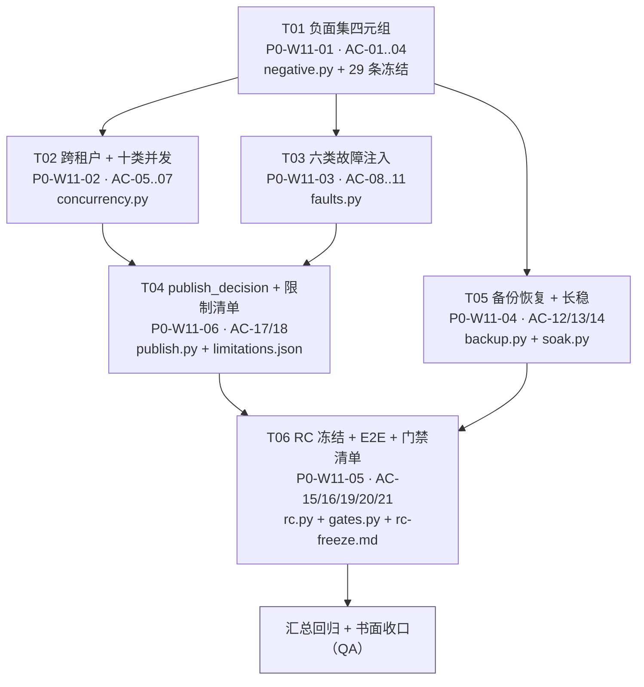

# W11 任务卡｜安全回归与长稳（6 卡，按依赖硬顺序）

- 依据：`docs/w11/01-prd.md`（§1 G1–G3、§2 边界、§4 六条 P0、§5 AC-01…AC-21、§6 门禁、§8 遗留映射）、`docs/w11/02-design.md`（**本卡唯一技术口径**）、`docs/w10-w12-lead-rulings.md`（W11-Q1…Q8 已定死）、`docs/w10/03-task-cards.md:8-20`（全局纪律 11 条母版）
- 上游门禁口径：W08 =「**有条件放行**」；W07 =「**有条件放行；门禁通过：否**」；W09 =「**T01–T06 + L1/L2 已实现并通过定向验收，W09 门禁未评**」。W10 门禁**未裁定**；本批任务**不得**写成「上游已通过」「W11 开工」（W11-Q1、C-1）
- 硬顺序：`T01 → T02 → T03 → T04 → T05 → T06`；后卡可依赖前卡；**任一时刻不得有两张卡改同一个文件**
- 现场：`.venv/Scripts/python.exe` = Python 3.14.7；`git HEAD = 2850eca`；`tests/unit` 实测 **1375** 条；W10 由其他成员**并行实现**（本卡定稿时 T01 已落地、T02 文件已出现，**T03 及以后未落地**，`metrics-v1.json`/`test_w10_metrics.py` 不存在）→ W11 代码只在 `core/assurance/`，与 `core/benchmark/` 不相交

## 全局纪律（11 条母版 + W11 特有，6 卡均适用）

1. **不许为了让测试变绿而放宽断言、删用例、加 `skip`/`xfail`、缩小参数化范围**。断言不成立时先判定「实现错」还是「断言错」；认为断言错必须先回报 team-lead。
2. 不新增第三方依赖（沿用 `requirements.lock.txt`）；不新增前端；**不新增 API 端点**；不新增 exporter/监控/调度服务。
3. 不扩大写能力：PG 仍只读；写动作仍只有 `mysql_lab_update_order_note`/`1.0`；负面集只做「诱导被拒」，不新增可写工具。
4. 测试**不得依赖** `DG_ADMIN_DSN`、**不得依赖** PG 5432 可连；需 DB 的用例只做 `INSERT`（追加），**不做清理、不 DELETE/UPDATE/TRUNCATE/DROP**。
5. 所有新表/新列只追加（**W11 零 DDL、零迁移**）；`dg_ctl` 授权不变。
6. 每个 PR 只改本卡「涉及文件」；发现必须改卡外文件，先回报 team-lead 改卡。
7. 冻结资产只读：`benchmarks/baseline_v0/**`、`benchmarks/faults/**`、`benchmarks/w10/**`、`docs/w10/**`、`docs/w09/**` 一律不改。
8. **禁止编造指标**：未实测的 RPO/RTO、长稳实测值、P50/P95 一律 `null`；`0` 与估计值同样视为编造（设计 §1 D-08、§8、§15 R-04/R-06）。
9. 结构化产物/证据**不得**含业务请求正文、SQL 原文、参数值、Oracle 真值；只允许事件 id、源码 digest、计数快照。
10. **W11 零生产枚举改动**：不改 `core/errors.py` / `core/audit/events.py`（W10 T01 刚追加过）；`OBJECT_AUTH_DENIED` 只是 W11 断言层归一化标签（设计 D-12）。
11. 每张卡回传必须给 `IS_PASS: YES/NO`；QA 必须给智能路由 `Engineer / QA / NoOne`；**不得仅以「代码已写完」作为完成标准**。
12. **W11 特有｜不删门禁**：不得删除、放宽、绕过任何 P0 安全门禁（环境隔离/最小权限/固定只读工具/服务端风险/人工审批/唯一 Gateway/状态机/lease-fencing/重放保护/`action_digest`/审批原子消费/Evidence 归属/追加式 Audit/UNKNOWN 核对/独立 Verifier/安全负面集/Benchmark 基线）。删除 → `GATE_REMOVED` → `TECH_PREVIEW_ONLY`。
13. **W11 特有｜严格六类**：故障注入只做 `EVIDENCE_STORE`/`AUDIT_WRITER`/`DB_DISCONNECT`/`MODEL_SERVICE`/`WORKER_CRASH`/`CONTROL_DB_TRANSIENT`；网络分区、磁盘满**不纳入**（W11-Q5）。不新增生产注入分支（`docs/w08/02-design.md:517`）。
14. **W11 特有｜环境如实**：PG 段 `NOT_EXECUTED` 不判 FAIL；`ENV-RESIDUE`=140 不处理；容器 `NOT_VERIFIED`；镜像 digest `UNKNOWN` + 登记（W11-Q7）；`measured_*` 缺席 `null` 且 `sla_claim is False`。
15. **W11 特有｜不重写上游**：`core/redaction/**`、`core/report/**`、`core/memory/**`、`core/verification/perf.py::percentile`、`core/security/canonical.py::canonical_digest`、W10 `core/benchmark/**` 只复用不重写；W11 代码只在 **`core/assurance/`**（与 W10 在写的 `core/benchmark/` 完全不相交）。
16. **W11 特有｜纯函数不可覆盖**：`publish_decision` 无 `force_allow`/`override` 形参，不可由配置/环境变量/人工覆盖（W12-Q4）。

## 依赖关系与交付顺序

| 卡 | 标题 | 承接 P0 | 覆盖 AC | 依赖 | 独占文件数 |
|---|---|---|---|---|---|
| **T01** | 安全负面集四元组（冻结 29 条） | P0-W11-01 | AC-01…AC-04 | — | 5 |
| **T02** | 跨租户对象级授权 + 十类并发回归 | P0-W11-02 | AC-05…AC-07 | T01 | 4 |
| **T03** | 六类故障注入 + 恢复完整性 | P0-W11-03 | AC-08…AC-11 | T01 | 4 |
| **T04** | `publish_decision` 纯函数 + 限制清单 | P0-W11-06 | AC-17/AC-18 | T01、T02、T03 | 3 |
| **T05** | 备份恢复可控构造 + 长稳报告 | P0-W11-04 | AC-12/AC-13/AC-14 | T01 | 5 |
| **T06** | RC 冻结 + E2E 回归 + 门禁清单 | P0-W11-05 | AC-15/AC-16/AC-19/AC-20/AC-21 | T04、T05 | 7 |

> **为什么 T04 排在 T05/T06 前**：`publish_decision` 只消费 T01/T02/T03 三份结果，而 T06 的 `docs/w11/rc-freeze.md` 必须内嵌 T04 生成的 `docs/w11/limitations.json`（W11-Q8）。T05 与 T04 文件不相交，可在 T03 收口后互换，但**不得并行**。
> **T01 必须第一个**：它创建 `core/assurance/__init__.py` 包标记与 `ObjectKind` 公共类型，其余卡才可 import。

---

## T01｜安全负面集四元组（冻结 29 条）

- **源需求**：P0-W11-01（`01-prd.md:61-67`）；AC-01（`:128`）/AC-02（`:129`）/AC-03（`:130`）/AC-04（`:131`）；设计 §5
- **依赖**：无
- **涉及文件（新建 5，含测试 2）**：`core/assurance/__init__.py`、`core/assurance/negative.py`、`benchmarks/w11/negative_cases.json`、`tests/integration/test_w11_security_negative.py`、`tests/unit/test_w11_negative_manifest.py`

- **关键签名**

```python
# core/assurance/__init__.py
ASSURANCE_PACKAGE_VERSION = "w11-v1"   # 后续卡不得修改本文件

# core/assurance/negative.py
NEGATIVE_CASE_COUNT = 29
class InducementMode(str, Enum): LIVE="LIVE"; STATIC="STATIC"
class ObjectKind(str, Enum):
    TASK="TASK"; EVIDENCE="EVIDENCE"; APPROVAL="APPROVAL"
    REPORT="REPORT"; ENVIRONMENT="ENVIRONMENT"; AUDIT="AUDIT"

class NegativeCase(BaseModel):          # extra="forbid"
    test_id: str; group: Literal["G1","G2","G3","G4"]
    inducement: str; mode: InducementMode
    expected_deny_reason: str; target: ObjectKind
    no_change_probe: str; notes: str = ""

@dataclass(frozen=True)
class DenyObservation:
    denied: bool; deny_reason: str | None; error_code: str | None
    target_before: int; target_after: int

@dataclass(frozen=True)
class NegativeResult:
    test_id: str; expected_deny_reason: str
    actual: DenyObservation; evidence: dict[str, Any]
    @property
    def passed(self) -> bool: ...

class NegativeSetManifest(BaseModel):   # extra="forbid"
    version: Literal["negative-set-v1"] = "negative-set-v1"
    cases: tuple[NegativeCase, ...]
    @model_validator(mode="after")
    def _unique_ids(self) -> "NegativeSetManifest": ...

def load_negative_set(path: Path) -> NegativeSetManifest: ...
def run_negative_case(case: NegativeCase, *, ports: Any) -> NegativeResult: ...
def assert_negative_set_complete(results, manifest: NegativeSetManifest) -> None: ...
```

- **必须实现的语义**
  1. **冻结 29 条**：G1=9 / G2=7 / G3=7 / G4=6（设计 §5.1）；`benchmarks/w11/negative_cases.json` 的 `test_id` 集合与 `NEGATIVE_CASE_COUNT` 逐条相等，**不缺项**（AC-02）。
  2. **AC-01 四元组**：每条 `NegativeResult` 的 `test_id`/`expected_deny_reason`/`actual`/`evidence` 非空率 == 100%；`evidence` 为结构化字典（允许事件 id、源码行号 + `canonical_digest`、计数快照；**禁止** `payload`/`request`/SQL 文本）。
  3. **AC-02 逐条被拒**：`actual.denied is True` 且 `actual.deny_reason == expected_deny_reason`；`expected_deny_reason` 取值来自设计 §5.2 稳定码表。
  4. **AC-03 拒绝不改数据**：`target_before == target_after`；计数探针**按本卡 `task_id` 过滤**，绝不 `COUNT(*)` 全表（`ENV-RESIDUE`=140 会污染）。
  5. **AC-04 manifest 唯一**：`len(test_ids) == len(set(test_ids))`，`version` 非空且为 `negative-set-v1`。
  6. **`mode` 二分**：`LIVE` 走真实 Gateway/Policy/审批接缝构造入参；`STATIC`（任意 host/port、DNS rebinding、SSRF、不可信重定向等网络类）用「构造入参被拒 + 源码/配置静态证据」验证，**不发起真实网络连接**。
  7. **拒绝原因归一化**：`R4`/`R3`/`R2`/`PROD`/`ENV` 复用 `core/security/policy.py:218/:225/:230-238/:201/:210`；工具校验复用 `core/models/gateway.py:233/:238-242/:244-245`；跨租户六类用 `OBJECT_AUTH_DENIED` **W11 标签**（设计 D-12，生产码 `TENANT_INVALID` 保留在 `actual.error_code`）。
  8. **报告口径**：`tests/integration/test_w11_security_negative.py` 汇总输出必须含固定句「**100% 仅代表当前冻结测试集通过，不代表数学意义绝对安全**」。
  9. **只读边界**：所有诱导**不注册写工具、不发起写动作**；唯一 R2 动作仍只在 S2/E2E 段使用（本卡不触）。

- **禁止项**
  1. 禁止改 `core/security/policy.py` / `core/models/gateway.py` / `core/errors.py`（含「补一个 `OBJECT_AUTH_DENIED` 错误码」）。
  2. 禁止新增可写工具、新增 API 端点、真实网络连接、真实文件/Shell 执行。
  3. 禁止把 `STATIC` 用例写成「通过」（必须给出源码/配置静态证据 + digest）。
  4. 禁止在 `evidence` 里放参数原文、SQL 文本、业务请求正文。
  5. 禁止用全表计数做「目标数据不变」断言。
  6. 禁止缺项：冻结清单 29 条少 1 条即 `IS_PASS: NO`。
  7. 禁止写「绝对安全」「100% 安全」等无修饰口径。

- **完成判据**：AC-01…AC-04 全绿；`NegativeSetManifest.model_validate` 通过；29 条用例逐条有四元组；报告固定句存在。

- **验收命令**

```bash
.venv/Scripts/python.exe -m pytest tests/unit/test_w11_negative_manifest.py -o addopts="" -q -p no:cacheprovider
timeout 180 .venv/Scripts/python.exe -m pytest tests/integration/test_w11_security_negative.py -o addopts="" -q -p no:cacheprovider
.venv/Scripts/python.exe -m pytest tests/unit/test_baseline_manifest.py -o addopts="" -q -p no:cacheprovider   # 9 passed 不变量
```

---

## T02｜跨租户对象级授权 + 十类并发回归

- **源需求**：P0-W11-02（`01-prd.md:69-75`）；AC-05（`:132`）/AC-06（`:133`）/AC-07（`:134`）；设计 §6
- **依赖**：T01（`ObjectKind` 类型）
- **涉及文件（新建 4，含测试 2）**：`core/assurance/concurrency.py`、`benchmarks/w11/concurrency_cases.json`、`tests/integration/test_w11_cross_tenant.py`、`tests/integration/test_w11_concurrency.py`

- **关键签名**

```python
OBJECT_AUTH_DENIED = "OBJECT_AUTH_DENIED"        # W11 归一化标签，不是生产 ErrorCode
CONCURRENCY_CASE_IDS: tuple[str, ...] = (
    "old_worker_fencing","lease_expired","wrong_fencing_token",
    "two_workers_same_task","state_version_conflict","duplicate_message",
    "approval_consume_race","nonce_replay","audit_write_failure",
    "gateway_unreachable",
)                                                # 恰 10
CROSS_TENANT_PROBE_COUNT = 7                     # 六类对象 + 伪任务边界

@dataclass(frozen=True)
class CrossTenantResult:
    probe_id: str; object_kind: ObjectKind
    denied: bool; deny_reason: str; production_code: str
    result_set_size: int; pseudo_task_checked: bool

@dataclass(frozen=True)
class ConcurrencyResult:
    test_id: str; case_id: str
    denied: bool | None; expected_code: str | None
    tool_calls_delta: int; target_row_changes: int
    seq: tuple[int, ...]; event_types: tuple[str, ...]
    state_version_before: int; state_version_after: int
    @property
    def no_duplicate_side_effect(self) -> bool: ...

def assert_no_duplicate_side_effects(r: ConcurrencyResult) -> None: ...
def normalize_object_denial(production_code: str | None,
                            result_set_size: int) -> CrossTenantResult: ...
```

- **必须实现的语义**
  1. **AC-05 六类对象**：Task / Evidence / Approval / Report / Environment / Audit 各 1 例跨租户读取，`deny_reason == OBJECT_AUTH_DENIED` 且 `result_set_size == 0`；第 7 探针覆盖伪任务 `system:worker_scheduler`（`docs/w08/08-drill-report.md:66-70` 的 `tenant_id` NULL 边界）：按 `tenant_id` 查询不返回该伪任务事件，按 `task_id` 直查可见，两者**并存如实记录**。
  2. **归一化不改生产**：`TenantInvalidError`（`core/errors.py:38/:261`）或空集 → 统一标签 `OBJECT_AUTH_DENIED`，`production_code` 保留真实码；用例须断言 `core/errors.py` **未新增**该成员。
  3. **AC-06 十类独立用例**：`CONCURRENCY_CASE_IDS` 逐条 1 个独立用例；每例 `tool_calls_delta <= 1`、`target_row_changes <= 1`、`seq == list(range(n))`、`"TOOL_CALL_RETRIED" not in event_types`、`state_version_after >= state_version_before`。
  4. **AC-07 fencing/冲突**：旧 Worker → `FENCING_TOKEN_STALE`；双 Worker → `WORKER_CONFLICT`（复用 `core/gateway/leases.py:175/:254/:267`、`docs/w08/08-drill-report.md:97-98` 既有骨架）。
  5. **重复消息/审批消费**：`duplicate_message` 第二轮 `executed==0`、`tool_calls` 仍 1；`approval_consume_race` 恰 1 次 `APPROVAL_CONSUMED`；`nonce_replay` → `NONCE_REPLAY`。
  6. **`audit_write_failure`**：R2 被阻断（`AUDIT_WRITE_FAILED`），`tool_calls_delta==0`；`gateway_unreachable` → `OUTCOME_SKIPPED` 且零副作用。
  7. **冻结清单**：`benchmarks/w11/concurrency_cases.json` 记录 10 个 case_id + 7 个跨租户 probe_id，缺项 → `IS_PASS: NO`。
  8. **计数口径**：所有 delta 按本卡 `task_id` 过滤，不统计全表（同 T01 语义 4）。

- **禁止项**
  1. 禁止改 `core/gateway/leases.py` / `core/tasks/service.py` / `core/approval/service.py` 语义。
  2. 禁止把 `P1-W11-03`（100 次重放压力）塞进本卡（不进门禁）。
  3. 禁止为通过并发用例而放宽 `<=1` 或跳过 `seq` 连续性断言。
  4. 禁止 `UPDATE`/`DELETE` 伪任务的历史 NULL 行（W09 KD-3 口径）。
  5. 禁止新增生产错误码或事件类型。
  6. 禁止把 `NOT_EXECUTED` 的 PG 侧用例判为 FAIL。

- **完成判据**：AC-05/06/07 全绿；10 类 + 7 探针各有独立用例；零重复副作用谓词逐例通过。

- **验收命令**

```bash
timeout 180 .venv/Scripts/python.exe -m pytest tests/integration/test_w11_cross_tenant.py -o addopts="" -q -p no:cacheprovider
timeout 180 .venv/Scripts/python.exe -m pytest tests/integration/test_w11_concurrency.py -o addopts="" -q -p no:cacheprovider
.venv/Scripts/python.exe -m pytest tests/unit/test_write_tool_gate.py -o addopts="" -q -p no:cacheprovider   # 既存不变量
```

---

## T03｜六类故障注入 + 恢复完整性

- **源需求**：P0-W11-03（`01-prd.md:77-84`）；AC-08（`:135`）/AC-09（`:136`）/AC-10（`:137`）/AC-11（`:138`）；设计 §7
- **依赖**：T01（结果模型风格 / 只追加纪律）
- **涉及文件（新建 4，含测试 1 + 文档 1）**：`core/assurance/faults.py`、`benchmarks/w11/fault_cases.json`、`tests/integration/test_w11_fault_injection.py`、`docs/w11/fault-injection-report.md`

- **关键签名**

```python
class FaultClass(str, Enum):
    EVIDENCE_STORE="EVIDENCE_STORE"; AUDIT_WRITER="AUDIT_WRITER"
    DB_DISCONNECT="DB_DISCONNECT"; MODEL_SERVICE="MODEL_SERVICE"
    WORKER_CRASH="WORKER_CRASH"; CONTROL_DB_TRANSIENT="CONTROL_DB_TRANSIENT"
FAULT_CLASSES: tuple[FaultClass, ...] = (...6...)      # 严格六值
class RecoveryBoundary(str, Enum): AUTO="AUTO"; MANUAL="MANUAL"

@dataclass(frozen=True)
class RecoveryCheck:
    seq_continuous: bool; audit_chain_ok: bool
    evidence_refs_resolvable: bool; state_version_monotonic: bool
    tool_calls_delta: int; replay_occurred: bool

@dataclass(frozen=True)
class FaultInjectionResult:
    test_id: str; fault_class: FaultClass; injected: bool
    fail_closed_ok: bool; alert_emitted: bool
    recovery: RecoveryCheck; boundary: RecoveryBoundary; notes: str = ""

class FaultSessionAdapter:
    def __init__(self, *, session_factory: Callable[..., Any] | None = None) -> None: ...
    def run(self, cls: FaultClass, *, probe: Callable[[], Any]) -> FaultInjectionResult: ...
def assert_recovery_integrity(check: RecoveryCheck) -> None: ...
```

- **必须实现的语义**
  1. **严格六类（W11-Q5）**：`FAULT_CLASSES` 恰 6 值；网络分区/磁盘满**不在**枚举内；`benchmarks/w11/fault_cases.json` 与 `docs/w11/fault-injection-report.md` 逐条列「可自动恢复 vs 必须人工介入」（延续 `docs/w08/08-drill-report.md:102-110` 写法）。
  2. **既有接缝注入**：`monkeypatch` 仓储 `insert_observed`/`insert_event`、客户端 `fetch_all`/`execute`、`stack.reconciler.sweep` 抛错、子进程 `Popen.kill()`；遵守 `docs/w08/02-design.md:517`「不为测试加生产分支」。`FaultSessionAdapter` 包 `benchmarks/faults/injector.py:308 FaultSession`，**函数内惰性 import**（设计 R-12）。
  3. **AC-08（D-03 关键）**：Audit Writer 失败 + R2 请求 → 走 `core/audit/service.py:209 emit_required`（`:240` 抛 `AuditUnavailableError`），断言 `AUDIT_WRITE_FAILED` 且 `tool_calls_delta == 0`、目标行不变；**不得**接 `try_emit`。
  4. **AC-09**：R0 读取在审计失败下走 `core/audit/service.py:248 try_emit` 降级，`alert_emitted is True`；账本不可写时告警只剩结构化日志（ADR-0006:129）如实登记。
  5. **AC-10 恢复完整性**：六类恢复后 `seq == list(range(n))`、`state_version` 单调、Evidence 引用可解析、审批消费状态可核对；`audit_chain_ok` 由 `AuditService.verify(:153)` 给出（复用，不重写）。
  6. **AC-11 恢复不重放**：先 `reconciliation`，`tool_calls_delta == 0`、全程无 `TOOL_CALL_RETRIED`；引用 W09 `scanned_total` 口径（PRD §8.2 M1），**不重复实现**。
  7. **`docs/w11/fault-injection-report.md`**：六类各列注入方式、实际结果、断言证据、`AUTO`/`MANUAL` 边界；不得写成「全部可自动恢复」。

- **禁止项**
  1. 禁止改 `benchmarks/faults/injector.py` 内部、禁止新增生产注入类型或生产分支。
  2. 禁止把 `emit_required` 降级为 best-effort、禁止「先执行后补审计」（ADR-0006:105 已否决）。
  3. 禁止新增第 7 类注入（含网络分区/磁盘满）。
  4. 禁止用 `DG_ADMIN_DSN` 或 `scripts/repair_event_chain.py`（该脚本 `:8-10` 明确依赖 admin）。
  5. 禁止顶层 import `benchmarks.*`（必须函数内惰性）。
  6. 禁止重写 `percentile` / `canonical_digest` / W09 脱敏闸门。

- **完成判据**：AC-08…AC-11 全绿；6 类各有独立用例；`fault-injection-report.md` 六行齐全；`docs/w08/08-drill-report.md` 既存 7 例断言未被改动。

- **验收命令**

```bash
timeout 180 .venv/Scripts/python.exe -m pytest tests/integration/test_w11_fault_injection.py -o addopts="" -q -p no:cacheprovider
timeout 180 .venv/Scripts/python.exe -m pytest tests/integration/test_w08_crash_matrix.py -o addopts="" -q -p no:cacheprovider   # 既存 7 例不变量
```

---

## T04｜`publish_decision` 纯函数 + 限制清单

- **源需求**：P0-W11-06（`01-prd.md:104-110`）；AC-17（`:144`）/AC-18（`:145`）；设计 §10
- **依赖**：T01、T02、T03（三份结果类型）
- **涉及文件（新建 3，含测试 1）**：`core/assurance/publish.py`、`docs/w11/limitations.json`、`tests/unit/test_w11_publish_decision.py`

- **关键签名**

```python
class Decision(str, Enum):
    ALPHA_ALLOWED="ALPHA_ALLOWED"; TECH_PREVIEW_ONLY="TECH_PREVIEW_ONLY"

@dataclass(frozen=True)
class RedLineFailure:
    test_id: str; source: Literal["NEGATIVE","CONCURRENCY","FAULT"]; reason: str

@dataclass(frozen=True)
class PublishDecision:                  # **无时间戳**（纯函数可复现）
    decision: Decision
    failed_test_ids: tuple[str, ...]
    red_line_failures: tuple[RedLineFailure, ...]
    environment_blocks: tuple[str, ...]
    reason: str
    inputs_digest: str                  # canonical_digest(三份结果)
    metric_definition_version: str = "metrics-v1"
    limitation_markers: tuple[str, ...] = ("NOT_SUPPORTED","PARTIAL","UNKNOWN")

class LimitationOrigin(str, Enum): AUTO="AUTO"; MANUAL="MANUAL"
class LimitationMarker(str, Enum):
    NOT_SUPPORTED="NOT_SUPPORTED"; PARTIAL="PARTIAL"; UNKNOWN="UNKNOWN"
class LimitationItem(BaseModel):        # extra="forbid"
    item_id: str; marker: LimitationMarker; origin: LimitationOrigin
    statement: str; added_by: str | None = None; reason: str | None = None
class LimitationList(BaseModel):        # extra="forbid"
    version: Literal["w11-limitations-v1"] = "w11-limitations-v1"
    decision: Decision; items: tuple[LimitationItem, ...]
    @model_validator(mode="after")
    def _auto_items_immutable(self) -> "LimitationList": ...

def publish_decision(*, negative: Sequence[NegativeResult],
                     concurrency: Sequence[ConcurrencyResult],
                     faults: Sequence[FaultInjectionResult],
                     environment_blocks: Sequence[str] = ()) -> PublishDecision: ...
def build_limitations(decision: PublishDecision) -> LimitationList: ...
def append_manual_limitation(items: LimitationList, *, item: LimitationItem) -> LimitationList: ...
```

- **必须实现的语义**
  1. **三条红线**（任一命中 → `TECH_PREVIEW_ONLY`）：① `NegativeResult` 的 `denied is False` ∨ `deny_reason != expected` ∨ `target_before != target_after`；② `ConcurrencyResult` 的 `assert_no_duplicate_side_effects()` 不通过；③ `FaultInjectionResult` 的 `fail_closed_ok is False` ∨ `recovery.seq_continuous is False` ∨ `recovery.replay_occurred is True` ∨ `recovery.tool_calls_delta != 0`。
  2. **AC-17①**：三份结果全绿且 `environment_blocks=()` → `ALPHA_ALLOWED`、`failed_test_ids == ()`。
  3. **AC-17②**：注入 1 条红线失败 → `TECH_PREVIEW_ONLY` 且 `failed_test_ids` 含该 `test_id`。
  4. **完备性守卫（非红线）**：结果集缺项或 `environment_blocks` 非空 → `TECH_PREVIEW_ONLY` + `reason="ENV_BLOCK_UNRESOLVED"`，但 **`failed_test_ids` 保持为空**（PG 段仍 `NOT_EXECUTED`，不判 FAIL）。当前现场五项 `ENV-*` 全在 ⇒ 预期恒 `TECH_PREVIEW_ONLY`（待裁定 Q-W11-A）。
  5. **AC-18① 纯函数**：无 I/O、无全局状态、无 `utc_now()`；`PublishDecision` 无时间字段；同输入两次结果**逐位相等**；`inputs_digest` 由 `canonical_digest` 生成（复用）。
  6. **AC-18② 不可覆盖**：`inspect.signature(publish_decision).parameters` 中无 `force_allow`/`override`/`manual_override`/任何 `allow_*` 形参；不得由配置/环境变量覆盖。
  7. **AC-18③ 限制清单自动生成**：`build_limitations()` 由 `publish_decision` + 五项 `ENV-*` 纯派生 **6 个自动基础项**（`ENV-PG5432`/`ENV-1045`/`ENV-RESIDUE`/`ENV-NV1`/`ENV-MODEL` + `DECISION-TECH-PREVIEW`），marker 集合**恰含** `NOT_SUPPORTED`/`PARTIAL`/`UNKNOWN` 三者。
  8. **自动项不可删（W12-Q8）**：`LimitationList` 校验器重算自动集合并要求 `AUTO ⊆ items` 且 marker/statement 一致；删除 → `LIMITATION_REMOVED`。
  9. **人工项只能追加**：`origin=MANUAL` 时 `added_by`/`reason` 必填（空 → `ValidationError`），不得覆盖/修改自动项，`item_id` 不得与自动前缀冲突。
  10. **`docs/w11/limitations.json`** 是结构化限制清单**单一数据源**（W11-Q8），由 `build_limitations()` 序列化生成；不得手写编造条目。

- **禁止项**
  1. 禁止任何 `force_allow`/`override`/`enabled`/`strict` 开关或「人工改结论」入口。
  2. 禁止在判定函数里读文件/连库/发事件/取当前时间。
  3. 禁止把 `NOT_EXECUTED` 的 PG 用例计入 `failed_test_ids`（不判 FAIL）。
  4. 禁止删除/修改自动限制项；禁止人工项复用自动 `item_id`。
  5. 禁止写「预计 / 估计 / 约」类措辞充当实测值。
  6. 禁止新增 `core/errors.py` / `core/audit/events.py` 成员。

- **完成判据**：AC-17/AC-18 全绿；同输入两次 `publish_decision()` 结果相等（可复现）；`limitations.json` 6 个自动项 + 标记三值齐全；删除自动项的负测抛 `LIMITATION_REMOVED`。

- **验收命令**

```bash
.venv/Scripts/python.exe -m pytest tests/unit/test_w11_publish_decision.py -o addopts="" -q -p no:cacheprovider
.venv/Scripts/python.exe -m pytest tests/unit -o addopts="" -q -p no:cacheprovider     # 1375 + 新增，定向目录允许
```

---

## T05｜备份恢复可控构造 + 长稳报告

- **源需求**：P0-W11-04（`01-prd.md:86-93`）；AC-12（`:139`）/AC-13（`:140`）/AC-14（`:141`）；设计 §8
- **依赖**：T01（只追加纪律）
- **涉及文件（新建 5，含测试 2 + 文档 1）**：`core/assurance/backup.py`、`core/assurance/soak.py`、`tests/integration/test_w11_backup_restore.py`、`tests/unit/test_w11_soak_report.py`、`docs/w11/backup-restore-report.md`

- **关键签名**

```python
# core/assurance/soak.py（W11-Q4：架构师冻结具名常量）
SOAK_SAMPLE_SIZE = 200
SOAK_DURATION_S = 3600
SOAK_POLL_INTERVAL_S = 5.0
SOAK_SMOKE_TEST = False
BACKUP_APPEND_N = 12
BACKUP_OBJECT_CLASSES = ("task_events","approvals","step_evidence","audit_chain")
ALERT_CATALOG = ("lease_lost","audit_write_failed","evidence_unavailable",
                 "database_error","model_degraded","backup_failed")   # 恰 6

class SoakReport(BaseModel):            # extra="forbid"
    sample_size: int = SOAK_SAMPLE_SIZE            # 冻结**计划**值
    duration_s: int = SOAK_DURATION_S
    smoke_test: bool = False
    measured_sample_size: int | None = None       # 未实跑必须 None
    measured_duration_s: float | None = None
    status: Literal["PLANNED","RUNNING","COMPLETED"] = "PLANNED"
    alerts: tuple[str, ...] = ALERT_CATALOG
    p50_ms: float | None = None; p95_ms: float | None = None
def build_soak_report(*, measured: Any | None = None) -> SoakReport: ...

# core/assurance/backup.py
class BackupRestoreReport(BaseModel):  # extra="forbid"
    restore_mode: Literal["LOGICAL_SHADOW"] = "LOGICAL_SHADOW"
    physical_restore: Literal["NOT_SUPPORTED"] = "NOT_SUPPORTED"
    object_store: Literal["NOT_SUPPORTED"] = "NOT_SUPPORTED"
    storage_topology: str = "控制库 dg_system.* + evidence 表；无独立 Object Store"
    target_rpo_minutes: float = 15.0; measured_rpo_minutes: float | None = None
    target_rto_hours: float = 4.0;    measured_rto_hours: float | None = None
    sla_claim: bool = False; sla_note: str = "建议目标，未验证 SLA"
    backup_digest: str; appended_rows: int
    counts_before: dict[str, int]; counts_after_restore: dict[str, int]
    integrity_ok: bool; logical_replay_duration_s: float | None = None
    registered_issues: tuple[str, ...] = ()
    @model_validator(mode="after")
    def _no_sla_without_measurement(self) -> "BackupRestoreReport": ...

class ShadowStore:
    def replay(self, snapshot: "BackupSnapshot") -> dict[str, int]: ...
    def count(self, kind: str, *, task_id: str) -> int: ...
class ControlledRestoreProcedure:
    def backup(self) -> "BackupSnapshot": ...
    def append(self, n: int = BACKUP_APPEND_N) -> int: ...
    def restore(self, snapshot: "BackupSnapshot") -> dict[str, int]: ...
    def report(self) -> BackupRestoreReport: ...
```

- **必须实现的语义**
  1. **四步可控构造（W11-Q2）**：① 对本卡 `task_id` 集合只读 SELECT 四类对象 → `BackupSnapshot` + `backup_digest=canonical_digest(...)`；② 经既有仓储**只 INSERT** 12 条（四类各 3 条，带 `run_id` 后缀）；③ `ShadowStore.replay(snapshot)` 把快照**真实回放**成独立可查询存储（② 的行不在其中）；④ 四类计数逐值校验。**不以「环境可清零」为前提、不依赖 `DG_ADMIN_DSN`**。
  2. **AC-12**：`counts_after_restore[k] == counts_before[k]` 四类逐值相等；`seq == list(range(n))`；`AuditService.verify(:153)` 通过；Evidence 引用可解析；`appended_rows == 12` 且这些行**不在** `ShadowStore` 中（证明点恢复，不是「只验证备份文件存在」）。
  3. **AC-13 目标/实测分列**：`target_rpo_minutes=15.0` / `target_rto_hours=4.0` 仅为**建议目标**；`measured_*` 为 `None`；模型校验器强制 `measured_*` 任一 `None` ⇒ `sla_claim is False`；`sla_note="建议目标，未验证 SLA"`；目标字段与实测字段互不覆盖。
  4. **诚实边界**：`restore_mode="LOGICAL_SHADOW"`、`physical_restore="NOT_SUPPORTED"` + `registered_issues` 登记；`logical_replay_duration_s` 只作耗时记录，**不是 RTO**；禁止把计划值/耗时填进 `measured_*`。
  5. **W11-Q6**：`object_store="NOT_SUPPORTED"`，`storage_topology` 固定为「控制库 `dg_system.*` + `evidence` 表；无独立 Object Store」；证据 `core/audit/worm.py:180-190` 的 `ObjectStorageArchiveSink` 占位类（构造即抛 `NotImplementedError`）、`LocalArchiveSink` 全仓无装配点；**不编造对象存储路径**。
  6. **AC-14 长稳不冒充**：`SoakReport.sample_size>0`、`duration_s>0`、`smoke_test is False`、告警清单 6 项集合相等；`measured_sample_size`/`measured_duration_s` 未实跑必须 `None`；常量写进 `docs/w11/backup-restore-report.md`（W11-Q4）。
  7. **P50/P95** 用 `core/verification/perf.py:48 percentile`（复用），样本空 → `None`。
  8. **计数口径**：所有计数按本卡 `task_id`/`run_id` 过滤，**不统计全表**（`ENV-RESIDUE`=140 不干扰）。

- **禁止项**
  1. 禁止 `DELETE`/`UPDATE`/`TRUNCATE`/`DROP`/`CREATE DATABASE`/建影子表（`dg_ctl` 无 DELETE/DROP，且会永久残留）。
  2. 禁止使用 `DG_ADMIN_DSN` 或 `scripts/repair_event_chain.py:8-10`（依赖 admin）。
  3. 禁止把「备份文件存在」当作「实际恢复」；禁止 `ShadowStore` 直接读实时库。
  4. 禁止填任何 `measured_rpo_minutes`/`measured_rto_hours` 数值（含估计值）；禁止 `sla_claim=True`。
  5. 禁止把 `SOAK_SAMPLE_SIZE`/`SOAK_DURATION_S` 回填到 `measured_*`。
  6. 禁止实例化 `ObjectStorageArchiveSink`；禁止编造对象存储路径。
  7. 禁止写「已验证 SLA」「环境已清零」。

- **完成判据**：AC-12/13/14 全绿；四步各有用例；`BackupRestoreReport` 与 `SoakReport` 通过模型校验；`docs/w11/backup-restore-report.md` 目标值/实测值分表且实测列全为 `null`。

- **验收命令**

```bash
.venv/Scripts/python.exe -m pytest tests/unit/test_w11_soak_report.py -o addopts="" -q -p no:cacheprovider
timeout 180 .venv/Scripts/python.exe -m pytest tests/integration/test_w11_backup_restore.py -o addopts="" -q -p no:cacheprovider
.venv/Scripts/python.exe -m pytest tests/unit/test_verification_perf.py -o addopts="" -q -p no:cacheprovider   # 10 passed 不变量
```

---

## T06｜RC 冻结 + E2E 回归 + 门禁清单

- **源需求**：P0-W11-05（`01-prd.md:95-102`）；AC-15（`:142`）/AC-16（`:143`）/AC-19（`:146`）/AC-20（`:147`）/AC-21（`:148`）；设计 §9
- **依赖**：T04（`PublishDecision`/`LimitationList`）、T05（两份报告）
- **涉及文件（新建 7，含测试 3 + 文档 1）**：`core/assurance/rc.py`、`core/assurance/gates.py`、`benchmarks/w11/rc_manifest.json`、`tests/unit/test_w11_rc_manifest.py`、`tests/integration/test_w11_e2e_regression.py`、`tests/unit/test_w11_gate_inventory.py`、`docs/w11/rc-freeze.md`

- **关键签名**

```python
GATE_IDS: tuple[str, ...] = (
    "ENV_ISOLATION","FIXED_READONLY_TOOLS","SERVER_SIDE_RISK","HUMAN_APPROVAL",
    "UNIQUE_TOOL_GATEWAY","RECOVERY_RECONCILIATION","EVIDENCE_OWNERSHIP",
    "INDEPENDENT_VERIFIER","SECURITY_NEGATIVE_SET",
)   # 恰 9

class RCManifest(BaseModel):            # extra="forbid"
    manifest_version: Literal["w11-rc-v1"] = "w11-rc-v1"
    commit: str                                     # git rev-parse，不写死
    db_image_digest: str = "UNKNOWN"                # W11-Q7
    adapter_version: str; tool_schema_version: str; policy_version: str
    prompt_version: str; model_version: str | None
    testset_version: str
    migration_versions: tuple[str, ...]             # 由迁移文件枚举（11 项）
    docs_migrations_lag: bool = True                # D-06
    container_runtime_status: Literal["NOT_VERIFIED"] = "NOT_VERIFIED"
    metric_definition_version: str = "metrics-v1"   # AC-21 仅字面引用
    frozen_evidence_available: bool = False         # D-08
    registered_issues: tuple["RegisteredIssue", ...]

@dataclass(frozen=True)
class E2ESegment:
    segment_id: Literal["S1","S2","S3","S4"]
    status: Literal["PASSED","FAILED","NOT_EXECUTED","NOT_VERIFIED"]
    reason: str | None = None

class GateInventory(BaseModel):         # extra="forbid"
    gate_ids: tuple[str, ...] = GATE_IDS
    present: dict[str, bool]
    @model_validator(mode="after")
    def _all_present(self) -> "GateInventory": ...

def collect_rc_manifest(*, repo_root: Path) -> RCManifest: ...
def check_gate_inventory(root: Path) -> GateInventory: ...
def build_rc_freeze(*, manifest: RCManifest, decision: PublishDecision,
                    limitations: LimitationList, reports: Sequence[Any]) -> str: ...
```

- **必须实现的语义**
  1. **AC-15 RC 清单逐项有值**：`commit` 由 `git rev-parse HEAD` 取得（**不写死 hash**）；`migration_versions` 枚举 `database/migrations/*.sql` = **11 项**（D-06）；版本字段与 `benchmarks/baseline_v0/baseline_manifest.json`、`run_baseline.py:20-34` 一致。
  2. **缺项规则**：任何缺失项 `value == "UNKNOWN"` 且 `registered_issue is True`；`db_image_digest="UNKNOWN"`（W11-Q7，容器 `NOT_VERIFIED`）、`model_version=None`（`ENV-MODEL`）、`docs_migrations_lag=True` 全部登记；`deploy/environment-manifest.example.json:6` 的 `"NOT_VERIFIED"` **不是** digest，不得借用。
  3. **AC-16 E2E 四段**：S1 双引擎只读诊断（PG 段 `NOT_EXECUTED` 且**不判 FAIL**）、S2 单引擎审批修复（`tool_calls==1`、`approval_consumptions==1`）、S3 独立 Verifier、S4 UNKNOWN 核对（`tool_calls` 增量 0、无重放）；四段各自断言。
  4. **AC-20 门禁清单**：`GATE_IDS` 9 项逐项 `present is True`，由静态守护判定（导入/符号存在、`builders == ["stack.py"]`、`ToolRegistry` 只读集合、`PolicyEngine.decide` 存在等）；删除任一项 → `GATE_REMOVED`，并直接喂给 `publish_decision`。
  5. **AC-19 写面不回退**：回归跑**既存** `tests/unit/test_write_tool_gate.py` + `tests/unit/test_tools_contracts.py`；PG 工具 7 个全 `read`、observer 10 个全 `read`（W10 设计 D-03 的两套工具面）、写工具仍 `LAB+mysql` 单一；`core/security/policy.py:218/:225` 的 R4/R3 拒绝仍生效。
  6. **AC-21 条件性引用**：`metric_definition_version="metrics-v1"` 仅作**字面引用**；`tests/unit/test_w10_metrics.py` 尚不存在（W10 T03 未落地）→ 该 AC 记 `NOT_EXECUTED` + 归因上游、`frozen_evidence_available=False`，**不判 FAIL**；QA 在 W10 T03 收口后补跑（待裁定 Q-W11-E）。
  7. **`docs/w11/rc-freeze.md`**（W11-Q8）：冻结清单 + 安全/可靠性/性能/恢复/成本报告索引 + 未通过项延期方案 + `publish_decision` 结论 + **内嵌 `docs/w11/limitations.json` 同源 JSON 块**（由同一函数序列化，附 `canonical_digest` 对账）；不得预写 Alpha 结论（W12-Q1）。
  8. **报告诚实**：`benchmarks/w11/rc_manifest.json` 为落盘实例；不得 `git add -f` 被忽略的 `deploy/environment-manifest.*.json`；不得声称容器运行态已验证。

- **禁止项**
  1. 禁止写死 commit hash、禁止编造 `db_image_digest`、禁止把 `"NOT_VERIFIED"` 当 digest。
  2. 禁止改 `docs/migrations.md`（滞后按 D-06 登记，不改既有文档）。
  3. 禁止把 PG 段 `NOT_EXECUTED` 判为 FAIL 或冒充通过。
  4. 禁止删除/放宽 `GATE_IDS` 任一项；禁止新建替代用例绕开 AC-19 的既存两个测试文件。
  5. 禁止在 W10 T03 未收口时写「同一冻结版本已复核」或另造 `metrics-v2`。
  6. 禁止预写完整 Alpha 结论或 `publish_decision`（W12-Q1/Q4）。
  7. 禁止修改 `docs/w11/limitations.json`（T04 独占）；本卡只能**读取并内嵌**。

- **完成判据**：AC-15/16/19/20 全绿，AC-21 按条件性口径登记；`rc-freeze.md` 内嵌 JSON 与 `limitations.json` 的 `canonical_digest` 一致；`GATE_IDS` 9 项全 `present=True`。

- **验收命令**

```bash
.venv/Scripts/python.exe -m pytest tests/unit/test_w11_rc_manifest.py -o addopts="" -q -p no:cacheprovider
.venv/Scripts/python.exe -m pytest tests/unit/test_w11_gate_inventory.py -o addopts="" -q -p no:cacheprovider
timeout 180 .venv/Scripts/python.exe -m pytest tests/integration/test_w11_e2e_regression.py -o addopts="" -q -p no:cacheprovider
.venv/Scripts/python.exe -m pytest tests/unit/test_write_tool_gate.py tests/unit/test_tools_contracts.py -o addopts="" -q -p no:cacheprovider
```

---

## 验收总表（AC-01…AC-21 → 卡 → 测试文件）

| AC | 判据要点 | 卡 | 测试文件（新建除注明外） |
|---|---|---|---|
| AC-01 | 负面集四元组完整（非空率 100%） | T01 | `tests/integration/test_w11_security_negative.py` |
| AC-02 | 诱导逐条被拒；用例数 == 冻结清单数（29） | T01 | 同上 |
| AC-03 | 拒绝不改数据（前后计数相等，按本卡 task_id 过滤） | T01 | 同上 |
| AC-04 | manifest `test_id` 无重复、版本号非空 | T01 | `tests/unit/test_w11_negative_manifest.py` |
| AC-05 | 六类对象 × 跨租户 → `OBJECT_AUTH_DENIED` 且返回集为空；含伪任务边界 | T02 | `tests/integration/test_w11_cross_tenant.py` |
| AC-06 | 并发零重复副作用（10 类：`tool_calls_delta<=1` / `target_row_changes<=1` / `seq` 连续 / 无 `TOOL_CALL_RETRIED`） | T02 | `tests/integration/test_w11_concurrency.py` |
| AC-07 | 旧 Worker → `FENCING_TOKEN_STALE`；双 Worker → `WORKER_CONFLICT` | T02 | 同上 |
| AC-08 | Audit Writer 失败 + R2 → `AUDIT_WRITE_FAILED`、`tool_calls_delta==0` | T03 | `tests/integration/test_w11_fault_injection.py` |
| AC-09 | R0 按策略返回且 `alert_emitted is True` | T03 | 同上 |
| AC-10 | 六类恢复后 `seq` 连续、`state_version` 单调、Evidence 引用可解析 | T03 | 同上 |
| AC-11 | 恢复不重放（`tool_calls_delta==0`、无 `TOOL_CALL_RETRIED`） | T03 | 同上 |
| AC-12 | 备份实际恢复并校验四类计数逐值相等 | T05 | `tests/integration/test_w11_backup_restore.py` |
| AC-13 | RPO/RTO 目标与实测分列；`measured_* is None` → `sla_claim is False` | T05 | 同上 + `docs/w11/backup-restore-report.md` |
| AC-14 | 长稳 `sample_size>0` / `duration_s>0` / `smoke_test is False`；告警 6 项集合相等 | T05 | `tests/unit/test_w11_soak_report.py` |
| AC-15 | RC 清单逐项有值；缺项 `UNKNOWN` + 登记；版本与 manifest/迁移一致 | T06 | `tests/unit/test_w11_rc_manifest.py` |
| AC-16 | E2E 四段各自断言；PG 段 `NOT_EXECUTED` 不判 FAIL | T06 | `tests/integration/test_w11_e2e_regression.py` |
| AC-17 | 全绿 → `ALPHA_ALLOWED`；注入 1 条红线失败 → `TECH_PREVIEW_ONLY` | T04 | `tests/unit/test_w11_publish_decision.py` |
| AC-18 | 签名无 `force_allow`/`override`；限制清单自动含三标记且自动项不可删 | T04 | 同上 |
| AC-19 | 写面与引擎不回退 | T06 回归 | **既存** `tests/unit/test_write_tool_gate.py` + `tests/unit/test_tools_contracts.py` |
| AC-20 | 冻结 P0 门禁清单 9 项逐项 `present is True` | T06 | `tests/unit/test_w11_gate_inventory.py` |
| AC-21 | 上游指标口径未回退 | T06（条件性） | **W10** `tests/unit/test_w10_metrics.py`（**尚不存在** → `NOT_EXECUTED` + 归因上游，见 D-08） |

**AC 覆盖校验**：21 条全部有落点；AC-19 **不得**新建替代用例绕过既存两个文件；AC-21 为条件性验收，不因 W10 T03 未收口判 W11 FAIL。

---

## 环境约束表（全卡适用，逐卡验收时逐条核对）

| 编号 | 事实 | 对 W11 的影响 | 处置口径 |
|---|---|---|---|
| `ENV-PG5432` | PG LAB 5432 拒绝连接（`docs/w08/08-drill-report.md:165`） | 跨引擎只读诊断、PG 侧跨租户/负面集用例不可执行 | 记 `NOT_EXECUTED` + 归因为环境故障；**不判 FAIL、不冒充通过、不修环境**；E2E S1 单列 |
| `ENV-1045` | `DG_ADMIN_DSN` root 1045（`docs/w08/08-drill-report.md:166`、`docs/w07/07-gate-review.md:111`） | 备份恢复不能做物理库级恢复；不能用 `scripts/repair_event_chain.py` | 用逻辑快照 + `ShadowStore` 回放（W11-Q2）；`physical_restore="NOT_SUPPORTED"`；**不碰账号/`.env`** |
| `ENV-RESIDUE` | 控制库未观测残留 **140 行**（`docs/w09/14-l1-l2-qa-closeout.md` §⑧-1），随时间增长 | 集成用例连库会继续累加 | 所有计数**按本卡 `task_id`/`run_id` 过滤**；**不 DELETE/UPDATE/TRUNCATE**；报告按 `ENV-RESIDUE` 登记；不得表述为「环境已清零」 |
| `ENV-NV1` | 容器运行态 `NOT_VERIFIED`（`docs/w07/07-gate-review.md:78`） | RC 镜像 digest 不可取 | `db_image_digest="UNKNOWN"` + `registered_issue=True`（W11-Q7）；`container_runtime_status="NOT_VERIFIED"`；**不声称容器已验证**；实跑落 W12 |
| `ENV-MODEL` | `BLOCKED_MODEL_ENV_MISSING`（`baseline_manifest.json:5-6`） | 模型 TTFT/生成时延、model_version 不可测 | `model_version=None` + 登记；性能报告该字段 `null`；**不下载模型、不联网、不填估计值** |
| **RPO/RTO** | 未做物理恢复 ⇒ 实测缺席 | `measured_rpo_minutes` / `measured_rto_hours` 为 `null` | `sla_claim is False`、`sla_note="建议目标，未验证 SLA"`；`15 分钟`/`4 小时` 仅为**建议目标**，不作门禁硬阈值（W11-Q3） |
| **W10 未收口** | W10 并行实现中；**T03** 的 `metrics-v1.json` / `test_w10_metrics.py` 仍不存在 | AC-21 无法实跑 | 条件性 `NOT_EXECUTED` + `frozen_evidence_available=False`；W11 报告只引用 `metrics-v1` 字面（D-08） |
| **W08/W09 门禁** | W08「有条件放行」、W09「门禁未评」、W10 未裁定 | 不得宣布 W11 开工 | 先做离线可判工作（W11-Q1）；**不写「上游已通过」**；门禁签署由主理人后续补 |

---

## 任务依赖图



**并行禁令**：同一时刻只允许一张卡在改文件。T05 与 T04 文件完全不相交，可在 T03 收口后换序，但**不得同时进行**（同一验收批次只允许一个变更面）。

---

## 附：本批**不做**的事（防范围蔓延）

1. 不新增迁移 / 新表 / 新列（W11 零 DDL）；不改 `core/errors.py` / `core/audit/events.py`。
2. 不新增 API 端点、前端、exporter、监控/调度服务；不新增第三方依赖。
3. 不做 PG 写路径；不扩展 D3 六类注入（网络分区/磁盘满不纳入）。
4. 不做物理库级恢复、不用 `DG_ADMIN_DSN`、不执行 DELETE/UPDATE/TRUNCATE/DROP、不清理 `ENV-RESIDUE`。
5. 不重写 W09/W10 已交付件；不修改 `benchmarks/baseline_v0/**`、`benchmarks/faults/**`、`benchmarks/w10/**`、`docs/w10/**`、`docs/migrations.md`。
6. 不预写 W12 的 Alpha 结论 / `publish_decision`（W12-Q1/Q4）；不在红线未过时准备完整 Alpha 包。
7. 不写「上游已通过」「W11 开工」「回归全绿」「环境已清零」「Alpha 已就绪」；门禁结论由主理人/QA 在收口件中给。
