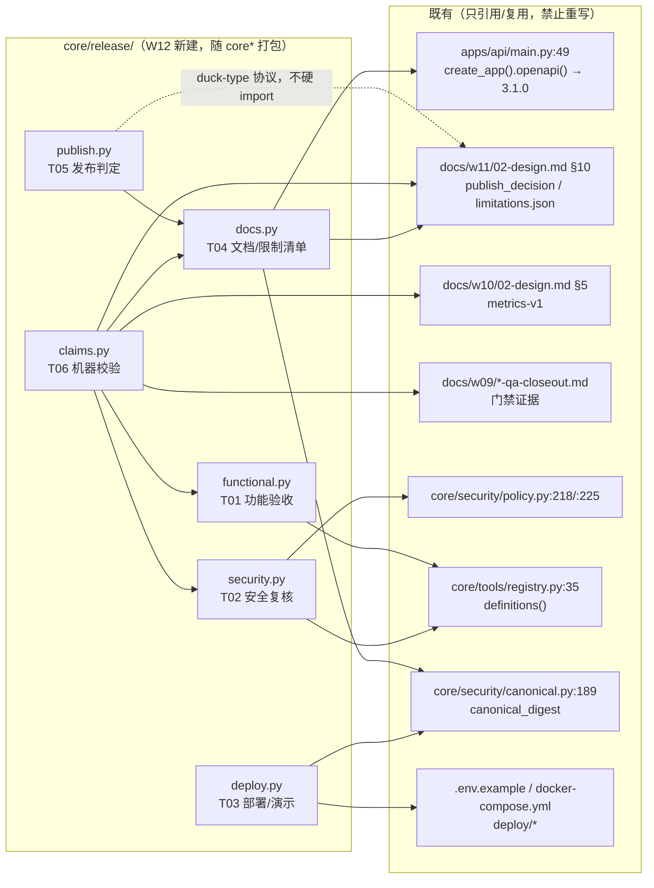
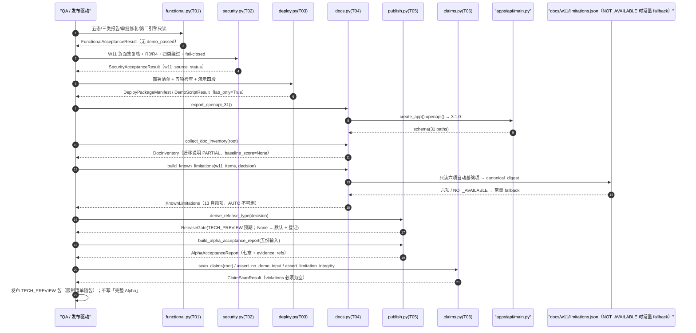

# W12 设计｜Alpha 验收与发布（以冻结集与报告为准，限制诚实、降级由裁定派生）

- 作者：高见远（架构师）｜语言：简体中文
- 现场：`D:/DBGuaredian`，`git HEAD = 2850eca`（W09/W10 改动**未提交**），`.venv/Scripts/python.exe` = Python 3.14.7，FastAPI **0.162.0**
- 上游依据（逐字读）：`docs/w12/01-prd.md`（§1 G1–G3、§2 边界与六类不承诺、§4 六条 P0、§5 AC-01…AC-22、§6 最终 Alpha 门禁、§8 遗留映射）、`docs/w10-w12-lead-rulings.md`（**W12-Q1…Q8 已定死**；§7 W10 补充裁定、§8 W11 补充裁定 **5 点全部批准**）、`docs/w11/02-design.md` §10（`publish_decision` / `build_limitations()` / 六个自动基础项 / `limitations.json` 单一数据源）、`docs/w11/03-task-cards.md` T04/T06 交付形态
- 现场时点：W10 实现由其他成员并行推进；**W11 仅有 PRD/设计/任务卡，`core/assurance/` 与 `docs/w11/limitations.json`、`docs/w11/rc-freeze.md` 均未落地**。W12 结论只依赖这一事实与已定死裁定，不依赖 W10/W11 实现进度

**门禁口径（全文强制）**：W08 =「有条件放行」；W07 =「有条件放行；门禁通过：否」；W09 =「T01–T06 + L1/L2 已实现并通过定向验收，**W09 门禁未评**」。W10/W11 门禁**未裁定**；W12 **不宣布开工、不预写 Alpha 结论、不预写 `publish_decision`**（W12-Q1、C-1）。按 W12-Q4 与 §8 Q-W11-A 批准口径，当前现场预期 `publish_decision=TECH_PREVIEW_ONLY` ⇒ `release_type=TECH_PREVIEW`。

---

## 1. 现状核对差异（先行登记，**不按错误前提设计**）

> 方法：对 PRD §4/§5/§8 的每条 `file:line` 与「全仓无 X」断言逐一 `Grep`/`Read` 复核；关键能力（OpenAPI 版本）用只读 `python -c` 实跑取证。以下 **12 条**与 PRD 表述不一致或需口径校准，设计以本表为准。

| # | PRD 表述 | 实测（证据） | 处置 |
|---|---|---|---|
| **D-01** | §0/Q1：`docs/w08/06-qa-report.md`、`07-gate-review.md`「均未落盘」，W08 门禁「尚在复核、未裁定」 | 两文件**均存在**（`06-qa-report.md` 29 923 B、`07-gate-review.md` 9 273 B，2026-11-13），`GR-0` 结论行 =「**有条件放行**」（与 W11 D-10 同源） | 事实登记；**裁定不变**：W08 仍有条件放行、W09/W10/W11 门禁未评、W12 不宣布开工 |
| **D-02** | §0/Q2「控制库 830+ 行」、§8.1 L6「7 条残留」 | 台账 `C-2` / `docs/w09/14-l1-l2-qa-closeout.md` §⑧-1：**未观测 140 行**（`step_prepared` 276 / `step_observed` 136），随时间增长 | 全文统一 `ENV-RESIDUE`=**140**；不重测、不清理；表述禁令仍按 W07 §6 引用「存在 7 条已登记残留」历史口径时须注明其为 W07 时点 |
| **D-03** | P0-01：`core/evidence/models.py:102-111` 为 `ReportFacts` | 实际 `ReportFacts` = **`:121-130`**（`supporting_evidence_ids` `:128`、`missing_evidence` `:130`）；成因 `2850eca` 插入 `WEAK_COLLECTION_STATUSES`(`:42-50`) 与 `source_payload_hash`(`:77/:108`)（W10 D-01 同源） | 引用实测行号 + 符号名 |
| **D-04** | P0-02：`policy.py:216/:223/:230-235`、`models/gateway.py:226-239`、`executor.py:452/:495` | W11 已逐条实测：R4 **`:218`** / R3 **`:225`** / R2 块 **`:230-238`**；工具校验块 **`:226-246`**（`allow_write=False` 在 `:185`）；`_observe_step` **`:456`**、`insert_observed` **`:496`**、`_unknown_because_no_evidence` **`:508/:512`** | 沿用 W11 D-01/D-02/D-04 的实测行号；`emit_required`(:209/:240) 与 `try_emit`(:248) 两条路径不得混用（W11 D-03） |
| **D-05** | P0-03「`database/migrations/001..008` + `rollback/`」 | 实测 **11 正向**（`001…011`）+ **8 回滚**；`docs/migrations.md` 版本表**止于 007**；`deploy/environment-manifest.example.json:9` 的 `migration_version="001_harness_core"` 亦滞后（W11 D-06 同源） | `DocInventory` 的迁移说明项标 **`PARTIAL` + `registered_issue`**；版本权威 = 迁移文件枚举 + `docs/migrations.md` + `git rev-parse`（W12-Q6）；**不改既有文档** |
| **D-06** | AC-04/AC-22 `write_tools() == []`；AC-06 `registry.risk_levels_registered` | `ToolRegistry`（`core/tools/registry.py:12-36`）**只有** `register/get/names/definitions/__len__`，两个方法/属性都不存在；全仓 `write_tools` 只出现在 `run_baseline.py:327` 与 `test_write_tool_gate.py:111` 的函数名 | 等价断言：`[d for d in registry.definitions() if d.side_effect=="write"] == []`；`not any(d.risk_level=="R4" for d in registry.definitions())`。沿用 W10 D-02 既有惯例 `test_write_tool_gate.py:124-132` |
| **D-07** | P0-04「`.env.example:33-36` 说明 `model_provider` 三态」 | 实际 `:33-36` 只描述 **2 态**（`fake`/`openai_compat`），**`disabled` 未提**；`DG_MODEL_PROVIDER=fake` 在 **`:37`**；全文件无 `disabled` 字样。`docker-compose.yml:145` 才有 `DG_MODEL_PROVIDER: disabled` | 文档清单须如实标「三态说明不完整」为 `PARTIAL`；不改 `.env.example`（配置零改动） |
| **D-08** | P0-04「`README.md:124` 已有验收状态表」 | 表头在 **`:120`**（`:124` 是「能力状态五态」行） | 引用 `:120` |
| **D-09** | P0-02/P0-05：W11 负面集、恢复报告、`publish_decision`「尚未落盘」 | **半对半错**：`docs/w11/01-prd.md`、`02-design.md`、`03-task-cards.md` **已落盘**；但 `core/assurance/**`、`docs/w11/limitations.json`、`docs/w11/rc-freeze.md`、`docs/w11/fault-injection-report.md` **均未落地**（`git status` 只见 w11 两份设计文档） | W12 **不得**硬依赖 W11 实现件：`KnownLimitations` 需 W11 自动基础项的**常量级 fallback**；`derive_release_type()` 用 duck-type 协议而非顶层 import `core.assurance.publish`（该文件此刻不存在） |
| **D-10** | **AC-19 表述禁令自相矛盾**：禁用集合含「门禁通过」，但权威 W07 口径是「有条件放行；门禁通过：否」；且 `docs/w12/` 内引用禁令表的设计/任务卡本身会被 raw substring 扫描命中 | `docs/w12/01-prd.md:113` 要求「扫描 `docs/w12/` 全部文本 → 不含 5 条禁用表述」；`:200` 又要求 W07 写「有条件放行」；主理人硬约束要求 W07 写「有条件放行；门禁通过：否」。三者**无法用朴素子串扫描同时满足** | 设计 §8 定义**双范围上下文感知扫描器**：对外材料严格模式、内部设计/任务卡 `spec_mode`（剥离代码语境 + 扩展否定标记）、`01-prd.md` 作为上游输入排除并登记理由；`门禁通过` 用 `(?!：否|:否)` 负向先行断言。否则 AC-19 与本设计自身必然互相判红（§16 自查行亦需豁免） |
| **D-11** | §8.1 L8 要 W07 写「有条件放行（QA 最终复核确认，2026-11-11 23:56）」 | 主理人 W12 硬约束要求 W07 一律写「**有条件放行；门禁通过：否**」 | 以**主理人**为准；PRD 变体登记为历史写法，W12 对外材料只用主理人版本（配合 D-10 的豁免规则） |
| **D-12** | §0/§7 Q4 说 `publish_decision`「尚未落盘/裁定」，Q4 建议「裁定缺失默认 TECH_PREVIEW_ONLY」 | 主理人 §8 **已批准 Q-W11-A**（完备性守卫；当前五项 `ENV-*` 全在 ⇒ W11 预期输出恒 `TECH_PREVIEW_ONLY`），W12-Q4 亦已定死默认口径 | W12 对 `decision is None` 与 `decision=TECH_PREVIEW_ONLY` **两种输入都产出 `TECH_PREVIEW`**，并对 `None` 记 `PUBLISH_DECISION_MISSING`；**不预写** W11 的 `publish_decision` 具体值（W12-Q1） |

**「全仓无 X」断言复核结果（成立，附只读实测）**：`release_type` / `AlphaAcceptanceReport` / `KnownLimitations` / `DeployPackageManifest` / `ClaimScanResult` / `OpenAPIContract` / `DocInventory` / `DemoScriptResult` / `FunctionalAcceptanceResult` / `SecurityAcceptanceResult` 在业务代码零命中；`docs/w12/` 本周前只有 `01-prd.md`；`git tag -l` 只有 `w07-close` / `w08-close`（无发布版本标签）；`find` 无独立 OpenAPI 交付件，代码中亦无 `app.openapi()` 调用点。

**核对一致项（不是差异，作为设计依据取证）**：
- `apps/api/main.py:91-93`：`app = FastAPI(title="DBGuardian API", version=__version__, ...)` ✓；只读实跑 `create_app().openapi()` 得到 **`openapi="3.1.0"`、`info.version="0.1.0"`、31 paths**（FastAPI 0.162.0），故 AC-13「OpenAPI 主版本 == 3.1」**可由既有 FastAPI 能力直接满足，零新框架**。
- `apps/api/routes/tasks.py`、`core/tasks/{state_machine,service}.py`、`core/verification/verifier.py`、`adapters/mysql/lab_repair.py`、`core/audit/worm.py`、`benchmarks/faults/manifests/`（6 个）、`run_baseline.py:46-48` 六组合、`results.json`（`NOT_RUN`/`scores=null`/`metrics=null`）均存在。
- `deploy/{Dockerfile.api,Dockerfile.worker,environment-manifest.example.json,init/pg_lab_bootstrap.sh,network/README.md}`、`scripts/{migrate,bootstrap_mysql,bootstrap_pg_lab,environment_manifest}.py`、`docs/adr/ADR-0001…0007`、`docs/{baseline_v0,capability-matrix,diagnosis_flows,migrations,cleanup-inventory,dev-guidelines}.md`、`docs/security/{w05-security-tests,identity-and-policy}.md`、`README.md` 均存在；`.env.example` 全部口令为 `CHANGE_ME_*` 占位（AC-10 可断言）；`docker-compose.yml:102/125/145/156-162` 行号准确；`docs/w07/07-gate-review.md:77/78/101/104/129-137` 准确；`docs/w07/05-freeze.md` 与 `06-conformance-audit.md` **确实不存在**（W06 有）→ 文档完整性须标 `PARTIAL`。
- `docs/w09/12-w09-qa-closeout.md`、`14-l1-l2-qa-closeout.md`、`13-l1-l2-design.md`、`docs/w10/02-design.md`、`03-task-cards.md`、`docs/w11/02-design.md`、`03-task-cards.md` 均可作 AC-20 的 `evidence_refs`；`benchmarks/w10/metrics-v1.json` / `docs/w11/rc-freeze.md` / `docs/w11/limitations.json` **尚不存在** → 引用路径保留但标 `NOT_AVAILABLE` + `registered_issue`（不判 FAIL）。

---

## 2. 实现方案总览（六条 P0 + 发布边界）

### 2.1 三条正交目标 → 三个技术难点与取舍

| 目标 | 难点 | 取舍（结论） |
|---|---|---|
| **G1 功能验收以冻结集为准** | 「演示通过」容易被当成验收 | `FunctionalAcceptanceResult` / `SecurityAcceptanceResult` 用 `extra="forbid"` **结构上不设 `demo_passed` 字段**；`AcceptanceEvidence.evidence_refs` 冻结必含 W11/W10/W09 门禁件路径；演示结果只能进 `DemoScriptResult`，**永不作 AC 判定输入**（§9） |
| **G2 安全可靠性逐条复核** | W11 结果件尚未落地（D-09） | W12 **不重写** W11 逻辑，只做「引用 + 复核」：已落地的按路径读取，未落地的标 `NOT_AVAILABLE` + 登记；R3/R4、fail-closed、脱敏等用**既有生产符号**静态断言（`policy.py:218/:225`、`emit_required:209`、`core/redaction/gate.py`），不新增门禁 |
| **G3 交付物完整、限制诚实** | 版本权威滞后（D-05）、AC-19 自相矛盾（D-10）、W11 限制清单未落地（D-09） | 版本取 `git rev-parse` + 迁移文件枚举 + `docs/migrations.md`，文档完整性标 `PARTIAL` + `registered_issue`；限制清单做 **W11 六项自动基础项 + W12 七项自动项的超集结构**，W11 文件缺失时用冻结常量 fallback；表述禁令用上下文感知扫描器 |

### 2.2 模块划分（W12 全新建包 `core/release/`，与 W10 `core/benchmark/`、W11 `core/assurance/` 完全不重叠）



**依赖方向规则**：`publish.py` / `claims.py` 只消费 T01–T04 的**结果模型**；任何 W12 模块**不得**顶层 import `core.assurance.*` / `core.benchmark.*`（此刻不存在，D-09）；不得 import `apps/api/routes/**` 的执行路径；`docs.py` 导出 OpenAPI 时**函数内**才 `from apps.api.main import create_app`。

### 2.3 六条 P0 的实现方案与发布边界

| P0 | 卡 | 实现方案 | 发布边界 |
|---|---|---|---|
| **P0-W12-01** 功能验收 | T01 | 五态生命周期 / 三类诊断报告五字段 / 审批修复闭环 / 第二引擎只读 四组探针 → `FunctionalAcceptanceResult` | PG 段 `NOT_EXECUTED` 不判 FAIL；`write_tools()` 等价断言（D-06）；不新增工具/端点 |
| **P0-W12-02** 安全验收 | T02 | 逐条复核 W11 负面集、R3/R4 不进执行器、四类绕过、UNKNOWN 不重试、fail-closed、脱敏越界、知识审核 → `SecurityAcceptanceResult` | 不重写 W11 逻辑；W11 结果件缺失标 `NOT_AVAILABLE`；不改生产门禁 |
| **P0-W12-03** 部署包与演示 | T03 | `DeployPackageManifest`（五项检查 + 制品记录）+ `DemoScriptResult`（四段演示）；`deployment-guide.md` | 演示**隔离 LAB**：`lab_only=True`、`production_dsn_referenced=False`；容器 `ENV-NV1` **不设硬门槛**（W12-Q3），未跑通保持 `NOT_VERIFIED`；不实跑 `docker build`；不新增 Web |
| **P0-W12-04** 文档/限制清单 | T04 | `OpenAPIContract`（`app.openapi()` 3.1.0）、`DocInventory`（四类）、`KnownLimitations`（13 自动项 + 人工追加） | `baseline_score=None` + 「未微调 / 指标未测得」（W12-Q5）；文档完整性标 `PARTIAL`（D-05/D-07 + W07 冻结缺件）；`docs/migrations.md` 零改动 |
| **P0-W12-05** 发布与复盘 | T05 | `derive_release_type()` 纯函数 → `ReleaseGate`；`AlphaAcceptanceReport` 七类章节 | `release_type` **只由 W11 `publish_decision` 派生**；`None` → 默认 `TECH_PREVIEW_ONLY` + 登记（W12-Q4）；`TECH_PREVIEW` 名称不含 `Alpha`；签名无 `force_alpha`/`override`；训练收益诚实（AC-18） |
| **P0-W12-06** 机器校验 | T06 | `ClaimScanResult` 上下文感知扫描器 + 限制清单完整性 + `demo_passed` 结构性排除 + 写面回归 | 扫描器须处理 D-10 的自指矛盾；自动限制项不可删；AC-22 落**既存**两个测试文件 |

---

## 3. 新建 vs 复用清单

### 3.1 新建（W12）

| 路径 | 职责 | 卡 |
|---|---|---|
| `core/release/__init__.py` | 包标记 + `RELEASE_PACKAGE_VERSION = "w12-v1"`（T01 建，后续卡不改） | T01 |
| `core/release/functional.py` | `FunctionalAcceptanceResult` / 四组探针 / 冻结 case 清单 | T01 |
| `core/release/security.py` | `SecurityAcceptanceResult` / W11 复核 / R3/R4 / 四类绕过 / fail-closed | T02 |
| `core/release/deploy.py` | `DeployPackageManifest` / `DemoScriptResult` / 五项检查 / 演示四段 / LAB 隔离断言 | T03 |
| `core/release/docs.py` | `OpenAPIContract` / `DocInventory` / `KnownLimitations` / `LimitationItem` / OpenAPI 3.1 导出 | T04 |
| `core/release/publish.py` | `ReleaseGate` / `AlphaAcceptanceReport` / `derive_release_type()` | T05 |
| `core/release/claims.py` | `ClaimScanResult` / `AcceptanceEvidence` / 表述扫描器 / 限制项完整性 / `demo_passed` 排除 | T06 |
| `docs/w12/openapi.json` | 由 `create_app().openapi()` 导出的 3.1 契约（31 paths） | T04 |
| `docs/w12/api-contract.md` | DTO / Tool JSON Schema / 错误码 / 状态机合同索引（指向既有源码） | T04 |
| `docs/w12/security-materials.md` | 威胁模型 / RBAC / 风险表 / 审批 / 审计脱敏 / Fault Manifest / Oracle 隔离 / 数据切分 | T04 |
| `docs/w12/benchmark-baseline.md` | 冻结 Baseline 版本与 Benchmark 结果（未微调 / 指标未测得） | T04 |
| `docs/w12/known-limitations.json` | **W12 限制清单单一数据源** | T04 |
| `docs/w12/known-limitations.md` | 限制清单人读件（内嵌同源 JSON 块 + `canonical_digest` 对账） | T04 |
| `docs/w12/deployment-guide.md` | 部署包说明 + 五项检查结果 + 命名一致性复核（KD-2） | T03 |
| `docs/w12/demo-script.md` | 演示四段脚本与隔离检查记录 | T03 |
| `docs/w12/alpha-acceptance-report.md` | 七类章节 + 延期项 + `evidence_refs` | T05 |
| `docs/w12/release-notes.md` | 发布说明（`release_type` / `release_name` / 限制清单随包） | T05 |
| `docs/w12/claim-scan-report.md` | 表述扫描 / 限制完整性 / 演示≠验收 的机器结果 | T06 |

### 3.2 复用（**禁止重写**）

| 能力 | 复用点（实测） | 禁止事项 |
|---|---|---|
| OpenAPI 3.1 | `apps/api/main.py:49 create_app()` → `app.openapi()`（实测 `3.1.0`） | 不引新文档框架；不新增 API 端点；不改 `main.py` |
| W11 发布裁定 | `docs/w11/02-design.md` §10（协议化引用）/ `docs/w11/limitations.json`（**尚未落地** → 常量 fallback） | 不重写 `publish_decision`、不预写其值；不改 `docs/w11/**` |
| W10 指标口径 | `docs/w10/02-design.md` §5 `metrics-v1`（**`metrics-v1.json` 尚未落地**） | 不造 `metrics-v2`；未在收口前不声称已冻结 |
| W09 门禁证据 | `docs/w09/12-w09-qa-closeout.md`、`14-l1-l2-qa-closeout.md`、`13-l1-l2-design.md` | 不改 `docs/w09/**` |
| 策略红线 | `core/security/policy.py:218/:225/:230-238`；`core/models/gateway.py:233/:238-242/:244-245` | 不放宽 `decide`、不给 `allow_write` 改默认值 |
| 只读注册表面 | `core/tools/registry.py:35 definitions()`；`adapters/postgres_mcp/tools.py::TOOL_DEFINITIONS`；`database/observers/__init__.py:31` | 坚持 W10 D-03：PG 7 个 / observer 10 个是**两个工具面** |
| 审计 fail-closed | `core/audit/service.py:209 emit_required` / `:248 try_emit` / `:153 verify` | 不混用两条路径（W11 D-03） |
| 脱敏/知识审核 | `core/redaction/gate.py`、`core/report/samples.py:242`、`core/memory/models.py` | 不重写 W09 交付件 |
| 摘要/分位数 | `core/security/canonical.py:189 canonical_digest`、`core/verification/perf.py:48` | 禁止重写 |
| 部署资产 | `deploy/**`、`docker-compose.yml`、`scripts/{migrate,bootstrap_mysql,bootstrap_pg_lab,environment_manifest,demo_agent_run}.py`、`.env.example` | 配置零改动；不 `git add -f` 被忽略的 `deploy/environment-manifest.*.json`（KD-4）；不实跑 `docker build` |
| 版本权威 | `git rev-parse` + `database/migrations/*.sql`（11 项）+ `docs/migrations.md` | 不写死 hash；文档滞后记 `PARTIAL` |

---

## 4. 关键数据模型

> 全部 pydantic v2 `extra="forbid"` 或 `@dataclass(frozen=True)`；**禁止**用 `0`/`""`/估计值冒充未实测值。

### 4.1 验收结果（T01/T02）

```python
class AcceptanceStatus(str, Enum):
    PASSED="PASSED"; FAILED="FAILED"
    NOT_EXECUTED="NOT_EXECUTED"      # ENV-PG5432 等环境阻塞，不判 FAIL
    NOT_AVAILABLE="NOT_AVAILABLE"    # 上游结果件未落地（D-09）

class FunctionalAcceptanceResult(BaseModel):   # extra="forbid"
    run_id: str
    lifecycle: dict[str, AcceptanceStatus]     # create/query/pause/resume/cancel 各 1
    diagnosis_reports: tuple[DiagnosisReportCheck, ...]   # 3 类，五字段非空率 100%
    repair_closure: RepairClosureCheck         # verdict PASS / tool_calls==1 / row_changes==1
    second_engine_readonly: bool
    pg_segment_status: AcceptanceStatus        # NOT_EXECUTED 时不得 FAILED
    evidence_refs: tuple[str, ...]
    # ★ 结构上**不存在** demo_passed / demo_status / demo_ok 字段（AC-20）

class DiagnosisReportCheck(BaseModel):
    scenario: Literal["slow_query","connection_pressure","lock_wait"]
    evidence_id: str
    supporting_evidence_ids: tuple[str, ...]
    contradicting_evidence_ids: tuple[str, ...]
    missing_evidence: tuple[str, ...]
    scope: str
    @property
    def five_fields_nonempty(self) -> bool: ...

class SecurityAcceptanceResult(BaseModel):    # extra="forbid"
    run_id: str
    negative_review: tuple[NegativeReviewItem, ...]   # 与 W11 冻结集 29 条对齐
    r4_not_registered: bool
    r3_denied: bool
    bypass_rejections: dict[str, bool]        # model/sql_comment/mcp_param/ui 四类
    unknown_no_retry: bool; fail_closed_ok: bool
    redaction_ok: bool; knowledge_indexable_gate_ok: bool
    w11_source_status: AcceptanceStatus       # NOT_AVAILABLE 时如实登记（D-09）
    evidence_refs: tuple[str, ...]
    # ★ 同样**不存在** demo_passed 字段
```

### 4.2 部署与演示（T03）

```python
class CheckStatus(str, Enum): PASS="PASS"; NOT_EXECUTED="NOT_EXECUTED"

class DeployCheck(BaseModel):                # extra="forbid"
    check_id: Literal["install","start","stop","upgrade","rollback"]
    status: CheckStatus
    reason: str | None = None               # NOT_EXECUTED 必填（如 ENV-NV1）
    @model_validator(mode="after")
    def _reason_when_not_executed(self): ...

class DeployPackageManifest(BaseModel):      # extra="forbid"
    manifest_version: Literal["w12-deploy-v1"] = "w12-deploy-v1"
    commit: str                              # git rev-parse（不写死）
    image_digest: str = "UNKNOWN"            # W12-Q2 / ENV-NV1
    artifact_hash: str = "UNKNOWN"
    registered_issues: tuple[str, ...]
    checks: tuple[DeployCheck, ...]          # 恰 5 项
    required_files: dict[str, bool]          # 部署清单必填文件 exists
    env_example_has_real_secret: bool = False
    container_runtime_status: Literal["NOT_VERIFIED"] = "NOT_VERIFIED"
    nv1_is_hard_gate: ClassVar[bool] = False    # W12-Q3

class DemoScriptResult(BaseModel):           # extra="forbid"
    segments: tuple[DemoSegment, ...]        # 恰 4 段
    lab_only: bool = True                    # AC-12
    production_dsn_referenced: bool = False
    pg_segment_status: AcceptanceStatus
    report_has_completion_wording_for_advice: bool = False   # 「已修复」描述建议 → True 即违规
    web_console_used: ClassVar[bool] = False                 # W12-Q7

class DemoSegment(BaseModel):
    segment_id: Literal["S1","S2","S3","S4"]
    name: str; status: AcceptanceStatus; reason: str | None = None
```

### 4.3 文档与限制清单（T04）

```python
class OpenAPIContract(BaseModel):            # extra="forbid"
    openapi_version: str                     # 实测 "3.1.0"
    info_title: str; info_version: str
    path_count: int
    source: Literal["apps.api.main.create_app().openapi()"]
    exported_path: str = "docs/w12/openapi.json"

class DocCategory(str, Enum):
    API_CONTRACT="API_CONTRACT"; SECURITY="SECURITY"
    DATA_BENCHMARK="DATA_BENCHMARK"; LIMITATIONS="LIMITATIONS"

class DocEntry(BaseModel):
    path: str; category: DocCategory
    exists: bool
    status: Literal["EXISTS","PARTIAL","UNKNOWN"]    # PARTIAL 须登记
    note: str = ""

class DocInventory(BaseModel):               # extra="forbid"
    entries: tuple[DocEntry, ...]
    baseline_score: float | None = None      # W12-Q5：恒 None
    baseline_model_status: Literal["未微调"] = "未微调"
    baseline_metrics_status: Literal["指标未测得"] = "指标未测得"
    baseline_blocked_reason: str = "BLOCKED_MODEL_ENV_MISSING"
    @model_validator(mode="after")
    def _baseline_not_fabricated(self): ...

class LimitationOrigin(str, Enum): AUTO="AUTO"; MANUAL="MANUAL"
class LimitationMarker(str, Enum):
    NOT_SUPPORTED="NOT_SUPPORTED"; PARTIAL="PARTIAL"; UNKNOWN="UNKNOWN"

class LimitationItem(BaseModel):             # extra="forbid"
    item_id: str; marker: LimitationMarker
    origin: LimitationOrigin
    statement: str
    added_by: str | None = None              # MANUAL 必填
    reason: str | None = None                # MANUAL 必填

class KnownLimitations(BaseModel):           # extra="forbid"
    version: Literal["w12-limitations-v1"] = "w12-limitations-v1"
    items: tuple[LimitationItem, ...]
    w11_source_status: AcceptanceStatus      # NOT_AVAILABLE → 常量 fallback（D-09）
    w11_source_digest: str | None = None     # canonical_digest(W11 六项自动基础项)
    items_digest: str                        # canonical_digest(items)
    source_path: str = "docs/w12/known-limitations.json"
    @model_validator(mode="after")
    def _auto_items_immutable(self) -> "KnownLimitations": ...
```

**自动基础项（13 项，不可删）**

| 来源 | item_id | 数量 | marker |
|---|---|---|---|
| W11 `build_limitations()` 六项（W11 §10.2） | `ENV-PG5432` / `ENV-1045` / `ENV-RESIDUE` / `ENV-NV1` / `ENV-MODEL` / `DECISION-TECH-PREVIEW` | 6 | 三值齐全 |
| W12 六类不承诺能力（PRD §2 / AC-15） | `NP-PROD-AUTO-WRITE` / `NP-GENERIC-AUTO-REPAIR` / `NP-ALWAYS-DIAGNOSE` / `NP-FULL-DEADLOCK-INDEX` / `NP-EXACTLY-ONCE` / `NP-NETWORK-ISOLATION-VERIFIED` | 6 | `NOT_SUPPORTED` |
| W12 文档完整性滞后（D-05/D-07/W07 冻结缺件） | `DOC-PARTIAL` | 1 | `PARTIAL` |

`W11_AUTO_BASE_SPEC` 是 W11 §10.2 的**常量级镜像**（只含 item_id/marker/statement），用于 `docs/w11/limitations.json` 未落地时派生；**绝不伪造** W11 的输出文件、绝不写 `docs/w11/**`。

### 4.4 发布与机器校验（T05/T06）

```python
class ReleaseType(str, Enum): TECH_PREVIEW="TECH_PREVIEW"; ALPHA="ALPHA"

@dataclass(frozen=True)
class ReleaseGate:                           # 无时间戳（纯函数可复现）
    release_type: ReleaseType
    release_name: str
    effective_decision: str                  # ALPHA_ALLOWED / TECH_PREVIEW_ONLY
    decision_digest: str | None              # canonical_digest(W11 PublishDecision) 或 None
    registered_issues: tuple[str, ...]
    source: Literal["W11_PUBLISH_DECISION","DEFAULT_TECH_PREVIEW_ONLY"]

class AlphaAcceptanceReport(BaseModel):      # extra="forbid"
    report_version: Literal["w12-alpha-report-v1"] = "w12-alpha-report-v1"
    sections: dict[str, str]                 # 功能/安全/可靠性/性能/模型收益/成本/已知问题 七类 + 延期项
    evidence_refs: tuple[str, ...]           # 必含 W11/W10/W09 门禁件路径（AC-20）
    baseline_score: float | None = None
    model: Literal["baseline"] = "baseline"
    sft_reproducible_gain: bool = False
    dpo_deferred: ClassVar[bool] = True
    full_14b_deferred: ClassVar[bool] = True
    rl_deferred: ClassVar[bool] = True
    @model_validator(mode="after")
    def _seven_sections_and_baseline_honest(self): ...

@dataclass(frozen=True)
class ClaimScanResult:
    scanned_files: tuple[str, ...]           # 严格模式：W12 对外材料
    spec_mode_files: tuple[str, ...]         # 02-design.md / 03-task-cards.md（内部件）
    excluded_files: tuple[str, ...]          # 01-prd.md（上游输入，排除理由写入报告）
    exempted_lines: int                      # 代码围栏/否定语境豁免计数
    violations: tuple[str, ...]              # 两个范围合计，必须为空
    allowed_phrases: tuple[str, ...]         # 「有条件放行；门禁通过：否」等豁免
    demo_input_violations: tuple[str, ...]   # demo_passed 出现在 AC 输入 → 非空即违规
    limitation_integrity_ok: bool
    evidence_refs_ok: bool

@dataclass(frozen=True)
class AcceptanceEvidence:
    ac_id: str
    evidence_refs: tuple[str, ...]           # 冻结必含路径集
    # ★ 无 demo_passed / demo_status / demo_ok 字段；注入即 ValidationError/DEMO_AS_ACCEPTANCE
```

---

## 5. `release_type` 判定树（W12-Q4 / AC-16/AC-17）

### 5.1 纯函数

```python
class PublishDecisionLike(Protocol):         # duck-type，不硬 import W11 实现（D-09）
    decision: str
    failed_test_ids: tuple[str, ...]
    environment_blocks: tuple[str, ...]

def derive_release_type(*, decision: PublishDecisionLike | None) -> ReleaseGate: ...
```

```mermaid
stateDiagram-v2
    [*] --> Read: derive_release_type(decision)
    Read --> Default: decision is None
    Default --> TechPreview: 默认 TECH_PREVIEW_ONLY + 登记 PUBLISH_DECISION_MISSING（W12-Q4）
    Read --> Branch: decision 非空
    Branch --> TechPreview: decision.decision == TECH_PREVIEW_ONLY
    Branch --> Alpha: decision.decision == ALPHA_ALLOWED
    Branch --> Default: 其它取值 → 视为缺失（fail-closed）
    TechPreview --> [*]: release_type=TECH_PREVIEW / release_name 不含 alpha（大小写不敏感）
    Alpha --> [*]: release_type=ALPHA / 仅写 "Alpha"，不写「完整 Alpha」
```

### 5.2 逐条语义

1. `decision is None` → `effective_decision="TECH_PREVIEW_ONLY"`、`source="DEFAULT_TECH_PREVIEW_ONLY"`、`registered_issues += ("PUBLISH_DECISION_MISSING",)`（W12-Q4）。
2. `TECH_PREVIEW_ONLY` → `release_type="TECH_PREVIEW"`、`release_name="DBGuardian 技术预览（受限发布）"`；模型校验器断言 `"alpha" not in release_name.casefold()`（AC-16）。
3. `ALPHA_ALLOWED` → `release_type="ALPHA"`、`release_name="DBGuardian Alpha"`；**仍不写「完整 Alpha」**（主理人表述禁令）。
4. 其它取值（含大小写异常、空串）→ 走第 1 条 fail-closed，并登记 `UNKNOWN_DECISION_VALUE`。
5. `decision_digest = canonical_digest(...)`（**复用**）用于 RC 冻结件对账；`None` 时字段为 `None`。
6. **纯函数**：无 I/O、无全局状态、无 `utc_now()`；`ReleaseGate` 无时间字段；同输入逐位相等。
7. 签名**无** `force_alpha` / `override` / `manual_override` / 任何 `force_*` 形参（AC-17，`inspect.signature` 逐字断言）；**不可**由配置/环境变量/人工覆盖（W12-Q4）。
8. `release_type` **只**由这一个入参派生；`demo_passed`、演示结果、验收报告章节数、人工意见**都不是**入参（AC-20）。
9. 当前现场（五项 `ENV-*` 全在，§8 Q-W11-A 批准完备性守卫）⇒ 预期 `decision=TECH_PREVIEW_ONLY` 或 `None`，**两种都产出 `TECH_PREVIEW`**。

---

## 6. 限制清单不可删（W12-Q8 / AC-21）

### 6.1 单一数据源与 W11 同源对账

```
docs/w11/limitations.json（W11 单一数据源；当前 NOT_AVAILABLE）
   │ 读取六项自动基础项 → canonical_digest → w11_source_digest
   │ 缺失时用 W11_AUTO_BASE_SPEC 常量派生（D-09），w11_source_status=NOT_AVAILABLE
   ▼
docs/w12/known-limitations.json（W12 单一数据源，13 自动项 + 人工追加项）
   │ 同一函数序列化
   ▼
docs/w12/known-limitations.md（内嵌 ```json 同源块 + items_digest / w11_source_digest 对账）
```

- 生成函数 `build_known_limitations(*, w11_items: Sequence[LimitationItem] | None, decision: PublishDecisionLike | None) -> KnownLimitations` **纯派生**；先取 W11 六项，再追加 W12 六类不承诺 + `DOC-PARTIAL`。
- `KnownLimitations._auto_items_immutable` 校验器重算 13 项自动集合并要求 `AUTO ⊆ items`，且 marker/statement 与常量逐字一致 → **删除任一自动项 → `LIMITATION_REMOVED`**（W12-Q8 / AC-21）。
- 人工追加项：`origin=MANUAL`，`added_by`/`reason` 必填（空 → `ValidationError`），`item_id` 不得与自动前缀冲突；**只能追加**，不得修改/覆盖自动项。
- `docs/w12/known-limitations.md` 内嵌 JSON 块与 `known-limitations.json` **由同一函数序列化**（`items_digest` 对账）；`w11_source_digest` 记录 W11 六项的摘要，保证 W12 不出现第二个真值（W11 Q-W11-D 同款）。
- **禁止**写 `docs/w11/**`；W12 对 W11 只读。

### 6.2 六类不承诺能力（PRD §2 / AC-15）

| item_id | 能力 | marker |
|---|---|---|
| `NP-PROD-AUTO-WRITE` | 生产自动写入 | `NOT_SUPPORTED` |
| `NP-GENERIC-AUTO-REPAIR` | 通用故障自动修复 | `NOT_SUPPORTED` |
| `NP-ALWAYS-DIAGNOSE` | 所有场景必然诊断成功 | `NOT_SUPPORTED` |
| `NP-FULL-DEADLOCK-INDEX` | 完整死锁/索引评估 | `PARTIAL` |
| `NP-EXACTLY-ONCE` | 跨系统 Exactly Once | `NOT_SUPPORTED` |
| `NP-NETWORK-ISOLATION-VERIFIED` | 网络级隔离已验证（`docs/w07/07-gate-review.md:101` KD-1 账号级） | `NOT_SUPPORTED` |

---

## 7. AC-20「演示 ≠ 验收」的结构保证

| 层 | 机制 | 断言 |
|---|---|---|
| 模型层 | `FunctionalAcceptanceResult` / `SecurityAcceptanceResult` / `AcceptanceEvidence` 全部 `extra="forbid"` 且**不设** `demo_passed` / `demo_status` / `demo_ok` 字段 | 注入 `demo_passed=True` → `ValidationError`；`DEMO_INPUT_FIELDS` 常量与 `model_fields` 交集为空 |
| 判定层 | `derive_release_type()` 签名只有 `decision`；`ac_result` 判定输入集合冻结为 `{ac_id, evidence_refs, status}` | `assert_no_demo_input(payload)` 命中任一 demo 键 → `DEMO_AS_ACCEPTANCE` |
| 证据层 | `AcceptanceEvidence.evidence_refs` **冻结必含路径集**（AC-20）：W11 `docs/w11/02-design.md` / `03-task-cards.md`（`rc-freeze.md` 可用时）、W10 `docs/w10/02-design.md` / `03-task-cards.md`（`metrics-v1.json` 可用时）、W09 `docs/w09/12-w09-qa-closeout.md` / `14-l1-l2-qa-closeout.md` / `13-l1-l2-design.md` | 每周至少 1 条路径，集合非空；缺失项标 `NOT_AVAILABLE` + `registered_issue`，**不判 FAIL**（D-09） |
| 产物层 | `DemoScriptResult` 独立成件，只写进 `docs/w12/demo-script.md` 与部署报告，**不写进** `AlphaAcceptanceReport` 的 `ac_result` 输入 | `demo-script.md` 与 `alpha-acceptance-report.md` 的 `evidence_refs` 无交集判定输入 |

---

## 8. AC-19 表述禁令的机器校验（D-10 落地）

### 8.1 朴素子串扫描为何不可行

禁用集合含「门禁通过」，但主理人要求的 W07 权威口径是「有条件放行；**门禁通过：否**」；且 `docs/w12/02-design.md`、`03-task-cards.md` 本身要引用禁令表（如本表）。若按 `docs/w12/01-prd.md:113` 的字面做全文本子串匹配，**W12 自己的设计档必然被判红**，且所有合规的 W07 表述也无法写出。故 AC-19 必须实现为**上下文感知扫描**。

### 8.2 `ClaimScanner` 规则（可断言）

```python
FORBIDDEN_CLAIMS: tuple[tuple[str, str], ...] = (
    ("GATE_CLOSED",      r"已收口"),
    ("GATE_PASSED",      r"门禁通过(?!：否|:否)"),   # 「门禁通过：否」豁免
    ("NETWORK_VERIFIED", r"容器网络隔离已验证"),
    ("ENV_CLEANED",      r"已清理"),
    ("QA_INDEPENDENT",   r"QA\s*独立实跑通过"),
)
W12_EXTRA_FORBIDDEN: tuple[str, ...] = (
    "上游已通过", "W12 开工", "回归全绿", "环境已清零", "Alpha 已就绪", "完整 Alpha",
)
NEGATION_MARKERS: tuple[str, ...] = (
    "禁用", "不得", "禁止", "应改为", "表述禁令", "自查", "沿用", "不写", "不含",
)
```

扫描流程：

1. **三范围划分**（`ClaimScanResult` 逐项记录，不允许静默跳过）：
   - **严格模式** `scanned_files`：全部 W12 **对外材料** —— `deployment-guide.md`、`demo-script.md`、`known-limitations.{json,md}`、`api-contract.md`、`security-materials.md`、`benchmark-baseline.md`、`alpha-acceptance-report.md`、`release-notes.md`、`claim-scan-report.md`、`openapi.json`。这些文件**不允许**出现任何禁用表述（唯一例外是 `门禁通过：否`）。
   - **`spec_mode_files`**：`02-design.md` / `03-task-cards.md` 是内部设计件，必须引用禁令表与扫描规则本身；按下方 2–3 步放宽，但**肯定式断言仍必须零命中**。
   - **`excluded_files`**：`01-prd.md` 是上游输入（其 `:113`/`:200` 正含禁用词表），显式排除并把理由写进 `claim-scan-report.md`。AC-19 的「全文」按「**W12 本周对外产出全文 + 内部件 spec_mode**」解释，登记为口径校准 D-10 / 待裁定 Q-W12-A。
2. **剥离**：去掉 fenced code blocks 与行内 code spans —— 禁令表、正则、模型定义都在代码语境。
3. **否定语境豁免**：严格模式仅豁免 `门禁通过：否`；`spec_mode` 额外豁免含 `NEGATION_MARKERS` ∪ `SPEC_MARKERS`（`未写`/`不预写`/`不宣布`/`互斥`/`豁免`/`排除`/`负向先行`/`字面`/`规则`/`常量`/`断言`/含反引号的行）的行，累加 `exempted_lines`。例如 §16 自查行的「**未写**『上游已通过』…」属规范引用，不是对外宣称。
4. **剩余文本**按 `FORBIDDEN_CLAIMS` 正则 + `W12_EXTRA_FORBIDDEN` 子串匹配；`门禁通过` 用负向先行断言放行「：否」。
5. `ClaimScanResult.violations` 必须为空；非空 → `IS_PASS: NO` 且**不得发布任何对外材料**。
6. `allowed_phrases` 固定含「有条件放行；门禁通过：否」「有条件放行」「配置层已实测 / 运行态 NOT_VERIFIED」「只读数据复核通过（依赖工程师实跑产物）」。

> W07/W08/W09 权威口径逐字：**W07「有条件放行；门禁通过：否」**、**W08「有条件放行」**、**W09「T01–T06 + L1/L2 已实现并通过定向验收，W09 门禁未评」**。

---

## 9. 部署包、演示与版本权威

### 9.1 五项检查（W12-Q3：容器不作硬门槛）

| check_id | 判据 | 未实跑口径 |
|---|---|---|
| `install` / `start` / `stop` / `upgrade` / `rollback` | 每项恰 1 条 `DeployCheck` | `status=NOT_EXECUTED` + `reason`（如 `ENV-NV1` / `DG_ADMIN_DSN 不可用` / `本轮不执行 rollback`）→ **不判 FAIL**；不实跑 `docker build`、不执行 rollback（含 DROP，须人工 admin） |

- `commit`：`git rev-parse HEAD`（不写死）；`image_digest="UNKNOWN"` + `registered_issue`（W12-Q2 / `ENV-NV1`）；`artifact_hash` 由交付文件哈希得出，缺失 `UNKNOWN` + 登记。
- `container_runtime_status="NOT_VERIFIED"`、`nv1_is_hard_gate=False` 是 `ClassVar`，不可被实例覆盖。
- `required_files`：`deploy/Dockerfile.api`、`Dockerfile.worker`、`environment-manifest.example.json`、`init/pg_lab_bootstrap.sh`、`network/README.md`、`docker-compose.yml`、`.env.example`、`scripts/migrate.py`、`bootstrap_mysql.py`、`bootstrap_pg_lab.py`、`environment_manifest.py` 逐项 `exists=True`。
- `.env.example` 口令全为 `CHANGE_ME_*` 占位 → `env_example_has_real_secret=False`（AC-10，已实测）。
- `deployment-guide.md` 复核 KD-2 命名：Gateway 与 Worker **同进程装配**（`workers/stack.py`），`tool_gateway` 为遗留占位（`docker-compose.yml:156-162`），**不误写**「api → gateway 容器」。

### 9.2 演示四段（W12-Q7：无 Web）

S1 双引擎只读诊断（PG 段 `NOT_EXECUTED`）/ S2 单引擎审批修复（`mysql_lab_update_order_note/1.0`，一次 grant）/ S3 独立 Verifier / S4 UNKNOWN 结果恢复演练。全段 `lab_only=True`、`production_dsn_referenced=False`（扫描 `scripts/demo_agent_run.py`、`.env.example`、compose 中不含生产 DSN / `prod` 目标）；演示报告**不得**用「已修复」描述「建议」（AC-12、`core/report/models.py` AC-11 措辞禁令同款）。`web_console_used=False` 为 `ClassVar`。

### 9.3 版本权威（W12-Q6 / D-05）

```
git rev-parse HEAD            → commit（唯一动态值）
database/migrations/*.sql     → 11 项枚举（权威）
docs/migrations.md            → 版本说明（止于 007，标 PARTIAL + registered_issue）
benchmarks/baseline_v0/baseline_manifest.json → 冻结版本字段
```

`DocInventory` 的「迁移说明」条目 `status="PARTIAL"`、`note="docs/migrations.md 版本表止于 007，实测 011；环境清单不入库（KD-4）"`；W07 冻结四件套缺 2 件亦标 `PARTIAL`（已核实 `docs/w07/05-freeze.md`/`06-conformance-audit.md` 不存在）。**不声称「迁移说明齐全」「四件套齐全」**。

### 9.4 OpenAPI 3.1（零新框架）

```python
def export_openapi_31() -> OpenAPIContract:
    from apps.api.main import create_app          # 函数内 import，避免配置加载副作用提前发生
    schema = create_app().openapi()
    assert str(schema["openapi"]).startswith("3.1")     # 实测 3.1.0
    ...
```

只读导出到 `docs/w12/openapi.json`；**不新增 API 端点、不改 `main.py`、不引文档框架**。AC-13 断言 `openapi` 主版本 `3.1`。

### 9.5 Baseline 不包装（W12-Q5 / AC-14/AC-18）

`results.json` 实测 `NOT_RUN` / `scores=null` / `metrics=null` → `DocInventory.baseline_score=None`；`benchmark-baseline.md` 必须含「**未微调**」与「**指标未测得**」及 `BLOCKED_MODEL_ENV_MISSING`；`AlphaAcceptanceReport.model="baseline"`，`sft_reproducible_gain=False`，`dpo_deferred`/`full_14b_deferred`/`rl_deferred` 恒 `True`（`ClassVar`）。**不填任何估计值**。

---

## 10. 关键签名（可直接抄）

```python
# core/release/publish.py (T05)
def derive_release_type(*, decision: "PublishDecisionLike | None") -> ReleaseGate: ...
def build_alpha_acceptance_report(*, functional, security, deploy, docs,
                                  decision: "PublishDecisionLike | None") -> AlphaAcceptanceReport: ...

# core/release/docs.py (T04)
def export_openapi_31() -> OpenAPIContract: ...
def collect_doc_inventory(root: Path) -> DocInventory: ...
def build_known_limitations(*, w11_items: Sequence[LimitationItem] | None,
                            decision: "PublishDecisionLike | None") -> KnownLimitations: ...
def append_manual_limitation(items: KnownLimitations, *, item: LimitationItem) -> KnownLimitations: ...

# core/release/claims.py (T06)
def scan_claims(root: Path) -> ClaimScanResult: ...        # 三范围，见 §8.2
def assert_no_demo_input(payload: Mapping[str, Any]) -> None: ...
def assert_limitation_integrity(items: KnownLimitations) -> None: ...
def assert_evidence_refs(refs: Sequence[str]) -> None: ...

# core/release/deploy.py (T03)
def collect_deploy_package(root: Path) -> DeployPackageManifest: ...
def build_demo_result() -> DemoScriptResult: ...

# core/release/functional.py / security.py (T01/T02)
def run_functional_acceptance(*, control_client: Any) -> FunctionalAcceptanceResult: ...
def run_security_acceptance(*, registry: Any) -> SecurityAcceptanceResult: ...
```

---

## 11. 程序调用时序（Mermaid）



---

## 12. 文件清单与独占文件矩阵

### 12.1 新建（25，含测试 6）/ 修改（0）

| 卡 | 新建文件 | 数量 |
|---|---|---|
| **T01** | `core/release/__init__.py`、`core/release/functional.py`、`tests/integration/test_w12_functional_acceptance.py` | 3 |
| **T02** | `core/release/security.py`、`tests/integration/test_w12_security_acceptance.py` | 2 |
| **T03** | `core/release/deploy.py`、`tests/integration/test_w12_deploy_package.py`、`tests/integration/test_w12_demo_script.py`、`docs/w12/deployment-guide.md`、`docs/w12/demo-script.md` | 5 |
| **T04** | `core/release/docs.py`、`tests/unit/test_w12_doc_inventory.py`、`docs/w12/openapi.json`、`docs/w12/api-contract.md`、`docs/w12/security-materials.md`、`docs/w12/benchmark-baseline.md`、`docs/w12/known-limitations.json`、`docs/w12/known-limitations.md` | 8 |
| **T05** | `core/release/publish.py`、`tests/unit/test_w12_publish_gate.py`、`docs/w12/alpha-acceptance-report.md`、`docs/w12/release-notes.md` | 4 |
| **T06** | `core/release/claims.py`、`tests/unit/test_w12_claims.py`、`docs/w12/claim-scan-report.md` | 3 |

合计 **25**（7 代码 + 6 测试 + 12 文档/契约件）。**修改既有文件：0**。W12 **不碰** `apps/**`、`core/**`（除新建 `core/release/`）、`workers/**`、`database/**`、`deploy/**`、`docker-compose.yml`、`.env.example`、`scripts/**`、`docs/w07/**`–`docs/w11/**`、`docs/migrations.md`、`README.md`、`pyproject.toml`。

### 12.2 独占文件矩阵（任一时刻不得两卡改同一文件）

| 卡 | 独占文件 | 依赖 |
|---|---|---|
| **T01** | `core/release/__init__.py`、`functional.py`、`test_w12_functional_acceptance.py` | — |
| **T02** | `security.py`、`test_w12_security_acceptance.py` | T01（`AcceptanceStatus` 类型） |
| **T03** | `deploy.py`、`test_w12_deploy_package.py`、`test_w12_demo_script.py`、`deployment-guide.md`、`demo-script.md` | T01 |
| **T04** | `docs.py`、`test_w12_doc_inventory.py`、`openapi.json`、`api-contract.md`、`security-materials.md`、`benchmark-baseline.md`、`known-limitations.{json,md}` | T01 |
| **T05** | `publish.py`、`test_w12_publish_gate.py`、`alpha-acceptance-report.md`、`release-notes.md` | T04（`KnownLimitations` / `DocInventory` 类型） |
| **T06** | `claims.py`、`test_w12_claims.py`、`claim-scan-report.md` | T01–T05（结果类型，只读 import） |

> **T04 必须早于 T05/T06**：`KnownLimitations` / `DocInventory` 由 T04 独占，T05/T06 只 import 类型不改文件。T06 最后执行，对全部 W12 产出做机器校验。

---

## 13. 依赖包：**零新增**

| 需求 | 方案 |
|---|---|
| OpenAPI 3.1 | `apps.api.main.create_app().openapi()`（FastAPI 0.162.0 既有能力，实测 3.1.0） |
| 摘要 / 对账 | `core/security/canonical.py:189 canonical_digest`（复用） |
| 数据模型 | `pydantic`（`pyproject.toml:14` 既有）、`dataclasses` |
| 表述扫描 | 标准库 `re` / `pathlib`，无第三方 |
| 版本 | 标准库 `subprocess` 调 `git rev-parse`（只读） |
| 部署/演示 | 只读解析既有 `deploy/**`、`docker-compose.yml`、`.env.example`、`scripts/demo_agent_run.py` |

`requirements.lock.txt` 零变更；不新增前端、API 端点、exporter、迁移、DDL。

---

## 14. 风险登记

| # | 风险 | 触发 | 影响 | 缓解 |
|---|---|---|---|---|
| **R-01** | 朴素子串扫描把 W12 自己的设计档判红（D-10） | 按 PRD AC-19 字面实现 | 门禁自锁、或被迫删掉合规 W07 口径 | §8 双范围扫描器：严格模式管对外材料、`spec_mode` 管内部设计件、`01-prd.md` 排除并登记；`门禁通过(?!：否)`；`violations` 两范围合计必须为空 |
| **R-02** | W11 结果件缺失被当成「可自行裁定」 | 实现者见 `publish_decision` 无输入 | 预写 Alpha 结论（违反 W12-Q1/Q4） | `decision is None` → 默认 `TECH_PREVIEW_ONLY` + `PUBLISH_DECISION_MISSING`；`derive_release_type` 用 duck-type 协议，**不硬 import** 尚不存在的 `core.assurance.*` |
| **R-03** | 限制清单自动项被人工删除或 W11 六项被改写 | 发布材料编辑 | 违反 W12-Q8 / AC-21 | `KnownLimitations` 校验器重算 13 项自动集合 + `w11_source_digest` 对账；删除 → `LIMITATION_REMOVED`；人工项只能追加且带 `added_by`/`reason` |
| **R-04** | 演示通过被当验收 | 把 `demo_passed` 塞进 ac_result | 违反 AC-20 | 三个验收模型 `extra="forbid"` 且结构上无 demo 字段；`assert_no_demo_input()`；`evidence_refs` 冻结必含 W11/W10/W09 路径 |
| **R-05** | 编造镜像 digest / 制品 hash / Baseline 成绩 | 为「交付完整」填值 | 红线 | `image_digest`/`artifact_hash` 缺失 `UNKNOWN` + 登记；`baseline_score=None` + 文档含「未微调 / 指标未测得」；`DocInventory` 校验器强制 |
| **R-06** | 容器运行态被写成「已验证」 | 部署文档措辞 | 违反 W12-Q3 / 表述禁令 | `container_runtime_status="NOT_VERIFIED"`、`nv1_is_hard_gate=False` 为 `ClassVar`；五项检查可 `NOT_EXECUTED` + 原因；扫描器禁用「容器网络隔离已验证」 |
| **R-07** | `release_name` 仍含 Alpha | TECH_PREVIEW 命名 | AC-16 失败 | `ReleaseGate` 模型校验器 `"alpha" not in casefold(release_name)`；`release-notes.md` 同源生成 |
| **R-08** | 文档完整性被写成「齐全」 | `docs/migrations.md` 止于 007、W07 冻结缺 2 件、`.env.example` 只写 2 态 | 虚假交付 | `DocEntry.status="PARTIAL"` + `DOC-PARTIAL` 自动限制项 + `registered_issue`；不改既有文档 |
| **R-09** | `release_type` 被人工/配置覆盖 | 加 `force_alpha` 开关 | 违反 W12-Q4 / AC-17 | 签名逐字断言无 `force_alpha`/`override`/`force_*`；`ReleaseGate` 无时间字段、纯函数可复现 |
| **R-10** | `write_tools()` / `risk_levels_registered` 不存在导致用例 AttributeError | 照 PRD 字面写断言（D-06） | AC-04/06/22 红 | 等价断言：`definitions()` 过滤 `side_effect`/`risk_level`；沿用 W10 D-02 惯例 |
| **R-11** | 演示连生产库 / 用「已修复」描述建议 | 演示脚本措辞 | 违反 AC-12 与安全边界 | `lab_only=True`、`production_dsn_referenced=False`、`report_has_completion_wording_for_advice=False`；只读扫描 DSN/措辞 |
| **R-12** | `docs/w12/` 内出现两个限制清单真值 | md 手写、json 另写 | 违反 W12-Q8「同源」 | `known-limitations.md` 内嵌由同一函数序列化的 JSON 块 + `items_digest`/`w11_source_digest` 对账；`known-limitations.json` 唯一数据源 |
| **R-13** | 顶层 import 尚不存在的 W10/W11 模块 | `docs.py`/`claims.py` 直接 import | W12 在并行状态下无法启动 | 一律 duck-type / 函数内 import；`evidence_refs` 路径可 `NOT_AVAILABLE` + 登记，不判 FAIL |

---

## 15. 待主理人裁定点

| # | 待裁定 | 我的建议 |
|---|---|---|
| **Q-W12-A** | AC-19「扫描 `docs/w12/` 全文」是否按「**对外材料严格模式 + 内部设计件 `spec_mode` + 上游 `01-prd.md` 排除**」三范围解释（D-10） | **是**。朴素子串扫描与「W07 写有条件放行；门禁通过：否」硬约束互斥；排除 `01-prd.md` 并把理由写进 `ClaimScanResult`，不降低对外材料的扫描强度 |
| **Q-W12-B** | W11 `limitations.json` 未落地时，W12 用 `W11_AUTO_BASE_SPEC` 常量派生六项自动基础项是否可接受 | **可接受**：常量逐字镜像 W11 §10.2，标 `w11_source_status=NOT_AVAILABLE` + `registered_issue`，**绝不伪造 W11 文件**；W11 落地后由 QA 补做 `w11_source_digest` 对账 |
| **Q-W12-C** | 五项部署检查是否允许全部 `NOT_EXECUTED`（因 `ENV-NV1` / 不执行 rollback） | **允许**（W12-Q3：容器不作硬门槛）；每条必带原因且不判 FAIL；`deployment-guide.md` 如实列出，`DOC-PARTIAL` 限制项登记 |
| **Q-W12-D** | `release_name` 的 `TECH_PREVIEW` 命名文案 | 建议「DBGuardian 技术预览（受限发布）」（不含 Alpha 大小写变体）；`ALPHA_ALLOWED` 时用「DBGuardian Alpha」，**仍不写「完整 Alpha」** |
| **Q-W12-E** | W12 是否需要把 `docs/w12/openapi.json` 纳入冻结件（此后改须升版本） | **是**：与 `known-limitations.json` 同规格，附 `canonical_digest`；FastAPI 版本升级导致契约变化时须重新导出并登记 |

---

## 16. 冻结口径与表述禁令自查

1. **上游门禁**：W08「有条件放行」/ W07「有条件放行；门禁通过：否」/ W09「T01–T06 + L1/L2 已实现并通过定向验收，W09 门禁未评」；W10/W11 门禁未裁定；**未写**「上游已通过」「W12 开工」「回归全绿」「环境已清零」「Alpha 已就绪」「完整 Alpha」（除 §8 豁免规则中的引用语境）。
2. **编号**：五项环境阻塞按 `ENV-PG5432`/`ENV-1045`/`ENV-RESIDUE`(140)/`ENV-NV1`/`ENV-MODEL`（台账 §6）；本文件**未用** `E-` 指环境项。
3. **裁定已定死、未提替代方案**：默认 `TECH_PREVIEW_ONLY`（W12-Q4）、容器 NV-1 不作硬门槛（W12-Q3）、Baseline 未微调 + `baseline_score=null`（W12-Q5）、演示无 Web（W12-Q7）、版本缺失 `UNKNOWN`（W12-Q6）、限制清单自动项不可删（W12-Q8）、W11 §8 五点全部批准。
4. **写能力**：唯一 R2 动作仍 `mysql_lab_update_order_note`/`1.0`；无 PG 写路径；不新增端点/迁移/DDL；不删除任何 P0 安全门禁或限制清单自动项。
5. **冻结零改动**：`payload_hash`/`redacted_payload_hash`/`source_payload_hash`、`action_digest`、`ToolStatus`、`redaction_version=redaction-v2`、迁移 009/010/011 表结构；`benchmarks/baseline_v0/results.json` 保持 `NOT_RUN`。
6. **不重写**：`core/redaction/**`、`core/report/**`、`core/memory/**`、`core/verification/perf.py::percentile`、`core/security/canonical.py::canonical_digest`、W10 `core/benchmark/**`、W11 `core/assurance/**`；`docs/w10/**`、`docs/w11/**` 只读。
7. **不 git 写**：本文件为唯一新增（连同任务卡共两份），无 `commit/add/checkout/reset`；不 `git add -f` 被忽略的 `deploy/environment-manifest.*.json`。
