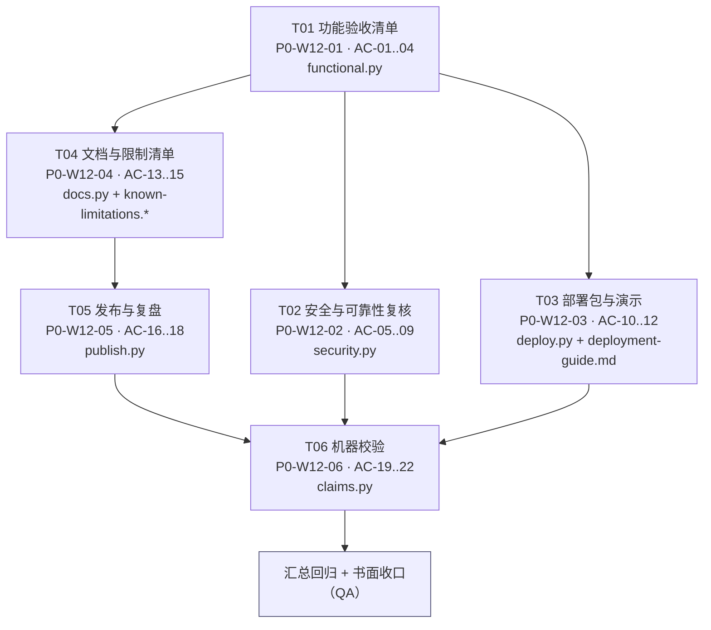

# W12 任务卡｜Alpha 验收与发布（6 卡，按依赖硬顺序）

- 依据：`docs/w12/01-prd.md`（§1 G1–G3、§2 边界与六类不承诺、§4 六条 P0、§5 AC-01…AC-22、§6 最终 Alpha 门禁、§8 遗留映射）、`docs/w12/02-design.md`（**本卡唯一技术口径**）、`docs/w10-w12-lead-rulings.md`（W12-Q1…Q8 已定死；§7 W10、§8 W11 补充裁定全部批准）、`docs/w10/03-task-cards.md:8-20`（全局纪律 11 条母版）
- 上游门禁口径：W08 =「**有条件放行**」；W07 =「**有条件放行；门禁通过：否**」；W09 =「**T01–T06 + L1/L2 已实现并通过定向验收，W09 门禁未评**」。W10/W11 门禁**未裁定**；本批任务**不得**写成「上游已通过」「W12 开工」，**不预写 Alpha 结论、不预写 `publish_decision`**（W12-Q1）
- 硬顺序：`T01 → T02 → T03 → T04 → T05 → T06`；后卡可依赖前卡；**任一时刻不得有两张卡改同一个文件**
- 现场：`.venv/Scripts/python.exe` = Python 3.14.7，FastAPI **0.162.0**（`app.openapi()` 实测 `3.1.0`、31 paths）；`git HEAD = 2850eca`；W10 由其他成员并行实现，**W11 仅有 PRD/设计/任务卡，`core/assurance/` 与 `docs/w11/limitations.json` 未落地**；`tests/unit` 基线随并行实现增长，逐卡以实跑数字为准

## 全局纪律（11 条母版 + W12 特有，6 卡均适用）

1. **不许为了让测试变绿而放宽断言、删用例、加 `skip`/`xfail`、缩小参数化范围**。断言不成立时先判定「实现错」还是「断言错」；认为断言错必须先回报 team-lead。
2. 不新增第三方依赖（沿用 `requirements.lock.txt`）；不新增前端；**不新增 API 端点**；不新增文档框架（OpenAPI 走既有 FastAPI）。
3. 不扩大写能力：PG 仍只读；写动作仍只有 `mysql_lab_update_order_note`/`1.0`；演示复用该动作，不新增工具。
4. 测试**不得依赖** `DG_ADMIN_DSN`、**不得依赖** PG 5432 可连；需 DB 的用例只做 `INSERT`（追加），**不做清理、不 DELETE/UPDATE/TRUNCATE/DROP**；**不执行 rollback**（含 DROP，须人工 admin）。
5. 所有新表/新列只追加（**W12 零 DDL、零迁移**）；`dg_ctl` 授权不变。
6. 每个 PR 只改本卡「涉及文件」；发现必须改卡外文件，先回报 team-lead 改卡。
7. 冻结资产只读：`benchmarks/baseline_v0/**`、`benchmarks/faults/**`、`benchmarks/w10/**`、`docs/w07/**`–`docs/w11/**`、`docs/migrations.md` 一律不改。
8. **禁止编造指标**：`baseline_score` 恒 `None`、镜像 digest / 制品 hash 缺失记 `UNKNOWN` + 登记；`0` 与估计值同样视为编造（W12-Q5/Q6）。
9. 结构化产物/证据**不得**含业务请求正文、SQL 原文、参数值、真实口令；`.env.example` 保持 `CHANGE_ME_*` 占位。
10. **W12 零生产枚举/配置改动**：不改 `core/errors.py`、`core/audit/events.py`、`core/config.py`、`apps/api/main.py`、`docker-compose.yml`、`.env.example`、`pyproject.toml`。
11. 每张卡回传必须给 `IS_PASS: YES/NO`；QA 必须给智能路由 `Engineer / QA / NoOne`；**不得仅以「代码已写完」作为完成标准**。
12. **W12 特有｜降级由裁定派生**：`release_type` **只由 W11 `publish_decision`** 决定；`decision is None` → 默认 `TECH_PREVIEW_ONLY` + 登记（W12-Q4）；签名无 `force_alpha`/`override`；`TECH_PREVIEW` 的 `release_name` 不含 `Alpha`（大小写不敏感）。
13. **W12 特有｜限制清单不可删**：自动基础项（W11 六项 + W12 六类不承诺 + `DOC-PARTIAL`，共 13）不可人工删除，删除 → `LIMITATION_REMOVED`；人工项 `origin=MANUAL` 且 `added_by`/`reason` 必填、只能追加；与 W11 `docs/w11/limitations.json` 同源对账（`canonical_digest`）。
14. **W12 特有｜演示 ≠ 验收**：`demo_passed` 不得出现在任何 `ac_result` 判定输入；`evidence_refs` 必含 W11/W10/W09 门禁件路径；演示只走隔离 LAB（`lab_only=True`、`production_dsn_referenced=False`），无 Web 控制台（W12-Q7）。
15. **W12 特有｜容器不作硬门槛**：`ENV-NV1` 未跑通保持 `NOT_VERIFIED` + 写限制清单；五项检查可 `NOT_EXECUTED` + 原因，不判 FAIL；不得表述为「容器网络隔离已验证」（W12-Q3）。
16. **W12 特有｜表述禁令**：W07「有条件放行；门禁通过：否」、W08「有条件放行」、W09「…W09 门禁未评」；不写「上游已通过」「W12 开工」「回归全绿」「环境已清零」「Alpha 已就绪」「完整 Alpha」；AC-19 用**上下文感知**扫描器（设计 §8，D-10）。
17. **W12 特有｜不硬依赖上游实现**：W12 代码只在 **`core/release/`**（与 W10 `core/benchmark/`、W11 `core/assurance/` 不相交）；**不得顶层 import** 尚不存在的 `core.assurance.*` / `core.benchmark.*`（用 duck-type 协议 / 函数内 import）；上游结果件缺失标 `NOT_AVAILABLE` + 登记，不判 FAIL。

## 依赖关系与交付顺序

| 卡 | 标题 | 承接 P0 | 覆盖 AC | 依赖 | 独占文件数 |
|---|---|---|---|---|---|
| **T01** | 功能验收清单（冻结集为准） | P0-W12-01 | AC-01…AC-04 | — | 3 |
| **T02** | 安全与可靠性逐条复核 W11 | P0-W12-02 | AC-05…AC-09 | T01 | 2 |
| **T03** | 部署包与可复现演示 | P0-W12-03 | AC-10…AC-12 | T01 | 5 |
| **T04** | 文档、模型与已知限制清单 | P0-W12-04 | AC-13…AC-15 | T01 | 8 |
| **T05** | 发布与复盘（`release_type` 派生） | P0-W12-05 | AC-16…AC-18 | T04 | 4 |
| **T06** | 演示≠验收 / 限制不可删 / 表述禁令 | P0-W12-06 | AC-19…AC-22 | T01–T05 | 3 |

> **T04 必须早于 T05/T06**：`KnownLimitations`/`DocInventory` 由 T04 独占，T05/T06 只 import 类型不改文件。**T06 最后执行**：对全部 W12 产出做机器校验。
> **T01 必须第一个**：它创建 `core/release/__init__.py` 与 `AcceptanceStatus` 公共类型。

---

## T01｜功能验收清单（以冻结测试集为准）

- **源需求**：P0-W12-01（`01-prd.md:62-69`）；AC-01（`:131`）/AC-02（`:132`）/AC-03（`:133`）/AC-04（`:134`）；设计 §4.1、§7
- **依赖**：无
- **涉及文件（新建 3，含测试 1）**：`core/release/__init__.py`、`core/release/functional.py`、`tests/integration/test_w12_functional_acceptance.py`

- **关键签名**

```python
# core/release/__init__.py
RELEASE_PACKAGE_VERSION = "w12-v1"     # 后续卡不得修改本文件

class AcceptanceStatus(str, Enum):
    PASSED="PASSED"; FAILED="FAILED"
    NOT_EXECUTED="NOT_EXECUTED"        # ENV-PG5432 等环境阻塞，不判 FAIL
    NOT_AVAILABLE="NOT_AVAILABLE"      # 上游结果件未落地（D-09）

class DiagnosisReportCheck(BaseModel):   # extra="forbid"
    scenario: Literal["slow_query","connection_pressure","lock_wait"]
    evidence_id: str
    supporting_evidence_ids: tuple[str, ...]
    contradicting_evidence_ids: tuple[str, ...]
    missing_evidence: tuple[str, ...]
    scope: str
    @property
    def five_fields_nonempty(self) -> bool: ...

class FunctionalAcceptanceResult(BaseModel):   # extra="forbid"
    run_id: str
    lifecycle: dict[str, AcceptanceStatus]     # create/query/pause/resume/cancel 各 1
    diagnosis_reports: tuple[DiagnosisReportCheck, ...]
    repair_closure: "RepairClosureCheck"
    second_engine_readonly: bool
    pg_segment_status: AcceptanceStatus
    evidence_refs: tuple[str, ...]
    # ★ 结构上无 demo_passed / demo_status / demo_ok（AC-20）

def run_functional_acceptance(*, control_client: Any) -> FunctionalAcceptanceResult: ...
```

- **必须实现的语义**
  1. **AC-01 五态生命周期**：创建/查询/暂停/恢复/取消各 1 例；每例 `task_events` 可查询且 `seq == list(range(n))`（复用 `core/audit/service.py:153` / `query:76`）。
  2. **AC-02 三类诊断报告**：`slow_query`/`connection_pressure`/`lock_wait` 各 1 例，五字段（`evidence_id`/支持/反证/未知/适用范围）非空率 == 100%；`ReportFacts` 口径按**实测** `core/evidence/models.py:121-130`（PRD 的 `:102-111` 已漂移，设计 D-03）。
  3. **AC-03 审批修复闭环**：`verification_result.verdict == PASS`、`tool_calls == 1`、目标行变化 == 1 次；唯一 R2 动作仍 `mysql_lab_update_order_note/1.0`（`adapters/mysql/lab_repair.py`）。
  4. **AC-04 第二引擎只读**：无写闭环引擎用**等价断言** `[d for d in registry.definitions() if d.side_effect=="write"] == []`（`write_tools()` 方法不存在，设计 D-06）；PG 段 `status=="NOT_EXECUTED"` 时不判 FAIL、不冒充通过。
  5. **只读边界**：所有计数按本卡 `task_id`/`run_id` 过滤，**不统计全表**（`ENV-RESIDUE`=140 不干扰）；不新增工具/端点。
  6. **`evidence_refs`**：`FunctionalAcceptanceResult` 保留字段由 T06 校验必含 W11/W10/W09 门禁件路径（本卡至少写入自身断言证据路径）。

- **禁止项**
  1. 禁止改 `core/tasks/**`、`core/evidence/**`、任何既有 `.py`。
  2. 禁止把 PG 段 `NOT_EXECUTED` 判为 FAIL 或写成通过。
  3. 禁止在验收结果模型里加 `demo_passed`/`demo_status`/`demo_ok` 字段（AC-20）。
  4. 禁止用全表计数、禁止 DELETE/UPDATE/TRUNCATE。
  5. 禁止新增写工具或 API 端点。

- **完成判据**：AC-01…AC-04 全绿；`FunctionalAcceptanceResult` 注入 `demo_passed=True` → `ValidationError`；PG 段状态为 `NOT_EXECUTED` 且整体不判 FAIL。

- **验收命令**

```bash
timeout 180 .venv/Scripts/python.exe -m pytest tests/integration/test_w12_functional_acceptance.py -o addopts="" -q -p no:cacheprovider
.venv/Scripts/python.exe -m pytest tests/unit/test_write_tool_gate.py -o addopts="" -q -p no:cacheprovider   # 既存不变量
```

---

## T02｜安全与可靠性验收（逐条复核 W11）

- **源需求**：P0-W12-02（`01-prd.md:71-78`）；AC-05（`:135`）/AC-06（`:136`）/AC-07（`:137`）/AC-08（`:138`）/AC-09（`:139`）；设计 §4.1、§7
- **依赖**：T01（`AcceptanceStatus`）
- **涉及文件（新建 2，含测试 1）**：`core/release/security.py`、`tests/integration/test_w12_security_acceptance.py`

- **关键签名**

```python
class NegativeReviewItem(BaseModel):        # extra="forbid"
    test_id: str; denied: bool
    source_status: AcceptanceStatus         # W11 结果件缺失 → NOT_AVAILABLE
    evidence_ref: str

class SecurityAcceptanceResult(BaseModel):  # extra="forbid"
    run_id: str
    negative_review: tuple[NegativeReviewItem, ...]
    r4_not_registered: bool
    r3_denied: bool
    bypass_rejections: dict[str, bool]      # model / sql_comment / mcp_param / ui
    unknown_no_retry: bool
    fail_closed_ok: bool
    redaction_ok: bool
    knowledge_indexable_gate_ok: bool
    w11_source_status: AcceptanceStatus
    evidence_refs: tuple[str, ...]
    # ★ 结构上无 demo_passed 字段

def run_security_acceptance(*, registry: Any) -> SecurityAcceptanceResult: ...
```

- **必须实现的语义**
  1. **AC-05 W11 负面集逐条复核**：复核结果数与 W11 冻结集数（**29 条**，见 `docs/w11/03-task-cards.md` T01）相等；每条 `denied is True`。W11 结果件未落地 → `source_status=NOT_AVAILABLE` + 登记，**不判 FAIL**（设计 D-09），且不得自行编造 W11 结果。
  2. **AC-06 R3/R4 不进执行器**：`not any(d.risk_level=="R4" for d in registry.definitions())`（`risk_levels_registered` 属性不存在，D-06）；R3 执行请求 → `R3_AGENT_EXECUTION_FORBIDDEN`（`core/security/policy.py:225`）；R4 拒绝符号在 `:218`。
  3. **AC-07 四类绕过被拒**：模型 / SQL 注释 / MCP 参数 / UI 各 1 例 → 只读角色写入被拒且目标行不变；复用 `core/models/gateway.py:233/:238-242/:244-245` 既有校验，不改生产代码。
  4. **AC-08 未知不重试 + fail closed**：UNKNOWN → `NEEDS_RECONCILIATION`/`MANUAL_INTERVENTION` 且无 `TOOL_CALL_RETRIED`；审计失败 + R2 → `tool_calls_delta==0`，必须走 `core/audit/service.py:209 emit_required`（`:240` 抛 `AuditUnavailableError`），**不得**接 `try_emit:248`（W11 D-03）。
  5. **AC-09 敏感数据不越界**：回归**既存** `tests/integration/test_w09_redaction_pipeline.py`；模型上下文/普通日志/训练集三处不含敏感样本；知识未审核 `is_indexable is False`（W09 AC-13）。
  6. **只读引用 W11/W10/W09**：`evidence_refs` 只记录路径与可用状态，不修改 `docs/w11/**`、`docs/w10/**`、`docs/w09/**`。

- **禁止项**
  1. 禁止重写 W11 `publish_decision`/负面集/恢复报告逻辑；禁止编造 W11 结果。
  2. 禁止改 `core/security/policy.py` / `core/tools/executor.py` / `core/audit/service.py`。
  3. 禁止把 `emit_required` 与 `try_emit` 混用、禁止「先执行后补审计」。
  4. 禁止在结果模型里加 demo 字段；禁止放宽任一拒绝断言。
  5. 禁止写「完整 Alpha」「Alpha 已就绪」等表述。

- **完成判据**：AC-05…AC-09 全绿（AC-05 的 W11 缺失部分按 `NOT_AVAILABLE` 登记）；`registry.definitions()` 等价断言通过；`w11_source_status` 如实。

- **验收命令**

```bash
timeout 180 .venv/Scripts/python.exe -m pytest tests/integration/test_w12_security_acceptance.py -o addopts="" -q -p no:cacheprovider
timeout 180 .venv/Scripts/python.exe -m pytest tests/integration/test_w09_redaction_pipeline.py -rs -o addopts="" -q -p no:cacheprovider   # 既存 W09 门禁
```

---

## T03｜部署包与可复现演示

- **源需求**：P0-W12-03（`01-prd.md:80-87`）；AC-10（`:140`）/AC-11（`:141`）/AC-12（`:142`）；设计 §9.1/§9.2
- **依赖**：T01
- **涉及文件（新建 5，含测试 2 + 文档 2）**：`core/release/deploy.py`、`tests/integration/test_w12_deploy_package.py`、`tests/integration/test_w12_demo_script.py`、`docs/w12/deployment-guide.md`、`docs/w12/demo-script.md`

- **关键签名**

```python
class CheckStatus(str, Enum): PASS="PASS"; NOT_EXECUTED="NOT_EXECUTED"
class DeployCheck(BaseModel):                # extra="forbid"
    check_id: Literal["install","start","stop","upgrade","rollback"]
    status: CheckStatus
    reason: str | None = None                # NOT_EXECUTED 必填
    @model_validator(mode="after")
    def _reason_when_not_executed(self): ...

class DeployPackageManifest(BaseModel):      # extra="forbid"
    commit: str                              # git rev-parse
    image_digest: str = "UNKNOWN"            # W12-Q2 / ENV-NV1
    artifact_hash: str = "UNKNOWN"
    registered_issues: tuple[str, ...]
    checks: tuple[DeployCheck, ...]          # 恰 5
    required_files: dict[str, bool]
    env_example_has_real_secret: bool = False
    container_runtime_status: Literal["NOT_VERIFIED"] = "NOT_VERIFIED"
    nv1_is_hard_gate: ClassVar[bool] = False   # W12-Q3

class DemoScriptResult(BaseModel):           # extra="forbid"
    segments: tuple["DemoSegment", ...]      # 恰 4
    lab_only: bool = True
    production_dsn_referenced: bool = False
    pg_segment_status: AcceptanceStatus
    report_has_completion_wording_for_advice: bool = False
    web_console_used: ClassVar[bool] = False   # W12-Q7

def collect_deploy_package(root: Path) -> DeployPackageManifest: ...
def build_demo_result() -> DemoScriptResult: ...
```

- **必须实现的语义**
  1. **AC-10 部署清单完整**：`deploy/Dockerfile.api`、`Dockerfile.worker`、`environment-manifest.example.json`、`init/pg_lab_bootstrap.sh`、`network/README.md`、`docker-compose.yml`、`.env.example`、`scripts/{migrate,bootstrap_mysql,bootstrap_pg_lab,environment_manifest}.py` 逐项 `exists is True`；`.env.example` 全部口令为 `CHANGE_ME_*` 占位（已实测）→ `env_example_has_real_secret=False`。
  2. **AC-11 五项检查 + 制品记录**：`install/start/stop/upgrade/rollback` 各 1 条；`commit` 取 `git rev-parse HEAD`（**不写死**）；`image_digest`/`artifact_hash` 缺失 `UNKNOWN` + `registered_issue`；五项可全部 `NOT_EXECUTED` + 原因（如 `ENV-NV1`、`DG_ADMIN_DSN 不可用`、`本轮不执行 rollback`），**不判 FAIL**（W12-Q3）。
  3. **容器不作硬门槛**：`nv1_is_hard_gate=False` 为 `ClassVar`；`container_runtime_status="NOT_VERIFIED"`；**不实跑** `docker build`/`compose up`、不执行 rollback（含 DROP）。
  4. **AC-12 演示隔离且措辞诚实**：S1 双引擎只读诊断（PG 段 `NOT_EXECUTED`）/ S2 单引擎审批修复 / S3 独立 Verifier / S4 UNKNOWN 恢复演练四段各 1 例；`lab_only is True`、`production_dsn_referenced is False`；演示报告**不得**用「已修复」描述「建议」；`web_console_used=False`（W12-Q7）。
  5. **`deployment-guide.md`**：整理 Compose/网络隔离/`.env.example`/Secret 注入/PG·MySQL LAB 镜像/初始化脚本/迁移；复核 KD-2 命名（Gateway 与 Worker **同进程装配**、`tool_gateway` 为遗留占位 `docker-compose.yml:156-162`），**不误写**「api → gateway 容器」；不写「容器网络隔离已验证」。
  6. **`demo-script.md`**：四段脚本与隔离检查记录；不连接生产库；复用 `scripts/demo_agent_run.py` 既有接缝。

- **禁止项**
  1. 禁止改 `deploy/**`、`docker-compose.yml`、`.env.example`、`scripts/**`（配置零改动）。
  2. 禁止 `git add -f` 被忽略的 `deploy/environment-manifest.mysql.json` / `.postgresql.json`（KD-4）。
  3. 禁止实跑 `docker build` / `compose up`、禁止执行 rollback/DROP、禁止用 `DG_ADMIN_DSN`。
  4. 禁止编造镜像 digest / 制品 hash；禁止把 `NOT_EXECUTED` 写成 `PASS`。
  5. 禁止新增 Web 控制台或新增 API 端点；禁止演示连生产 DSN。
  6. 禁止用「已修复」描述建议、禁止写「环境已清零」。

- **完成判据**：AC-10/11/12 全绿；五项检查逐条有 `PASS` 或 `NOT_EXECUTED`+原因；`lab_only=True`、`production_dsn_referenced=False`；两份文档存在且措辞合规。

- **验收命令**

```bash
timeout 180 .venv/Scripts/python.exe -m pytest tests/integration/test_w12_deploy_package.py -o addopts="" -q -p no:cacheprovider
timeout 180 .venv/Scripts/python.exe -m pytest tests/integration/test_w12_demo_script.py -o addopts="" -q -p no:cacheprovider
```

---

## T04｜文档、模型与已知限制清单

- **源需求**：P0-W12-04（`01-prd.md:89-96`）；AC-13（`:143`）/AC-14（`:144`）/AC-15（`:145`）；设计 §4.3、§6、§9.3/§9.4/§9.5
- **依赖**：T01
- **涉及文件（新建 8，含测试 1 + 文档/契约 7）**：`core/release/docs.py`、`tests/unit/test_w12_doc_inventory.py`、`docs/w12/openapi.json`、`docs/w12/api-contract.md`、`docs/w12/security-materials.md`、`docs/w12/benchmark-baseline.md`、`docs/w12/known-limitations.json`、`docs/w12/known-limitations.md`

- **关键签名**

```python
W11_AUTO_BASE_SPEC: tuple[dict[str, str], ...] = (...6...)   # W11 §10.2 常量镜像（D-09 fallback）
NON_PROMISES: tuple[tuple[str, str, str], ...] = (...6...)   # item_id / 能力 / marker
AUTO_ITEM_IDS: frozenset[str] = frozenset({...13...})        # 6 W11 + 6 不承诺 + DOC-PARTIAL

class OpenAPIContract(BaseModel):            # extra="forbid"
    openapi_version: str; info_title: str; info_version: str
    path_count: int
    source: Literal["apps.api.main.create_app().openapi()"]
    exported_path: str = "docs/w12/openapi.json"

class DocEntry(BaseModel):
    path: str; category: DocCategory; exists: bool
    status: Literal["EXISTS","PARTIAL","UNKNOWN"]; note: str = ""

class DocInventory(BaseModel):               # extra="forbid"
    entries: tuple[DocEntry, ...]
    baseline_score: float | None = None
    baseline_model_status: Literal["未微调"] = "未微调"
    baseline_metrics_status: Literal["指标未测得"] = "指标未测得"
    baseline_blocked_reason: str = "BLOCKED_MODEL_ENV_MISSING"

class KnownLimitations(BaseModel):           # extra="forbid"
    version: Literal["w12-limitations-v1"] = "w12-limitations-v1"
    items: tuple[LimitationItem, ...]
    w11_source_status: AcceptanceStatus
    w11_source_digest: str | None = None
    items_digest: str
    @model_validator(mode="after")
    def _auto_items_immutable(self) -> "KnownLimitations": ...

def export_openapi_31() -> OpenAPIContract: ...
def collect_doc_inventory(root: Path) -> DocInventory: ...
def build_known_limitations(*, w11_items, decision) -> KnownLimitations: ...
def append_manual_limitation(items, *, item: LimitationItem) -> KnownLimitations: ...
```

- **必须实现的语义**
  1. **AC-13 OpenAPI 3.1**：`export_openapi_31()` **函数内** `from apps.api.main import create_app` → `app.openapi()`，断言 `openapi.startswith("3.1")`（实测 `3.1.0`、31 paths），导出 `docs/w12/openapi.json`；**不引新框架、不改 `main.py`、不新增端点**。
  2. **AC-13 四类文档清单**：接口合同（OpenAPI / DTO / Tool JSON Schema / 错误码 / 状态机合同 / 迁移说明）、安全材料（威胁模型 / RBAC / 风险表 / 审批 / 审计脱敏 / Fault Manifest / Oracle 隔离 / 数据切分）、数据与 Benchmark、限制清单，逐项 `exists is True`。既有件（`docs/adr/ADR-0001…0007`、`docs/security/*`、`docs/migrations.md` 等）只**引用**。
  3. **文档完整性如实标 `PARTIAL`**（设计 D-05/D-07）：`docs/migrations.md` 版本表止于 007（实测 11 正向 + 8 回滚）、`.env.example:33-36` 只写 2 态、W07 冻结四件套缺 `05-freeze.md`/`06-conformance-audit.md` → `DocEntry.status="PARTIAL"` + `DOC-PARTIAL` 自动限制项 + `registered_issue`；**不声称「迁移说明齐全」「四件套齐全」**。
  4. **AC-14 Baseline 不包装**：`results.json` 实测 `NOT_RUN`/`scores=null`/`metrics=null` → `DocInventory.baseline_score is None`；`benchmark-baseline.md` 必须含「**未微调**」「**指标未测得**」与 `BLOCKED_MODEL_ENV_MISSING`；`DocInventory` 校验器强制（W12-Q5）。**不填估计值**。
  5. **AC-15 六类不承诺能力**：`NON_PROMISES` 六项逐条写入限制清单并带 `NOT_SUPPORTED`/`PARTIAL`/`UNKNOWN` 标记（设计 §6.2）。
  6. **限制清单 13 自动项不可删（W12-Q8 / AC-21）**：W11 六项（`ENV-PG5432`/`ENV-1045`/`ENV-RESIDUE`/`ENV-NV1`/`ENV-MODEL`/`DECISION-TECH-PREVIEW`）+ 六类不承诺 + `DOC-PARTIAL`；`KnownLimitations` 校验器重算 `AUTO ⊆ items` 且 marker/statement 逐字一致 → 删除 → `LIMITATION_REMOVED`；人工项 `origin=MANUAL`、`added_by`/`reason` 必填、只能追加。
  7. **W11 同源对账（D-09）**：优先只读 `docs/w11/limitations.json` 取六项并算 `w11_source_digest=canonical_digest(...)`；文件未落地 → 用 `W11_AUTO_BASE_SPEC` 常量派生，`w11_source_status=NOT_AVAILABLE` + `registered_issue`，**绝不伪造 W11 文件、绝不写 `docs/w11/**`**。
  8. **单一数据源**：`docs/w12/known-limitations.json` 唯一真值；`known-limitations.md` 内嵌**同一函数序列化**的 ```json 块 + `items_digest`/`w11_source_digest` 对账（W11 Q-W11-D 同款）。

- **禁止项**
  1. 禁止改 `apps/api/main.py`、`docs/migrations.md`、`README.md`、`.env.example`、`benchmarks/baseline_v0/results.json`。
  2. 禁止填 `baseline_score` 任何数值（含 0）；禁止把 `NOT_RUN` 包装成基线成绩。
  3. 禁止删除/修改自动限制项；禁止人工项复用自动 `item_id`。
  4. 禁止写 `docs/w11/**`；禁止在 W11 文件缺失时编造 W11 输出。
  5. 禁止新增第三方依赖/文档框架；禁止改既有文档补齐「齐全」表象。
  6. 禁止写「预计 / 估计 / 约」充当实测值。

- **完成判据**：AC-13/14/15 全绿；`openapi.json` 主版本 `3.1`；删除任一自动项的负测抛 `LIMITATION_REMOVED`；`known-limitations.md` 内嵌块与 `.json` 的 `items_digest` 一致。

- **验收命令**

```bash
.venv/Scripts/python.exe -m pytest tests/unit/test_w12_doc_inventory.py -o addopts="" -q -p no:cacheprovider
.venv/Scripts/python.exe -m pytest tests/unit/test_baseline_manifest.py -o addopts="" -q -p no:cacheprovider   # 9 passed 不变量（results.json 未改）
```

---

## T05｜发布与复盘（`release_type` 严格派生）

- **源需求**：P0-W12-05（`01-prd.md:98-105`）；AC-16（`:146`）/AC-17（`:147`）/AC-18（`:148`）；设计 §5、§9.5
- **依赖**：T04（`KnownLimitations` / `DocInventory` 类型，只 import 不改文件）
- **涉及文件（新建 4，含测试 1 + 文档 2）**：`core/release/publish.py`、`tests/unit/test_w12_publish_gate.py`、`docs/w12/alpha-acceptance-report.md`、`docs/w12/release-notes.md`

- **关键签名**

```python
class ReleaseType(str, Enum): TECH_PREVIEW="TECH_PREVIEW"; ALPHA="ALPHA"

class PublishDecisionLike(Protocol):       # duck-type：不硬 import 尚不存在的 W11 实现（D-09）
    decision: str
    failed_test_ids: tuple[str, ...]
    environment_blocks: tuple[str, ...]

@dataclass(frozen=True)
class ReleaseGate:                          # 无时间戳（纯函数可复现）
    release_type: ReleaseType
    release_name: str
    effective_decision: str
    decision_digest: str | None
    registered_issues: tuple[str, ...]
    source: Literal["W11_PUBLISH_DECISION","DEFAULT_TECH_PREVIEW_ONLY"]

class AlphaAcceptanceReport(BaseModel):     # extra="forbid"
    sections: dict[str, str]                # 七类章节 + 延期项
    evidence_refs: tuple[str, ...]
    baseline_score: float | None = None
    model: Literal["baseline"] = "baseline"
    sft_reproducible_gain: bool = False
    dpo_deferred: ClassVar[bool] = True
    full_14b_deferred: ClassVar[bool] = True
    rl_deferred: ClassVar[bool] = True

def derive_release_type(*, decision: PublishDecisionLike | None) -> ReleaseGate: ...
def build_alpha_acceptance_report(*, functional, security, deploy, docs,
                                  decision: PublishDecisionLike | None) -> AlphaAcceptanceReport: ...
```

- **必须实现的语义**
  1. **AC-16①**：`decision=TECH_PREVIEW_ONLY` → `release_type=="TECH_PREVIEW"` 且 `"alpha" not in release_name.casefold()`；建议名称「DBGuardian 技术预览（受限发布）」。
  2. **AC-16②**：`decision=ALPHA_ALLOWED` → `release_type=="ALPHA"`、名称「DBGuardian Alpha」；**仍不写「完整 Alpha」**。
  3. **W12-Q4 默认**：`decision is None` → `effective_decision="TECH_PREVIEW_ONLY"`、`source="DEFAULT_TECH_PREVIEW_ONLY"`、`registered_issues += ("PUBLISH_DECISION_MISSING",)`；其它未知取值同样 fail-closed + `UNKNOWN_DECISION_VALUE`。当前现场两种输入都产出 `TECH_PREVIEW`。
  4. **AC-17 纯函数不可覆盖**：`inspect.signature(derive_release_type).parameters` 无 `force_alpha`/`override`/`manual_override`/任何 `force_*`；无 I/O、无全局状态、无 `utc_now()`；`ReleaseGate` 无时间字段；同输入逐位相等；`decision_digest` 用 `canonical_digest`（复用）。
  5. **`release_type` 只由 `decision` 派生**：演示结果、`ac_result`、报告章节数、人工意见**都不是**入参（AC-20）。
  6. **AC-17 七类章节**：`alpha-acceptance-report.md` 含功能/安全/可靠性/性能/模型收益/成本/已知问题 + 延期项；`evidence_refs` 必含 W11/W10/W09 门禁件路径（由 T06 校验）。
  7. **AC-18 训练收益诚实**：`sft_reproducible_gain is False` → `model == "baseline"`；`dpo_deferred`/`full_14b_deferred`/`rl_deferred` 恒 `True`（`ClassVar`，不可覆盖）；`baseline_score=None`；不因发布压力升级模型。
  8. **`release-notes.md`**：`release_type`/`release_name` 由同一 `ReleaseGate` 生成，限制清单随包发布；`TECH_PREVIEW` 时不得出现「完整 Alpha」。
  9. **RC 记录**：`commit` 由 `git rev-parse` 取；`image_digest`/`artifact_hash` 缺失 `UNKNOWN` + 登记；对未过门禁能力标 `NOT_SUPPORTED`/`PARTIAL`/`UNKNOWN`。
  10. **不预写**：不写 W11 `publish_decision` 的具体值、不预写 Alpha 结论（W12-Q1）。

- **禁止项**
  1. 禁止任何 `force_alpha`/`override`/`enabled`/人工开关；禁止从环境变量读发布类型。
  2. 禁止把 `decision is None` 当作「可发 Alpha」；禁止默认 `ALPHA`。
  3. 禁止填 `baseline_score`、禁止把 SFT 无可重复收益写成「已升级模型」。
  4. 禁止顶层 import `core.assurance.*`（此刻不存在）；禁止修改 `docs/w11/**`。
  5. 禁止写「完整 Alpha」「Alpha 已就绪」「上游已通过」。
  6. 禁止在 `derive_release_type` 里读文件/取当前时间/发事件。

- **完成判据**：AC-16/17/18 全绿；`None` 与 `TECH_PREVIEW_ONLY` 两输入都产出 `TECH_PREVIEW`；`ALPHA_ALLOWED` 产出 `ALPHA`；删除/新增覆盖形参的负测通过；七类章节齐全。

- **验收命令**

```bash
.venv/Scripts/python.exe -m pytest tests/unit/test_w12_publish_gate.py -o addopts="" -q -p no:cacheprovider
.venv/Scripts/python.exe -m pytest tests/unit -o addopts="" -q -p no:cacheprovider     # 定向目录，串行
```

---

## T06｜「演示 ≠ 验收」与「限制不可删除」的机器校验

- **源需求**：P0-W12-06（`01-prd.md:107-113`）；AC-19（`:149`）/AC-20（`:150`）/AC-21（`:151`）/AC-22（`:152`）；设计 §7、§8
- **依赖**：T01–T05（只 import 结果类型，不改其文件）
- **涉及文件（新建 3，含测试 1 + 文档 1）**：`core/release/claims.py`、`tests/unit/test_w12_claims.py`、`docs/w12/claim-scan-report.md`

- **关键签名**

```python
FORBIDDEN_CLAIMS: tuple[tuple[str, str], ...] = (
    ("GATE_CLOSED",      r"已收口"),
    ("GATE_PASSED",      r"门禁通过(?!：否|:否)"),   # 「门禁通过：否」豁免（D-10）
    ("NETWORK_VERIFIED", r"容器网络隔离已验证"),
    ("ENV_CLEANED",      r"已清理"),
    ("QA_INDEPENDENT",   r"QA\s*独立实跑通过"),
)
W12_EXTRA_FORBIDDEN = ("上游已通过","W12 开工","回归全绿","环境已清零","Alpha 已就绪","完整 Alpha")
NEGATION_MARKERS = ("禁用","不得","禁止","应改为","表述禁令","自查","沿用","不写","不含")
REQUIRED_EVIDENCE_WEEKS = ("W11","W10","W09")

@dataclass(frozen=True)
class ClaimScanResult:
    scanned_files: tuple[str, ...]           # 严格模式：W12 对外材料
    spec_mode_files: tuple[str, ...]         # 02-design.md / 03-task-cards.md
    excluded_files: tuple[str, ...]          # 01-prd.md（上游输入）
    exempted_lines: int
    violations: tuple[str, ...]              # 两范围合计，必须为空
    allowed_phrases: tuple[str, ...]
    demo_input_violations: tuple[str, ...]
    limitation_integrity_ok: bool
    evidence_refs_ok: bool

SPEC_MARKERS = ("未写","不预写","不宣布","互斥","豁免","排除","负向先行",
                "字面","规则","常量","断言")   # 仅 spec_mode 生效

@dataclass(frozen=True)
class AcceptanceEvidence:
    ac_id: str
    evidence_refs: tuple[str, ...]
    # ★ 无 demo_passed / demo_status / demo_ok

def scan_claims(root: Path) -> ClaimScanResult: ...
def assert_no_demo_input(payload: Mapping[str, Any]) -> None: ...
def assert_limitation_integrity(items: KnownLimitations) -> None: ...
def assert_evidence_refs(refs: Sequence[str]) -> None: ...
```

- **必须实现的语义**
  1. **AC-19 双范围上下文感知扫描（D-10 落地）**：① `scanned_files`（严格模式）= 全部 W12 **对外材料**（deployment-guide / demo-script / known-limitations.{json,md} / api-contract / security-materials / benchmark-baseline / alpha-acceptance-report / release-notes / claim-scan-report / openapi.json），禁用表述零容忍，唯一例外 `门禁通过：否`；② `spec_mode_files` = `02-design.md` / `03-task-cards.md`（内部件，须引用禁令表），剥离代码围栏 + 行内 code spans 后，含 `NEGATION_MARKERS` ∪ `SPEC_MARKERS` 的行豁免；③ `excluded_files` = 上游 `01-prd.md`，排除理由写进 `claim-scan-report.md`。剩余文本按 `FORBIDDEN_CLAIMS` 正则 + `W12_EXTRA_FORBIDDEN` 匹配，`violations` 两范围合计必须为空；`allowed_phrases` 固定含「有条件放行；门禁通过：否」「有条件放行」「配置层已实测 / 运行态 NOT_VERIFIED」「只读数据复核通过（依赖工程师实跑产物）」。
  2. **AC-20 `demo_passed` 结构性排除**：`FunctionalAcceptanceResult`/`SecurityAcceptanceResult`/`AcceptanceEvidence` 的字段集与 `{"demo_passed","demo_status","demo_ok"}` 交集为空；`assert_no_demo_input()` 命中 → `DEMO_AS_ACCEPTANCE`；注入 `demo_passed=True` 的负测必须抛 `ValidationError`。
  3. **AC-20 `evidence_refs` 必含上游门禁件**：W11（`docs/w11/02-design.md`/`03-task-cards.md`，`rc-freeze.md` 可用时）、W10（`docs/w10/02-design.md`/`03-task-cards.md`，`benchmarks/w10/metrics-v1.json` 可用时）、W09（`docs/w09/12-w09-qa-closeout.md`/`14-l1-l2-qa-closeout.md`/`13-l1-l2-design.md`）每周至少 1 条；缺失项标 `NOT_AVAILABLE` + `registered_issue`，**不判 FAIL**（D-09）。
  4. **AC-21 限制清单不可删**：`assert_limitation_integrity()` 重算 13 项自动集合并要求 `AUTO ⊆ items`；构造删除任一自动项的 `KnownLimitations` → `LIMITATION_REMOVED`；人工项 `added_by`/`reason` 为空 → `ValidationError`。
  5. **AC-22 写面不回退**：回归**既存** `tests/unit/test_write_tool_gate.py` + `tests/unit/test_tools_contracts.py`；PG 7 个固定名全 `read`、observer 10 个全 `read`（W10 D-03 两个工具面）、写工具仍 `LAB+mysql` 单一；`core/security/policy.py:218/:225` 的 R4/R3 拒绝仍生效；**不得**新建替代用例绕开既存两个文件。
  6. **`claim-scan-report.md`**：记录 `scanned_files` / `spec_mode_files` / `excluded_files` / `exempted_lines` / `violations`（空）/ `allowed_phrases` / `demo_input_violations`（空）/ `limitation_integrity_ok` / `evidence_refs_ok`；对 D-10 的三范围划分、排除与豁免规则逐条说明，**不得静默跳过任何对外材料**。
  7. **W07/W08/W09 口径**：报告内引用一律用主理人版本（W07「有条件放行；门禁通过：否」、W08「有条件放行」、W09「…W09 门禁未评」）。

- **禁止项**
  1. 禁止用朴素全文本子串扫描（会与 W07 权威口径及本设计档自相矛盾，D-10）；禁止静默排除任何对外材料。
  2. 禁止把 `01-prd.md` 的排除写成「不扫描任何文档」；`spec_mode` 的放宽**只**适用于两份内部设计件，不得外溢到对外材料；排除/放宽理由必须写进 `ClaimScanResult`。
  3. 禁止删除/放宽任一自动限制项；禁止人工项缺 `added_by`/`reason`。
  4. 禁止把 `demo_passed` 塞进任何 `ac_result` 判定输入；禁止以演示跑通作为任一 AC 通过依据。
  5. 禁止改 W09/W10/W11 门禁件；禁止改既存写面测试文件。
  6. 禁止写「QA 独立实跑通过」「容器网络隔离已验证」「已清理」「已收口」等禁用表述（除否定语境引用）。

- **完成判据**：AC-19/20/21/22 全绿；`violations == ()`、`demo_input_violations == ()`、限制完整性/证据引用均为 `True`；`claim-scan-report.md` 逐项有值。

- **验收命令**

```bash
.venv/Scripts/python.exe -m pytest tests/unit/test_w12_claims.py -o addopts="" -q -p no:cacheprovider
.venv/Scripts/python.exe -m pytest tests/unit/test_write_tool_gate.py tests/unit/test_tools_contracts.py -o addopts="" -q -p no:cacheprovider
```

---

## 验收总表（AC-01…AC-22 → 卡 → 测试文件）

| AC | 判据要点 | 卡 | 测试文件（新建除注明外） |
|---|---|---|---|
| AC-01 | 五态生命周期各 1 例、`task_events` 可追溯且 `seq` 连续 | T01 | `tests/integration/test_w12_functional_acceptance.py` |
| AC-02 | 三类诊断报告五字段非空率 100% | T01 | 同上 |
| AC-03 | 审批修复闭环 `verdict==PASS`、`tool_calls==1`、目标行变化 1 次 | T01 | 同上 |
| AC-04 | 第二引擎 `definitions()` 无写工具；PG 段 `NOT_EXECUTED` 不判 FAIL | T01 | 同上 |
| AC-05 | W11 负面集逐条 `denied is True`；复核数 == 冻结集数（29） | T02 | `tests/integration/test_w12_security_acceptance.py` |
| AC-06 | `definitions()` 无 R4；R3 → `R3_AGENT_EXECUTION_FORBIDDEN` | T02 | 同上 |
| AC-07 | 模型/SQL 注释/MCP 参数/UI 四类绕过 → 写入被拒且目标行不变 | T02 | 同上 |
| AC-08 | UNKNOWN 不重试；审计失败 + R2 → `tool_calls_delta==0` | T02 | 同上 |
| AC-09 | 模型上下文/日志/训练集无敏感样本；未审核知识 `is_indexable is False` | T02 | 同上 + **既存** `tests/integration/test_w09_redaction_pipeline.py` |
| AC-10 | 部署清单逐项 `exists=True`；`.env.example` 无真实口令 | T03 | `tests/integration/test_w12_deploy_package.py` |
| AC-11 | 五项检查各 1 条；`commit`/`image_digest`/`artifact_hash` 有值或 `UNKNOWN`+登记 | T03 | 同上 |
| AC-12 | `lab_only=True`、`production_dsn_referenced=False`；不用「已修复」描述建议 | T03 | `tests/integration/test_w12_demo_script.py` |
| AC-13 | 四类文档逐项存在；OpenAPI 主版本 `3.1` | T04 | `tests/unit/test_w12_doc_inventory.py` |
| AC-14 | `NOT_RUN` → `baseline_score is None` + 文档含「未微调 / 指标未测得」 | T04 | 同上 |
| AC-15 | 六类不承诺能力逐项在限制清单且带三标记 | T04 | 同上 |
| AC-16 | `TECH_PREVIEW_ONLY`→`TECH_PREVIEW` 且名称无 Alpha；`ALPHA_ALLOWED`→`ALPHA` | T05 | `tests/unit/test_w12_publish_gate.py` |
| AC-17 | 签名无 `force_alpha`/`override`；七类章节齐全 | T05 | 同上 |
| AC-18 | `sft_reproducible_gain=False` → `model==baseline` 且 DPO/14B/RL 全 `deferred` | T05 | 同上 |
| AC-19 | 双范围扫描（对外严格 + 内部 spec_mode + 上游排除）→ `violations == ()` | T06 | `tests/unit/test_w12_claims.py` |
| AC-20 | `evidence_refs` 含 W11/W10/W09 门禁件路径；`demo_passed` 不在任何 `ac_result` 输入 | T06 | 同上 |
| AC-21 | 13 项自动基础项超集；删除任一 → `LIMITATION_REMOVED` | T06 | 同上 |
| AC-22 | 写面与引擎不回退 | T06 回归 | **既存** `tests/unit/test_write_tool_gate.py` + `tests/unit/test_tools_contracts.py` |

**AC 覆盖校验**：22 条全部有落点；AC-09/AC-22 **不得**新建替代用例绕开既存文件；AC-05 的 W11 结果件缺失按 `NOT_AVAILABLE` 登记，不判 W12 FAIL。

---

## 环境约束表（全卡适用，逐卡验收时逐条核对）

| 编号 | 事实 | 对 W12 的影响 | 处置口径 |
|---|---|---|---|
| `ENV-PG5432` | PG LAB 5432 拒绝连接（`docs/w08/08-drill-report.md:165`） | 双引擎只读诊断、演示双引擎段不可执行 | 记 `NOT_EXECUTED` + 归因为环境故障；**不判 FAIL、不冒充通过、不修环境**；AC-04/演示 S1 单列 |
| `ENV-1045` | `DG_ADMIN_DSN` root 1045；只追加表无 DELETE（`docs/w08/08-drill-report.md:166`、`docs/w07/07-gate-review.md:111`） | 不能清理、不能执行 rollback/DROP | 五项检查中 upgrade/rollback 可 `NOT_EXECUTED` + 原因；**不碰账号/`.env`/`dg_ctl`** |
| `ENV-RESIDUE` | 控制库未观测残留 **140 行**（`docs/w09/14-l1-l2-qa-closeout.md` §⑧-1），随时间增长 | 集成用例连库会继续累加 | 所有计数按本卡 `task_id`/`run_id` 过滤；不 DELETE/UPDATE/TRUNCATE；限制清单 `ENV-RESIDUE` 自动项；**不得写「环境已清零」** |
| `ENV-NV1` | 容器运行态 `NOT_VERIFIED`（`docs/w07/07-gate-review.md:78`） | 镜像 digest 不可取、容器实跑未做 | `image_digest="UNKNOWN"` + 登记；`nv1_is_hard_gate=False`（W12-Q3）；**不实跑 `docker build`**、不写「容器网络隔离已验证」 |
| `ENV-MODEL` | `BLOCKED_MODEL_ENV_MISSING`、`results.json` 仍 `NOT_RUN` | Baseline 成绩不可得 | `baseline_score=None` + 「未微调 / 指标未测得」（W12-Q5）；保留未微调 Baseline；DPO/14B/RL 延期 |
| **PG 段** | AC-04 / 演示 S1 的 PG 分支 | 不得误判 | `status == "NOT_EXECUTED"` 时该段不判 FAIL，整体门禁按 §6 处置 |
| **RPO/RTO** | W11 逻辑影子回放、未做物理恢复 | 文档不得写「已验证 SLA」 | 引用 W11 `backup-restore-report.md` 的 `measured_*=null`、`sla_claim=False`；仅列建议目标 |
| **上游门禁** | W08 有条件放行、W09 门禁未评、W10/W11 未裁定；W11 `publish_decision` 未落地 | 不得宣布 W12 开工、不得预写 Alpha 结论 | 先做离线可判工作（W12-Q1）；`decision is None` → 默认 `TECH_PREVIEW_ONLY` + `PUBLISH_DECISION_MISSING`；预期 `release_type=TECH_PREVIEW` |
| **文档滞后** | `docs/migrations.md` 止于 007（实测 011）、W07 冻结缺 2 件、`.env.example` 只写 2 态 | 文档完整性不能写「齐全」 | `DocEntry.status="PARTIAL"` + `DOC-PARTIAL` 自动限制项 + `registered_issue`；**不改既有文档** |

---

## 任务依赖图



**并行禁令**：同一时刻只允许一张卡在改文件。T02/T03/T04 文件互不相交，可在 T01 收口后换序，但**不得同时并行**（同一验收批次只允许一个变更面）；两个 pytest 不得并发（3.14.7 `access violation`）。

---

## 附：本批**不做**的事（防范围蔓延）

1. 不新增迁移 / 新表 / 新列（W12 零 DDL）；不改 `core/errors.py`、`core/audit/events.py`、`core/config.py`、`apps/api/main.py`、`pyproject.toml`。
2. 不新增 API 端点、前端、Web 控制台（W12-Q7）、文档框架、第三方依赖。
3. 不做 PG 写路径；不扩大 D3 六类注入；不实跑 `docker build` / `compose up`；不执行 rollback/DROP。
4. 不用 `DG_ADMIN_DSN`、不清理 `ENV-RESIDUE`、不改 `.env`/`dg_ctl` 授权；不 `git add -f` 被忽略的环境清单。
5. 不重写 W09/W10/W11 交付件；不改 `docs/w10/**`、`docs/w11/**`、`docs/migrations.md`、`benchmarks/baseline_v0/results.json`。
6. 不预写 W11 `publish_decision` 值、不预写 Alpha 验收结论（W12-Q1）；不在红线未过时准备完整 Alpha 包。
7. 不写「上游已通过」「W12 开工」「回归全绿」「环境已清零」「Alpha 已就绪」「完整 Alpha」；门禁结论由主理人/QA 在收口件中给。
